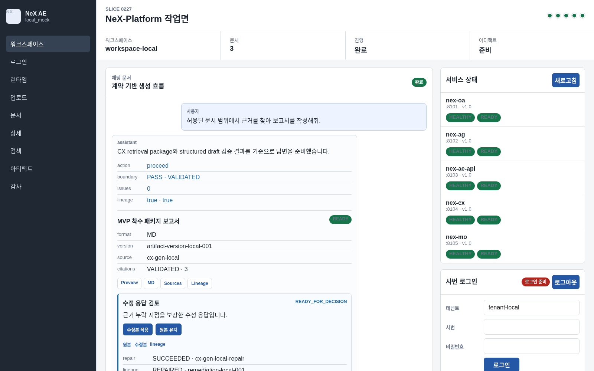

# NeX Platform v1.0 시스템 구축(설치) 절차서

## 1. 문서 목적

이 문서는 NeX Platform v1.0을 Single-host Docker Compose 환경에 재현 가능하게 구성하기 위한 기준 절차를 제공한다. 구축 대상은 OA, AE API/Web, CX, MO, AG, Traefik, OpenBao, RustFS, 서비스별 PostgreSQL 데이터베이스와 원격 model provider다.

> 현재 v1.0 release decision은 `NO_GO`다. 이 절차는 설치와 staging 검증 기준을 제공하지만 production 배포 승인을 대체하지 않는다.

## 2. 기준 버전과 구성

| 항목 | 기준 |
| --- | --- |
| Git tag | `v1.0` |
| Commit | `ab7af0fc` |
| 배포 방식 | Single-host Docker Compose |
| 애플리케이션 이미지 | OA, AG, AE API, CX, MO, AE Web의 6개 OCI 이미지 |
| 진입점 | Traefik HTTPS |
| Secret·PKI | OpenBao |
| Private object storage | RustFS |
| 관계형 데이터베이스 | PostgreSQL 16, 서비스별 role/database |
| Model provider | generation, embedding, reranker의 OpenAI-compatible endpoint |

v1.0은 multi-node service failover, PostgreSQL 자동 failover, object-storage node failover, GPU autoscaling/failover, 외부 dead-man monitoring을 지원 범위에 포함하지 않는다.

## 3. 설치 전 준비

### 3.1 호스트 요구사항

- Linux x86_64 호스트와 시간 동기화
- Docker Engine과 Docker Compose plugin
- Git, Python 3.12, Node.js와 npm
- PostgreSQL 16 접속 경로
- DGX 또는 동등한 세 개 model provider 접속 경로
- `/data/nex-platform`에 runtime·backup·private data를 둘 충분한 용량
- 운영자만 읽을 수 있는 외부 secret materialization 경로

다음 명령이 모두 성공해야 한다.

```bash
docker version
docker compose version
git --version
python3 --version
node --version
npm --version
```

### 3.2 네트워크와 이름

외부 접근은 Traefik의 `8443` HTTPS 진입점만 사용한다. OpenBao 관리 endpoint는 `127.0.0.1:8200`에 제한한다. 애플리케이션, control, identity, object-storage network는 Compose 내부 network로 유지한다.

운영 DNS 또는 승인된 hosts 설정에는 OA, AG, AE API, CX, MO, AE Web, identity, object storage와 provider route를 등록한다. 실제 주소와 credential은 문서나 저장소에 기록하지 않는다.

### 3.3 PostgreSQL 준비

다음 다섯 서비스는 서로 다른 role과 database를 소유한다.

| 서비스 | 환경 변수 | 소유 범위 |
| --- | --- | --- |
| OA | `NEX_OA_DATABASE_URL` | identity, credential, authorization |
| AG | `NEX_AG_DATABASE_URL` | audit, alert, operations |
| AE API | `NEX_AE_DATABASE_URL` | workspace, chat, artifact |
| CX | `NEX_CX_DATABASE_URL` | ingestion, chunk, vector, generation |
| MO | `NEX_MO_DATABASE_URL` | provider catalog, telemetry, rollout |

DB role에는 자기 database의 schema migration과 runtime DML 권한만 부여한다. 다른 서비스 database를 직접 읽는 경로는 허용하지 않는다.

## 4. 소스 기준선 준비

```bash
git clone <approved repository URL> nex-platform-v1
cd nex-platform-v1
git fetch --tags
git checkout --detach v1.0
git rev-parse HEAD
```

마지막 출력은 `ab7af0fc3b42225d1d71d20d517889d694a01c03`이어야 한다. 공개된 `v1.0` 태그를 이동하거나 재작성하지 않는다.

Python과 AE Web 의존성을 준비한다.

```bash
python3 -m venv .venv
./.venv/bin/pip install -r requirements-dev.txt
npm ci --prefix apps/nex-ae-web
```

조직의 artifact repository를 사용하는 경우 lock과 hash를 보존하고 승인된 mirror만 사용한다.

## 5. OCI 이미지 생성

깨끗한 committed worktree에서 6개 owner-scoped context와 이미지를 일괄 생성한다.

```bash
NEX_PLATFORM_OCI_IMAGE_BUILD=1 \
./.venv/bin/python scripts/deployment/build_platform_images.py \
  --execute \
  --report reports/deployment/s142-oci-image-build.json \
  --summary
```

성공 조건은 6개 image, 6개 unique manifest digest, 6개 non-root user, 7개 background process `--check`, complete release set이다. 이 명령은 registry push와 production contact를 수행하지 않는다.

## 6. Runtime 디렉터리와 secret 준비

권장 디렉터리 경계는 다음과 같다.

```text
/data/nex-platform/
  runtime/
    credentials/
    certificates/
  postgres-backups/
  postgres-state/
  object-storage/
```

runtime directory는 mode `0700`으로 만들고 bootstrap token, private key, database password, provider API key를 저장소·Compose `.env`·shell history·report에 남기지 않는다. OpenBao에는 서비스별 AppRole, database reference, service token, provider API key, object-storage credential과 PKI material을 분리해 저장한다.

## 7. Compose 구성 검증

v1.0의 기준 Compose 파일은 다음 세 계층이다.

- `deployment/compose/s143-staging.compose.yaml`
- `deployment/compose/s144-staging.override.yaml`
- `deployment/compose/s146-object-storage.override.yaml`

```bash
docker compose \
  -f deployment/compose/s143-staging.compose.yaml \
  -f deployment/compose/s144-staging.override.yaml \
  -f deployment/compose/s146-object-storage.override.yaml \
  config --quiet
```

이미지 reference는 mutable tag가 아닌 검증된 digest를 사용한다. AE Web에는 database/provider secret을 전달하지 않으며, Traefik에는 Docker socket을 mount하지 않는다.

## 8. Database migration

실제 URL은 보호된 환경에서 주입한 뒤 dry-run과 실행을 분리한다.

```bash
./.venv/bin/python scripts/db/run_migrations.py --all --profile test --dry-run
./.venv/bin/python scripts/db/run_migrations.py --all --profile test
```

서비스별 `schema_migrations`의 마지막 version이 저장소 migration head와 같아야 한다. 실패한 서비스를 건너뛰고 나머지를 기동하지 않는다.

## 9. 설치 검증

1. Compose config가 secret 값을 출력하지 않고 성공하는지 확인한다.
2. 6개 image의 digest와 non-root user를 확인한다.
3. 5개 database의 migration head와 owner를 확인한다.
4. OpenBao seal·health·owner policy를 확인한다.
5. Traefik certificate chain과 HTTPS route를 확인한다.
6. RustFS의 CX/AE bucket 격리와 암호화를 확인한다.
7. 세 model capability의 readiness와 model revision을 확인한다.
8. Full Gate와 release evidence의 revision이 일치하는지 확인한다.



위 화면은 v1.0 deterministic mock 화면이다. 실제 설치 검증은 사용자 화면만으로 완료하지 않고 `/health`, `/ready`, migration, storage, provider evidence를 함께 확인한다.

## 10. 구축 완료 체크리스트

| 점검 항목 | 합격 기준 |
| --- | --- |
| Source | tag와 commit exact match |
| Images | complete 6-image set, immutable digest |
| PostgreSQL | 5개 database migration current |
| Trust | OA signed token, OpenBao custody, owner policy |
| TLS | 관리 certificate와 rollback 가능 |
| Object storage | CX/AE private bucket isolation |
| Provider | generation reasoning disabled, 세 capability ready |
| Privacy | source·prompt·credential가 log/report에 없음 |
| Release | 10개 gate의 GO 또는 NO_GO가 명시됨 |

현재 v1.0은 `p1_waivers_valid`와 `approval_roles_complete`가 false이므로 production 기동으로 넘어가지 않는다. 설치 검증이 끝나도 release manager의 별도 승인 전에는 배포 명령을 실행하지 않는다.

## 11. 관련 문서

- `docs/runbooks/platform_reproducible_deployment_packaging.md`
- `docs/runbooks/platform_production_configuration_secret_tls.md`
- `docs/runbooks/postgresql_single_host_disaster_recovery.md`
- `docs/runbooks/private_object_storage_operations.md`
- `docs/runbooks/platform_production_release_go_live.md`
