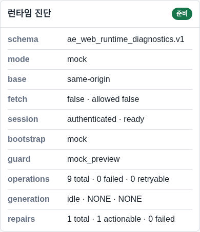

# NeX Platform v1.0 시스템 기동·종료 절차서

## 1. 목적과 안전 경계

이 문서는 Single-host Docker Compose 기반 v1.0의 정상 기동, 상태 확인, 재기동, 정상 종료와 비상 종료 기준을 정의한다.

> 현재 release decision은 `NO_GO`다. 아래 production-shaped 명령은 승인된 staging 또는 별도 change window에서만 실행하며, 문서 자체는 production 배포 승인이 아니다.

## 2. 프로세스 구성

v1.0 runtime manifest는 6개 network process와 7개 background process를 정의한다.

| 계층 | 구성 |
| --- | --- |
| Control·edge | OpenBao, Traefik |
| Storage | PostgreSQL 5개 database, RustFS |
| API·Web | OA, MO, CX, AE API, AG, AE Web |
| Background | AE artifact worker, AE retention daemon, AG remediation worker, AG dispatch daemon, CX generation worker, CX ingestion worker, CX remediation worker |

S143 Compose는 6개 application image의 staging acceptance 파일이다. 7개 background process는 동일 owner image와 `nex_runtime.background_process` command를 사용하지만, production process declaration과 scheduling은 release approval 전에 별도로 검토해야 한다.

## 3. 기동 전 점검

1. 승인된 release candidate ID와 6개 image digest를 확인한다.
2. change window와 rollback 담당자를 확인한다.
3. 디스크, inode, memory, Docker daemon과 host clock을 확인한다.
4. PostgreSQL 5개 database가 연결 가능하고 migration current인지 확인한다.
5. OpenBao unseal·policy·PKI와 runtime secret generation을 확인한다.
6. RustFS volume과 CX/AE bucket readiness를 확인한다.
7. generation, embedding, reranker provider readiness와 revision을 확인한다.
8. 이전 Compose project와 orphan container가 없는지 확인한다.

```bash
docker version
docker compose version
docker ps --format '{{.Names}} {{.Status}}'
./.venv/bin/python scripts/dev/run_platform.py --profile staging_live --check-config
```

config check는 process를 시작하지 않는다. raw database URL, token, key를 화면이나 log에 출력하면 즉시 중지한다.

## 4. 기동 순서

### 4.1 구성 고정

```bash
export COMPOSE_PROJECT_NAME=nex-platform-v1
export NEX_S143_RUNTIME_DIR=/data/nex-platform/runtime

docker compose \
  -f deployment/compose/s143-staging.compose.yaml \
  -f deployment/compose/s144-staging.override.yaml \
  -f deployment/compose/s146-object-storage.override.yaml \
  config --quiet
```

### 4.2 Control과 storage

1. `openbao-data-init`을 실행해 volume owner를 확인한다.
2. OpenBao를 시작하고 health가 정상인지 확인한다.
3. Traefik을 시작하고 ping·certificate를 확인한다.
4. RustFS를 시작하고 internal health와 bucket policy를 확인한다.

```bash
docker compose \
  -f deployment/compose/s143-staging.compose.yaml \
  -f deployment/compose/s144-staging.override.yaml \
  -f deployment/compose/s146-object-storage.override.yaml \
  up -d openbao-data-init openbao traefik rustfs
```

### 4.3 API와 Web

서비스 의존 순서는 OA → MO → CX → AE API → AG → AE Web이다.

```bash
docker compose \
  -f deployment/compose/s143-staging.compose.yaml \
  -f deployment/compose/s144-staging.override.yaml \
  -f deployment/compose/s146-object-storage.override.yaml \
  up -d nex-oa nex-mo nex-cx nex-ae-api nex-ag nex-ae-web
```

Compose dependency만 신뢰하지 말고 각 서비스 `/ready`가 성공한 뒤 다음 계층을 승인한다.

### 4.4 Background process

Background process는 API readiness와 migration을 확인한 뒤 시작한다. 각 process는 시작 시 restart reconciliation을 완료하고 lease를 획득하기 전에 owner database와 downstream readiness를 확인해야 한다. 현재 S143 Compose에 background service declaration이 없으므로 승인되지 않은 ad-hoc `docker run`으로 보완하지 않는다.

## 5. 기동 확인



화면의 service badge는 사용자 관점의 보조 신호다. 최종 기동 판정은 다음을 모두 만족해야 한다.

- 6개 network process의 health와 readiness 성공
- 7개 background process의 heartbeat 또는 `--check` 성공
- PostgreSQL pool 생성과 migration head 일치
- RustFS private bucket 접근·교차 owner 거부
- 세 provider capability readiness와 calibration 유효
- OA signed token 발급·검증과 cross-service deny flow 정상
- AG signal freshness와 alert pipeline 정상
- secret, certificate, model revision drift 없음

## 6. 정상 종료

1. 신규 사용자 요청과 upload admission을 중단한다.
2. background claim을 중단하고 in-flight job을 drain한다.
3. artifact·generation·ingestion checkpoint가 durable한지 확인한다.
4. AE Web을 종료한다.
5. AG → AE API → CX → MO → OA 역순으로 종료한다.
6. RustFS, Traefik, OpenBao를 종료한다.
7. PostgreSQL은 별도 운영 자산이므로 application Compose 종료와 함께 내리지 않는다.

```bash
docker compose \
  -f deployment/compose/s143-staging.compose.yaml \
  -f deployment/compose/s144-staging.override.yaml \
  -f deployment/compose/s146-object-storage.override.yaml \
  stop nex-ae-web nex-ag nex-ae-api nex-cx nex-mo nex-oa rustfs traefik openbao
```

종료 후 container는 남아 있을 수 있지만 실행 중인 process, 열린 lease, 임시 route override와 run-scoped secret은 없어야 한다.

## 7. 완전 제거와 보존

staging acceptance를 정리할 때만 다음 명령을 사용한다.

```bash
docker compose \
  -f deployment/compose/s143-staging.compose.yaml \
  -f deployment/compose/s144-staging.override.yaml \
  -f deployment/compose/s146-object-storage.override.yaml \
  down --remove-orphans
```

`--volumes`는 데이터 삭제 승인을 받은 ephemeral acceptance에만 사용한다. PostgreSQL backup, OpenBao Raft, RustFS data volume을 자동 삭제하지 않는다.

## 8. 재기동과 복구

### 8.1 Application process 장애

- 장애 서비스의 readiness와 최근 trace를 확인한다.
- owner database와 downstream service가 정상인지 확인한다.
- 동일 image digest와 config generation으로 한 번만 재생성한다.
- restart read model과 lease reconciliation을 확인한다.

### 8.2 PostgreSQL 장애

- 해당 서비스의 write와 worker claim을 중지한다.
- isolated restore 또는 whole-cluster PITR 절차를 따른다.
- 자동 failover나 in-place overwrite를 수행하지 않는다.

### 8.3 Provider 장애

- MO에서 capability별 readiness와 revision을 확인한다.
- generation, embedding, reranker를 서로 대체하지 않는다.
- retry budget 소진 시 degraded/no-answer 상태를 유지한다.

### 8.4 Host 장애

Single-host v1.0은 host failover를 제공하지 않는다. host 복구 후 PostgreSQL, OpenBao, RustFS, API, worker 순서로 상태를 재구성하고 AG에서 durable state와 zero-residue 여부를 확인한다.

## 9. 비상 종료 기준

다음 상황에서는 drain보다 즉시 차단을 우선한다.

- credential·private payload가 log 또는 report에 노출됨
- 잘못된 tenant/owner 접근이 관찰됨
- release digest나 image digest가 변경됨
- DB migration identity가 불일치함
- certificate 또는 signing key가 검증되지 않음
- 같은 job이 중복 실행되거나 compensation이 보장되지 않음

비상 종료 후에는 incident ID를 발급하고 데이터 보존·복구·재기동 승인자를 분리한다.

## 10. 종료 확인 체크리스트

| 항목 | 확인 기준 |
| --- | --- |
| 사용자 요청 | 신규 admission 차단 |
| Background | claim 중단, in-flight checkpoint 완료 |
| API·Web | 역순 종료 완료 |
| Lease | 만료 또는 명시적 release |
| Storage | durable data와 backup 보존 |
| Secret | run-scoped material 제거 |
| Container | 예상된 stopped 상태 |
| Audit | 종료·장애·복구 event 기록 |
