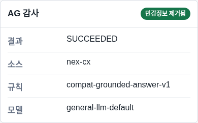

# NeX Platform v1.0 시스템 운영 절차서

## 1. 목적

이 문서는 NeX Platform v1.0 Single-host 환경의 일상 점검, 사용자·권한, 데이터, provider, observability, backup, incident와 변경 관리를 정의한다.

## 2. 역할과 책임

| 역할 | 주요 책임 |
| --- | --- |
| Release manager | release identity, evidence, GO/NO_GO, change window |
| Platform operator | Compose host, process lifecycle, capacity, TLS |
| Security owner | OA trust, OpenBao, credential, federation, incident |
| Data owner | PostgreSQL backup·restore, retention, RustFS lifecycle |
| Model operator | provider readiness, revision, calibration, rollback |
| Service owner | OA·AE·CX·MO·AG의 기능과 service-local data |

승인자와 실제 deployment actor를 분리한다. 한 역할이 P1 waiver를 작성하고 스스로 승인할 수 없다.

## 3. 일일 운영 점검

### 3.1 시작 점검

1. host time, disk, inode, memory와 Docker daemon을 확인한다.
2. 6개 network process readiness와 7개 background heartbeat를 확인한다.
3. PostgreSQL pool, connection saturation, migration drift를 확인한다.
4. RustFS capacity, bucket policy, lifecycle와 encryption 상태를 확인한다.
5. provider capability, model revision, BF16/declared dtype와 latency를 확인한다.
6. SLI/SLO의 `NO_DATA`, `BREACHED`와 active alert를 확인한다.
7. backup freshness, WAL archive exposure와 last verified restore point를 확인한다.

브라우저 표시는 보조 진단이다. 운영 판단은 AG projection, service API, database와 protected evidence를 함께 사용한다.

### 3.2 종료 점검

- 신규 P0/P1 incident와 unresolved alert가 없는지 확인한다.
- retry·dead-letter·stale lease와 pending notification을 확인한다.
- backup과 retention batch 결과를 확인한다.
- 당일 model/config/secret/certificate generation 변경을 기록한다.
- 다음 교대자에게 change window와 rollback deadline을 인계한다.

## 4. 사용자와 권한 운영

OA가 identity와 authorization의 authority다.

1. 사번은 tenant 내에서 유일하게 관리한다.
2. 사용자 상태, group, role, membership은 revision을 포함해 변경한다.
3. 비밀번호는 Argon2id로 저장하고 lockout과 session idle timeout을 적용한다.
4. 퇴직·비활성화 시 credential, session, membership을 함께 revoke한다.
5. Service principal은 목적별 scope와 만료를 가진다.
6. signing key rotation 시 overlap, JWKS, introspection과 rollback을 검증한다.
7. 권한 거부를 우회하기 위해 mock profile이나 raw service token을 사용하지 않는다.

## 5. 문서와 RAG 운영

### 5.1 Ingestion

- 업로드는 tenant·owner·uploaded-by scope를 claim에서 결정한다.
- 사용자별 source hash로 중복을 차단한다.
- 원본, 추출 Markdown, chunk, summary와 vector lineage를 유지한다.
- source와 derived private payload는 RustFS owner bucket에 저장한다.
- PostgreSQL에는 metadata, digest, size와 opaque storage reference만 저장한다.
- 실패한 step은 durable checkpoint에서 bounded retry한다.

### 5.2 Retrieval

- permission filter를 lexical/vector candidate 생성 전에 적용한다.
- BM25와 vector candidate는 weighted RRF로 결합한다.
- reranker와 confidence calibration은 model revision별 정책을 사용한다.
- threshold 미달은 no-answer 또는 low-confidence로 처리한다.
- operator가 임의로 threshold를 낮춰 답변을 제조하지 않는다.

### 5.3 Grounded generation

- retrieval package, prompt policy, generation request와 response lineage를 연결한다.
- generation reasoning mode는 v1.0 acceptance에서 disabled다.
- citation 검증 실패는 bounded repair를 거친다.
- private draft와 artifact payload는 object storage에 두고 metadata만 DB에 저장한다.

## 6. Job과 worker 운영

Job 상태는 durable DB가 authority다. process memory는 authority가 아니다.

- claim은 lease와 compare-and-set을 사용한다.
- retry는 taxonomy, attempt budget와 backoff를 따른다.
- non-retryable 오류는 dead-letter로 이동한다.
- operator replay는 reason, actor, revision과 audit event를 요구한다.
- daemon은 bounded tick/run-once가 기본이며 무제한 중첩 실행을 금지한다.
- restart 후 expired lease와 checkpoint를 reconcile한 뒤 work를 재개한다.

## 7. Observability와 incident

AG는 서비스별 metadata projection을 통합한다. source document, prompt, generated text, vector, credential을 AG에 복제하지 않는다.

### 7.1 Alert 처리

| 상태 | 운영 의미 |
| --- | --- |
| `FIRING` | 조건이 활성 상태이며 미확인 |
| `ACKNOWLEDGED` | 담당자가 인수했지만 조건은 활성일 수 있음 |
| `SUPPRESSED` | 승인된 기간 동안 알림 억제, 복구 의미 아님 |
| `RESOLVED` | 정상 평가 또는 복구 신호 확인 |
| `NO_DATA` | telemetry 누락, healthy로 간주하지 않음 |

현재 external notification은 `EXTERNAL_NOT_ACTIVATED`다. local AG workbench를 compensating control로 사용하며, 외부 전송을 성공으로 가장하지 않는다.

### 7.2 Incident 기본 절차

1. incident ID와 severity를 확정한다.
2. 영향 tenant, service, release/config generation을 확인한다.
3. trace ID와 bounded correlation key로 범위를 좁힌다.
4. 추가 쓰기·claim·outbound delivery를 제한한다.
5. owner runbook에 따라 복구하거나 last-known-good로 rollback한다.
6. privacy와 zero-residue를 확인한 뒤 incident를 종료한다.

## 8. PostgreSQL 운영

- logical backup 목표 간격: 6시간
- WAL exposure budget: 300초
- service-local restore RTO: 30분
- whole-cluster restore RTO: 60분
- logical retention: 28개 point와 최소 7일
- physical retention: 검증된 base backup 2세대

Backup은 PostgreSQL data volume과 독립된 failure domain에 둔다. restore는 active source가 아닌 isolated target에서 검증하고, application이 자동 promote하거나 database downgrade하지 않는다.

## 9. RustFS 운영

- CX와 AE는 서로 다른 private bucket과 credential을 사용한다.
- RustFS root credential은 application에 전달하지 않는다.
- object version, delete marker, retention과 restore를 확인한다.
- object hash와 DB metadata가 일치하지 않으면 payload를 사용하지 않는다.
- migration/rollback mode는 명시적으로 승인하고 dual-read를 무기한 유지하지 않는다.

## 10. Model provider 운영

1. generation, embedding, reranker를 capability별로 관리한다.
2. model ID뿐 아니라 revision, dtype, endpoint policy를 기록한다.
3. readiness와 capacity admission을 통과한 revision만 canary로 보낸다.
4. model별 calibration을 통과하지 못하면 alias를 활성화하지 않는다.
5. timeout, retry와 circuit 상태를 AG/MO metadata로 확인한다.
6. rollback은 last-known-good revision과 calibration policy를 함께 복원한다.

특정 Qwen model 이름은 현재 provider evidence일 뿐 코드의 고정 dependency가 아니다.

## 11. Retention과 purge

- 1차 삭제는 logical purge로 처리한다.
- 15일·30일 등 승인된 보존 기간 후 batch physical purge를 수행한다.
- dry-run projection, candidate count와 owner scope를 먼저 확인한다.
- DB metadata와 object payload의 삭제 순서와 receipt를 유지한다.
- audit, legal hold, incident evidence는 일반 retention으로 삭제하지 않는다.

## 12. 변경 관리

모든 변경은 source revision, image digest, config generation, secret generation, TLS generation, model revision과 migration head를 기록한다. 변경 전후 protected preflight와 rollback rehearsal을 수행한다.

다음은 즉시 `NO_GO` 또는 rollback 사유다.

- P0 risk 또는 승인되지 않은 P1 waiver
- 필수 승인 역할이나 change window 누락
- image/config/evidence digest drift
- owner isolation 또는 privacy failure
- backup·restore·rollback 실패
- zero-residue 실패

## 13. 주간·월간 체크리스트

| 주기 | 작업 |
| --- | --- |
| 일일 | readiness, alerts, jobs, provider, backup freshness |
| 주간 | restore sample, dead-letter review, capacity trend, key expiry |
| 월간 | key/certificate rotation rehearsal, retention, access review, rollback rehearsal |
| 분기 | disaster recovery, model replacement calibration, security/privacy acceptance |

## 14. 관련 runbook

- `docs/runbooks/platform_observability_incident_operations.md`
- `docs/runbooks/postgresql_single_host_disaster_recovery.md`
- `docs/runbooks/private_object_storage_operations.md`
- `docs/runbooks/model_serving_rollout_operations.md`
- `docs/runbooks/platform_production_release_go_live.md`
