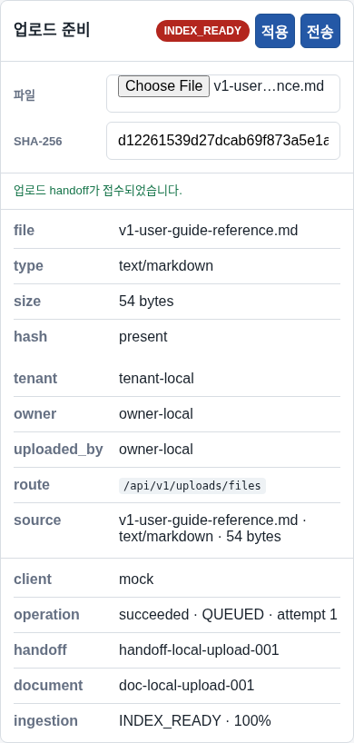
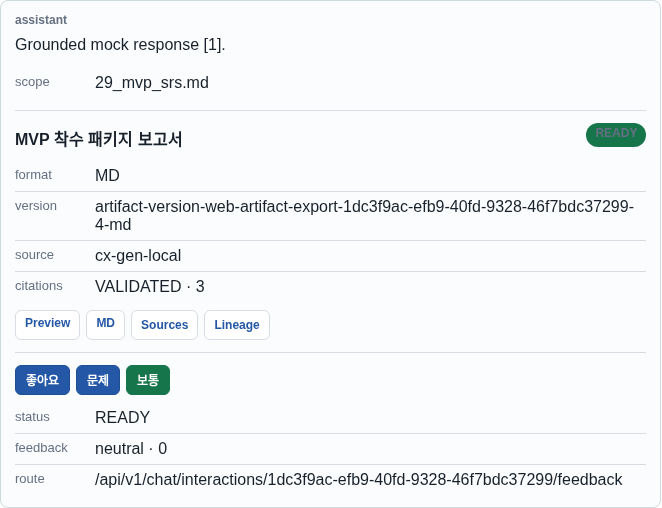
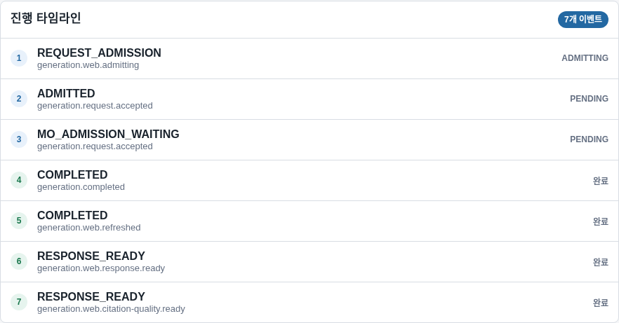
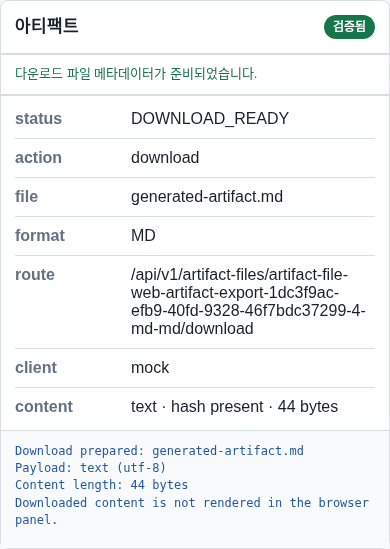

# NeX Platform v1.0 시스템 사용자 매뉴얼

## 1. NeX Platform 소개

NeX Platform v1.0은 사용자가 사번으로 로그인하고, 자신의 문서를 업로드한 뒤, 권한이 확인된 문서를 근거로 질문하고 결과 문서를 생성할 수 있는 한국어 기본 업무 지원 시스템이다.

사용자는 다음 기능을 이용할 수 있다.

- 사번과 비밀번호를 이용한 로그인
- 개인·tenant 범위의 문서 업로드
- 문서 처리 상태와 요약 정보 확인
- 권한이 확인된 문서를 대상으로 RAG 검색
- 근거와 citation이 포함된 답변 생성
- 생성 진행, 실패, 취소와 복구 상태 확인
- 생성 artifact 미리보기와 다운로드

## 2. 접속과 로그인

관리자가 제공한 HTTPS 주소로 접속한다. 인증서 경고가 나타나면 진행하지 말고 운영자에게 문의한다.


1. 테넌트가 자신의 회사 또는 조직인지 확인한다.
2. 사번을 입력한다.
3. 비밀번호를 입력한다.
4. `로그인`을 선택한다.
5. 성공 메시지와 사용자 범위를 확인한다.

비밀번호는 화면에 다시 표시되지 않는다. 브라우저 개발자 도구, 메모장, 채팅 prompt에 비밀번호나 token을 입력하지 않는다.

로그인이 반복해서 실패하면 잠금 시간이 끝날 때까지 기다리거나 관리자에게 계정 상태를 확인한다. 다른 사용자의 계정으로 우회하지 않는다.

## 3. 작업공간 이해하기

| 영역 | 설명 |
| --- | --- |
| 좌측 탐색 | 워크스페이스, 로그인, 런타임, 업로드, 문서, 검색, artifact, 감사 이동 |
| 상단 요약 | 현재 workspace, 문서 수, 생성 단계, artifact 상태 |
| 채팅 | 질문 입력, 근거 사용, 출력 형식 선택 |
| 진행 타임라인 | retrieval, generation, citation 검증 상태 |
| 컨텍스트 패널 | 서비스, 문서, 검색 범위와 실행 결과 |

화면의 runtime 정보는 문제 신고에 유용하지만 service token, database 주소 같은 서버 정보는 표시하지 않는다.

## 4. 문서 업로드



1. `업로드` 영역으로 이동한다.
2. 허용된 문서 파일을 선택한다.
3. 파일명과 크기가 올바른지 확인한다.
4. 조직 정책이 요구하면 source SHA-256 값을 확인한다.
5. `전송`을 선택한다.
6. 업로드 성공과 처리 상태를 확인한다.

업로드한 사용자가 해당 문서의 기본 owner다. 같은 사용자가 동일한 파일을 다시 올리면 hash 기반 중복 검사가 동작할 수 있다. 다른 사용자의 문서는 같은 파일이라도 권한 없이 조회되지 않는다.

### 4.1 처리 단계

| 단계 | 의미 |
| --- | --- |
| 업로드 접수 | 파일 metadata와 owner scope가 등록됨 |
| 원본 저장 | private object storage에 원본 저장 |
| 텍스트 추출 | 문서에서 Markdown 생성 |
| Chunk 생성 | 정책에 따라 검색 단위 생성 |
| Embedding | vector 생성 및 index publish |
| 요약 | 1개 chunk보다 작은 문서 요약 생성 |
| 준비 완료 | 검색과 생성에 사용 가능 |

처리가 실패하면 무작정 다시 업로드하지 말고 retry 가능 여부와 실패 단계를 확인한다.

## 5. 문서 선택과 검색 범위

`문서` 영역에서 검색에 사용할 문서를 선택한다. 문서 상세에는 processing, extraction, summary와 confidence 상태가 표시된다. 원문 storage path와 vector 값은 표시되지 않는다.

검색은 tenant와 owner 권한을 먼저 적용한 뒤 BM25와 vector candidate를 결합하고 reranker로 순위를 조정한다. 관련 근거가 부족하면 시스템은 답을 만들기보다 no-answer 또는 low-confidence 안내를 표시한다.

## 6. 근거 기반 채팅



1. 질문을 구체적으로 입력한다.
2. 문서를 근거로 답변받으려면 `근거 사용`을 켠다.
3. 필요한 출력 형식을 선택한다.
4. `전송`을 선택한다.
5. 진행 타임라인과 결과의 citation 상태를 확인한다.

좋은 질문은 대상, 기간, 원하는 결과와 출력 형식을 포함한다.

```text
선택한 운영 절차서를 기준으로 장애 대응 순서를 표로 정리하고,
각 항목에 근거 문서를 표시해줘.
```

### 6.1 결과 판정

- `HIGH`: 근거와 confidence가 충분함
- `LOW_CONFIDENCE`: 근거가 약하므로 문서 범위나 질문을 조정해야 함
- `NO_ANSWER`: 권한이 있는 문서에서 답을 뒷받침할 근거를 찾지 못함
- citation validation 실패: 자동 repair 또는 사용자 재시도가 필요함

답변은 업무 판단을 보조한다. 중요한 의사결정은 citation으로 연결된 원문과 최신 사내 규정을 함께 확인한다.

## 7. 생성 진행과 복구



타임라인은 request intake, retrieval, prompt package, provider generation, draft validation, citation validation과 완료 단계를 보여준다.

- 실행 중인 요청은 정책이 허용할 때 취소할 수 있다.
- 일시적 provider 오류는 제한된 횟수만 재시도한다.
- 화면을 새로 열어도 durable job 상태에서 진행 상황을 복구한다.
- 같은 요청이 중복 실행되는 것으로 보이면 추가 전송하지 말고 운영자에게 interaction ID를 전달한다.

## 8. Artifact 미리보기와 다운로드



생성 결과가 artifact로 준비되면 다음 작업을 수행할 수 있다.

1. `미리보기`로 내용과 형식을 확인한다.
2. citation, source lineage와 품질 상태를 확인한다.
3. 필요한 형식이 제공되면 다운로드한다.
4. 오래된 version이 아닌지 확인한다.

다운로드 링크는 owner scope와 session을 검사한다. 링크를 다른 사용자에게 전달해도 권한이 자동으로 공유되지 않는다.

## 9. 오류 메시지 대응

| 상황 | 사용자 조치 |
| --- | --- |
| 로그인 실패 | 사번·tenant 확인, lockout 대기, 관리자 문의 |
| 업로드 거부 | 파일 형식·크기·중복·권한 확인 |
| 처리 지연 | 진행 상태 확인 후 retry 가능 여부 확인 |
| 검색 결과 없음 | 문서 선택과 질문 범위를 조정 |
| Low confidence | 더 구체적인 질문 또는 추가 문서 선택 |
| 생성 실패 | retryable 표시가 있을 때 한 번 재시도 |
| 다운로드 실패 | session과 artifact 상태 확인 |
| 권한 없음 | owner 또는 관리자에게 정식 공유·권한 요청 |

오류 신고에는 발생 시각, 화면 단계, workspace ID, document/artifact의 안전한 식별자와 표시된 error code를 포함한다. 비밀번호, token, 문서 원문은 첨부하지 않는다.

## 10. 보안과 개인정보

- 자신의 계정만 사용한다.
- 승인되지 않은 개인정보·기밀문서를 업로드하지 않는다.
- prompt에 비밀번호, API key, 주민등록번호 같은 민감정보를 입력하지 않는다.
- citation이 없는 답변을 사실로 확정하지 않는다.
- 다운로드한 파일은 회사의 문서 보안 정책에 따라 보관·삭제한다.
- 로그아웃 후 공용 브라우저를 종료한다.

## 11. 현재 제한사항

- v1.0은 Single-host 구성이다.
- 외부 incident notification은 아직 활성화되지 않았다.
- host 전체 장애 자동 failover는 제공하지 않는다.
- model 변경 시 readiness와 calibration을 다시 통과해야 한다.
- 현재 release governance가 `NO_GO`인 환경에서는 production 사용을 시작하지 않는다.

## 12. 빠른 작업 요약

```text
로그인 → 문서 업로드 → 처리 완료 확인 → 문서 선택
→ 질문과 근거 사용 설정 → 진행·citation 확인
→ artifact 미리보기 → 다운로드 → 로그아웃
```
