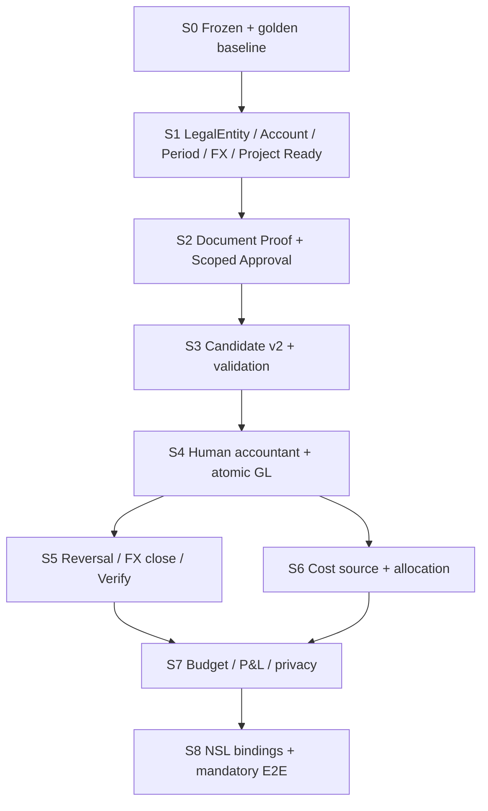

# NeX–MyBee D04/D12 EOS Implementation Slice Plan v1.0

**Document ID:** `NEX-MYBEE-EOS-ISP-D04D12-20261109`  
**Status:** `IMPLEMENTATION PLAN / CONTRACT-BASED / NOT EXECUTED`  
**Date:** 2026-11-09 (Asia/Seoul)  
**Parent:** `NeX–MyBee D04/D12 EOS SRS v1.0`; `Pre-Architecture Decision v1.0`; `Source Audit & Gap Analysis v1.0`  
**Target repos:** `nurigitdev/2607_nex_platform`, `nurigitdev/2608_nsl` (no frozen edits), MyBee Blueprint (read-only reference)  
**Top-level authority:** Frozen NeX Platform v2.1 / Agent v2.1 / admitted NSL wheel > EOS canonical contracts > MyBee AX Domain policy.  
**Scope:** D04 accounting + D12 Project Phase-1, shared payroll/purchase Source, foreign currency and FX source policy, GL Posting / Management Allocation / P&L.  
**Quality floor:** EOS changed-code Statement ≥96%, Branch ≥94%; existing platform/NSL quality-gate thresholds retained.  
**Execution claim:** documentation planning only — no Git branch, migration, API, skill, data or PostgreSQL test has been changed/run by this artifact.  
**Security:** all Approval/GL/FX information uses an authorized EOS Business API, never direct NSL SQL.

---

## 0. Executive decision and outcome

**The current PAD ADR-01~15, ownership and invariant set are frozen for this plan.** MyBee is the Domain AX Service on NeX; EOS remains Business Transaction SoR. Existing P8 / Golden A v1 `VoucherDraft` semantics, schema, `DRAFT` CHECK, Tool ID and result binding remain unchanged. Phase-1 is an **additive v2** path, not a migration or replacement of existing v1.

**Target vertical slice:** approved 기안/품의 `DOCUMENT_SIGNOFF` → immutable `VoucherCandidate v2` → independent human `ACCOUNTING_POSTING` → EOS single-transaction `PostedJournal` → POSTED-source `CostSourcePool`/`AllocationBatch` → authorized Project/NVT P&L. A USD shared-cost case additionally proves approved `매매기준율` snapshot, functional KRW posting, FX provenance and deterministic 40/60 allocation.

**Non-negotiable acceptance invariants:**

1. `BusinessApproved != AccountingApproved != GL_POSTED`; WC Human decision is not an EOS Journal.
2. EOS alone commits JournalHeader + all Lines + AccountingAcceptance + approved-document Consumption + Candidate POSTED CAS + BusinessOperation + Idempotency + Outbox in **one PostgreSQL UoW**; any failure leaves none.
3. EOS v1 Draft uses only `DRAFT`; no old API or frozen NSL Tool contract changed.
4. LegalEntity/company approval is genuine COMPANY/PROJECT_SET, **never a fake Project**. Company candidate header has no required `project_id`.
5. Posted GL is immutable; correction/revaluation/reversal is another independently approved journal. Period close and posting acquire the same row lock.
6. Management allocation conserves each GL cost component exactly (`E = D + A + U`), is source-backed, and forbids cost double-counting across DIRECT/MANAGEMENT/GL_TRANSFER.
7. Salary/individual actual cost is protected; PA/PM see only authorized company/Project aggregates, not reconstructible personal wages.
8. Foreign transactions preserve currency + approved spot/market-base snapshot (rate source/date/issue/quote unit/policy hash) + functional posting; monetary close and realized/unrealized FX are explicit, tax valuation separate.
9. Missing/expired human proof, unapproved rate/policy or P&L authorization **fails closed**; no LLM fallback or implicit `0` amount.
10. Each task has one primary owning WBS item, migration/API/Tool implications, a deterministic pytest ID and PostgreSQL evidence.

### Snapshot confirmation at authoring time

| Repo | Checked HEAD | Notes |
|---|---|---|
| NeX Platform `master` | `5e64fb1f6b9af2198797d1bcdbc82e577b098fbe` | SRS older `c2c03...` → new head has 32 added commits; comparison showed no EOS migration/service or AE NSL-EOS adapter changes. Still recheck before implementation. |
| NSL `master` | `f5d899bb611ee2cd65ce9f6544ed6e51b450b7d4` | Existing admitted `CREATE`/`CREATE_DRAFT`, `UPDATE` in 0.2.1 (strict wheel lock); no NSL `POST` OperationKind. |
| MyBee Blueprint `main` | `948b50fd43fc4e0f0d3f40ffd6335871ec741559` | D04 v1.9, D12 v2.8 PDFs listed; text/page-by-page alignment not certified. |
| EOS Migration | `2500`–`2515` (16 files) | New names `2516`–`2527` are **provisional** and must be rebased if head changes. |

---

## 1. Implementation rules for Codex

**Branch:** recommended `feat/mybee-d04d12-eos-phase1`, created only by the user's normal development workflow; do not directly commit MyBee's design-source repo. Codex should implement one work packet/PR/commit checkpoint at a time, with source review and tests, not all 37 packets in one request. Project control documents and traceability live under `docs/mybee_d04d12/`, additive schemas under `contracts/`, migration sources under EOS-owned database directory.

**At start of *every* packet:** verify current HEAD, migration name collisions, frozen hashes, exact wheel lock; read the owning SRS requirements and PAD ADR; create failing test; implement minimal production code; run focused SQLite/unit plus guarded `nex_eos_test` PostgreSQL where called; validate contracts/negative cases and Golden A compatibility; report changed paths, test counts, DB identity and results; do not claim pass from a planned command.

**Definition of Done:** (a) observable behavior matches exact SRS semantics; (b) no non-owned DB write/cross-service FK/secret exposure; (c) DB indices/checks and rollback tests supplied; (d) `requirements.json` entries contain source, WBS, migration, API/Tool, test and Gate; (e) no disabled tests / skipped protection gates / changed frozen artifacts; (f) explicit evidence file and commit identity. No production activation until S8 closure.

**Existing v1 read/write contract path must not be mutated:**

`database/nex-eos/migrations/2506_eos_voucher_draft.sql`, `services/nex-eos/nex_eos/vouchers.py`, `voucher_commands.py`, `voucher_api.py`, the v1 schema `contracts/schemas/service/nex_eos/create_voucher_draft_command.v1.schema.json`, and AE `nsl_eos_write_execution.py` existing v1 branch. Shared helper extraction is allowed only after byte/semantic regression proof and explicit code-review gate; prefer new v2 service/module/route.

**Field and service authority:** `OA` computes principal/role/claims, `WC` owns Human WorkItem and decision delivery, `EOS` verifies and binds final business and accounting approval facts and financial transaction, `AE` handles admitted NSL Tool Binding, `WA` retains originals and evidence hashes. New EOS tables may use within-EOS FKs but never cross service database FK. `BusinessOperationId`/`IdempotencyKey`/`PayloadHash` are separate; wire Money/FX are string decimals and Python Decimal/PostgreSQL NUMERIC.

**Code organization:** keep migrations additive and allow contract-first independent review. New Module / API names in this plan are **explicit proposed paths**; check collision before use, do not misrepresent them as implemented. Register v2 endpoints in `app.py` and `contracts/openapi/nex-eos.openapi.yaml` only when relevant endpoints are implemented. Versioned v2 schemas and explicit negative fixtures must be introduced with them.

---

## 2. Dependency, production activation and cutover



Only **read-only / non-posting** modules may be developed in parallel when their contract dependence is fixed. `S1` Project WorkCode policy and Account/FX masters can be coded in parallel after `S0`; `S2` WC adapter and envelope schema can be parallel pre-merge; `S5` and `S6` can run in separate branches after the same `S4` Posting baseline, with a single integrated regression before `S7`. Full production path stays disabled until `S8` passes `G-RELEASE`, `G-SRC-PDF`, `G-COA`, `G-FX`, `G-GL-ACID` and sign-offs.

**Deployment switches (proposed, names not yet existing):** `NEX_EOS_MYBEE_CANDIDATE_V2_ENABLED`, `NEX_EOS_MYBEE_POSTING_V2_ENABLED`, `NEX_EOS_MYBEE_FX_ENABLED`, `NEX_EOS_MYBEE_ALLOCATION_ENABLED`, `NEX_EOS_MYBEE_PNL_ENABLED`. Defaults `false`; separate capability admission and OA scope validation required; an on/off switch **cannot override proof/security decisions**. Production kill-switch stops new operations, never rolls back committed GL.

**Rollback strategy:** before live posting, rolling back app/API flags is allowed; migrations remain additive. After first real POSTED Journal, financial data is never deleted/edited by deployment rollback; disable new writes, continue verification/reconciliation, fix forward or issue approved compensating journal. Do not attempt a destructive `DROP`/`TRUNCATE` of production accounting tables.

---

## 3. Provisional EOS migration registry (ordered implementation contract)

**Guard:** Confirm migration head at Codex start; if `2516+` is already used, assign the next monotonic version and rewrite this registry/trace manifest as a governed documentation change. Never modify existing `2500..2515` files.

| Version | New EOS migration file (`database/nex-eos/migrations/`) | DDL author packet (other packets are consumers) | Key constraints |
|---|---|---|---|
| `2516` | `2516_eos_legal_entity_project_binding.sql` | `S1-01` | company PK + non-overlap ProjectCompany effective ranges; functional currency version |
| `2517` | `2517_eos_account_catalog_accounting_period.sql` | `S1-02` | company account-policy leaf/monetary rules; immutable catalog release; period OPEN lock/unique year-period |
| `2518` | `2518_eos_fx_rate_policy_snapshot.sql` | `S1-04` | immutable FX snapshot + provider issue/hash, positive rate/quote-unit; optional policy tax track |
| `2519` | `2519_eos_project_work_code_readiness.sql` | `S1-05` | mandatory FL set, immutable revision, assignment/no private salary, BusinessReady gate |
| `2520` | `2520_eos_document_approval_envelope.sql` | `S2-01` | document exact proof/hash/allowance, immutable consumption unique normalized source key |
| `2521` | `2521_eos_scoped_approval_case_v2.sql` | `S2-02` | COMPANY / PROJECT_SET scoped case + purpose and human decision exact hash |
| `2522` | `2522_eos_voucher_candidate_v2.sql` | `S3-01` | candidate v2 revision/line, unique current rev/CAS, immutable hash/FX source |
| `2523` | `2523_eos_posted_journal_posting.sql` | `S4-01` | proof acceptance + posted header/lines + unique candidate/revision + immutable GL/sequence |
| `2524` | `2524_eos_fx_monetary_remeasurement.sql` | `S5-02` | FX monetary position/run, close/adjustment reference, same approved journal path |
| `2525` | `2525_eos_cost_source_allocation.sql` | `S6-01` | source pool component unique, plan/line/batch/reversal, exact sum+mode |
| `2526` | `2526_eos_project_budget_master.sql` | `S7-01` | D04 Budget SoR + D12 binding separate; provenance and version |
| `2527` | `2527_eos_project_pnl_projection.sql` | `S7-02` | P&L derived watermarks/cost-actual/projection checkpoints; no second GL |

**DDL single-writer rule:** Every provisional migration has exactly **one author packet** in this registry. Other packets linked to the same version are downstream consumers only. The DDL author must include all column/constraint requirements of dependent packets before the migration is applied; once applied, later fixes require a fresh additive migration, not mutation of historical SQL. For example, `S1-02` authors `2517` including the AccountingPeriod schema consumed by `S1-03`; `S4-01` authors `2523` including Journal/Acceptance tables consumed by `S4-02/03/04`.

Migrations must target PostgreSQL semantics (`NUMERIC`, `TIMESTAMPTZ`, `FK`, `UNIQUE`, exclusion/partial index if needed, row locking). SQLite fast fixtures are not a substitute. Journal-level `ΣDr=ΣCr` requires transaction-level aggregate verification and DB role/trigger protection, not a per-line CHECK alone. A series of short EOS local transactions is valid for workflow, but **Posting acceptance and journal/consumption remain one EOS local transaction**.

---

## 4. Codex implementation packet register — S0→S8, 37 concrete tasks

**Columns:** `Existing` = source from the checked baseline **or the output of a prerequisite packet** (relative to repo; EOS Python files live below `services/nex-eos/nex_eos/` unless otherwise noted); `Add` = proposed new or adapted file (not yet present); `Tool` = canonical semantic operation, not MyBee FL-code itself. `PG` Gate is a required real PostgreSQL acceptance, not an assertion that tests already pass.

| Packet | Task | Depends | Migration | Primary gate |
|---|---|---|---|
| `S0-01` | Frozen/HEAD·DB 기준선 고정 | `start` | `—` | `G-ARCH` |
| `S0-02` | P8 Golden A 및 기존 승인 회귀 기준선 | `S0-01` | `—` | `G-V1` |
| `S0-03` | 요구사항 추적·소스 원문·변경통제 Gate | `S0-01` | `—` | `G-ARCH/G-SRC-PDF` |
| `S1-01` | LegalEntity와 ProjectCompanyBinding | `S0-03` | `2516` | `G-MASTER/PG-FK` |
| `S1-02` | K-IFRS 채택 계정표/승인 릴리스·PostingRule | `S1-01` | `2517` | `G-COA/PG-ACCOUNT` |
| `S1-03` | AccountingPeriod·Close/Post 동시성 기반 | `S1-01` | `2517` | `G-PERIOD/PG-RACE` |
| `S1-04` | 매매기준율 정책·FX RateSnapshot·Feed | `S1-01/S1-02` | `2518` | `G-FX/G-COA/PG-FX` |
| `S1-05` | D12 필수 5 FL코드 및 BusinessReady Gate | `S1-01` | `2519` | `G-PROJECT/PG-WORKCODE` |
| `S1-06` | Project WorkAssignment·Grade/MD 계획 | `S1-05` | `2519` | `G-PROJECT/G-PRIVACY` |
| `S2-01` | 기안/품의 ApprovedDocumentEnvelope | `S1-01/S1-02` | `2520` | `G-DOC/PG-PROOF` |
| `S2-02` | 회사/다수 Project ScopedApprovalCase v2 | `S1-01/S2-01` | `2521` | `G-HUMAN/PG-SCOPE` |
| `S2-03` | 회계 Human SoD·OA/WC 이벤트 어댑터 | `S2-02` | `2521` | `G-HUMAN/PG-OA` |
| `S2-04` | 품의 승인금액 소비·중복청구 Guard | `S2-01/S2-02` | `2520` | `G-DOC/PG-CONCURRENCY` |
| `S3-01` | VoucherCandidate v2 불변 Revision/Line | `S1-02/S2-01` | `2522` | `G-CANDIDATE/G-V1` |
| `S3-02` | Candidate 회계규칙·FX·기간/균형 검증 | `S3-01/S1-04/S1-03` | `2522` | `G-FX/G-CANDIDATE` |
| `S3-03` | Review Submit/Return/Invalidate 상태 머신 | `S3-02/S2-03` | `2522` | `G-CANDIDATE/G-HUMAN` |
| `S4-01` | Accounting Proof 수용·현재 OA 재검증 | `S2-03/S3-03` | `2523` | `G-HUMAN/G-GL-ACID` |
| `S4-02` | Immutable PostedJournal·JournalLine/DB 보호 | `S1-03/S3-02` | `2523` | `G-GL-ACID/PG-IMMUTABLE` |
| `S4-03` | Posting 원자적 단일 EOS Transaction | `S4-01/S4-02/S2-04` | `2523` | `G-GL-ACID/PG-FAULT` |
| `S4-04` | Posting Replay·Outbox·UNKNOWN 복구 | `S4-03` | `2523` | `G-GL-ACID/G-RECOVERY` |
| `S5-01` | 역분개·정정 처리 | `S4-03` | `2524` | `G-REVERSAL/PG-IMMUTABLE` |
| `S5-02` | 외화 화폐성 항목 기말평가 | `S4-03/S1-04` | `2524` | `G-FX/PG-FX-CLOSE` |
| `S5-03` | Period Closing Gate·외화 결제·환차손익 | `S5-02/S1-03` | `2524` | `G-FX/G-PERIOD` |
| `S5-04` | Journal Verify/Recon/GL 조회·오류 복구 | `S4-04/S5-02` | `2524` | `G-RECOVERY/PG-QUERY` |
| `S6-01` | POSTED GL SourcePool 적격성 | `S4-03/S1-01` | `2525` | `G-ALLOCATION/PG-POOL` |
| `S6-02` | Allocation Plan 릴리스·배부 정책 | `S6-01/S1-06` | `2525` | `G-ALLOCATION/PG-POLICY` |
| `S6-03` | Deterministic Allocation Batch·대사 | `S6-02` | `2525` | `G-ALLOCATION/PG-CONSERVE` |
| `S6-04` | D08 Payroll / D15 Purchase 최소 소스 어댑터 | `S6-03` | `2525` | `G-ALLOCATION/G-PRIVACY` |
| `S7-01` | D04 Budget SoR / D12 Project Budget Link | `S1-05/S4-03` | `2526` | `G-BUDGET/PG-BUDGET` |
| `S7-02` | Project P&L Query/Projection·Watermark | `S6-03/S7-01` | `2527` | `G-PNL/PG-PROJECTION` |
| `S7-03` | Executive P&L 보안/소인원 역산 방지 | `S7-02/S1-06` | `2527` | `G-PRIVACY/PG-RLS` |
| `S7-04` | NVT 롤업·Project 종결/미정산 검증 | `S7-02/S5-03` | `2527` | `G-PNL/G-PROJECT` |
| `S8-01` | NSL Tool JSON Schema·Registry·Skill Pack | `S0-03/S4-03/S6-03` | `—` | `G-ARCH/G-NSL` |
| `S8-02` | AE Binding·NSL Postwrite Verify/Recon | `S8-01/S5-04` | `—` | `G-NSL/G-RECOVERY` |
| `S8-03` | Golden E2E: 승인 USD 공용전표→손익 | `S8-02/S7-03` | `—` | `G-E2E/G-FX` |
| `S8-04` | Payroll·Inventory·FX settlement/close E2E | `S8-03/S5-03/S6-04` | `—` | `G-E2E/G-PRIVACY` |
| `S8-05` | Full Regression·Signoffs·Controlled Release Closure | `S8-04` | `—` | `G-RELEASE/G-SRC-PDF` |

### 4.1 Packet execution detail — filename + contract + pytest + exact pass condition

A packet can be treated as **one Codex task/PR**; do not combine two safety-critical packets (`S2-03`, `S4-01`, `S4-03`, `S6-03`) into an unreviewed mega-commit. Every task must include database tests for transaction behavior where a migration is involved.
#### `S0-01` — Frozen/HEAD·DB 기준선 고정
- **Prerequisite:** `start`; **migration:** — (schema 없음).
- **Source input (baseline or predecessor):** `docs/frozen/v2.1/10_PLATFORM_v2.1/05_NORMATIVE_BASELINE/NeX_Platform_v2.1_Architecture_Consistency_Closure_and_Unified_Change_Ledger_v1.0.md; database/nex-eos/README.md`. **Implement / change:** `docs/mybee_d04d12/baselines/source_manifest.json`.
- **API:** `보안/권한/DB 소유권 검증`. **NSL/Tool:** `N/A (runtime tool 미변경)`.
- **Test:** `tests/test_mybee_d04d12_architecture_snapshot.py`; **Gate:** `G-ARCH`.
- **PASS:** Frozen diff=0, 실제 master HEAD/계약 해시/마이그레이션 끝번호 기록. Report exact test node IDs, SQL identity and negative/fault outcome.

#### `S0-02` — P8 Golden A 및 기존 승인 회귀 기준선
- **Prerequisite:** `S0-01`; **migration:** — (schema 없음).
- **Source input (baseline or predecessor):** `vouchers.py; voucher_commands.py; approval_transitions.py; nsl_eos_write_execution.py`. **Implement / change:** `docs/mybee_d04d12/baselines/v1_regression_results.md`.
- **API:** `기존 /internal/v1/finance/voucher-drafts READ/CREATE`. **NSL/Tool:** `FINANCE.CREATE_VOUCHER_DRAFT (v1 unchanged)`.
- **Test:** `tests/test_nex_eos_p8_s15_voucher_draft.py; tests/test_nex_ae_eos_p8_s66_golden_a_commit_journey.py`; **Gate:** `G-V1`.
- **PASS:** 기존 v1 Draft/DRAFT DB CHECK/ACK·NSL 회귀 실패 0. Report exact test node IDs, SQL identity and negative/fault outcome.

#### `S0-03` — 요구사항 추적·소스 원문·변경통제 Gate
- **Prerequisite:** `S0-01`; **migration:** — (schema 없음).
- **Source input (baseline or predecessor):** `contracts/openapi/nex-eos.openapi.yaml; docs/frozen/v2.1`. **Implement / change:** `docs/mybee_d04d12/traceability/requirements.json`.
- **API:** `Schema/Operation registry 충돌 예비검사`. **NSL/Tool:** `No new Tool activation`.
- **Test:** `tests/test_mybee_d04d12_traceability.py`; **Gate:** `G-ARCH/G-SRC-PDF`.
- **PASS:** 116개 요구사항 누락·중복 0; PDF 미검증은 Open Gate로 표기. Report exact test node IDs, SQL identity and negative/fault outcome.

#### `S1-01` — LegalEntity와 ProjectCompanyBinding
- **Prerequisite:** `S0-03`; **migration:** database/nex-eos/migrations/2516_eos_legal_entity_project_binding.sql.
- **Source input (baseline or predecessor):** `projects.py; project_operations.py; 2504_eos_project_hierarchy.sql`. **Implement / change:** `legal_entities.py; legal_entity_api.py`.
- **API:** `FINANCE.LEGAL_ENTITY.GET; company binding command/query`. **NSL/Tool:** `READ: FINANCE.LEGAL_ENTITY.GET`.
- **Test:** `tests/test_nex_eos_mybee_legal_entity.py`; **Gate:** `G-MASTER/PG-FK`.
- **PASS:** 법인 유효기간·프로젝트 법인 귀속 1:1; 가짜 Project 금지. Report exact test node IDs, SQL identity and negative/fault outcome.

#### `S1-02` — K-IFRS 채택 계정표/승인 릴리스·PostingRule
- **Prerequisite:** `S1-01`; **migration:** database/nex-eos/migrations/2517_eos_account_catalog_accounting_period.sql.
- **Source input (baseline or predecessor):** `accounts.py; account_api.py; 2505_eos_account.sql`. **Implement / change:** `account_catalog.py; account_policy_api.py`.
- **API:** `FINANCE.ACCOUNT.CATALOG_GET; FINANCE.ACCOUNT.CREATE_APPROVED`. **NSL/Tool:** `READ: FINANCE.ACCOUNT.CATALOG_GET; governed CREATE`.
- **Test:** `tests/test_nex_eos_mybee_account_policy.py`; **Gate:** `G-COA/PG-ACCOUNT`.
- **PASS:** 원본 계정표 seed hash·승인; leaf/유효일/통화/monetary 구분. Report exact test node IDs, SQL identity and negative/fault outcome.

#### `S1-03` — AccountingPeriod·Close/Post 동시성 기반
- **Prerequisite:** `S1-01`; **migration:** database/nex-eos/migrations/2517_eos_account_catalog_accounting_period.sql.
- **Source input (baseline or predecessor):** `business_transactions.py; persistence.py`. **Implement / change:** `accounting_periods.py; accounting_period_api.py`.
- **API:** `FINANCE.PERIOD.GET; FINANCE.PERIOD.CLOSE (Close gate S5)`. **NSL/Tool:** `READ: FINANCE.PERIOD.GET; later governed WRITE`.
- **Test:** `tests/test_nex_eos_mybee_period_lock_pg.py`; **Gate:** `G-PERIOD/PG-RACE`.
- **PASS:** 동일 period FOR UPDATE 잠금과 OPEN/CLOSING/CLOSED 전이. Report exact test node IDs, SQL identity and negative/fault outcome.

#### `S1-04` — 매매기준율 정책·FX RateSnapshot·Feed
- **Prerequisite:** `S1-01/S1-02`; **migration:** database/nex-eos/migrations/2518_eos_fx_rate_policy_snapshot.sql.
- **Source input (baseline or predecessor):** `accounts.py; business_transactions.py; nsl_eos_post_write_verification.py`. **Implement / change:** `fx_rates.py; fx_policy.py; fx_api.py`.
- **API:** `FINANCE.FX_RATE.IMPORT; FINANCE.FX_RATE.RESOLVE`. **NSL/Tool:** `READ: FINANCE.FX_RATE.RESOLVE; approved source WRITE`.
- **Test:** `tests/test_nex_eos_mybee_fx_rate.py`; **Gate:** `G-FX/G-COA/PG-FX`.
- **PASS:** 공식 출처/고시회차/일자/quote_unit/version·원문 해시·휴일 실패닫기. Report exact test node IDs, SQL identity and negative/fault outcome.

#### `S1-05` — D12 필수 5 FL코드 및 BusinessReady Gate
- **Prerequisite:** `S1-01`; **migration:** database/nex-eos/migrations/2519_eos_project_work_code_readiness.sql.
- **Source input (baseline or predecessor):** `projects.py; project_operations.py; project_memberships.py`. **Implement / change:** `project_work_codes.py; project_business_api.py`.
- **API:** `PROJECT.WORK_CODE_SET.GET/APPROVE; readiness query`. **NSL/Tool:** `READ GET; WRITE APPROVE UPDATE (admitted 0.2.1 only)`.
- **Test:** `tests/test_nex_eos_mybee_work_code_ready.py`; **Gate:** `G-PROJECT/PG-WORKCODE`.
- **PASS:** FL0012004/005/006/013/026 필수; v1 ACTIVE와 BUSINESS_READY 분리. Report exact test node IDs, SQL identity and negative/fault outcome.

#### `S1-06` — Project WorkAssignment·Grade/MD 계획
- **Prerequisite:** `S1-05`; **migration:** database/nex-eos/migrations/2519_eos_project_work_code_readiness.sql.
- **Source input (baseline or predecessor):** `project_memberships.py; project_api.py`. **Implement / change:** `project_work_assignments.py`.
- **API:** `Project work assignment command/query`. **NSL/Tool:** `New domain Tool contract after OA admission`.
- **Test:** `tests/test_nex_eos_mybee_work_assignment.py`; **Gate:** `G-PROJECT/G-PRIVACY`.
- **PASS:** Grade/MD와 개인 실제급여 분리; OA Scope 필수. Report exact test node IDs, SQL identity and negative/fault outcome.

#### `S2-01` — 기안/품의 ApprovedDocumentEnvelope
- **Prerequisite:** `S1-01/S1-02`; **migration:** database/nex-eos/migrations/2520_eos_document_approval_envelope.sql.
- **Source input (baseline or predecessor):** `approval_instances.py; approval_transitions.py`. **Implement / change:** `approved_documents.py; approved_document_api.py`.
- **API:** `BUSINESS.DOCUMENT_APPROVED.GET`. **NSL/Tool:** `READ proof by EOS and hash; no direct approval bypass`.
- **Test:** `tests/test_nex_eos_mybee_document_envelope.py`; **Gate:** `G-DOC/PG-PROOF`.
- **PASS:** 최종 BUSINESS_FORMAL proof/문서 revision/첨부/한도/법인 정확 결합. Report exact test node IDs, SQL identity and negative/fault outcome.

#### `S2-02` — 회사/다수 Project ScopedApprovalCase v2
- **Prerequisite:** `S1-01/S2-01`; **migration:** database/nex-eos/migrations/2521_eos_scoped_approval_case_v2.sql.
- **Source input (baseline or predecessor):** `approval_policies.py; approval_instances.py; business_formal_wc.py`. **Implement / change:** `scoped_approvals.py; scoped_approval_api.py`.
- **API:** `FINANCE.ACCOUNTING_APPROVAL.REQUEST (v2 case)`. **NSL/Tool:** `WRITE CREATE request only; Human WC decision separate`.
- **Test:** `tests/test_nex_eos_mybee_approval_company.py`; **Gate:** `G-HUMAN/PG-SCOPE`.
- **PASS:** v1 project_id NOT NULL 유지; COMPANY/PROJECT_SET 회사 기반. Report exact test node IDs, SQL identity and negative/fault outcome.

#### `S2-03` — 회계 Human SoD·OA/WC 이벤트 어댑터
- **Prerequisite:** `S2-02`; **migration:** database/nex-eos/migrations/2521_eos_scoped_approval_case_v2.sql.
- **Source input (baseline or predecessor):** `approval_decision_api.py; approval_transitions.py; authorization.py`. **Implement / change:** `accounting_approval.py; accounting_approval_api.py`.
- **API:** `FINANCE.ACCOUNTING_APPROVAL.REQUEST + WC event`. **NSL/Tool:** `No agent self-approve; OA human finance:journal:approve`.
- **Test:** `tests/test_nex_eos_mybee_approval_human.py`; **Gate:** `G-HUMAN/PG-OA`.
- **PASS:** 중복/역순/권한철회/자기승인 거부; 회계 Proof v2. Report exact test node IDs, SQL identity and negative/fault outcome.

#### `S2-04` — 품의 승인금액 소비·중복청구 Guard
- **Prerequisite:** `S2-01/S2-02`; **migration:** database/nex-eos/migrations/2520_eos_document_approval_envelope.sql.
- **Source input (baseline or predecessor):** `business_transactions.py; approval_instances.py`. **Implement / change:** `approved_document_consumption.py`.
- **API:** `Document allowance GET; Consumption EOS-only in S4 Posting`. **NSL/Tool:** `READ validation; no stand-alone consumption WRITE`.
- **Test:** `tests/test_nex_eos_mybee_doc_consumption_pg.py`; **Gate:** `G-DOC/PG-CONCURRENCY`.
- **PASS:** 법인·통화별 한도와 source invoice uniqueness; S4와 동일 UoW. Report exact test node IDs, SQL identity and negative/fault outcome.

#### `S3-01` — VoucherCandidate v2 불변 Revision/Line
- **Prerequisite:** `S1-02/S2-01`; **migration:** database/nex-eos/migrations/2522_eos_voucher_candidate_v2.sql.
- **Source input (baseline or predecessor):** `vouchers.py; voucher_commands.py`. **Implement / change:** `voucher_candidates.py; finance_v2_api.py`.
- **API:** `FINANCE.VOUCHER_CANDIDATE.CREATE_V2`. **NSL/Tool:** `WRITE CREATE_DRAFT; existing v1 unchanged`.
- **Test:** `tests/test_nex_eos_mybee_voucher_candidate.py`; **Gate:** `G-CANDIDATE/G-V1`.
- **PASS:** 사업승인 없이는 후보 생성 0; 회사 공용 헤더 project_id 필수 금지. Report exact test node IDs, SQL identity and negative/fault outcome.

#### `S3-02` — Candidate 회계규칙·FX·기간/균형 검증
- **Prerequisite:** `S3-01/S1-04/S1-03`; **migration:** database/nex-eos/migrations/2522_eos_voucher_candidate_v2.sql.
- **Source input (baseline or predecessor):** `vouchers.py; accounts.py; nsl_eos_write_execution.py`. **Implement / change:** `candidate_validation.py`.
- **API:** `FINANCE.VOUCHER_CANDIDATE.VALIDATE`. **NSL/Tool:** `READ/validation Tool; no GL side-effect`.
- **Test:** `tests/test_nex_eos_mybee_voucher_fx_validation.py`; **Gate:** `G-FX/G-CANDIDATE`.
- **PASS:** Dr/Cr 기능통화 균형, immutable FX/rule snapshots, 휴일/단위/미확정 차단. Report exact test node IDs, SQL identity and negative/fault outcome.

#### `S3-03` — Review Submit/Return/Invalidate 상태 머신
- **Prerequisite:** `S3-02/S2-03`; **migration:** database/nex-eos/migrations/2522_eos_voucher_candidate_v2.sql.
- **Source input (baseline or predecessor):** `approval_transitions.py; WC ApprovalWorkItem`. **Implement / change:** `candidate_review.py; finance_v2_api.py`.
- **API:** `FINANCE.ACCOUNTING_APPROVAL.REQUEST; candidate review GET`. **NSL/Tool:** `WRITE CREATE review case; NO POST on WC result`.
- **Test:** `tests/test_nex_eos_mybee_candidate_review.py`; **Gate:** `G-CANDIDATE/G-HUMAN`.
- **PASS:** 변경 시 승인 무효, immutable revision + compare-and-swap. Report exact test node IDs, SQL identity and negative/fault outcome.

#### `S4-01` — Accounting Proof 수용·현재 OA 재검증
- **Prerequisite:** `S2-03/S3-03`; **migration:** database/nex-eos/migrations/2523_eos_posted_journal_posting.sql.
- **Source input (baseline or predecessor):** `approval_transitions.py; authorization.py; approval_instances.py`. **Implement / change:** `accounting_posting_admission.py`.
- **API:** `FINANCE.VOUCHER.APPROVE_AND_POST (admission)`. **NSL/Tool:** `NSL WRITE R5; OA freshness + exact human proof`.
- **Test:** `tests/test_nex_eos_mybee_accountant_proof.py`; **Gate:** `G-HUMAN/G-GL-ACID`.
- **PASS:** DOCUMENT_SIGNOFF ≠ ACCOUNTING_POSTING, stale/자기승인 실패닫기. Report exact test node IDs, SQL identity and negative/fault outcome.

#### `S4-02` — Immutable PostedJournal·JournalLine/DB 보호
- **Prerequisite:** `S1-03/S3-02`; **migration:** database/nex-eos/migrations/2523_eos_posted_journal_posting.sql.
- **Source input (baseline or predecessor):** `business_transactions.py; 2506_eos_voucher_draft.sql KEEP`. **Implement / change:** `journals.py; journal_verification.py`.
- **API:** `FINANCE.JOURNAL.GET/VERIFY`. **NSL/Tool:** `READ verification + signed journal result`.
- **Test:** `tests/test_nex_eos_mybee_journal_immutable_pg.py`; **Gate:** `G-GL-ACID/PG-IMMUTABLE`.
- **PASS:** JournalHeader/Line 불변 및 UNIQUE posting/period/계정 snapshot. Report exact test node IDs, SQL identity and negative/fault outcome.

#### `S4-03` — Posting 원자적 단일 EOS Transaction
- **Prerequisite:** `S4-01/S4-02/S2-04`; **migration:** database/nex-eos/migrations/2523_eos_posted_journal_posting.sql.
- **Source input (baseline or predecessor):** `business_transactions.py; persistence.py; outbox_publication.py`. **Implement / change:** `journal_posting.py; finance_v2_api.py`.
- **API:** `FINANCE.VOUCHER.APPROVE_AND_POST`. **NSL/Tool:** `WRITE CREATE immutable journal; no POST OperationKind`.
- **Test:** `tests/test_nex_eos_mybee_posting_atomic_pg.py`; **Gate:** `G-GL-ACID/PG-FAULT`.
- **PASS:** ProofAcceptance+Journal+consumption+candidate CAS+Idem+Outbox 전부 1 Commit. Report exact test node IDs, SQL identity and negative/fault outcome.

#### `S4-04` — Posting Replay·Outbox·UNKNOWN 복구
- **Prerequisite:** `S4-03`; **migration:** database/nex-eos/migrations/2523_eos_posted_journal_posting.sql.
- **Source input (baseline or predecessor):** `business_transactions.py; outbox_publication.py; nsl_eos_reconciliation.py`. **Implement / change:** `journal_operations.py; journal_outbox_events.py`.
- **API:** `FINANCE.JOURNAL.RECONCILE`. **NSL/Tool:** `READ authoritative business operation; NSL typed UNKNOWN`.
- **Test:** `tests/test_nex_eos_mybee_posting_replay_pg.py`; **Gate:** `G-GL-ACID/G-RECOVERY`.
- **PASS:** 20경합 1장, ACK유실 조회, same key/hash replay, outbox 중복 안전. Report exact test node IDs, SQL identity and negative/fault outcome.

#### `S5-01` — 역분개·정정 처리
- **Prerequisite:** `S4-03`; **migration:** database/nex-eos/migrations/2524_eos_fx_monetary_remeasurement.sql.
- **Source input (baseline or predecessor):** `vouchers.py; business_transactions.py`. **Implement / change:** `journal_reversal.py`.
- **API:** `FINANCE.JOURNAL.REVERSE`. **NSL/Tool:** `WRITE CREATE new approved reversal journal`.
- **Test:** `tests/test_nex_eos_mybee_journal_reversal.py`; **Gate:** `G-REVERSAL/PG-IMMUTABLE`.
- **PASS:** 원 GL 변경 0, fresh approval/새 기간, allocation compensation. Report exact test node IDs, SQL identity and negative/fault outcome.

#### `S5-02` — 외화 화폐성 항목 기말평가
- **Prerequisite:** `S4-03/S1-04`; **migration:** database/nex-eos/migrations/2524_eos_fx_monetary_remeasurement.sql.
- **Source input (baseline or predecessor):** `account_catalog.py; fx_rates.py`. **Implement / change:** `fx_remeasurement.py; monetary_positions.py`.
- **API:** `FINANCE.FX_REMEASUREMENT.RUN`. **NSL/Tool:** `WRITE CREATE_DRAFT/CREATE candidate; Human POST later`.
- **Test:** `tests/test_nex_eos_mybee_fx_remeasurement_pg.py`; **Gate:** `G-FX/PG-FX-CLOSE`.
- **PASS:** K-IFRS monetary only, 금액 Snapshot·revaluation journal/세무정책 분리. Report exact test node IDs, SQL identity and negative/fault outcome.

#### `S5-03` — Period Closing Gate·외화 결제·환차손익
- **Prerequisite:** `S5-02/S1-03`; **migration:** database/nex-eos/migrations/2524_eos_fx_monetary_remeasurement.sql.
- **Source input (baseline or predecessor):** `accounting_periods.py; journals.py`. **Implement / change:** `period_closing.py; fx_settlement.py`.
- **API:** `FINANCE.PERIOD.CLOSE; settlement approved flow`. **NSL/Tool:** `CREATE_DRAFT -> Human -> CREATE journal`.
- **Test:** `tests/test_nex_eos_mybee_period_close_fx_pg.py`; **Gate:** `G-FX/G-PERIOD`.
- **PASS:** OPEN 경합 일관성·closing-rate 및 미처리 UNKNOWN 차단. Report exact test node IDs, SQL identity and negative/fault outcome.

#### `S5-04` — Journal Verify/Recon/GL 조회·오류 복구
- **Prerequisite:** `S4-04/S5-02`; **migration:** database/nex-eos/migrations/2524_eos_fx_monetary_remeasurement.sql.
- **Source input (baseline or predecessor):** `business_queries.py; nsl_eos_post_write_verification.py`. **Implement / change:** `journal_read_api.py; journal_reconciliation.py`.
- **API:** `FINANCE.JOURNAL.GET/VERIFY/RECONCILE`. **NSL/Tool:** `READ post-write verification + exact hashes`.
- **Test:** `tests/test_nex_eos_mybee_journal_verification.py`; **Gate:** `G-RECOVERY/PG-QUERY`.
- **PASS:** COMMITTED + VERIFY_FAILED 별도 경고, 재기표 금지. Report exact test node IDs, SQL identity and negative/fault outcome.

#### `S6-01` — POSTED GL SourcePool 적격성
- **Prerequisite:** `S4-03/S1-01`; **migration:** database/nex-eos/migrations/2525_eos_cost_source_allocation.sql.
- **Source input (baseline or predecessor):** `journals.py; account_catalog.py`. **Implement / change:** `cost_source_pools.py`.
- **API:** `Cost source pool internal read admission`. **NSL/Tool:** `READ eligible component; no manual GL duplication`.
- **Test:** `tests/test_nex_eos_mybee_cost_pool.py`; **Gate:** `G-ALLOCATION/PG-POOL`.
- **PASS:** 비용계정만, 자산/AP/예수금·FX 구분, source unique + company. Report exact test node IDs, SQL identity and negative/fault outcome.

#### `S6-02` — Allocation Plan 릴리스·배부 정책
- **Prerequisite:** `S6-01/S1-06`; **migration:** database/nex-eos/migrations/2525_eos_cost_source_allocation.sql.
- **Source input (baseline or predecessor):** `project_work_assignments.py; project_memberships.py`. **Implement / change:** `allocation_plans.py`.
- **API:** `Allocation plan approve/read v2`. **NSL/Tool:** `WRITE CREATE/UPDATE only admitted; Human plan approval`.
- **Test:** `tests/test_nex_eos_mybee_allocation_plan.py`; **Gate:** `G-ALLOCATION/PG-POLICY`.
- **PASS:** 업무실적→계획→인력매개→지정비율 원천/승인 hash. Report exact test node IDs, SQL identity and negative/fault outcome.

#### `S6-03` — Deterministic Allocation Batch·대사
- **Prerequisite:** `S6-02`; **migration:** database/nex-eos/migrations/2525_eos_cost_source_allocation.sql.
- **Source input (baseline or predecessor):** `business_transactions.py; outbox_publication.py`. **Implement / change:** `cost_allocations.py; allocation_reconciliation.py`.
- **API:** `FINANCE.COST_ALLOCATION.RUN/VERIFY`. **NSL/Tool:** `WRITE CREATE batch + READ VERIFY`.
- **Test:** `tests/test_nex_eos_mybee_allocation_pg.py`; **Gate:** `G-ALLOCATION/PG-CONSERVE`.
- **PASS:** E=D+A+U 정확; 20경합 1 Batch; DIRECT/MANAGEMENT 배타. Report exact test node IDs, SQL identity and negative/fault outcome.

#### `S6-04` — D08 Payroll / D15 Purchase 최소 소스 어댑터
- **Prerequisite:** `S6-03`; **migration:** database/nex-eos/migrations/2525_eos_cost_source_allocation.sql.
- **Source input (baseline or predecessor):** `allocation_plans.py; journals.py`. **Implement / change:** `mybee_cost_source_adapters.py`.
- **API:** `D08/D15 source ingest → approved candidate v2`. **NSL/Tool:** `NSL domain Skill invokes canonical EOS tools`.
- **Test:** `tests/test_mybee_domain_cost_pilots.py`; **Gate:** `G-ALLOCATION/G-PRIVACY`.
- **PASS:** 급여 개인금액 차단, 구매 120/100/20 재고, FX gain 기본 공용 미귀속. Report exact test node IDs, SQL identity and negative/fault outcome.

#### `S7-01` — D04 Budget SoR / D12 Project Budget Link
- **Prerequisite:** `S1-05/S4-03`; **migration:** database/nex-eos/migrations/2526_eos_project_budget_master.sql.
- **Source input (baseline or predecessor):** `projects.py; business_transactions.py`. **Implement / change:** `budgets.py; project_budget_bindings.py`.
- **API:** `Budget read/commit v2, D12 readonly link`. **NSL/Tool:** `Governed Budget WRITE, Project READ`.
- **Test:** `tests/test_nex_eos_mybee_budget.py`; **Gate:** `G-BUDGET/PG-BUDGET`.
- **PASS:** 예산 하나의 SoR, 승인 예산 고정/실적은 GL·Allocation 파생. Report exact test node IDs, SQL identity and negative/fault outcome.

#### `S7-02` — Project P&L Query/Projection·Watermark
- **Prerequisite:** `S6-03/S7-01`; **migration:** database/nex-eos/migrations/2527_eos_project_pnl_projection.sql.
- **Source input (baseline or predecessor):** `journals.py; outbox_publication.py; projects.py`. **Implement / change:** `project_pnl.py; pnl_projector.py`.
- **API:** `FINANCE.PROJECT_PNL.GET`. **NSL/Tool:** `READ scoped P&L, no new monetary SoR`.
- **Test:** `tests/test_nex_eos_mybee_project_pnl.py`; **Gate:** `G-PNL/PG-PROJECTION`.
- **PASS:** POSTED actual만; 손익 미기표·지연·미배부 구분, as_of/watermarks. Report exact test node IDs, SQL identity and negative/fault outcome.

#### `S7-03` — Executive P&L 보안/소인원 역산 방지
- **Prerequisite:** `S7-02/S1-06`; **migration:** database/nex-eos/migrations/2527_eos_project_pnl_projection.sql.
- **Source input (baseline or predecessor):** `authorization.py; voucher_access.py`. **Implement / change:** `pnl_privacy.py; pnl_access.py`.
- **API:** `FINANCE.PROJECT_PNL.GET; FINANCE.NVT_PNL.GET`. **NSL/Tool:** `READ classification EAC/OA scope`.
- **Test:** `tests/test_nex_eos_mybee_pnl_privacy.py`; **Gate:** `G-PRIVACY/PG-RLS`.
- **PASS:** PA 개인급여 금지, group/company aggregation·필터 차분 공격 차단. Report exact test node IDs, SQL identity and negative/fault outcome.

#### `S7-04` — NVT 롤업·Project 종결/미정산 검증
- **Prerequisite:** `S7-02/S5-03`; **migration:** database/nex-eos/migrations/2527_eos_project_pnl_projection.sql.
- **Source input (baseline or predecessor):** `projects.py; project_operations.py`. **Implement / change:** `project_close_guards.py; nvt_pnl_rollup.py`.
- **API:** `FINANCE.NVT_PNL.GET; project close check`. **NSL/Tool:** `READ authoritative receipts + governed close`.
- **Test:** `tests/test_nex_eos_mybee_project_close.py`; **Gate:** `G-PNL/G-PROJECT`.
- **PASS:** 후손 1회 합산; 미기표·미배부·미결재·미FX정산 종결 차단. Report exact test node IDs, SQL identity and negative/fault outcome.

#### `S8-01` — NSL Tool JSON Schema·Registry·Skill Pack
- **Prerequisite:** `S0-03/S4-03/S6-03`; **migration:** — (schema 없음).
- **Source input (baseline or predecessor):** `examples/voucher_draft_validation/tools_write.json [NSL repo]; contracts/schemas/service/nex_eos/create_voucher_draft_command.v1.schema.json [NeX repo]`. **Implement / change:** `contracts/schemas/service/nex_eos/eos_voucher_candidate_create_v2.schema.json; contracts/schemas/service/nex_eos/eos_accounting_posting_v2.schema.json; contracts/schemas/service/nex_eos/eos_journal_verification_v2.schema.json; contracts/schemas/service/nex_eos/eos_cost_allocation_v2.schema.json; contracts/schemas/service/nex_eos/eos_fx_rate_snapshot_v2.schema.json; contracts/schemas/service/nex_eos/eos_project_pnl_query_v2.schema.json; docs/mybee_d04d12/skill_registry.md`.
- **API:** `All FINANCE/PROJECT v2 operations, existing v1 untouched`. **NSL/Tool:** `NSL 0.2/0.2.1 admitted kinds only, CREATE not POST`.
- **Test:** `tests/test_mybee_nsl_contracts.py`; **Gate:** `G-ARCH/G-NSL`.
- **PASS:** 코어 컴파일러 수정 0, canonical contract compile/negative PASS. Report exact test node IDs, SQL identity and negative/fault outcome.

#### `S8-02` — AE Binding·NSL Postwrite Verify/Recon
- **Prerequisite:** `S8-01/S5-04`; **migration:** — (schema 없음).
- **Source input (baseline or predecessor):** `nsl_eos_write_execution.py; nsl_eos_reconciliation.py; nsl_eos_post_write_verification.py`. **Implement / change:** `nsl_eos_journal_execution.py; nsl_eos_journal_reconciliation.py; nsl_eos_journal_verification.py`.
- **API:** `AE-to-EOS v2 tool binding`. **NSL/Tool:** `WRITE CREATE, typed UNKNOWN, READ_AFTER_WRITE_STRONG`.
- **Test:** `tests/test_nex_ae_mybee_nsl_eos_integration.py`; **Gate:** `G-NSL/G-RECOVERY`.
- **PASS:** 고정 wheel/hash, 검증 실패 뒤 이중 Posting 0. Report exact test node IDs, SQL identity and negative/fault outcome.

#### `S8-03` — Golden E2E: 승인 USD 공용전표→손익
- **Prerequisite:** `S8-02/S7-03`; **migration:** — (schema 없음).
- **Source input (baseline or predecessor):** `tests/test_nex_ae_eos_p8_s66_golden_a_commit_journey.py; tests/test_nex_eos_p8_s73_approval_transition.py`. **Implement / change:** `tests/fixtures/mybee_fx_shared_purchase.json`.
- **API:** `E2E-D04D12-FX-01`. **NSL/Tool:** `NSL Candidate/Journal/Allocation/P&L chain`.
- **Test:** `tests/test_mybee_d04d12_fx_e2e.py`; **Gate:** `G-E2E/G-FX`.
- **PASS:** USD10k×1350.20=KRW13,502,000; 40/60 split, no duplicate. Report exact test node IDs, SQL identity and negative/fault outcome.

#### `S8-04` — Payroll·Inventory·FX settlement/close E2E
- **Prerequisite:** `S8-03/S5-03/S6-04`; **migration:** — (schema 없음).
- **Source input (baseline or predecessor):** `docs/mybee_d04d12/traceability/requirements.json`. **Implement / change:** `tests/fixtures/mybee_payroll_purchase_fx.json`.
- **API:** `E2E-D04D12-01..09 and FX-02..03`. **NSL/Tool:** `All admitted NSL provider-independent Tool profiles`.
- **Test:** `tests/test_mybee_d04d12_domain_e2e.py`; **Gate:** `G-E2E/G-PRIVACY`.
- **PASS:** 급여 개인정보/재고/환차손익/외환결산/문서한도 동시 검증. Report exact test node IDs, SQL identity and negative/fault outcome.

#### `S8-05` — Full Regression·Signoffs·Controlled Release Closure
- **Prerequisite:** `S8-04`; **migration:** — (schema 없음).
- **Source input (baseline or predecessor):** `scripts/quality/run_quality_gate.sh; scripts/db/run_migrations.py`. **Implement / change:** `docs/mybee_d04d12/closure/evidence_manifest.json`.
- **API:** `Full API/PG/E2E & deployment enable switch`. **NSL/Tool:** `NSL wheel admissibility + rollback gates`.
- **Test:** `tests/test_mybee_d04d12_release_closure.py`; **Gate:** `G-RELEASE/G-SRC-PDF`.
- **PASS:** 116 SRS + 18 ACID + 12 E2E 100%, EOS ≥96/94, 12 gate evidence. Report exact test node IDs, SQL identity and negative/fault outcome.

---

## 5. Cross-cutting implementation contracts which must not drift

### 5.1 `S4-03` EOS single-transaction Posting (authoritative)

```text
PRE-SQL: verify service token, tenant/company, verified NSL artifact,
         fresh OA and WC human accountant decision and approved document proof.
BEGIN EOS PostgreSQL UoW
  SELECT accounting_period FOR UPDATE; require OPEN
  SELECT candidate revision/version FOR UPDATE; CAS exact approved hash
  SELECT approved_document allowance FOR UPDATE; same company and currency
  revalidate account leaf/effective, FX snapshot/rule release, functional balance
  validate accounting human purpose, requester/preparer SoD, proof/period/amount
  reserve BusinessOperation / Idempotency (stable key)
  INSERT accounting_approval_acceptance (exact candidate revision + proof)
  INSERT immutable journal_header + ALL journal_lines (functional Dr=Cr)
  INSERT document_consumption (after allowance and duplicate-source checks)
  UPDATE candidate SET state=POSTED WHERE expected version/hash
  persist operation result, idempotency result, Outbox event in same transaction
COMMIT exactly once
AFTER: publish; verify; project eligible GL component; allocate; refresh P&L
```

If `approval_acceptance` has a Journal FK, generate stable IDs before UoW and order inserts to satisfy all non-deferred FKs. **Never open a second `build_unit_of_work()` inside the existing coordinator mutation callback**. No OA/HTTP/FX provider call while holding GL row locks. External revocation-vs-commit cannot be globally atomic; do fresh bounded OA check and fail closed on stale evidence. Keep `ACCOUNTING_APPROVED_PENDING_POST` strictly as cross-service observation, not a successful Journal state.

### 5.2 FX + 매매기준율 Phase-1

- `FINANCE.FX_RATE.RESOLVE`: bound to LegalEntity, purpose (`TRANSACTION_RECOGNITION`, `MONETARY_CLOSE`, `SETTLEMENT`, `TAX`), rate date, provider, publication issue (`FIRST/FINAL`), quote base (`per 1` / `per 100` JPY), business calendar, revision/hash. `rate > 0`, Decimal only; reject missing approved policy, stale issue, unknown currency pair. Rates are fixture values in tests, never live invented.
- Every foreign candidate/GL line preserves original currency/amount **and** functional currency/amount; hash binds rate snapshot + policy + accounting recognition date. Company functional currency and presentation currency are different concepts.
- K-IFRS transaction-date spot vs monetary closing spot vs actual bank settlement rate vs corporate tax valuation policy are independently selected. Nonmonetary historical-cost assets must not be remeasured simply because the current spot rate changed. Foreign-currency advances can invoke IFRIC 22 case evidence when applicable.
- USD fixture: `USD 10,000.00 × KRW 1,350.20/USD = KRW 13,502,000`. JPY fixture: provider `KRW 960.50 per 100 JPY`; `JPY 10,000` → `KRW 96,050` before policy rounding. Initial and closing/settled adjustments are new approved journals, never in-place GL edits.
- Income/cost exchange differences have realized/unrealized labels; default attribution **company-unallocated** unless versioned approved company/Project policy. Finance/tax owner sign-off for real provider, K-IFRS and tax accounting application is a hard production gate.

### 5.3 SourcePool + P&L cost preservation

For every uniquely identified eligible *economic source component* `(tenant,company,posted_journal_line_id,economic_component_id)`:

`eligible functional cost E = DIRECT D + MANAGEMENT_ALLOCATION A + explicit UNALLOCATED U`.

For each committed AllocationBatch, deterministic sorted Project targets and quantized Decimal remainder owner rule make the exact sum stable under replay. Reversal creates a new adjustment line and versioned projection, not deletion of prior allocation. Expense vs liability (`AP`, withheld income tax), inventory asset (unused 20 units) and cash/payment must not all become new expense. The official GL is **not** duplicated in Project allocation.

Executive API must include `as_of`, `gl_watermark`, `allocation_watermark`, `projection_version`, `stale`, `confirmed/unposted/forecast`, `unallocated_amount`, FX gain/loss classification and source-provenance IDs (redacted by OA). NVT descendant rollup is unique and company-guarded; PA/PM cannot invert grouped amounts to employee salary, including drill-down, small-cell, repeated-query and differencing.

### 5.4 D12 and original P8 Project compatibility

Mandatory work-code set: `FL0012004 / 005 / 006 / 013 / 026` (full prefix `FL0012`), approved and immutable by revision. Project `ACTIVE` (existing EOS infrastructure) is separate from MyBee `BUSINESS_READY` (domain activation overlay). One Project has one active logical PA in AE Registry, but PM is a human, and Project Member membership alone is not an OA business operation grant. Existing `PROJECT.PROJECT.CREATE` / membership API is not broken by the new code-set gate; apply it only to **protected MyBee Domain WRITE**.

### 5.5 Canonical NSL Tool versioning and OperationKind

`NSL v0.2`: `CREATE`, `CREATE_DRAFT`; admitted 0.2.1 adds `UPDATE`. There is **no allowed `POST` OperationKind** for these releases, and `TRANSACTION` capability is not enabled. Implement `FINANCE.VOUCHER.APPROVE_AND_POST` as `WRITE` / `CREATE` because its EOS provider operation creates one immutable PostedJournal. `FINANCE.JOURNAL.REVERSE` similarly creates a new reversal journal. NSL `approve` for a Tool call ≠ BUSINESS_FORMAL document approval ≠ human ACCOUNTING_POSTING. The candidate/approval/proof/GL state machine remains EOS-owned.

For each new WRITE, require `side_effect=true`, `atomicity=ATOMIC` **at EOS local provider**, idempotency scope, exact payload hash, proof and preconditions, explicit commit confirmation, authoritative READ-after-WRITE verification. On `UNKNOWN_COMMIT_STATE`, reconcile by the **same** BusinessOperationId; on `COMMITTED + VERIFICATION_FAILED`, keep GL and alert, do not re-post. Tool Contracts remain provider-independent and live under versioned Registry/Skill artifact with a pinned admitted wheel hash.

---

## 6. Acceptance and testing plan

### 6.1 Required environment and commands

**Environment:** `nex_eos_test` (verify database name/role at runtime), `NEX_EOS_TEST_DATABASE_URL` is configured only in local/CI secret manager; no passwords or connection URIs committed. SQL/locking/failure tests must run against PostgreSQL with two or more independent connections, not a mock or SQLite. The test-runner must reject any `dev`/`prod` target; verify `SELECT current_database(), current_user` before fault injection.

```bash
# Recheck HEAD, frozen and migration collisions
 git rev-parse HEAD
 git diff --name-only <BASELINE_SHA> -- docs/frozen/v2.1
 find database/nex-eos/migrations -maxdepth 1 -name '*.sql' | sort

# Ensure canonical EOS schema and test DB (guarded profile only)
 ./.venv/bin/python scripts/db/run_migrations.py --service nex-eos --profile test

# Focused unit contract tests: tests shown are PROPOSED paths, created during packet
 ./.venv/bin/python -m pytest -q tests/test_nex_eos_mybee_fx_rate.py
 ./.venv/bin/python -m pytest -q tests/test_nex_eos_mybee_posting_atomic_pg.py

# Contract schema + existing v1 negative regressions
 ./.venv/bin/python scripts/quality/validate_contracts.py

# Owning service slice quality (example; adjust real changed-module paths)
 scripts/quality/run_slice_gate.sh --service nex-eos --test tests/test_nex_eos_mybee_voucher_candidate.py --coverage-target services/nex-eos/nex_eos/voucher_candidates.py

# Full release quality gate at closure (no source changes after gate)
 scripts/quality/run_quality_gate.sh
```

`<BASELINE_SHA>` must be substituted with the pinned baseline recorded at S0. Commands above are **test runbook examples**; newly named tests do not exist until their packet is implemented. If validation CLI options or environment variables change, consult repository help and record the validated command; never fabricate a passing test result. S0 must snapshot exact current smoke test requirements. Supplemental `pytest --cov` coverage is allowed only with authorized test DB and checked package path.

### 6.2 Gate definitions and no-bypass release policy

| Gate | Owner/evidence | Hard pass criterion |
|---|---|---|
| `G-ARCH` | Frozen semantic manifest, reviewed diff, OA/WC/EOS boundaries | 0 unauthorized frozen/NSL compiler changes |
| `G-V1` | Existing P8 Golden A schema/behavior + tests, exact v1 payload | 100% protected regressions pass; v1 remains DRAFT-only |
| `G-MASTER` | Company/Project/account source and effective-dated FK | no cross-company/overlap/invalid active lineage |
| `G-COA` | Approved exact MyBee account chart (source version/hash) | no synthetic/placeholder K-IFRS account seed |
| `G-FX` | FX provider/market-base source+tax election sign-off, 24 deterministic tests | all T-FX-01..24 pass; no guessed/missing rate Posting |
| `G-PERIOD` | Real PostgreSQL post-vs-close race | 0 POSTED journal after close linearization |
| `G-DOC` | Approved document proof, revision, allowance/concurrency | 0 unsigned candidate, 0 allowance overrun |
| `G-HUMAN` | Actual OA authorization + WC human accountant proof | 0 agent/self/cross-scope accounting approvals |
| `G-CANDIDATE` | Candidate revisions/FX/rules and v1 regression | state gate fail-closed; 0 unbalanced candidate promoted |
| `G-GL-ACID` | 18 real-PG fault tests + immutable Journal permission checks | partial journals 0, duplicate POSTED 0 |
| `G-RECOVERY` | same-operation reconciliation, unknown + verification-failed | commit state never fabricated, no new-key blind retries |
| `G-ALLOCATION` | Pool/Plan/Batch/Source hashing + MDS/privacy | E=D+A+U exact, no asset/withholding wrongly expensed |
| `G-BUDGET` | Budget SoR and D12 read-only association | 1 financial budget SoR, no double actual |
| `G-PNL` | watermarks/NVT rollup/reporting freshness | no duplicate ancestor sums, no hidden lag |
| `G-PRIVACY` | OA policy, privacy negative/aggregation/differencing | no raw salary/cross-tenant leak |
| `G-PROJECT` | five FL codes + BusinessReady/close | legacy ACTIVE unaffected, MyBee protected WRITE blocked until ready |
| `G-NSL` | admitted NSL wheel/Tool/AE Binding + typed outcomes | no frozen runtime edit; no unsupported POST kind |
| `G-E2E` | canonical FX+salary+purchase and P8 existing journeys | all 3 FX + 9 base lanes passed |
| `G-SRC-PDF` | D04 v1.9 / D12 v2.8 PDFs page-accurate business mapping | substantive original-source conflicts closed in Change Ledger |
| `G-COVERAGE` | EOS new-code pytest coverage | Statement ≥96%, Branch ≥94%, plus all historical gates |
| `G-RELEASE` | S8 independent review, signoffs, rollback plan | all mandatory gates and documented evidence are complete |

**Gate reporting schema:** `{packet_id, source_commit, migration_head, test_db_name, test_db_role, test_command, passed, failed, skipped, statement_pct, branch_pct, approval_evidence_refs, source_hashes, error_cases, frozen_diff, reviewer_signoff}`. A skipped protected test is **not** a pass. Unknown results must be reported as UNKNOWN, not green.

### 6.3 PostgreSQL fault and concurrency IDs → work packet (18 mandatory)

| SRS fault ID | Primary task | PG test module | Required assertion |
|---|---|---|---|
| `T-ACID-01` | `S4-03` | `tests/test_nex_eos_mybee_posting_atomic_pg.py` | After approval acceptance INSERT: all rolled back |
| `T-ACID-02` | `S4-03` | `tests/test_nex_eos_mybee_posting_atomic_pg.py` | Crash after JournalHeader and line #2: header+lines absent |
| `T-ACID-03` | `S4-03` | `tests/test_nex_eos_mybee_posting_atomic_pg.py` | Allowance Consumption insert crash: no POSTED/consumption |
| `T-ACID-04` | `S4-03` | `tests/test_nex_eos_mybee_posting_atomic_pg.py` | CAS before Outbox failure: complete rollback |
| `T-ACID-05` | `S4-04` | `tests/test_nex_eos_mybee_posting_replay_pg.py` | ACK lost after commit: same journal fetched with same ID |
| `T-ACID-06` | `S4-04` | `tests/test_nex_eos_mybee_posting_replay_pg.py` | 20 parallel calls same key: one posted journal |
| `T-ACID-07` | `S4-04` | `tests/test_nex_eos_mybee_posting_replay_pg.py` | same key/different hash -> conflict without alteration |
| `T-ACID-08` | `S1-03` | `tests/test_nex_eos_mybee_period_lock_pg.py` | 20 post vs close writers: period lock serial order |
| `T-ACID-09` | `S2-04` | `tests/test_nex_eos_mybee_doc_consumption_pg.py` | two invoices consuming final allowance: no overspend |
| `T-ACID-10` | `S2-03` | `tests/test_nex_eos_mybee_approval_human.py` | duplicate/late WC decision: no false approval |
| `T-ACID-11` | `S4-01` | `tests/test_nex_eos_mybee_accountant_proof.py` | OA revoke pre-admission: zero journal |
| `T-ACID-12` | `S4-04` | `tests/test_nex_eos_mybee_posting_replay_pg.py` | Outbox down after GL COMMIT: GL retained/stale projector |
| `T-ACID-13` | `S6-03` | `tests/test_nex_eos_mybee_allocation_pg.py` | Allocation line N error: all Batch rows rolled back |
| `T-ACID-14` | `S3-02` | `tests/test_nex_eos_mybee_voucher_fx_validation.py` | FX issue changed after review: block stale hash |
| `T-ACID-15` | `S5-02` | `tests/test_nex_eos_mybee_fx_remeasurement_pg.py` | FX snapshot correction after posting: immutable old journal |
| `T-ACID-16` | `S5-04` | `tests/test_nex_eos_mybee_journal_verification.py` | COMMITTED + verification failed: alert, no duplicate |
| `T-ACID-17` | `S5-02` | `tests/test_nex_eos_mybee_fx_remeasurement_pg.py` | repeat FX remeasure same period/source/hash: one adjustment |
| `T-ACID-18` | `S4-02` | `tests/test_nex_eos_mybee_journal_immutable_pg.py` | SQL UPDATE/DELETE original posted line must be denied |

**Concurrency run conditions:** 20-writer tests run with independent PostgreSQL connections; tests capture attempted/committed/rolled-back counts, journal row counts, document consumption and outbox counts after every injected fault. Idempotency conflicts are 409; an uncertain transport response is NOT authoritative non-commit.

### 6.4 Mandatory E2E IDs → work packet (12 lanes)

| SRS E2E ID | Primary task | Test file | Exit statement |
|---|---|---|---|
| `E2E-D04D12-FX-01` | `S8-03` | `tests/test_mybee_d04d12_fx_e2e.py` | approved USD shared purchase; 40/60 cost, FX snapshot, single POSTED GL |
| `E2E-D04D12-FX-02` | `S8-04` | `tests/test_mybee_d04d12_domain_e2e.py` | USD AR settlement realized FX and source rate separate |
| `E2E-D04D12-FX-03` | `S8-04` | `tests/test_mybee_d04d12_domain_e2e.py` | monetary close FX, nonmonetary excluded, tax valuation separate |
| `E2E-D04D12-01` | `S8-04` | `tests/test_mybee_d04d12_domain_e2e.py` | KRW direct expense full business/accounting approval |
| `E2E-D04D12-02` | `S8-04` | `tests/test_mybee_d04d12_domain_e2e.py` | shared payroll total, no private cost leakage |
| `E2E-D04D12-03` | `S8-04` | `tests/test_mybee_d04d12_domain_e2e.py` | 120 purchased, 40/60 consumed, 20 inventory, P&L only expensed |
| `E2E-D04D12-04` | `S8-04` | `tests/test_mybee_d04d12_domain_e2e.py` | partial invoice and concurrent allowance, no overconsumption |
| `E2E-D04D12-05` | `S8-04` | `tests/test_mybee_d04d12_domain_e2e.py` | failure after partial GL line, rollback complete |
| `E2E-D04D12-06` | `S8-04` | `tests/test_mybee_d04d12_domain_e2e.py` | duplicate human event not duplicate journal |
| `E2E-D04D12-07` | `S8-04` | `tests/test_mybee_d04d12_domain_e2e.py` | P8 Golden A v1 unchanged and DRAFT-only |
| `E2E-D04D12-08` | `S8-04` | `tests/test_mybee_d04d12_domain_e2e.py` | FX/rule change after review requires new approval |
| `E2E-D04D12-09` | `S8-04` | `tests/test_mybee_d04d12_domain_e2e.py` | salary privacy and cross-tenant P&L denial |

---

## 7. SRS requirement one-to-one traceability (all 116 SRS IDs)

This is a **primary implementation ownership matrix**, not a claim that a single source file uniquely implements a requirement. Each SRS ID appears exactly once here and has one owning Codex packet. `API/Tool` is the exact proposed interface family from that packet. Tests `T-ARCH-01..10` and `T-COM-01..02` are **added by this ISP** for SRS assertions without a pre-existing numbered test in SRS; all others follow the SRS's own `T-XX-01..` identifiers. `—` Migration means the packet is a contract/test-only change; never invent database migration for a no-schema requirement.

| SRS ID | Owning packet | Primary existing→new source | Migration | API / NSL Tool | pytest target / assertion ID | Gate |
|---|---|---|---|---|---|---|
| `SRS-ACC-001` | `S1-02` | `accounts.py` → `account_catalog.py` | `2517_eos_account_catalog_accounting_period.sql` | `FINANCE.ACCOUNT.CATALOG_GET; FINANCE.ACCOUNT.CREATE_APPROVED` / `READ: FINANCE.ACCOUNT.CATALOG_GET; governed CREATE` | `tests/test_nex_eos_mybee_account_policy.py` · `T-ACC-01` | `G-COA/PG-ACCOUNT` |
| `SRS-ACC-002` | `S1-02` | `accounts.py` → `account_catalog.py` | `2517_eos_account_catalog_accounting_period.sql` | `FINANCE.ACCOUNT.CATALOG_GET; FINANCE.ACCOUNT.CREATE_APPROVED` / `READ: FINANCE.ACCOUNT.CATALOG_GET; governed CREATE` | `tests/test_nex_eos_mybee_account_policy.py` · `T-ACC-02` | `G-COA/PG-ACCOUNT` |
| `SRS-ACC-003` | `S1-02` | `accounts.py` → `account_catalog.py` | `2517_eos_account_catalog_accounting_period.sql` | `FINANCE.ACCOUNT.CATALOG_GET; FINANCE.ACCOUNT.CREATE_APPROVED` / `READ: FINANCE.ACCOUNT.CATALOG_GET; governed CREATE` | `tests/test_nex_eos_mybee_account_policy.py` · `T-ACC-03` | `G-COA/PG-ACCOUNT` |
| `SRS-ACC-004` | `S3-02` | `vouchers.py` → `candidate_validation.py` | `2522_eos_voucher_candidate_v2.sql` | `FINANCE.VOUCHER_CANDIDATE.VALIDATE` / `READ/validation Tool; no GL side-effect` | `tests/test_nex_eos_mybee_voucher_fx_validation.py` · `T-ACC-04` | `G-FX/G-CANDIDATE` |
| `SRS-ACC-005` | `S1-02` | `accounts.py` → `account_catalog.py` | `2517_eos_account_catalog_accounting_period.sql` | `FINANCE.ACCOUNT.CATALOG_GET; FINANCE.ACCOUNT.CREATE_APPROVED` / `READ: FINANCE.ACCOUNT.CATALOG_GET; governed CREATE` | `tests/test_nex_eos_mybee_account_policy.py` · `T-ACC-05` | `G-COA/PG-ACCOUNT` |
| `SRS-ACC-006` | `S1-02` | `accounts.py` → `account_catalog.py` | `2517_eos_account_catalog_accounting_period.sql` | `FINANCE.ACCOUNT.CATALOG_GET; FINANCE.ACCOUNT.CREATE_APPROVED` / `READ: FINANCE.ACCOUNT.CATALOG_GET; governed CREATE` | `tests/test_nex_eos_mybee_account_policy.py` · `T-ACC-06` | `G-COA/PG-ACCOUNT` |
| `SRS-ACC-007` | `S4-02` | `business_transactions.py` → `journals.py` | `2523_eos_posted_journal_posting.sql` | `FINANCE.JOURNAL.GET/VERIFY` / `READ verification + signed journal result` | `tests/test_nex_eos_mybee_journal_immutable_pg.py` · `T-ACC-07` | `G-GL-ACID/PG-IMMUTABLE` |
| `SRS-ALC-001` | `S6-01` | `journals.py` → `cost_source_pools.py` | `2525_eos_cost_source_allocation.sql` | `Cost source pool internal read admission` / `READ eligible component; no manual GL duplication` | `tests/test_nex_eos_mybee_cost_pool.py` · `T-ALC-01` | `G-ALLOCATION/PG-POOL` |
| `SRS-ALC-002` | `S6-01` | `journals.py` → `cost_source_pools.py` | `2525_eos_cost_source_allocation.sql` | `Cost source pool internal read admission` / `READ eligible component; no manual GL duplication` | `tests/test_nex_eos_mybee_cost_pool.py` · `T-ALC-02` | `G-ALLOCATION/PG-POOL` |
| `SRS-ALC-003` | `S6-01` | `journals.py` → `cost_source_pools.py` | `2525_eos_cost_source_allocation.sql` | `Cost source pool internal read admission` / `READ eligible component; no manual GL duplication` | `tests/test_nex_eos_mybee_cost_pool.py` · `T-ALC-03` | `G-ALLOCATION/PG-POOL` |
| `SRS-ALC-004` | `S6-04` | `allocation_plans.py` → `mybee_cost_source_adapters.py` | `2525_eos_cost_source_allocation.sql` | `D08/D15 source ingest → approved candidate v2` / `NSL domain Skill invokes canonical EOS tools` | `tests/test_mybee_domain_cost_pilots.py` · `T-ALC-04` | `G-ALLOCATION/G-PRIVACY` |
| `SRS-ALC-005` | `S7-03` | `authorization.py` → `pnl_privacy.py` | `2527_eos_project_pnl_projection.sql` | `FINANCE.PROJECT_PNL.GET; FINANCE.NVT_PNL.GET` / `READ classification EAC/OA scope` | `tests/test_nex_eos_mybee_pnl_privacy.py` · `T-ALC-05` | `G-PRIVACY/PG-RLS` |
| `SRS-ALC-006` | `S6-03` | `business_transactions.py` → `cost_allocations.py` | `2525_eos_cost_source_allocation.sql` | `FINANCE.COST_ALLOCATION.RUN/VERIFY` / `WRITE CREATE batch + READ VERIFY` | `tests/test_nex_eos_mybee_allocation_pg.py` · `T-ALC-06` | `G-ALLOCATION/PG-CONSERVE` |
| `SRS-ALC-007` | `S6-03` | `business_transactions.py` → `cost_allocations.py` | `2525_eos_cost_source_allocation.sql` | `FINANCE.COST_ALLOCATION.RUN/VERIFY` / `WRITE CREATE batch + READ VERIFY` | `tests/test_nex_eos_mybee_allocation_pg.py` · `T-ALC-07` | `G-ALLOCATION/PG-CONSERVE` |
| `SRS-ALC-008` | `S6-03` | `business_transactions.py` → `cost_allocations.py` | `2525_eos_cost_source_allocation.sql` | `FINANCE.COST_ALLOCATION.RUN/VERIFY` / `WRITE CREATE batch + READ VERIFY` | `tests/test_nex_eos_mybee_allocation_pg.py` · `T-ALC-08` | `G-ALLOCATION/PG-CONSERVE` |
| `SRS-ALC-009` | `S6-03` | `business_transactions.py` → `cost_allocations.py` | `2525_eos_cost_source_allocation.sql` | `FINANCE.COST_ALLOCATION.RUN/VERIFY` / `WRITE CREATE batch + READ VERIFY` | `tests/test_nex_eos_mybee_allocation_pg.py` · `T-ALC-09` | `G-ALLOCATION/PG-CONSERVE` |
| `SRS-ALC-010` | `S6-01` | `journals.py` → `cost_source_pools.py` | `2525_eos_cost_source_allocation.sql` | `Cost source pool internal read admission` / `READ eligible component; no manual GL duplication` | `tests/test_nex_eos_mybee_cost_pool.py` · `T-ALC-10` | `G-ALLOCATION/PG-POOL` |
| `SRS-ALC-011` | `S6-01` | `journals.py` → `cost_source_pools.py` | `2525_eos_cost_source_allocation.sql` | `Cost source pool internal read admission` / `READ eligible component; no manual GL duplication` | `tests/test_nex_eos_mybee_cost_pool.py` · `T-ALC-11` | `G-ALLOCATION/PG-POOL` |
| `SRS-ALC-012` | `S6-01` | `journals.py` → `cost_source_pools.py` | `2525_eos_cost_source_allocation.sql` | `Cost source pool internal read admission` / `READ eligible component; no manual GL duplication` | `tests/test_nex_eos_mybee_cost_pool.py` · `T-ALC-12` | `G-ALLOCATION/PG-POOL` |
| `SRS-ALC-013` | `S6-03` | `business_transactions.py` → `cost_allocations.py` | `2525_eos_cost_source_allocation.sql` | `FINANCE.COST_ALLOCATION.RUN/VERIFY` / `WRITE CREATE batch + READ VERIFY` | `tests/test_nex_eos_mybee_allocation_pg.py` · `T-ALC-13` | `G-ALLOCATION/PG-CONSERVE` |
| `SRS-ALC-014` | `S6-03` | `business_transactions.py` → `cost_allocations.py` | `2525_eos_cost_source_allocation.sql` | `FINANCE.COST_ALLOCATION.RUN/VERIFY` / `WRITE CREATE batch + READ VERIFY` | `tests/test_nex_eos_mybee_allocation_pg.py` · `T-ALC-14` | `G-ALLOCATION/PG-CONSERVE` |
| `SRS-ALC-015` | `S6-04` | `allocation_plans.py` → `mybee_cost_source_adapters.py` | `2525_eos_cost_source_allocation.sql` | `D08/D15 source ingest → approved candidate v2` / `NSL domain Skill invokes canonical EOS tools` | `tests/test_mybee_domain_cost_pilots.py` · `T-ALC-15` | `G-ALLOCATION/G-PRIVACY` |
| `SRS-APR-001` | `S2-03` | `approval_decision_api.py` → `accounting_approval.py` | `2521_eos_scoped_approval_case_v2.sql` | `FINANCE.ACCOUNTING_APPROVAL.REQUEST + WC event` / `No agent self-approve; OA human finance:journal:approve` | `tests/test_nex_eos_mybee_approval_human.py` · `T-APR-01` | `G-HUMAN/PG-OA` |
| `SRS-APR-002` | `S2-03` | `approval_decision_api.py` → `accounting_approval.py` | `2521_eos_scoped_approval_case_v2.sql` | `FINANCE.ACCOUNTING_APPROVAL.REQUEST + WC event` / `No agent self-approve; OA human finance:journal:approve` | `tests/test_nex_eos_mybee_approval_human.py` · `T-APR-02` | `G-HUMAN/PG-OA` |
| `SRS-APR-003` | `S2-03` | `approval_decision_api.py` → `accounting_approval.py` | `2521_eos_scoped_approval_case_v2.sql` | `FINANCE.ACCOUNTING_APPROVAL.REQUEST + WC event` / `No agent self-approve; OA human finance:journal:approve` | `tests/test_nex_eos_mybee_approval_human.py` · `T-APR-03` | `G-HUMAN/PG-OA` |
| `SRS-APR-004` | `S4-01` | `approval_transitions.py` → `accounting_posting_admission.py` | `2523_eos_posted_journal_posting.sql` | `FINANCE.VOUCHER.APPROVE_AND_POST (admission)` / `NSL WRITE R5; OA freshness + exact human proof` | `tests/test_nex_eos_mybee_accountant_proof.py` · `T-APR-04` | `G-HUMAN/G-GL-ACID` |
| `SRS-APR-005` | `S2-03` | `approval_decision_api.py` → `accounting_approval.py` | `2521_eos_scoped_approval_case_v2.sql` | `FINANCE.ACCOUNTING_APPROVAL.REQUEST + WC event` / `No agent self-approve; OA human finance:journal:approve` | `tests/test_nex_eos_mybee_approval_human.py` · `T-APR-05` | `G-HUMAN/PG-OA` |
| `SRS-APR-006` | `S4-04` | `business_transactions.py` → `journal_operations.py` | `2523_eos_posted_journal_posting.sql` | `FINANCE.JOURNAL.RECONCILE` / `READ authoritative business operation; NSL typed UNKNOWN` | `tests/test_nex_eos_mybee_posting_replay_pg.py` · `T-APR-06` | `G-GL-ACID/G-RECOVERY` |
| `SRS-APR-007` | `S4-01` | `approval_transitions.py` → `accounting_posting_admission.py` | `2523_eos_posted_journal_posting.sql` | `FINANCE.VOUCHER.APPROVE_AND_POST (admission)` / `NSL WRITE R5; OA freshness + exact human proof` | `tests/test_nex_eos_mybee_accountant_proof.py` · `T-APR-07` | `G-HUMAN/G-GL-ACID` |
| `SRS-APR-008` | `S2-03` | `approval_decision_api.py` → `accounting_approval.py` | `2521_eos_scoped_approval_case_v2.sql` | `FINANCE.ACCOUNTING_APPROVAL.REQUEST + WC event` / `No agent self-approve; OA human finance:journal:approve` | `tests/test_nex_eos_mybee_approval_human.py` · `T-APR-08` | `G-HUMAN/PG-OA` |
| `SRS-ARCH-001` | `S0-01` | `docs/frozen/v2.1/10_PLATFORM_v2.1/05_NORMATIVE_BASELINE/NeX_Platform_v2.1_Architecture_Consistency_Closure_and_Unified_Change_Ledger_v1.0.md` → `docs/mybee_d04d12/baselines/source_manifest.json` | `—` | `보안/권한/DB 소유권 검증` / `N/A (runtime tool 미변경)` | `tests/test_mybee_d04d12_architecture_snapshot.py` · `T-ARCH-01` | `G-ARCH` |
| `SRS-ARCH-002` | `S0-01` | `docs/frozen/v2.1/10_PLATFORM_v2.1/05_NORMATIVE_BASELINE/NeX_Platform_v2.1_Architecture_Consistency_Closure_and_Unified_Change_Ledger_v1.0.md` → `docs/mybee_d04d12/baselines/source_manifest.json` | `—` | `보안/권한/DB 소유권 검증` / `N/A (runtime tool 미변경)` | `tests/test_mybee_d04d12_architecture_snapshot.py` · `T-ARCH-02` | `G-ARCH` |
| `SRS-ARCH-003` | `S0-03` | `contracts/openapi/nex-eos.openapi.yaml` → `docs/mybee_d04d12/traceability/requirements.json` | `—` | `Schema/Operation registry 충돌 예비검사` / `No new Tool activation` | `tests/test_mybee_d04d12_traceability.py` · `T-ARCH-03` | `G-ARCH/G-SRC-PDF` |
| `SRS-ARCH-004` | `S0-01` | `docs/frozen/v2.1/10_PLATFORM_v2.1/05_NORMATIVE_BASELINE/NeX_Platform_v2.1_Architecture_Consistency_Closure_and_Unified_Change_Ledger_v1.0.md` → `docs/mybee_d04d12/baselines/source_manifest.json` | `—` | `보안/권한/DB 소유권 검증` / `N/A (runtime tool 미변경)` | `tests/test_mybee_d04d12_architecture_snapshot.py` · `T-ARCH-04` | `G-ARCH` |
| `SRS-ARCH-005` | `S0-02` | `vouchers.py` → `docs/mybee_d04d12/baselines/v1_regression_results.md` | `—` | `기존 /internal/v1/finance/voucher-drafts READ/CREATE` / `FINANCE.CREATE_VOUCHER_DRAFT (v1 unchanged)` | `tests/test_nex_eos_p8_s15_voucher_draft.py` · `T-ARCH-05` | `G-V1` |
| `SRS-ARCH-006` | `S4-04` | `business_transactions.py` → `journal_operations.py` | `2523_eos_posted_journal_posting.sql` | `FINANCE.JOURNAL.RECONCILE` / `READ authoritative business operation; NSL typed UNKNOWN` | `tests/test_nex_eos_mybee_posting_replay_pg.py` · `T-ARCH-06` | `G-GL-ACID/G-RECOVERY` |
| `SRS-ARCH-007` | `S3-02` | `vouchers.py` → `candidate_validation.py` | `2522_eos_voucher_candidate_v2.sql` | `FINANCE.VOUCHER_CANDIDATE.VALIDATE` / `READ/validation Tool; no GL side-effect` | `tests/test_nex_eos_mybee_voucher_fx_validation.py` · `T-ARCH-07` | `G-FX/G-CANDIDATE` |
| `SRS-ARCH-008` | `S4-03` | `business_transactions.py` → `journal_posting.py` | `2523_eos_posted_journal_posting.sql` | `FINANCE.VOUCHER.APPROVE_AND_POST` / `WRITE CREATE immutable journal; no POST OperationKind` | `tests/test_nex_eos_mybee_posting_atomic_pg.py` · `T-ARCH-08` | `G-GL-ACID/PG-FAULT` |
| `SRS-ARCH-009` | `S4-03` | `business_transactions.py` → `journal_posting.py` | `2523_eos_posted_journal_posting.sql` | `FINANCE.VOUCHER.APPROVE_AND_POST` / `WRITE CREATE immutable journal; no POST OperationKind` | `tests/test_nex_eos_mybee_posting_atomic_pg.py` · `T-ARCH-09` | `G-GL-ACID/PG-FAULT` |
| `SRS-ARCH-010` | `S7-03` | `authorization.py` → `pnl_privacy.py` | `2527_eos_project_pnl_projection.sql` | `FINANCE.PROJECT_PNL.GET; FINANCE.NVT_PNL.GET` / `READ classification EAC/OA scope` | `tests/test_nex_eos_mybee_pnl_privacy.py` · `T-ARCH-10` | `G-PRIVACY/PG-RLS` |
| `SRS-COM-001` | `S0-03` | `contracts/openapi/nex-eos.openapi.yaml` → `docs/mybee_d04d12/traceability/requirements.json` | `—` | `Schema/Operation registry 충돌 예비검사` / `No new Tool activation` | `tests/test_mybee_d04d12_traceability.py` · `T-COM-01` | `G-ARCH/G-SRC-PDF` |
| `SRS-COM-002` | `S8-02` | `nsl_eos_write_execution.py` → `nsl_eos_journal_execution.py` | `—` | `AE-to-EOS v2 tool binding` / `WRITE CREATE, typed UNKNOWN, READ_AFTER_WRITE_STRONG` | `tests/test_nex_ae_mybee_nsl_eos_integration.py` · `T-COM-02` | `G-NSL/G-RECOVERY` |
| `SRS-DOC-001` | `S2-01` | `approval_instances.py` → `approved_documents.py` | `2520_eos_document_approval_envelope.sql` | `BUSINESS.DOCUMENT_APPROVED.GET` / `READ proof by EOS and hash; no direct approval bypass` | `tests/test_nex_eos_mybee_document_envelope.py` · `T-DOC-01` | `G-DOC/PG-PROOF` |
| `SRS-DOC-002` | `S2-01` | `approval_instances.py` → `approved_documents.py` | `2520_eos_document_approval_envelope.sql` | `BUSINESS.DOCUMENT_APPROVED.GET` / `READ proof by EOS and hash; no direct approval bypass` | `tests/test_nex_eos_mybee_document_envelope.py` · `T-DOC-02` | `G-DOC/PG-PROOF` |
| `SRS-DOC-003` | `S2-04` | `business_transactions.py` → `approved_document_consumption.py` | `2520_eos_document_approval_envelope.sql` | `Document allowance GET; Consumption EOS-only in S4 Posting` / `READ validation; no stand-alone consumption WRITE` | `tests/test_nex_eos_mybee_doc_consumption_pg.py` · `T-DOC-03` | `G-DOC/PG-CONCURRENCY` |
| `SRS-DOC-004` | `S2-04` | `business_transactions.py` → `approved_document_consumption.py` | `2520_eos_document_approval_envelope.sql` | `Document allowance GET; Consumption EOS-only in S4 Posting` / `READ validation; no stand-alone consumption WRITE` | `tests/test_nex_eos_mybee_doc_consumption_pg.py` · `T-DOC-04` | `G-DOC/PG-CONCURRENCY` |
| `SRS-DOC-005` | `S2-04` | `business_transactions.py` → `approved_document_consumption.py` | `2520_eos_document_approval_envelope.sql` | `Document allowance GET; Consumption EOS-only in S4 Posting` / `READ validation; no stand-alone consumption WRITE` | `tests/test_nex_eos_mybee_doc_consumption_pg.py` · `T-DOC-05` | `G-DOC/PG-CONCURRENCY` |
| `SRS-DOC-006` | `S5-01` | `vouchers.py` → `journal_reversal.py` | `2524_eos_fx_monetary_remeasurement.sql` | `FINANCE.JOURNAL.REVERSE` / `WRITE CREATE new approved reversal journal` | `tests/test_nex_eos_mybee_journal_reversal.py` · `T-DOC-06` | `G-REVERSAL/PG-IMMUTABLE` |
| `SRS-DOC-007` | `S2-01` | `approval_instances.py` → `approved_documents.py` | `2520_eos_document_approval_envelope.sql` | `BUSINESS.DOCUMENT_APPROVED.GET` / `READ proof by EOS and hash; no direct approval bypass` | `tests/test_nex_eos_mybee_document_envelope.py` · `T-DOC-07` | `G-DOC/PG-PROOF` |
| `SRS-FX-001` | `S1-04` | `accounts.py` → `fx_rates.py` | `2518_eos_fx_rate_policy_snapshot.sql` | `FINANCE.FX_RATE.IMPORT; FINANCE.FX_RATE.RESOLVE` / `READ: FINANCE.FX_RATE.RESOLVE; approved source WRITE` | `tests/test_nex_eos_mybee_fx_rate.py` · `T-FX-01` | `G-FX/G-COA/PG-FX` |
| `SRS-FX-002` | `S3-02` | `vouchers.py` → `candidate_validation.py` | `2522_eos_voucher_candidate_v2.sql` | `FINANCE.VOUCHER_CANDIDATE.VALIDATE` / `READ/validation Tool; no GL side-effect` | `tests/test_nex_eos_mybee_voucher_fx_validation.py` · `T-FX-02` | `G-FX/G-CANDIDATE` |
| `SRS-FX-003` | `S3-02` | `vouchers.py` → `candidate_validation.py` | `2522_eos_voucher_candidate_v2.sql` | `FINANCE.VOUCHER_CANDIDATE.VALIDATE` / `READ/validation Tool; no GL side-effect` | `tests/test_nex_eos_mybee_voucher_fx_validation.py` · `T-FX-03` | `G-FX/G-CANDIDATE` |
| `SRS-FX-004` | `S3-02` | `vouchers.py` → `candidate_validation.py` | `2522_eos_voucher_candidate_v2.sql` | `FINANCE.VOUCHER_CANDIDATE.VALIDATE` / `READ/validation Tool; no GL side-effect` | `tests/test_nex_eos_mybee_voucher_fx_validation.py` · `T-FX-04` | `G-FX/G-CANDIDATE` |
| `SRS-FX-005` | `S1-04` | `accounts.py` → `fx_rates.py` | `2518_eos_fx_rate_policy_snapshot.sql` | `FINANCE.FX_RATE.IMPORT; FINANCE.FX_RATE.RESOLVE` / `READ: FINANCE.FX_RATE.RESOLVE; approved source WRITE` | `tests/test_nex_eos_mybee_fx_rate.py` · `T-FX-05` | `G-FX/G-COA/PG-FX` |
| `SRS-FX-006` | `S1-04` | `accounts.py` → `fx_rates.py` | `2518_eos_fx_rate_policy_snapshot.sql` | `FINANCE.FX_RATE.IMPORT; FINANCE.FX_RATE.RESOLVE` / `READ: FINANCE.FX_RATE.RESOLVE; approved source WRITE` | `tests/test_nex_eos_mybee_fx_rate.py` · `T-FX-06` | `G-FX/G-COA/PG-FX` |
| `SRS-FX-007` | `S1-04` | `accounts.py` → `fx_rates.py` | `2518_eos_fx_rate_policy_snapshot.sql` | `FINANCE.FX_RATE.IMPORT; FINANCE.FX_RATE.RESOLVE` / `READ: FINANCE.FX_RATE.RESOLVE; approved source WRITE` | `tests/test_nex_eos_mybee_fx_rate.py` · `T-FX-07` | `G-FX/G-COA/PG-FX` |
| `SRS-FX-008` | `S1-04` | `accounts.py` → `fx_rates.py` | `2518_eos_fx_rate_policy_snapshot.sql` | `FINANCE.FX_RATE.IMPORT; FINANCE.FX_RATE.RESOLVE` / `READ: FINANCE.FX_RATE.RESOLVE; approved source WRITE` | `tests/test_nex_eos_mybee_fx_rate.py` · `T-FX-08` | `G-FX/G-COA/PG-FX` |
| `SRS-FX-009` | `S1-04` | `accounts.py` → `fx_rates.py` | `2518_eos_fx_rate_policy_snapshot.sql` | `FINANCE.FX_RATE.IMPORT; FINANCE.FX_RATE.RESOLVE` / `READ: FINANCE.FX_RATE.RESOLVE; approved source WRITE` | `tests/test_nex_eos_mybee_fx_rate.py` · `T-FX-09` | `G-FX/G-COA/PG-FX` |
| `SRS-FX-010` | `S3-02` | `vouchers.py` → `candidate_validation.py` | `2522_eos_voucher_candidate_v2.sql` | `FINANCE.VOUCHER_CANDIDATE.VALIDATE` / `READ/validation Tool; no GL side-effect` | `tests/test_nex_eos_mybee_voucher_fx_validation.py` · `T-FX-10` | `G-FX/G-CANDIDATE` |
| `SRS-FX-011` | `S3-02` | `vouchers.py` → `candidate_validation.py` | `2522_eos_voucher_candidate_v2.sql` | `FINANCE.VOUCHER_CANDIDATE.VALIDATE` / `READ/validation Tool; no GL side-effect` | `tests/test_nex_eos_mybee_voucher_fx_validation.py` · `T-FX-11` | `G-FX/G-CANDIDATE` |
| `SRS-FX-012` | `S5-02` | `account_catalog.py` → `fx_remeasurement.py` | `2524_eos_fx_monetary_remeasurement.sql` | `FINANCE.FX_REMEASUREMENT.RUN` / `WRITE CREATE_DRAFT/CREATE candidate; Human POST later` | `tests/test_nex_eos_mybee_fx_remeasurement_pg.py` · `T-FX-12` | `G-FX/PG-FX-CLOSE` |
| `SRS-FX-013` | `S5-02` | `account_catalog.py` → `fx_remeasurement.py` | `2524_eos_fx_monetary_remeasurement.sql` | `FINANCE.FX_REMEASUREMENT.RUN` / `WRITE CREATE_DRAFT/CREATE candidate; Human POST later` | `tests/test_nex_eos_mybee_fx_remeasurement_pg.py` · `T-FX-13` | `G-FX/PG-FX-CLOSE` |
| `SRS-FX-014` | `S5-03` | `accounting_periods.py` → `period_closing.py` | `2524_eos_fx_monetary_remeasurement.sql` | `FINANCE.PERIOD.CLOSE; settlement approved flow` / `CREATE_DRAFT -> Human -> CREATE journal` | `tests/test_nex_eos_mybee_period_close_fx_pg.py` · `T-FX-14` | `G-FX/G-PERIOD` |
| `SRS-FX-015` | `S5-02` | `account_catalog.py` → `fx_remeasurement.py` | `2524_eos_fx_monetary_remeasurement.sql` | `FINANCE.FX_REMEASUREMENT.RUN` / `WRITE CREATE_DRAFT/CREATE candidate; Human POST later` | `tests/test_nex_eos_mybee_fx_remeasurement_pg.py` · `T-FX-15` | `G-FX/PG-FX-CLOSE` |
| `SRS-FX-016` | `S5-01` | `vouchers.py` → `journal_reversal.py` | `2524_eos_fx_monetary_remeasurement.sql` | `FINANCE.JOURNAL.REVERSE` / `WRITE CREATE new approved reversal journal` | `tests/test_nex_eos_mybee_journal_reversal.py` · `T-FX-16` | `G-REVERSAL/PG-IMMUTABLE` |
| `SRS-FX-017` | `S5-02` | `account_catalog.py` → `fx_remeasurement.py` | `2524_eos_fx_monetary_remeasurement.sql` | `FINANCE.FX_REMEASUREMENT.RUN` / `WRITE CREATE_DRAFT/CREATE candidate; Human POST later` | `tests/test_nex_eos_mybee_fx_remeasurement_pg.py` · `T-FX-17` | `G-FX/PG-FX-CLOSE` |
| `SRS-FX-018` | `S1-04` | `accounts.py` → `fx_rates.py` | `2518_eos_fx_rate_policy_snapshot.sql` | `FINANCE.FX_RATE.IMPORT; FINANCE.FX_RATE.RESOLVE` / `READ: FINANCE.FX_RATE.RESOLVE; approved source WRITE` | `tests/test_nex_eos_mybee_fx_rate.py` · `T-FX-18` | `G-FX/G-COA/PG-FX` |
| `SRS-FX-019` | `S7-02` | `journals.py` → `project_pnl.py` | `2527_eos_project_pnl_projection.sql` | `FINANCE.PROJECT_PNL.GET` / `READ scoped P&L, no new monetary SoR` | `tests/test_nex_eos_mybee_project_pnl.py` · `T-FX-19` | `G-PNL/PG-PROJECTION` |
| `SRS-FX-020` | `S5-04` | `business_queries.py` → `journal_read_api.py` | `2524_eos_fx_monetary_remeasurement.sql` | `FINANCE.JOURNAL.GET/VERIFY/RECONCILE` / `READ post-write verification + exact hashes` | `tests/test_nex_eos_mybee_journal_verification.py` · `T-FX-20` | `G-RECOVERY/PG-QUERY` |
| `SRS-FX-021` | `S1-04` | `accounts.py` → `fx_rates.py` | `2518_eos_fx_rate_policy_snapshot.sql` | `FINANCE.FX_RATE.IMPORT; FINANCE.FX_RATE.RESOLVE` / `READ: FINANCE.FX_RATE.RESOLVE; approved source WRITE` | `tests/test_nex_eos_mybee_fx_rate.py` · `T-FX-21` | `G-FX/G-COA/PG-FX` |
| `SRS-FX-022` | `S1-04` | `accounts.py` → `fx_rates.py` | `2518_eos_fx_rate_policy_snapshot.sql` | `FINANCE.FX_RATE.IMPORT; FINANCE.FX_RATE.RESOLVE` / `READ: FINANCE.FX_RATE.RESOLVE; approved source WRITE` | `tests/test_nex_eos_mybee_fx_rate.py` · `T-FX-22` | `G-FX/G-COA/PG-FX` |
| `SRS-FX-023` | `S2-03` | `approval_decision_api.py` → `accounting_approval.py` | `2521_eos_scoped_approval_case_v2.sql` | `FINANCE.ACCOUNTING_APPROVAL.REQUEST + WC event` / `No agent self-approve; OA human finance:journal:approve` | `tests/test_nex_eos_mybee_approval_human.py` · `T-FX-23` | `G-HUMAN/PG-OA` |
| `SRS-FX-024` | `S1-04` | `accounts.py` → `fx_rates.py` | `2518_eos_fx_rate_policy_snapshot.sql` | `FINANCE.FX_RATE.IMPORT; FINANCE.FX_RATE.RESOLVE` / `READ: FINANCE.FX_RATE.RESOLVE; approved source WRITE` | `tests/test_nex_eos_mybee_fx_rate.py` · `T-FX-24` | `G-FX/G-COA/PG-FX` |
| `SRS-MST-001` | `S1-01` | `projects.py` → `legal_entities.py` | `2516_eos_legal_entity_project_binding.sql` | `FINANCE.LEGAL_ENTITY.GET; company binding command/query` / `READ: FINANCE.LEGAL_ENTITY.GET` | `tests/test_nex_eos_mybee_legal_entity.py` · `T-MST-01` | `G-MASTER/PG-FK` |
| `SRS-MST-002` | `S1-01` | `projects.py` → `legal_entities.py` | `2516_eos_legal_entity_project_binding.sql` | `FINANCE.LEGAL_ENTITY.GET; company binding command/query` / `READ: FINANCE.LEGAL_ENTITY.GET` | `tests/test_nex_eos_mybee_legal_entity.py` · `T-MST-02` | `G-MASTER/PG-FK` |
| `SRS-MST-003` | `S2-02` | `approval_policies.py` → `scoped_approvals.py` | `2521_eos_scoped_approval_case_v2.sql` | `FINANCE.ACCOUNTING_APPROVAL.REQUEST (v2 case)` / `WRITE CREATE request only; Human WC decision separate` | `tests/test_nex_eos_mybee_approval_company.py` · `T-MST-03` | `G-HUMAN/PG-SCOPE` |
| `SRS-MST-004` | `S1-01` | `projects.py` → `legal_entities.py` | `2516_eos_legal_entity_project_binding.sql` | `FINANCE.LEGAL_ENTITY.GET; company binding command/query` / `READ: FINANCE.LEGAL_ENTITY.GET` | `tests/test_nex_eos_mybee_legal_entity.py` · `T-MST-04` | `G-MASTER/PG-FK` |
| `SRS-PER-001` | `S1-03` | `business_transactions.py` → `accounting_periods.py` | `2517_eos_account_catalog_accounting_period.sql` | `FINANCE.PERIOD.GET; FINANCE.PERIOD.CLOSE (Close gate S5)` / `READ: FINANCE.PERIOD.GET; later governed WRITE` | `tests/test_nex_eos_mybee_period_lock_pg.py` · `T-PER-01` | `G-PERIOD/PG-RACE` |
| `SRS-PER-002` | `S1-03` | `business_transactions.py` → `accounting_periods.py` | `2517_eos_account_catalog_accounting_period.sql` | `FINANCE.PERIOD.GET; FINANCE.PERIOD.CLOSE (Close gate S5)` / `READ: FINANCE.PERIOD.GET; later governed WRITE` | `tests/test_nex_eos_mybee_period_lock_pg.py` · `T-PER-02` | `G-PERIOD/PG-RACE` |
| `SRS-PER-003` | `S5-03` | `accounting_periods.py` → `period_closing.py` | `2524_eos_fx_monetary_remeasurement.sql` | `FINANCE.PERIOD.CLOSE; settlement approved flow` / `CREATE_DRAFT -> Human -> CREATE journal` | `tests/test_nex_eos_mybee_period_close_fx_pg.py` · `T-PER-03` | `G-FX/G-PERIOD` |
| `SRS-PER-004` | `S5-03` | `accounting_periods.py` → `period_closing.py` | `2524_eos_fx_monetary_remeasurement.sql` | `FINANCE.PERIOD.CLOSE; settlement approved flow` / `CREATE_DRAFT -> Human -> CREATE journal` | `tests/test_nex_eos_mybee_period_close_fx_pg.py` · `T-PER-04` | `G-FX/G-PERIOD` |
| `SRS-PNL-001` | `S7-02` | `journals.py` → `project_pnl.py` | `2527_eos_project_pnl_projection.sql` | `FINANCE.PROJECT_PNL.GET` / `READ scoped P&L, no new monetary SoR` | `tests/test_nex_eos_mybee_project_pnl.py` · `T-PNL-01` | `G-PNL/PG-PROJECTION` |
| `SRS-PNL-002` | `S7-02` | `journals.py` → `project_pnl.py` | `2527_eos_project_pnl_projection.sql` | `FINANCE.PROJECT_PNL.GET` / `READ scoped P&L, no new monetary SoR` | `tests/test_nex_eos_mybee_project_pnl.py` · `T-PNL-02` | `G-PNL/PG-PROJECTION` |
| `SRS-PNL-003` | `S7-04` | `projects.py` → `project_close_guards.py` | `2527_eos_project_pnl_projection.sql` | `FINANCE.NVT_PNL.GET; project close check` / `READ authoritative receipts + governed close` | `tests/test_nex_eos_mybee_project_close.py` · `T-PNL-03` | `G-PNL/G-PROJECT` |
| `SRS-PNL-004` | `S7-03` | `authorization.py` → `pnl_privacy.py` | `2527_eos_project_pnl_projection.sql` | `FINANCE.PROJECT_PNL.GET; FINANCE.NVT_PNL.GET` / `READ classification EAC/OA scope` | `tests/test_nex_eos_mybee_pnl_privacy.py` · `T-PNL-04` | `G-PRIVACY/PG-RLS` |
| `SRS-PNL-005` | `S7-03` | `authorization.py` → `pnl_privacy.py` | `2527_eos_project_pnl_projection.sql` | `FINANCE.PROJECT_PNL.GET; FINANCE.NVT_PNL.GET` / `READ classification EAC/OA scope` | `tests/test_nex_eos_mybee_pnl_privacy.py` · `T-PNL-05` | `G-PRIVACY/PG-RLS` |
| `SRS-PNL-006` | `S7-02` | `journals.py` → `project_pnl.py` | `2527_eos_project_pnl_projection.sql` | `FINANCE.PROJECT_PNL.GET` / `READ scoped P&L, no new monetary SoR` | `tests/test_nex_eos_mybee_project_pnl.py` · `T-PNL-06` | `G-PNL/PG-PROJECTION` |
| `SRS-PNL-007` | `S7-02` | `journals.py` → `project_pnl.py` | `2527_eos_project_pnl_projection.sql` | `FINANCE.PROJECT_PNL.GET` / `READ scoped P&L, no new monetary SoR` | `tests/test_nex_eos_mybee_project_pnl.py` · `T-PNL-07` | `G-PNL/PG-PROJECTION` |
| `SRS-PNL-008` | `S7-02` | `journals.py` → `project_pnl.py` | `2527_eos_project_pnl_projection.sql` | `FINANCE.PROJECT_PNL.GET` / `READ scoped P&L, no new monetary SoR` | `tests/test_nex_eos_mybee_project_pnl.py` · `T-PNL-08` | `G-PNL/PG-PROJECTION` |
| `SRS-PNL-009` | `S7-02` | `journals.py` → `project_pnl.py` | `2527_eos_project_pnl_projection.sql` | `FINANCE.PROJECT_PNL.GET` / `READ scoped P&L, no new monetary SoR` | `tests/test_nex_eos_mybee_project_pnl.py` · `T-PNL-09` | `G-PNL/PG-PROJECTION` |
| `SRS-PNL-010` | `S7-02` | `journals.py` → `project_pnl.py` | `2527_eos_project_pnl_projection.sql` | `FINANCE.PROJECT_PNL.GET` / `READ scoped P&L, no new monetary SoR` | `tests/test_nex_eos_mybee_project_pnl.py` · `T-PNL-10` | `G-PNL/PG-PROJECTION` |
| `SRS-PRJ-001` | `S0-02` | `vouchers.py` → `docs/mybee_d04d12/baselines/v1_regression_results.md` | `—` | `기존 /internal/v1/finance/voucher-drafts READ/CREATE` / `FINANCE.CREATE_VOUCHER_DRAFT (v1 unchanged)` | `tests/test_nex_eos_p8_s15_voucher_draft.py` · `T-PRJ-01` | `G-V1` |
| `SRS-PRJ-002` | `S1-05` | `projects.py` → `project_work_codes.py` | `2519_eos_project_work_code_readiness.sql` | `PROJECT.WORK_CODE_SET.GET/APPROVE; readiness query` / `READ GET; WRITE APPROVE UPDATE (admitted 0.2.1 only)` | `tests/test_nex_eos_mybee_work_code_ready.py` · `T-PRJ-02` | `G-PROJECT/PG-WORKCODE` |
| `SRS-PRJ-003` | `S1-05` | `projects.py` → `project_work_codes.py` | `2519_eos_project_work_code_readiness.sql` | `PROJECT.WORK_CODE_SET.GET/APPROVE; readiness query` / `READ GET; WRITE APPROVE UPDATE (admitted 0.2.1 only)` | `tests/test_nex_eos_mybee_work_code_ready.py` · `T-PRJ-03` | `G-PROJECT/PG-WORKCODE` |
| `SRS-PRJ-004` | `S1-05` | `projects.py` → `project_work_codes.py` | `2519_eos_project_work_code_readiness.sql` | `PROJECT.WORK_CODE_SET.GET/APPROVE; readiness query` / `READ GET; WRITE APPROVE UPDATE (admitted 0.2.1 only)` | `tests/test_nex_eos_mybee_work_code_ready.py` · `T-PRJ-04` | `G-PROJECT/PG-WORKCODE` |
| `SRS-PRJ-005` | `S1-06` | `project_memberships.py` → `project_work_assignments.py` | `2519_eos_project_work_code_readiness.sql` | `Project work assignment command/query` / `New domain Tool contract after OA admission` | `tests/test_nex_eos_mybee_work_assignment.py` · `T-PRJ-05` | `G-PROJECT/G-PRIVACY` |
| `SRS-PRJ-006` | `S1-06` | `project_memberships.py` → `project_work_assignments.py` | `2519_eos_project_work_code_readiness.sql` | `Project work assignment command/query` / `New domain Tool contract after OA admission` | `tests/test_nex_eos_mybee_work_assignment.py` · `T-PRJ-06` | `G-PROJECT/G-PRIVACY` |
| `SRS-PRJ-007` | `S7-04` | `projects.py` → `project_close_guards.py` | `2527_eos_project_pnl_projection.sql` | `FINANCE.NVT_PNL.GET; project close check` / `READ authoritative receipts + governed close` | `tests/test_nex_eos_mybee_project_close.py` · `T-PRJ-07` | `G-PNL/G-PROJECT` |
| `SRS-PRJ-008` | `S1-05` | `projects.py` → `project_work_codes.py` | `2519_eos_project_work_code_readiness.sql` | `PROJECT.WORK_CODE_SET.GET/APPROVE; readiness query` / `READ GET; WRITE APPROVE UPDATE (admitted 0.2.1 only)` | `tests/test_nex_eos_mybee_work_code_ready.py` · `T-PRJ-08` | `G-PROJECT/PG-WORKCODE` |
| `SRS-SEC-001` | `S2-02` | `approval_policies.py` → `scoped_approvals.py` | `2521_eos_scoped_approval_case_v2.sql` | `FINANCE.ACCOUNTING_APPROVAL.REQUEST (v2 case)` / `WRITE CREATE request only; Human WC decision separate` | `tests/test_nex_eos_mybee_approval_company.py` · `T-SEC-01` | `G-HUMAN/PG-SCOPE` |
| `SRS-SEC-002` | `S2-03` | `approval_decision_api.py` → `accounting_approval.py` | `2521_eos_scoped_approval_case_v2.sql` | `FINANCE.ACCOUNTING_APPROVAL.REQUEST + WC event` / `No agent self-approve; OA human finance:journal:approve` | `tests/test_nex_eos_mybee_approval_human.py` · `T-SEC-02` | `G-HUMAN/PG-OA` |
| `SRS-SEC-003` | `S2-03` | `approval_decision_api.py` → `accounting_approval.py` | `2521_eos_scoped_approval_case_v2.sql` | `FINANCE.ACCOUNTING_APPROVAL.REQUEST + WC event` / `No agent self-approve; OA human finance:journal:approve` | `tests/test_nex_eos_mybee_approval_human.py` · `T-SEC-03` | `G-HUMAN/PG-OA` |
| `SRS-SEC-004` | `S7-03` | `authorization.py` → `pnl_privacy.py` | `2527_eos_project_pnl_projection.sql` | `FINANCE.PROJECT_PNL.GET; FINANCE.NVT_PNL.GET` / `READ classification EAC/OA scope` | `tests/test_nex_eos_mybee_pnl_privacy.py` · `T-SEC-04` | `G-PRIVACY/PG-RLS` |
| `SRS-SEC-005` | `S2-03` | `approval_decision_api.py` → `accounting_approval.py` | `2521_eos_scoped_approval_case_v2.sql` | `FINANCE.ACCOUNTING_APPROVAL.REQUEST + WC event` / `No agent self-approve; OA human finance:journal:approve` | `tests/test_nex_eos_mybee_approval_human.py` · `T-SEC-05` | `G-HUMAN/PG-OA` |
| `SRS-SEC-006` | `S7-03` | `authorization.py` → `pnl_privacy.py` | `2527_eos_project_pnl_projection.sql` | `FINANCE.PROJECT_PNL.GET; FINANCE.NVT_PNL.GET` / `READ classification EAC/OA scope` | `tests/test_nex_eos_mybee_pnl_privacy.py` · `T-SEC-06` | `G-PRIVACY/PG-RLS` |
| `SRS-SEC-007` | `S4-04` | `business_transactions.py` → `journal_operations.py` | `2523_eos_posted_journal_posting.sql` | `FINANCE.JOURNAL.RECONCILE` / `READ authoritative business operation; NSL typed UNKNOWN` | `tests/test_nex_eos_mybee_posting_replay_pg.py` · `T-SEC-07` | `G-GL-ACID/G-RECOVERY` |
| `SRS-SEC-008` | `S1-04` | `accounts.py` → `fx_rates.py` | `2518_eos_fx_rate_policy_snapshot.sql` | `FINANCE.FX_RATE.IMPORT; FINANCE.FX_RATE.RESOLVE` / `READ: FINANCE.FX_RATE.RESOLVE; approved source WRITE` | `tests/test_nex_eos_mybee_fx_rate.py` · `T-SEC-08` | `G-FX/G-COA/PG-FX` |
| `SRS-SEC-009` | `S1-01` | `projects.py` → `legal_entities.py` | `2516_eos_legal_entity_project_binding.sql` | `FINANCE.LEGAL_ENTITY.GET; company binding command/query` / `READ: FINANCE.LEGAL_ENTITY.GET` | `tests/test_nex_eos_mybee_legal_entity.py` · `T-SEC-09` | `G-MASTER/PG-FK` |
| `SRS-VCH-001` | `S3-01` | `vouchers.py` → `voucher_candidates.py` | `2522_eos_voucher_candidate_v2.sql` | `FINANCE.VOUCHER_CANDIDATE.CREATE_V2` / `WRITE CREATE_DRAFT; existing v1 unchanged` | `tests/test_nex_eos_mybee_voucher_candidate.py` · `T-VCH-01` | `G-CANDIDATE/G-V1` |
| `SRS-VCH-002` | `S3-01` | `vouchers.py` → `voucher_candidates.py` | `2522_eos_voucher_candidate_v2.sql` | `FINANCE.VOUCHER_CANDIDATE.CREATE_V2` / `WRITE CREATE_DRAFT; existing v1 unchanged` | `tests/test_nex_eos_mybee_voucher_candidate.py` · `T-VCH-02` | `G-CANDIDATE/G-V1` |
| `SRS-VCH-003` | `S4-03` | `business_transactions.py` → `journal_posting.py` | `2523_eos_posted_journal_posting.sql` | `FINANCE.VOUCHER.APPROVE_AND_POST` / `WRITE CREATE immutable journal; no POST OperationKind` | `tests/test_nex_eos_mybee_posting_atomic_pg.py` · `T-VCH-03` | `G-GL-ACID/PG-FAULT` |
| `SRS-VCH-004` | `S3-03` | `approval_transitions.py` → `candidate_review.py` | `2522_eos_voucher_candidate_v2.sql` | `FINANCE.ACCOUNTING_APPROVAL.REQUEST; candidate review GET` / `WRITE CREATE review case; NO POST on WC result` | `tests/test_nex_eos_mybee_candidate_review.py` · `T-VCH-04` | `G-CANDIDATE/G-HUMAN` |
| `SRS-VCH-005` | `S3-02` | `vouchers.py` → `candidate_validation.py` | `2522_eos_voucher_candidate_v2.sql` | `FINANCE.VOUCHER_CANDIDATE.VALIDATE` / `READ/validation Tool; no GL side-effect` | `tests/test_nex_eos_mybee_voucher_fx_validation.py` · `T-VCH-05` | `G-FX/G-CANDIDATE` |
| `SRS-VCH-006` | `S0-02` | `vouchers.py` → `docs/mybee_d04d12/baselines/v1_regression_results.md` | `—` | `기존 /internal/v1/finance/voucher-drafts READ/CREATE` / `FINANCE.CREATE_VOUCHER_DRAFT (v1 unchanged)` | `tests/test_nex_eos_p8_s15_voucher_draft.py` · `T-VCH-06` | `G-V1` |
| `SRS-VCH-007` | `S4-04` | `business_transactions.py` → `journal_operations.py` | `2523_eos_posted_journal_posting.sql` | `FINANCE.JOURNAL.RECONCILE` / `READ authoritative business operation; NSL typed UNKNOWN` | `tests/test_nex_eos_mybee_posting_replay_pg.py` · `T-VCH-07` | `G-GL-ACID/G-RECOVERY` |
| `SRS-VCH-008` | `S5-01` | `vouchers.py` → `journal_reversal.py` | `2524_eos_fx_monetary_remeasurement.sql` | `FINANCE.JOURNAL.REVERSE` / `WRITE CREATE new approved reversal journal` | `tests/test_nex_eos_mybee_journal_reversal.py` · `T-VCH-08` | `G-REVERSAL/PG-IMMUTABLE` |

**Traceability enforcement:** generate `requirements.json` with fields `{requirement_id, primary_packet_id, source_existing, source_new, eos_migration_files, canonical_api, canonical_nsl_tool, pytest_path, assertion_id, gate, status}`. A test under `S0-03` must reject a missing primary packet, duplicate ID, missing `pytest_path` or nonexistent admitted Tool version after implementation. During implementation, mark `status` individually (`NOT_STARTED`, `IN_PROGRESS`, `IMPLEMENTED`, `PG_VERIFIED`, `CLOSED`); this planning artifact sets all to `NOT_STARTED`.

---

## 8. ADR / Source Audit Gap coverage and implementation handoff

### 8.1 ADR-01~15 preservation matrix

| PAD ADR | Governing decision | Owning packet family |
|---|---|---|
| 01 | Frozen NeX architecture/ownership | S0, all packets |
| 02 | Real LegalEntity + ProjectCompanyBinding | S1-01/S2-02 |
| 03 | K-IFRS account/policy/period + foreign rates | S1-02/03/04, S5-02 |
| 04 | Five Project work codes and BusinessReady overlay | S1-05/06, S7-04 |
| 05 | Approved document proof/consumption | S2-01/04, S4-03 |
| 06 | v1 Draft preserved; v2 Candidate new | S0-02, S3-01/03 |
| 07 | Company/Project-set genuine approval case | S2-02/03 |
| 08 | Accountant Human + independent SoD | S2-03, S4-01 |
| 09 | EOS local Posting ACID | S4-02/03/04 |
| 10 | GL immutability/period lock/reversal | S1-03, S4-02, S5-01/03 |
| 11 | Management allocation-first and GL transfer exclusion | S6-01/03 |
| 12 | POSTED SourcePool + batch/line conservation | S6-01/02/03 |
| 13 | D04 Budget SoR + D12 link + P&L privacy | S7-01/02/03/04 |
| 14 | NSL additive Tool/AE binding | S8-01/02 |
| 15 | Separated events and unknown reconciliation | S4-04, S5-04, S8-02 |

### 8.2 G01~G18 disposition map

| Source Audit Gap | Owning packet(s) | Closing proof |
|---|---|---|
| G01 Proof optional / AE None | S2-01, S3-01, S8-02 | new v2 mandatory proof, old v1 unchanged |
| G02 Draft only | S3-01/03 | candidate states independent of v1 Draft |
| G03 Accountant authority gap | S2-03, S4-01 | fresh OA human SoD tested |
| G04 GL absent | S4-02/03 | immutable journal, atomic PG test |
| G05 Period absent | S1-03, S5-03 | period close/post race PASS |
| G06 Allocation and P&L absent | S6-01/03, S7-02 | conservation/watermarks correct |
| G07 flat Account | S1-02 | company-approved postable leaf mapping |
| G08 v1 ApprovalInstance Project FK | S2-02 | company case v2, no dummy Project |
| G09 Project BusinessReady absent | S1-05 | five FL gate |
| G10 Grade/MD absent | S1-06 | grade/plan without salary exposure |
| G11 Budget absent | S7-01 | D04 SoR, D12 only Project link |
| G12 AE NSL Draft only | S8-01/02 | versioned new tools, no v1 change |
| G13 EOS event kinds limited | S4-04, S6-03 | typed outbox event contract |
| G14 Shared cost multiple Project | S3-01, S6-01/03 | no `project_id` required on company candidate |
| G15 Wage inference | S7-03 | suppression + differencing tests |
| G16 Project close only deactivate | S7-04 | close business guard |
| G17 PG race/fault tests absent | S4-03/04, S6-03, S8-04 | T-ACID-01..18 real PG |
| G18 D04/D12 PDF text not checked | S0-03, S8-05 | page-to-code/contract source audit with approved delta |

**G18/PDF blocker remains open:** PDF is listed in GitHub but page-level text was not successfully retrieved in the prior SRS analysis; do not assert it was read. Original MyBee PDF conflicts with this plan must be recorded in a Change Ledger. If an issue crosses Frozen architecture/NSL boundaries, STOP and request a Controlled Amendment; no silent patch.

---

## 9. Codex task invocation and commit/Gate protocol

### 9.1 Copy-ready execution task template

```text
Task: NEX-MYBEE-D04D12-<PACKET-ID> / <PACKET-TITLE>
Baseline: NeX master HEAD recorded by S0; Frozen NeX v2.1/NSL wheel immutable.
Input documents: PAD v1.0, Source Audit v1.0, SRS v1.0, ISP v1.0.
Requirements: exact SRS IDs where requirements.json.primary_packet_id == <PACKET-ID>.
Allowed paths: use this packet's existing+new files and applicable additive migration.
Must NOT: change Frozen files; rename v1 operation or v1 voucher draft DRAFT CHECK;
  bypass company/business/accountant proofs; create cross-service FK; write raw GL from NSL;
  invent a FX rate/account seed; write to a non-test PostgreSQL DB for fault tests.
Process:
  (1) source audit/compile failing tests; (2) implement minimum code+schema;
  (3) register new API+Tool only after collision check; (4) run PG safety gate;
  (5) run v1 Golden A regression, contract schemas, owning slice quality gate;
  (6) report failures, commit diff, trace update, DB identity and hashes.
Deliverable: source diff, additive SQL, JSON Schema/positive/negative fixtures,
  focused pytest and protected PG fault tests, gate evidence, docs Change Ledger.
Stop condition: any PAD/Architecture contradiction, unknown FX policy, source PDF conflict,
  unsupported NSL OperationKind or missing human approval evidence.
```

### 9.2 Commit / PR checkpoints

- Each packet commits logically atomic code + tests + requirement trace changes. `S4-03` Posting schema+code+fault tests must be reviewed as a single integrated acceptance; never merge partial Posting with enabled API.
- Recommended checkpoint cadence: after each micro-packet run the owning `run_slice_gate.sh` and PostgreSQL focused tests; after every completed macro slice `S0..S8`, run checkpoint gate; before S4 production enabling and S8 closure, run full quality+negative+Golden A+FX acceptance.
- Source code compilation is not release proof. Reports show test counts/coverage and *actual* PostgreSQL `current_database()` and `current_user` (sanitize credentials). Test failures and known gaps remain open with accountable owner.
- Any AI-assisted code patch to security-critical code receives a human code review on OA scope/SoD, idempotency/unknown commit, FX rate correctness, P&L privacy and DB locks.
- Start new v2 feature flags disabled. Graceful rollback means disable new writes without deleting posted GL or consumed approvals; post-fact corrections need human-approved new transaction.

### 9.3 Completion checklist (closure requires all)

- [ ] All 116 unique `SRS-*` requirements have exact owning packet and implemented assertion, none falsely marked PASS.
- [ ] All 18 `T-ACID-01..18` fault/concurrency cases PASS on guarded PostgreSQL `nex_eos_test`.
- [ ] All 24 `T-FX-01..24` external-rate/accounting-policy fixtures PASS; real source and corporate-tax policy signed off.
- [ ] All 12 E2E lanes (`FX-01..03` plus `01..09`) PASS, with v1 Golden A no-regression.
- [ ] `D04 v1.9 / D12 v2.8` PDF clauses audited with page references; substantive conflicts resolved.
- [ ] Account chart source/version/hash, company/account/functional currency, FX provider and rate issue convention approved.
- [ ] No bypass of human accountant approval, document envelope, OA decision freshness, currency/period/GL lock.
- [ ] EOS local transaction leaves zero partial GL on injected errors; no double expense across Management Allocation and direct/GL transfer.
- [ ] P&L reports watermarks/freshness and salary-safe confidentiality; executive scope tested.
- [ ] Source/Frozen diff=0 and existing NSL/Golden A contracts pass; revised API/Tool contracts are additive.
- [ ] EOS changed-code Statement ≥96% and Branch ≥94%, existing quality gates retained.
- [ ] A versioned release evidence manifest is signed and a non-destructive disable/fix-forward plan exists.

---

## 10. Source evidence and unresolved governance

**Source reference snapshots:** NeX [repository](https://github.com/nurigitdev/2607_nex_platform) at `5e64fb1`, NSL [repository](https://github.com/nurigitdev/2608_nsl) at `f5d899b`, MyBee [repository](https://github.com/nurigitdev/2611_MyBee_Blueprint) at `948b50f`. Reviewed source hierarchy is version controlled; no GitHub changes were made during this plan. Current visible EOS `2500~2515` is still the last migration, `eos_voucher_draft` allows DRAFT only and company accounting/P&L/GL modules are not present at the checked snapshot.

**Control documents, unchanged:** 
- `NeX–MyBee D04/D12 EOS Pre-Architecture Decision v1.0` — ADR-01~15.
- `NeX–MyBee D04/D12 EOS Source Audit & Gap Analysis v1.0` — G01~G18.
- `NeX–MyBee D04/D12 EOS SRS v1.0` — 116 unique SRS IDs and 12 E2E lanes.
- `NeX Platform v2.1 Architecture Consistency Closure v1.0` — frozen semantics.
- `NSL v0.2.x Canonical Tool Contract` — Wheel digest/version gate.

**Open sign-off owners (role labels, not invented employees):** Finance/Accounting for chart, legal entity function currency, FX policies and close/revaluation; OA security owner for company scope & human SoD; Platform architecture reviewer for Frozen non-regression; QA for PG fault/negative E2E; Data protection reviewer for payroll P&L privacy; MyBee business analyst for original D04/D12 PDF clause reconciliation.

**Handoff state:** `PROPOSED FOR IMPLEMENTATION REVIEW`, **not** code completed, production Ready or official accounting policy certified. The next activity is `S0-01` source/contract baseline, followed by `S0-02` Golden A regression and `S0-03` traceability/source Gate, then S1 onward. A task cannot change an ADR or Frozen semantics without explicit controlled review.
