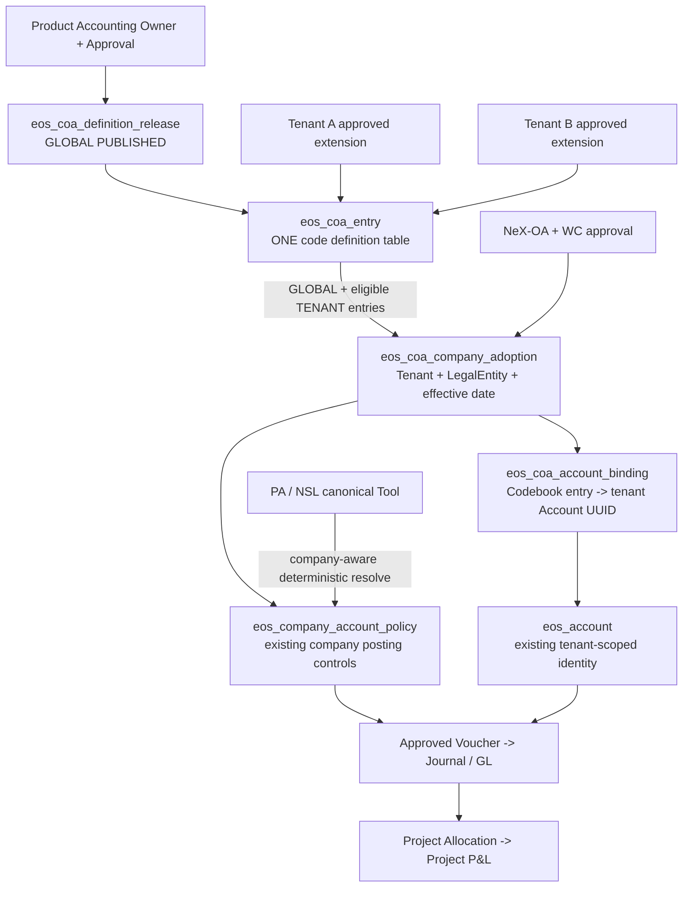

# NeX–MyBee Multi-Tenant Standard Chart of Accounts
# COA-PAD CA01 — Unified Account Codebook
## Controlled Architecture Decision v1.0

> **Status:** `ARCHITECTURE DECISION / ADDITIVE CONTROLLED AMENDMENT / IMPLEMENTATION & ACCOUNTING APPROVAL PENDING`  
> **Date:** 2026-11-10 (Asia/Seoul)  
> **Owner boundary:** NeX-EOS Business SoR / MyBee product-domain codebook  
> **Target implementation:** `nurigitdev/2607_nex_platform`, Phase-1 Monorepo (EOS extraction deferred)  
> **Predecessor:** `NeX_MyBee_COA_PAD_v1.0.md` — 659-line original PAD, retained unchanged  
> **Reviewed W10 branch:** `codex/mybee-phase1-implementation@2037bb5a08e5936c694a0a6c4a4b2b0662930e48` (source snapshot; refresh before work)  
> **Reviewed master:** `master@9fe6ddb151bd121c8fb66fbde62cc24cca29eddb`  
> **Implementation authority:** This CA01 overrides **only the codebook-definition table layout and related publication/read contracts** described below; the original PAD/SRS/Frozen invariants remain applicable elsewhere.  
> **Accounting data state:** Not approved. Candidate 166-node/88-leaf chart remains `DESIGN_CANDIDATE_NOT_APPROVED`; runtime Seed remains blocked.

---

## 0. Executive Decision

**Selected:** One and only one EOS-owned **account-code definition table** (`eos_coa_entry`) will store both common MyBee standard accounts and tenant-specific extensions. Its explicit `scope_type` is `GLOBAL` or `TENANT`; `owner_tenant_id` is `NULL` for GLOBAL and a real tenant identifier for TENANT. **Do not create a fictitious Tenant ID such as `0000` / `FFFF`.**

This is **one Codebook table, not one universal accounting Account table**. Existing `eos_account` (tenant-scoped Account UUID), `eos_company_account_policy`, `eos_posting_rule_release`, `eos_account_catalog_release` and voucher/Journal/GL remain separate EOS aggregates/tables, as already implemented or planned. Global codebook definitions are product-shared, **not an authorization or GL posting shortcut**. Each company explicitly adopts an approved release and uses its existing tenant Account and company PostingRule to post.

**CA01 objective:** Achieve the operation simplicity of one standard-code catalog without the security exception, cross-tenant foreign-key violation, duplicate GL SoR, or loss of P8/Golden A compatibility that a synthetic common tenant could introduce.

**Not in scope:** Replacing the MyBee 8-character numeric code convention; filling the unapproved 88-leaf candidate as production data; changing NSL language; migrating/rewriting historical journals; moving EOS into a separate repository; fully implementing XBRL reporting.

### 0.1 One-page architecture



---

## 1. Reason for CA01 and Source Audit

### 1.1 Original v1.0 and proposed alternative

The original `COA-ADR-004` proposed `eos_shared_coa_release` and `eos_shared_coa_account` as product-wide shared definitions; tenants could add local extensions through a separate tenant Account/extension layer. The user proposed keeping shared and tenant definitions in **one physical account-code table**, optionally by reserving `tenant_id='0000'` or `FFFF` for standard entries.

The proposal improves catalog discoverability and makes effective-code views simpler. However, `tenant_id` is already an authenticated real tenant boundary in EOS; an invented tenant would require special handling in OA, query filters, FK checks, publisher authorizations and API contracts. Those exceptions provide no accounting benefit.

### 1.2 Verified EOS implementation facts

| Source | Confirmed state on reviewed implementation branch | CA01 consequence |
|---|---|---|
| `database/nex-eos/migrations/2505_eos_account.sql` | `eos_account` PK `(tenant_id, account_id)`; unique `(tenant_id, account_code)` | Do not convert an existing Account to a pseudo-global row |
| `database/nex-eos/migrations/2506_eos_voucher_draft.sql` | `eos_voucher_draft_line` FK `(tenant_id, account_id)` → `eos_account` | Voucher line cannot reference a shared fake Tenant without contract violation |
| `database/nex-eos/migrations/2517_eos_account_catalog_accounting_period.sql` | `eos_account_catalog_release` and company PostingRule/Policy have tenant-qualified keys/FKs | Retain as tenant adoption/approval layer; add Codebook definitions independently |
| `services/nex-eos/nex_eos/accounts.py` | Legacy `account_code` permits up to 64 characters; v1 GET/RESOLVE | Do not impose 8-digit CHECK globally; Golden A legacy strings remain valid |
| `services/nex-eos/nex_eos/account_catalog.py` | Release, PostingRule, approved account and company policy checks already exist | Adapt the current implementation; avoid a second Account SoR |
| `services/nex-eos/nex_eos/account_policy_api.py` | `CATALOG_GET`/`CREATE_APPROVED` with fresh OA checks | Do not change v2 API required input/output semantics |
| `domains/mybee/config/account_catalog/approved_seed_manifest.json` | `SOURCE_PENDING_NOT_ADMITTED`; `runtime_seed_allowed=false`, `accounts=[]` | No silent account import or claim of signed K-IFRS numbering |
| `docs/slices/mybee_phase1_s1_02_account_catalog_posting_rule.md` | S1-02 framework completed; evidence reports no catalog rows seeded | CA01 is a **post-S1-02 enhancement**, not a retrospective S1-02 rewrite |

**Snapshot caution:** The above is a GitHub source review, not a fresh checkout/migration run. At CA01 implementation start, check actual HEAD, working tree, whether S1-02 has merged, schema migration history and conflicting new migration numbers. The next candidate number `2518` is provisional only.

### 1.3 Accounting vs reporting semantics

K-IFRS is an accounting and presentation standard. The IFRS and DART XBRL taxonomies tag **financial-reporting information**; they are not globally prescribed eight-digit ERP GL account numbers. MyBee's `10101001`-style numbers are product conventions requiring qualified accountant review. XBRL mapping remains independently versioned and may be N:1/1:N or rule-based. IFRS Foundation documentation and Korea's current XBRL evolution support keeping transaction-level Codebook identity separate from digital reporting tags.

---

## 2. Decision Precedence / Delta from Original PAD

This CA01 **does not replace the original PAD wholesale**; it is a narrow, explicit amendment. Interpret conflicting statements by the table below.

| Original PAD authority | Before CA01 | After CA01 | Change type |
|---|---|---|---|
| `COA-ADR-001..003` | Product standard; 8-digit code; stable semantic key | **Unchanged** | Retain |
| `COA-ADR-004` | `eos_shared_coa_release` + separate `eos_shared_coa_account` standard-entry table | `eos_coa_definition_release` (metadata) + **single** `eos_coa_entry` for GLOBAL and TENANT account-code definitions | **Superseded for proposed table names/layout** |
| `COA-ADR-005` | Tenant-scoped `eos_account_catalog_release` retained | **Unchanged**; tenant release is NOT converted to global | Retain |
| `COA-ADR-006` | Per-LegalEntity PostingRule and CompanyAccountPolicy | **Unchanged** | Retain |
| `COA-ADR-007/008` | 001–699 standard, 700–799 reserved, 800–999 tenant | **Unchanged**; enforced by `scope_type` + validation/constraints | Refined enforcement |
| `COA-ADR-009/010` | Independent XBRL mapping, immutable releases | **Unchanged** | Retain |
| `COA-ADR-011` | Product publish authority vs tenant OA and isolation | Global entries have `owner_tenant_id IS NULL`; no pseudo-tenant principal | Refined enforcement |
| `COA-ADR-012..020` | Approved source, extension governance, FX, allocation, v1 compatibility, deferred extraction | **Unchanged** | Retain |
| Section 5 suggested persistence | Separate standard entry and extension definition placement | One combined definition table plus release/adoption/binding metadata tables | **Superseded only for Codebook table placement** |
| Section 8 proposed API | Shared release read/publish and company adoption | Keep semantics, adjust provider query to one effective Codebook; canonical v1/v2 API untouched | Additive |
| Sections 10–11 tests/packets | PG-COA, COA-01..07 | Retain and add `PG-CA01` tests and explicit entry-table target | Additive |

**Explicit non-contradiction:** A common-code definition table and a tenant-scoped operational `eos_account` can coexist. Single-table consolidation applies **only to Codebook definitions**, not to Ledger or CompanyAccountPolicy.

---

## 3. Normative Architecture Decisions — COA-CA01-ADR-01..12

### COA-CA01-ADR-01 — Unified Codebook Entry Table

`eos_coa_entry` is the only authoritative persisted table of governed MyBee account-code **definitions**, for both `GLOBAL` and `TENANT` scope. Do not create parallel `eos_shared_coa_account` and `eos_tenant_coa_account_definition` tables. Multiple *metadata* tables for releases, adoption, bindings, reporting maps and immutable identities are allowed and required.

### COA-CA01-ADR-02 — Never encode GLOBAL as a fake Tenant ID

`scope_type ENUM-like CHECK IN ('GLOBAL','TENANT')`. `owner_tenant_id IS NULL` iff GLOBAL, non-null iff TENANT. No special `0000`, `FFFF`, `ALL`, wildcard tenant, global-service bearer token or OA principal is fabricated. Reserved string values cannot substitute for authorization; global publication uses separate product scope and proof.

### COA-CA01-ADR-03 — Release is versioned, entries immutable after publication

`eos_coa_definition_release` is product/global or tenant-extension metadata with ID, profile, version, optional base global release, approval source/hash, author, effective date, state, and immutable snapshot hash. GLOBAL release is approved by MyBee Product Accounting Owner; TENANT extension release is approved under applicable customer business control. No updates/deletes to PUBLISHED entry content; supersede or deprecate using new releases and an audit/change ledger.

### COA-CA01-ADR-04 — Code namespace / hierarchy preserved

Exactly eight ASCII digits, first digit `1..9`. Roots, groups, families and leaves retain `1 / 1+2 / 1+2+2 / 1+2+2+3` encoding. Non-leaf `...000` nodes are never postable. Within a five-digit family, GLOBAL standard leaves use `001..699`, `700..799` are product-reserved (not initially published as postable), TENANT leaves use `800..999`. A Tenant cannot create a new root/group/family or redefine standard codes. Parent is an explicit reference, not inferred by string slicing at GL Posting.

### COA-CA01-ADR-05 — Code and semantic identity never reused

`entry_id` is definition identity; `semantic_key` is economic meaning; `account_code` is a human-readable local number. Reassignment of an existing code to different meaning is forbidden across releases in the same standard profile or within a tenant. Reclassification requiring changed meaning produces a new semantic key/code and approved prospective bridge, not historical mutation. The 166-node / 88-leaf dataset is **not** approved merely because the code structure validates.

### COA-CA01-ADR-06 — Tenant and company control remain independent

A customer Tenant may have several LegalEntities. Each company approves its own adoption effective period, postable leaf, accepted currencies, PostingRule and reporting policy. A Tenant extension is visible only to its owner Tenant and may be enabled by one or several companies of that Tenant; it never becomes a product standard automatically.

### COA-CA01-ADR-07 — Existing tenant Account remains GL-facing SoR

GL, VoucherDraft, planned Journal and Account Resolve continue to use `(tenant_id, account_id)` in `eos_account`; add an approved immutable link `(tenant_id, account_id) → codebook entry/release/adoption`. A GLOBAL entry is mapped to a **tenant-owned Account UUID before posting**. Do not point a voucher FK directly at a GLOBAL Codebook row. Never share Journal/GL state between tenants.

### COA-CA01-ADR-08 — Effective Codebook resolution is a deterministic company-scoped view

`EffectiveCodebook(tenant_id, company_id, date, optional currency)` is **not** a blanket read of all GLOBAL rows. It joins the company's approved GLOBAL release, its approved tenant-extension release (if any), source codebook rows and company policy. It rejects collisions, ambiguous meanings, unpublished entries, non-effective dates, missing policy, wrong company or currency. A preview of globally available codebook entries is a **separate** read-only operation and is not an Account resolution.

### COA-CA01-ADR-09 — Exact code collision and override policy

GLOBAL code is canonical and cannot be shadowed by TENANT entry. Tenant code may recur across *different tenants* with independent semantics, but not within a tenant under a different meaning. Existing legacy `eos_account` code conflict must be explicitly resolved by accountant-approved migration/bridge; do not silently overwrite or renumber Golden A `TRAVEL-EXPENSE` or historical Account UUIDs. Company-local aliases are presentation overlays only.

### COA-CA01-ADR-10 — Separate human/business and Product publication authority

Product publishing requires `finance:catalog:publish` (proposed OA capability) plus exact, human-approved content hash, account-owner signoff and audit event. Tenant extension/adoption uses `finance:account:manage`, real tenant+company scope, business approval proof (`FL0004011` when applicable), independent maker/checker checks and EOS idempotency. Product publish rights are never implied by tenant finance scope. Unavailable OA/proof verification fails closed.

### COA-CA01-ADR-11 — Deterministic Release/Adoption transactions and reconciliation

A publisher must atomically commit release metadata + all entry rows + content hash + business operation/idempotency + outbox in the EOS DB, without partial publication. Company adoption atomically commits adoption + tenant Account/bindings + approved CompanyAccountPolicy/PostingRule references + outbox, using transaction locks and replay-safe keys. Do not claim one cross-service ACID transaction with OA/WC; accept/verify immutable approvals at the EOS boundary. Network-uncertain outcomes use the existing UNKNOWN_COMMIT_STATE reconciliation contract.

### COA-CA01-ADR-12 — Deferred work stays deferred; no frozen contract breakage

This amendment does not modify NeX Agent v2.1, NSL v0.2.x operation kinds, WC/OA SoRs, Golden A v1 voucher/account contract, original 2505/2517 migrations, or Monorepo deployment. New Codebook Tool is canonical READ; any controlled WRITE requires already admitted NSL semantics and approval, with no new `PUBLISH`/`POST` OperationKind. Repository extraction remains after M2 decision review.

---

## 4. Canonical Logical Data Model

| Proposed object | Type / key | Responsibility | Notes |
|---|---|---|---|
| `eos_coa_definition_release` | New metadata table; `definition_release_id UUID` | GLOBAL/TENANT definition versions, base release, source+approval digests | Multiple Releases allowed; no duplicate definition tables |
| **`eos_coa_entry`** | **Only new Codebook-definition table; `entry_id UUID`** | Account code/semantic key/name/parent/category/normal balance/contra/default monetary/postable | `GLOBAL` and `TENANT` share schema; owner nullable by scope |
| `eos_coa_code_identity` | Optional recommended invariant ledger, append-only | Retired code cannot be reassigned to a different semantic key across releases | Or equivalent DB-enforced history check under publish lock |
| `eos_coa_company_adoption` | New tenant/company-qualified table | Company picks global+extension release and effectivity, references approved tenant release | Existing company approval remains authoritative |
| `eos_coa_account_binding` | New tenant-qualified table | Immutable `eos_coa_entry` ↔ existing `(tenant_id, account_id)` | Enforce owner scope and approved adoption |
| `eos_account_catalog_release` | **Existing 2517** | Tenant-scoped approved source/adoption snapshot | **Do not globalize its PK** |
| `eos_account` | **Existing 2505** | Tenant-owned Account UUID and legacy v1 resolve | **Do not globalize its PK or enforce 8 digit globally** |
| `eos_company_account_policy` | **Existing 2517** | Company allowed/leaf/currency/effective policy | Required for Posting |
| `eos_posting_rule_release` | **Existing 2517** | Company accounting mapping/recognition rule | Required for Posting |
| `eos_coa_reporting_map` | Later M2, governed by EOS | Versioned K-IFRS/DART mapping | Separate from Codebook entry and GL |

### 4.1 Stable identity chain

```text
PRODUCT GLOBAL release (immutable)
  └─ eos_coa_entry (GLOBAL / owner_tenant_id=NULL / 8-digit code)
               |
               +-- tenant-owned company adoption (Tenant A / Company A)
               |      └─ eos_account (Tenant A, Account UUID A)
               |           └─ eos_company_account_policy -> Voucher/Journal/GL
               |
               +-- tenant-owned company adoption (Tenant B / Company B)
                      └─ eos_account (Tenant B, Account UUID B)
                           └─ eos_company_account_policy -> Voucher/Journal/GL

TENANT extension release (Tenant A / base GLOBAL release)
  └─ eos_coa_entry (TENANT / owner_tenant_id=Tenant A / e.g., ...801)
       └─ Tenant A adoption/binding/policy only
```

### 4.2 Illustrative PostgreSQL DDL (not a migration; adapt to EOS migration conventions)

```sql
-- Only the logical foundation and key invariants are shown; admission triggers,
-- provenance, immutability, FK scope checks, OA and company adoption are separate.
CREATE TABLE eos_coa_definition_release (
    definition_release_id UUID PRIMARY KEY,
    scope_type VARCHAR(8) NOT NULL CHECK (scope_type IN ('GLOBAL','TENANT')),
    owner_tenant_id VARCHAR(128) NULL,
    base_global_release_id UUID NULL
        REFERENCES eos_coa_definition_release(definition_release_id),
    chart_profile VARCHAR(64) NOT NULL,
    release_version VARCHAR(64) NOT NULL,
    effective_from DATE NOT NULL,
    source_reference VARCHAR(512) NOT NULL,
    source_hash VARCHAR(71) NOT NULL,
    approved_proof_ref VARCHAR(71) NOT NULL,
    content_hash VARCHAR(71) NOT NULL,
    status VARCHAR(16) NOT NULL CHECK (status IN ('DRAFT','PUBLISHED','SUPERSEDED')),
    created_at TIMESTAMPTZ NOT NULL,
    CHECK (
        (scope_type='GLOBAL' AND owner_tenant_id IS NULL
         AND base_global_release_id IS NULL)
      OR
        (scope_type='TENANT' AND owner_tenant_id IS NOT NULL
         AND base_global_release_id IS NOT NULL)
    )
);

CREATE TABLE eos_coa_entry (
    entry_id UUID PRIMARY KEY,
    definition_release_id UUID NOT NULL
        REFERENCES eos_coa_definition_release(definition_release_id),
    scope_type VARCHAR(8) NOT NULL CHECK (scope_type IN ('GLOBAL','TENANT')),
    owner_tenant_id VARCHAR(128) NULL,
    account_code VARCHAR(8) NOT NULL CHECK (account_code ~ '^[1-9][0-9]{7}$'),
    semantic_key VARCHAR(128) NOT NULL,
    account_name VARCHAR(256) NOT NULL,
    parent_entry_id UUID NULL REFERENCES eos_coa_entry(entry_id),
    category VARCHAR(16) NOT NULL
        CHECK (category IN ('ASSET','LIABILITY','EQUITY','REVENUE','EXPENSE')),
    normal_balance VARCHAR(2) NOT NULL CHECK (normal_balance IN ('DR','CR')),
    is_contra BOOLEAN NOT NULL DEFAULT FALSE,
    is_postable BOOLEAN NOT NULL,
    is_monetary_default BOOLEAN NOT NULL,
    source_row_hash VARCHAR(71) NOT NULL,
    CHECK (
        (scope_type='GLOBAL' AND owner_tenant_id IS NULL)
     OR (scope_type='TENANT' AND owner_tenant_id IS NOT NULL)
    ),
    CHECK (NOT is_postable OR RIGHT(account_code,3) <> '000')
);

-- Per-release uniqueness. Reused code across releases must retain meaning;
-- that requires a further immutable identity registry or publish-time DB checks.
CREATE UNIQUE INDEX ux_eos_coa_global_entry_code
ON eos_coa_entry (definition_release_id, account_code)
WHERE scope_type='GLOBAL';

CREATE UNIQUE INDEX ux_eos_coa_tenant_entry_code
ON eos_coa_entry (owner_tenant_id, definition_release_id, account_code)
WHERE scope_type='TENANT';
```

**DDL admission notes (normative for production implementation):**

1. Add an enforcing PostgreSQL trigger or equivalent transactional validation that **release scope/owner matches entry scope/owner**. An entry must not falsely claim GLOBAL when its Release is TENANT.
2. `parent_entry_id` cannot be accepted from arbitrary scope. A GLOBAL entry's parent belongs to the **same global release**; a TENANT leaf's parent must be an approved GLOBAL family in its pinned base release (or an explicitly approved Tenant grouping extension if the numbering policy is later amended). Verify hierarchy and semantic parent under transaction lock.
3. The regex alone does **not** validate exact root/group/family/leaf positions or leaf code reservation. Enforce the 001–699/700–799/800–999 rules during release admission with DB-backed invariants and negative tests.
4. Published releases/entry rows cannot be modified by tenant DB users or product publishers; enforce via DB roles/triggers and service authorization. `SUPERSEDED` is metadata state, not content mutation.
5. Code history and anti-reassignment must survive release supersession. Lock per `chart_profile` (GLOBAL) or `(tenant_id,chart_profile)` (TENANT) during publish and enforce semantic identity registry.
6. The reference table can have a GLOBAL row with `owner_tenant_id NULL`, but **tenant operational FKs must never point directly at it**. Account binding is an explicit trusted boundary.
7. Add real release and adoption FKs, tenant-qualified Account/Company FK, effective-range overlap protections, checks for cross-release mapping and a trigger or immutable proof against cross-tenant source/parent injection.
8. Account normal-balance, contra and monetary defaults are reviewed **proposals**; actual transaction-level FX monetary status remains subject to the approved EOS accounting rule.
9. Deployment RLS may provide defense-in-depth, but product publication vs tenant access **must first be enforced** by OA checks, service identity and DB least privilege. A single permissive `OR owner_tenant_id IS NULL` RLS policy on a writer role is insufficient.

### 4.3 Minimal effective-view query contract (pseudo-query; not SQL of record)

```text
READ EffectiveCodebook(tenant, company, effective_on, currency?)
  REQUIRE real OA principal + tenant/company authorization
  REQUIRE company active and approved adoption on effective_on
  REQUIRE global release PUBLISHED and pinned by adoption
  SELECT eos_coa_entry WHERE
      (GLOBAL AND release_id == adoption.global_release_id)
       OR
      (TENANT AND owner_tenant_id == real tenant
              AND release_id == adoption.extension_release_id)
  JOIN eligible eos_coa_account_binding on tenant + adoption
  JOIN existing eos_account and eos_company_account_policy
  APPLY date/currency/postable/business-policy filters
  IF duplicate code, wrong scope, stale policy, unpublished source:
       FAIL_CLOSED; never prefer TENANT over GLOBAL silently
  RETURN effective company Accounts with source scope/release and Account UUID
```

### 4.4 Three distinct read uses

| Intent | Business API | Can it be used to post? |
|---|---|---|
| Explore MyBee standard Chart | `FINANCE.COA.STANDARD_PREVIEW` (proposed) | **No**; metadata-only |
| Show company's actual available accounts | existing `FINANCE.ACCOUNT.CATALOG_GET` (v2) or additive `FINANCE.COA.EFFECTIVE_GET` | Only eligible company Account UUID after policy verification |
| Agent resolves intended business account | `FINANCE.COA.RESOLVE_SEMANTIC` (new READ Tool) | Only after same company/tenant/date/currency validation at Posting |

---

## 5. Code Examples and Collision Policy

Illustrative codes below come from the MyBee **candidate convention**; they are not K-IFRS-issued codes or approved runtime Seed.

| Entry scope | Tenant owner | Code | Meaning | Effective to whom? |
|---|---|---|---|---|
| GLOBAL | NULL | `10101001` | 현금 | Tenants that explicitly adopted its Release |
| GLOBAL | NULL | `10201001` | 매출채권 | Adopting companies with approved Account Policy |
| GLOBAL | NULL | `60101001` | 급여 | Adopting companies with approved Account Policy |
| TENANT | `T-A` | `60101801` | 연구개발 인건비 세부계정 | Tenant A's approved companies only |
| TENANT | `T-B` | `60101801` | 해외사업 인건비 세부계정 | Tenant B's approved companies only |

**Conflict examples:**

- Tenant A attempting `10101001` as a custom account ⇒ reject (`GLOBAL namespace`, plus prefix/suffix rule).
- Tenant A attempting `60101801` twice with different semantics ⇒ reject even across release revisions.
- Tenant B having `60101801` ⇒ allowed; its meaning does **not** automatically equal Tenant A's.
- Tenant A adopting a shared release and concurrently publishing a new extension with the same date ⇒ serialize or detect conflict, no partial account import.
- Golden A existing account `TRAVEL-EXPENSE` ⇒ retain v1 resolve and historical Account UUID; bridge only by explicit company accounting approval.
- Not adopted or blocked policy ⇒ `GLOBAL` preview row may be visible but never becomes a valid posting Account.

---

## 6. Publication, Adoption, Extension and Upgrade Flows

### 6.1 Product GLOBAL publication

1. Product Accounting Owner signs the **exact canonical JSON bytes** of real approved standard accounts; record profile, release version, source reference, provenance, digest, accounting policy and approver proof.
2. Validate all account codes, hierarchy, category, normal balance, contra semantics, shared semantic keys, code anti-reassignment, FX starter accounts, legal/taxonomy source markings and release diffs.
3. Require product publisher identity and **fresh OA** `finance:catalog:publish`, independent from tenant `finance:account:manage`.
4. In one EOS DB transaction, publish release+entry rows+hash+idempotency+outbox. Same key and same hash ⇒ original result; changed hash ⇒ conflict. Partial Release is never visible.
5. Previous published releases remain queryable for recorded historical adoption. No implicit customer upgrade.

### 6.2 Tenant extension admission

1. Real Tenant principal submits `FL0004011` request to add an approved local code ending `800–999` in an existing standard five-digit family.
2. WC tracks human workflow; EOS verifies Business Approval Proof and fresh OA tenant/company rights.
3. Approve a tenant extension release derived from an identified GLOBAL release; insert entries **into the same `eos_coa_entry` table** with `scope_type='TENANT'` and owner Tenant ID.
4. Reject code conflicts, invalid parent, semantic drift, cross-Tenant references, inactive base or race; publish immutably.
5. A company separately adopts the extension through EOS, creates tenant-owned Account UUIDs/bindings and company policies as appropriate.

### 6.3 Company adoption and batch materialization

1. Company Accounting Owner chooses a pinned GLOBAL release, optional TENANT extension release, effective date, account subset, currency policy and PostingRule.
2. EOS verifies `tenant_id`, company, approval proof, released hashes and existing legacy account conflicts.
3. Atomically commit adoption + existing `eos_account_catalog_release` snapshot + new tenant `eos_account` records if needed + `eos_coa_account_binding` + effective CompanyAccountPolicy + PostingRule reference and outbox.
4. Never mutate existing approved account UUIDs/Journals. Same request exact replay returns identical result; cross-key duplicate request must still be prevented by unique adoption/effective intervals and policy constraints.
5. Customer A's adoption must not change Customer B's effective codebook; company A/B within one tenant may use different active release subsets, **but an existing tenant code may not acquire different meanings**.

### 6.4 Upgrade / retrospective correction

- Upgrade creates a new approved adoption/policy interval, calculates differences, preserves old effective posting snapshots. No silent mass tenant migration.
- Erroneous posted transaction is handled through accounting reversal/adjustment; do not patch published Codebook rows or GL history.
- Release rollback is prospective with proof and company effective time, not deletion of previously published data.

---

## 7. Canonical APIs and NSL Binding Changes

| Operation | Existing/proposed | Boundary | Required authority |
|---|---|---|---|
| `FINANCE.ACCOUNT.RESOLVE` | Existing v1, unchanged | Tenant Account code to UUID | Existing service admission |
| `FINANCE.ACCOUNT.GET` | Existing v1, unchanged | Tenant Account UUID | Existing contract |
| `FINANCE.ACCOUNT.CATALOG_GET` | Existing v2, unchanged shape | Company-eligible Account listing | `finance:account:read` |
| `FINANCE.ACCOUNT.CREATE_APPROVED` | Existing v2, unchanged shape | Tenant approved account+policy | `finance:account:manage` |
| `FINANCE.COA.DEFINITION_RELEASE_GET` | Proposed read | GLOBAL/TENANT approved release metadata; strict visibility | Product/tenant scope as applicable |
| `FINANCE.COA.STANDARD_PREVIEW` | Proposed read | GLOBAL catalog only, NOT posting eligibility | Product-publication-independent authenticated read |
| `FINANCE.COA.PUBLISH_APPROVED` | Proposed admin command | Product GLOBAL or Tenant extension publish; different scopes/proofs | Product: `finance:catalog:publish`; tenant: managed governed extension capability |
| `FINANCE.COA.ADOPT_APPROVED` | Proposed EOS command | Explicit Tenant/Company adoption | `finance:account:manage` + business proof |
| `FINANCE.COA.RESOLVE_SEMANTIC` | Proposed canonical NSL READ | semantic key + company/date/currency → effective tenant Account UUID | fresh OA/tenant/project scope |
| `FINANCE.COA.REPORTING_MAP_GET` | Proposed M2 query | XBRL taxonomy version mapping | approved reporting authority |

**Backward-compatibility rule:** Do not change old URL request required fields, existing Account UUID behavior or Account resolver error meanings. New fields in existing responses must be optional and version-compatible; otherwise add an explicitly versioned route. Do not introduce an NSL `PUBLISH` operation kind. These APIs are **proposals**, not implemented in S1-02.

### 7.1 Example effective resolver response (fictitious)

```json
{
  "schema_version": "eos_finance_coa_effective_account.v1",
  "tenant_id": "T-A",
  "company_id": "00000000-0000-0000-0000-000000000001",
  "effective_on": "2026-11-10",
  "semantic_key": "MB-COA-CASH-ON-HAND",
  "account_code": "10101001",
  "source_scope": "GLOBAL",
  "definition_release_id": "00000000-0000-0000-0000-000000000011",
  "account_id": "00000000-0000-0000-0000-000000000101",
  "is_postable_leaf": true,
  "status": "RESOLVED"
}
```

If `company_id` has no approved active adoption or postable policy, the command returns a **typed failure**; it must not silently return a GLOBAL entry ID as an Account UUID.

---

## 8. Failure Contract (Additive)

| Proposed error code | Condition | Response/gate |
|---|---|---|
| `EOS_COA_GLOBAL_SCOPE_SPOOFED` | Fake/global tenant ID or tenant writer using GLOBAL | 403/422, fail closed |
| `EOS_COA_SCOPE_OWNER_MISMATCH` | Entry scope/owner differs from Release | 409/422 |
| `EOS_COA_DEFINITION_RELEASE_MISSING` | Required approved release absent | 404/409 |
| `EOS_COA_BASE_RELEASE_MISMATCH` | Tenant extension base differs from company global adoption | 409 |
| `EOS_COA_CODE_NAMESPACE_CONFLICT` | Tenant code uses standard/reserved suffix; duplicate eligible code | 409 |
| `EOS_COA_CODE_SEMANTIC_REASSIGNMENT` | Published code reused with different semantic key | 409 |
| `EOS_COA_PARENT_SCOPE_INVALID` | Parent missing/wrong scope/release/family | 422 |
| `EOS_COA_NOT_ADOPTED` | Company has no effective adoption | 409 |
| `EOS_COA_NOT_POSTABLE` | Root/family/non-approved/retired/currency-rejected | 409 |
| `EOS_COA_SEED_UNAPPROVED` | Candidate hash/proof missing or seed blocked | 409/422 |
| `EOS_COA_AMBIGUOUS_EFFECTIVE_VIEW` | Conflicting eligible code/period/release | 409, fail closed |
| `EOS_COA_AUTHORITY_UNAVAILABLE` | Fresh OA/proof cannot be verified | 503/403, fail closed |
| `EOS_COA_PUBLISH_UNCERTAIN` | Commit outcome uncertain after connection loss | Reconcile same business operation, no blind retry |

Use the existing Problem+JSON and canonical typed-result conventions; error taxonomy is to be finalized in SRS/contract fixtures. Never leak other tenants' rows in error details.

---

## 9. PostgreSQL / Security / Regression Acceptance

**PostgreSQL test database mandatory** for the protected acceptance listed here. SQLite-only/unit-only tests are insufficient for RLS, partial indexes, locks, triggers or duplicate publication races. Run within the existing EOS isolated test profile and verify zero residue.

| Gate | Required scenario | PASS condition |
|---|---|---|
| `PG-CA01-01` | Fresh additive migration after current migration inventory | 2505, 2517 and all older tables/constraints preserved |
| `PG-CA01-02` | GLOBAL entry owner must be NULL | `scope_type='GLOBAL',owner_tenant_id='T-A'` rejected |
| `PG-CA01-03` | TENANT entry owner required, real tenant scoped | `scope_type='TENANT',owner_tenant_id=NULL` rejected |
| `PG-CA01-04` | Release-entry scope mismatch under concurrent publish | FK/trigger or service transaction rejects mismatch |
| `PG-CA01-05` | GLOBAL/TENANT same code collisions, including 001–799, and retired code reuse | all invalid overrides/reuse rejected; reserved range enforced |
| `PG-CA01-06` | Tenant A and B use identical 800–999 code with different meanings | permitted and isolated; no cross-tenant read/write |
| `PG-CA01-07` | Company A/B under same Tenant adopt different release versions | company policy correct; no semantic drift on shared tenant Account |
| `PG-CA01-08` | Product vs tenant publisher OA / forged/global principal | Tenant cannot write GLOBAL, Product cannot bypass business proof |
| `PG-CA01-09` | Parent reference points to other tenant/unapproved release | rejected before commit, no partial rows |
| `PG-CA01-10` | Approved publication hash and immutable row after PUBLISHED | exact replay idempotent; tamper, update/delete rejected |
| `PG-CA01-11` | Concurrent company adoption, overlapping effective periods | only one valid active interval; no duplicate Account/Policy |
| `PG-CA01-12` | Crash after DB commit / before reply | reconciliation returns original outcome; exactly-once effect |
| `PG-CA01-13` | Invalid/empty/unapproved Seed manifest | fails closed; no catalog row created |
| `PG-CA01-14` | `TRAVEL-EXPENSE` Golden A account and voucher v1 | resolver and voucher flow unchanged; historical reference intact |
| `PG-CA01-15` | Non-postable root, missing adoption, missing currency | prohibited at company resolver and Posting boundary |
| `PG-CA01-16` | Test migration rollback/fixture cleanup/read visibility | test tenant data removed; no residue, no cross-tenant leakage |

### 9.1 Minimum E2E gates

| E2E | Steps | Acceptance |
|---|---|---|
| `E2E-CA01-01` | Approve GLOBAL chart → publish → Tenant A Company A adopt → create Account binding | Company-eligible standard account UUID returned, not GLOBAL entry UUID |
| `E2E-CA01-02` | Tenant A `FL0004011` creates approved extension 801 → adopt → validate Journal candidate | Tenant-owned account usable only under approved policy, correct account snapshot |
| `E2E-CA01-03` | Tenant A/B same 801 code → run separate GL/Project P&L | no mixed Account, allocation or totals |
| `E2E-CA01-04` | IA/PA requests USD cost → deterministic Account resolve → approved Posting → Allocation → Project P&L | source global code and tenant UUID traceable; no fake tenant, Golden A passes |

**Evidence:** migration report, OA denial matrix, PostgreSQL execution log, deterministic JSON fixtures, hashed approved source, exact replay, updated contract negatives, EOS Slice Gate, Golden A existing regression. Do not claim these tests PASS until actually executed.

---

## 10. Codex Change Plan — W10/S1-02 Follow-up (COA-01..07)

**Implementation principle:** Existing W10 `S1-02` remains CLOSED as a framework. CA01 creates **new additive packets**; do not reopen S1-02 or silently promote S1-03 AccountingPeriod runtime from the existing dormant 2517 DDL.

| Packet | Real existing source to inspect | New/updated target (proposed) | Exit criteria |
|---|---|---|---|
| `COA-01` Data and identity closure | `domains/mybee/config/account_catalog/approved_seed_manifest.json` | `domains/mybee/config/account_catalog/unified_codebook_candidate.v1.json`, schema/validator/review report | Exact candidate↔K-IFRS/DART terminology classification, code/semantic checks, real accounting-owner approval **before production seed** |
| `COA-02` Unified persistence | `2505`, `2517`, `nex_eos/account_catalog.py` | `database/nex-eos/migrations/<next_available>_eos_unified_coa.sql`, `nex_eos/unified_coa.py` | Release + **one** entry table + adoption + binding, full PG-CA01-01..07 |
| `COA-03` Publisher/adoption API | `nex_eos/account_policy_api.py`, existing OA | `nex_eos/coa_api.py`, versioned schema/OpenAPI fixtures | Product vs tenant admission, immutable source, approval, idempotency, negative tests |
| `COA-04` Extension / legacy bridge | `nex_eos/accounts.py`, company policy | tenant extension validator, `FL0004011` binding, Golden A regression | No collision and no v1 rewrite |
| `COA-05` PA and NSL READ | `nex_ae_api/nsl_eos_write_execution.py`, NSL contract catalog | deterministic `RESOLVE_SEMANTIC` Tool Binding and evidence | M1 AccountResolve→Posting→P&L E2E; no LLM code generation |
| `COA-06` Reporting map | existing company `statement_line_ref`, MyBee product mapping data | versioned K-IFRS/DART map; taxonomy fixture | M2 regulated reporting cannot export unresolved tag |
| `COA-07` Hardening | existing tests, `scripts/quality/run_slice_gate.sh` | `tests/test_nex_eos_mybee_unified_coa.py`, `tests/test_nex_eos_mybee_unified_coa_postgres.py`, negative fixtures | PG-CA01-08..16; Gate/coverage/zero residue |

**Sequence for speed:** `COA-01 candidate policy + accountant approval → COA-02 (schema) → COA-03 (publisher/adoption) → COA-04 (extension) → COA-05 (PA/NSL READ + M1)`, with COA-06 and remaining COA-07 M2 hardening as declared. Test scaffolding and schema work can start before real Seed approval; actual PUBLISHED chart and M1 live chart adoption cannot.

**Migration hygiene:** Never edit `2505` or `2517` historical SQL in place. Refresh actual branch migration inventory, reserve a new number atomically, and fail if another PR owns it. Use tenant-qualified references for existing Account/LegalEntity tables. Do not deploy an unreviewed new DB trigger to production without protected PostgreSQL tests.

### 10.1 Test command examples (commands are to be executed by Codex, not evidence of execution)

```bash
./.venv/bin/pytest -q tests/test_nex_eos_mybee_account_policy.py
./.venv/bin/pytest -q tests/test_nex_eos_p8_s15_voucher_draft.py
./.venv/bin/pytest -q tests/test_nex_ae_eos_p8_s66_golden_a_commit_journey.py
scripts/quality/run_slice_gate.sh --service nex-eos \
  --test tests/test_nex_eos_mybee_unified_coa.py \
  --coverage-target services/nex-eos/nex_eos/unified_coa.py
# Protected PostgreSQL tests: configure actual EOS test DB/profile and run with explicit opt-in.
# Checkpoint/Full Gate: escalate when contract/OA/schema changes cross service boundaries.
```

---

## 11. Risks, Alternatives, and Explicitly Rejected Paths

| Alternative | Apparent benefit | Failure mode / reason | Decision |
|---|---|---|---|
| `tenant_id='0000'` or `FFFF` for standard definition | Fewer explicit scope fields | Fake tenant, OA/tenant filter/foreign-key exceptions, unclear publisher principal | **Rejected** |
| Put all company vouchers on one GLOBAL Account UUID | No Account materialization | Breaks tenant-scoped GL FK and audit isolation | **Rejected** |
| Two separate account-definition tables | Simple static model | Duplicate column logic, merged query complexity | **Superseded by CA01** |
| One Codebook definition table with `scope_type` + nullable owner | Central registry/query, explicit authority | Needs robust release/scope/adoption constraints | **SELECTED** |
| Use one table for both definition and operational Account/GL | Minimum table count | Destroys company policy/posted-voucher ownership separation | **Rejected** |
| On-the-fly implicit adoption of GLOBAL account | Fast query | Bypasses company approval and GL postable controls | **Rejected** |
| Let Tenant override product meaning | Familiar UX | Destroy standard semantics, audit/report inconsistency | **Rejected** |

---

## 12. Unresolved Approvals / Boundaries

| Gate | Required before | Responsible |
|---|---|---|
| `COA-CA01-G01` | Real standard codebook **PUBLISHED** or runtime Seed | MyBee Product Accounting Owner: exact rows, source, effective date, signed digest |
| `COA-CA01-G02` | Migration PR | NeX EOS DB owner: schema, publish atomicity, parent scope, code history, FK/adoption review |
| `COA-CA01-G03` | Product global publisher activation | NeX OA/AG owner: separate Product authority, proof and audit |
| `COA-CA01-G04` | Company adoption activation | Accounting owner: maker-checker, account/rule/currency/legal entity policy |
| `COA-CA01-G05` | M1 PA/GL E2E | EOS+AE/NSL: semantic resolver, Golden A compatibility, end-to-end proof |
| `COA-CA01-G06` | M2 XBRL/export | Reporting owner: actual K-IFRS/DART taxonomy and mapping version |
| `COA-CA01-G07` | Deployment/merge | Actual quality/PG tests, zero residue, transition & NSL compatibility |

**Frozen architecture check:** No OA/WC/NSL SoR moves. Adding a new EOS-owned Codebook Aggregate is consistent with Phase-1's additive EOS expansion. If implementation reveals a required change to frozen trust/approval or canonical transaction semantics, stop and raise a separate Controlled Amendment; this CA01 is not blanket permission.

---

## 13. CA01 Decision Record and Source References

**Decision ID:** `COA-CA01-ADR-UNIFIED-CODEBOOK-v1.0`  
**State:** Accepted as the intended **design direction** for COA follow-up; code, migration, and accounting approval pending.  
**Chosen model:** `eos_coa_entry` single GLOBAL/TENANT Codebook definition table, with explicit scope/owner and release/adoption metadata; tenant `eos_account` / company policy / GL unchanged.  
**Effective for planning:** 2026-11-10  
**Supersedes:** Original COA PAD v1.0 `COA-ADR-004` physical definition table names/layout and section 5 shared-entry placement only.  
**Preserves:** All other existing PAD invariants, D04/D12 SRS, Phase-1 In-Repository ADR, W10 S1-02 history and P8/Golden A.  
**Release authority:** Real accounting-owner sign-off and tested EOS publisher/tenant-adoption path needed before production Seed admission.

### 13.1 Verified GitHub source snapshot

- NeX EOS current W10 branch source: https://github.com/nurigitdev/2607_nex_platform/tree/2037bb5a08e5936c694a0a6c4a4b2b0662930e48
- `2505` tenant Account schema: https://github.com/nurigitdev/2607_nex_platform/blob/2037bb5a08e5936c694a0a6c4a4b2b0662930e48/database/nex-eos/migrations/2505_eos_account.sql
- `2506` VoucherDraft FK: https://github.com/nurigitdev/2607_nex_platform/blob/2037bb5a08e5936c694a0a6c4a4b2b0662930e48/database/nex-eos/migrations/2506_eos_voucher_draft.sql
- `2517` catalog/period schema: https://github.com/nurigitdev/2607_nex_platform/blob/2037bb5a08e5936c694a0a6c4a4b2b0662930e48/database/nex-eos/migrations/2517_eos_account_catalog_accounting_period.sql
- W10 S1-02 closure: https://github.com/nurigitdev/2607_nex_platform/blob/2037bb5a08e5936c694a0a6c4a4b2b0662930e48/docs/slices/mybee_phase1_s1_02_account_catalog_posting_rule.md
- Manifest: https://github.com/nurigitdev/2607_nex_platform/blob/2037bb5a08e5936c694a0a6c4a4b2b0662930e48/domains/mybee/config/account_catalog/approved_seed_manifest.json
- Original local COA PAD: `NeX_MyBee_COA_PAD_v1.0.md`; candidate: `NeX_MyBee_COA_Codebook_Candidate_v0.1.json` (both unchanged by this amendment).

### 13.2 External interpretive sources (not account-code seed)

- IFRS Foundation, Accounting Taxonomy: https://www.ifrs.org/issued-standards/ifrs-taxonomy/
- IFRS Foundation, 2026 taxonomy guidance: https://www.ifrs.org/news-and-events/news/2026/02/ifrs-accounting-taxonomy-2025-to-remain-current-for-2026/
- Financial Supervisory Service, XBRL/DART improvement announcement (2026-10-14): https://eiec.kdi.re.kr/policy/materialView.do?num=288021

---

## 14. Summary for Codex

**Do not build a second GL Account SoR.** Amend COA PAD table placement only; one `eos_coa_entry` table contains both standard and tenant code definitions. Global definitions use `scope_type='GLOBAL',owner_tenant_id=NULL`; tenant extension uses `scope_type='TENANT',owner_tenant_id=<real tenant>`. Create versioned release, adoption and binding; use existing EOS Account/Company Policy/PostingRule for company-eligible posting. Do not use `0000`/`FFFF`. Preserve Golden A v1 and already closed S1-02. `approved_seed_manifest.json` stays blocked until real human approval, and candidate 88 leaves are not an operational K-IFRS code list. Deliver PG-CA01 security/race/compatibility gates before activating any data.
