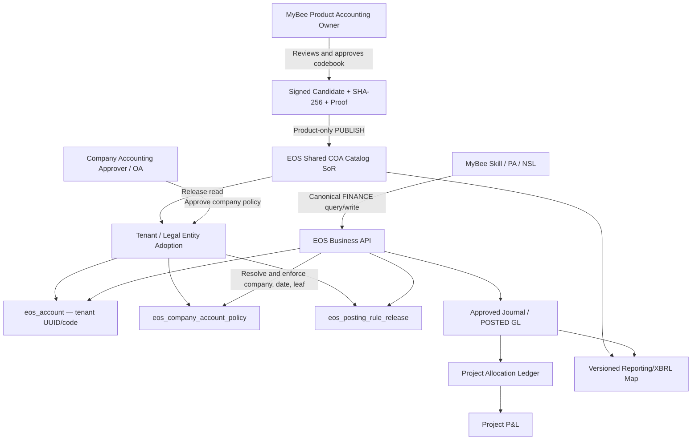

# NeX–MyBee Multi-Tenant Standard Chart of Accounts
# Pre-Architecture Decision v1.0

> **Status:** `DESIGN BASELINE / CONDITIONAL / ACCOUNTING OWNER SIGN-OFF REQUIRED`  
> **Date:** 2026-11-10 (Asia/Seoul)  
> **Program:** NeX–MyBee D04/D12 Enterprise OS Phase-1 (Project Agent → GL → Allocation → P&L)  
> **Execution Repository:** `nurigitdev/2607_nex_platform` (in-repository Phase-1; deferred EOS extraction)  
> **Source Implementation Branch:** `codex/mybee-phase1-implementation@2037bb5a08e5936c694a0a6c4a4b2b0662930e48`  
> **Master Comparison:** `master@9fe6ddb151bd121c8fb66fbde62cc24cca29eddb`  
> **Precedence:** NeX Agent v2.1 / NSL Frozen baseline → Phase-1 In-Repository ADR → D04/D12 Accounting PAD/SRS → this COA PAD (account code/catalog refinement)  
> **Implementation Precondition:** product accounting-owner approval of the *actual canonical account rows* and signed, hash-pinned catalog Release; no code is represented as an official K-IFRS-issued ERP account number.

---

## 0. Executive Decision

**Decision:** The NeX-EOS keeps one authoritative, tenant-isolated accounting Account / Journal / GL model. MyBee publishes an internally governed **shared, versioned standard Chart of Accounts (COA)** intended for multiple tenants. Each tenant/legal entity explicitly adopts a release into its existing tenant-scoped EOS `eos_account` + `eos_company_account_policy` + `eos_posting_rule_release` model and may add tenant-local subaccounts. Standard ERP account numbers are **MyBee-defined**; accounting treatment and external reporting are separately bound to applicable **K-IFRS policy** and **DART XBRL taxonomy**.

**S1-02 clarification:** W10 S1-02 delivered the governed *framework*, not the approved *contents*. Its manifest is intentionally `SOURCE_PENDING_NOT_ADMITTED`, `runtime_seed_allowed=false`, and `accounts=[]`. This document **does not re-open or reinterpret S1-02 as failed**. It closes the next source/codebook and tenant-adoption design decisions so later Codex work can create and approve real data without inventing official code numbers.

**Phase-1 default:** Non-financial manufacturing / services profile `MYBEE-KIFRS-NFI`; **eight-character numeric string**, four hierarchy levels (`1 / 1+2 / 1+2+2 / 1+2+2+3`), standard leaf suffix `001–699`, product-reserved `700–799`, tenant extension `800–999`. These are an **internal product convention**, not K-IFRS or DART codes. The appended example codebook is `DESIGN_CANDIDATE_NOT_APPROVED`, never an automatic or production seed.

**Key safety rule:** GL posting must resolve an **active company-allowed Account UUID**, compatible published catalog release/policy/PostingRule snapshot and leaf flag; the Account Code alone is not authorization to post.

**M1 focus:** Project Agent E2E revenue/cost, basic receivable/payable, KRW/USD FX handling, cost allocation and P&L. Complete regulatory XBRL tagging and extensive industry charts can remain M2/later; do not weaken M1 posting proof/approval, Golden A regression or seed admission checks.

---

## 1. Problem and Current Implementation Facts

### 1.1 Business problem

1. K-IFRS prescribes accounting recognition, measurement, presentation and disclosure principles; it does **not** prescribe one globally mandatory numerical GL account-code list for all ERPs.
2. DART XBRL taxonomy contains **public reporting concepts and IDs**, not an exhaustive substitute for transaction-level GL accounts.
3. MyBee must offer a portable common semantic vocabulary for Project Agent, Skill Pack, voucher generation, analytics and cross-tenant product maintenance, while allowing **tenant-level** custom accounts.
4. A customer may own multiple accounting **Legal Entities**; a shared tenant Account may have different activation, accepted currencies or posting policies for each company. Do not conflate `tenant_id`, `company_id`, or `account_id`.
5. Previously approved Project/GL workflows and existing P8/Golden A v1 Account resolver must remain backward compatible.

### 1.2 Verified W10 S1-02 source audit (not execution evidence from this PAD)

| Evidence | Existing implementation / constraint | Consequence |
|---|---|---|
| `2505_eos_account.sql` | `eos_account(tenant_id,account_id UUID,account_code VARCHAR(64),name,category,account_type,status,effective dates,version)`; unique `(tenant_id,account_code)` | Keep identity and legacy alphanumeric codes |
| `2516_eos_legal_entity_project_binding.sql` | `eos_legal_entity`, tenant-qualified Project↔Company binding | Company is a separate scope inside tenant |
| `2517_eos_account_catalog_accounting_period.sql` | `eos_account_catalog_release`, `eos_posting_rule_release`, `eos_company_account_policy`, future AccountingPeriod DDL | Reuse as tenant/company approved adoption layer; do not repurpose as global catalog |
| `account_catalog.py` | Approved release, PostingRule, CompanyAccountPolicy, atomic approved Account; parent/leaf/effective/currency constraints | Reuse and extend admission; no alternative Account SoR |
| `account_policy_api.py` | `FINANCE.ACCOUNT.CATALOG_GET` and `FINANCE.ACCOUNT.CREATE_APPROVED`, fresh OA checks | Preserve existing v2 API; additive routes only |
| `domains/mybee/config/account_catalog/approved_seed_manifest.json` | `SOURCE_PENDING_NOT_ADMITTED`, `runtime_seed_allowed=false`, empty accounts | No real approved chart yet; fail closed, do not fill with guessed official codes |
| `docs/slices/mybee_phase1_s1_02_account_catalog_posting_rule.md` | Records S1-02 EOS Slice Gate, protected Postgres smoke and 0 seeded rows | Framework closure ≠ source catalog approval or production deployment |
| Existing voucher v1 / P8 | `eos.account` UUID resolution, v1 voucher draft, controlled write | No destructive Account API/schema change |

**Repository drift note:** The reviewed S1-02 implementation exists on branch `codex/mybee-phase1-implementation`, **not asserted to be merged into `master`**. Codex must recheck actual working branch, migration inventory, and PR status before any new migration. As of this audit branch migration range ends at `2517`, but `2518` is only a *provisional* next number.

### 1.3 Relevant SRS and earlier decisions

- `SRS-ACC-001..007`: stable Account v1 identity, immutable approved release, company policy, postable leaf, PostingRule, human-approved additions and Journal snapshot.
- `SRS-SEC-*`: OA fresh authorization and tenant isolation.
- `SRS-FX-*`: functional currency, immutable FX Rate Snapshot and gain/loss behavior.
- EOS D04/D12 PAD: Account master / Journal / GL / Allocation / P&L remain EOS business SoR; Project Agent consumes canonical operations.
- Phase-1 In-Repository ADR: work remains in NeX Monorepo; EOS extraction deferred until after M2 review.

---

## 2. Source Authority and Vocabulary

| Object | What it means | Is it an ERP account code? | Authoritative owner |
|---|---|---|---|
| K-IFRS standards | Recognition, measurement, presentation and disclosure policy | **No** | Korean Accounting Standards Board / applicable standards |
| IFRS Accounting Taxonomy | Digital financial-reporting tags | **No** | IFRS Foundation; jurisdiction-specific adoption |
| DART XBRL taxonomy (`account_id`) | Korean filing/reporting concept | **No** | Financial Supervisory Service / DART |
| `standard_account_key` | Stable MyBee semantic account identity across releases | **No** | MyBee product-owned catalog, EOS persisted |
| `account_code` (8 digits) | Human-facing internal ledger/account number | **Yes — MyBee convention** | Shared standard or tenant extension policy |
| `account_id` (UUID) | Stable tenant-scoped EOS Account identity | Not human code | EOS |
| `statement_line_ref` / reporting rule | Versioned financial-reporting mapping | **No** | EOS governed reporting policy |
| `economic_category` / Project dimensions | Transaction nature / management cost attribution | **No** | EOS canonical accounting and allocation policies |

**Source provenance:** A shared catalog can be assembled from internal accountant-curated terms, approved example mappings, and permitted taxonomy reference information. **Do not present such a curated dataset as a published K-IFRS-issued code list.** Verify extraction terms and licensing of external materials separately. XBRL mapping IDs must come from actual, version-specific DART/IFRS source data; examples in this PAD deliberately do not fabricate them.

**2026→2027 taxonomy planning:** The IFRS Foundation has stated that *IFRS Accounting Taxonomy 2025 remains current for 2026 reporting*. Korea has announced K-IFRS 1118 mandatory application beginning 2027-01-01, with changes to statement presentation/MPM disclosures. Thus the internal GL account numbers must **not be hard-coded to a single XBRL taxonomy or 2026 income-statement format**.

---

## 3. Architecture Overview



- **Shared catalog is product-shared reference data; GL and company policy are never globally shared customer state.**
- `domains/mybee/` owns catalog proposal artifacts, source references, templates and configuration; **EOS** owns publishing, snapshots, approvals, Account resolution, Journal, GL and reporting policy storage.
- OA owns authorization; WC owns human workflow; EOS validates authoritative business approval proof and transaction; AE/NSL own controlled execution; WA stores signed evidence. No alternate MyBee ledger.
- One actual tenant/company posting request must resolve against one active EOS CompanyAccountPolicy (and an eligible Leaf) as of the transaction/recognition date.

---

## 4. Architecture Decisions (Normative)

### COA-ADR-001 — Product standard vs accounting standard

**DECISION:** Profile `MYBEE-KIFRS-NFI` targets non-financial manufacturing/services. `chart_profile`, `mybee_code_version`, `reporting_basis=K-IFRS`, `industry_profile`, and `source_basis` are separate metadata. The numerical coding scheme is a MyBee product policy, not a regulatory standard. Future profile-specific catalog, non-K-IFRS users and sector extensions must be additive, not forced into an incorrect chart.

### COA-ADR-002 — Exactly eight-digit numerical code for newly governed MyBee accounts

**DECISION:** Use `^[1-9][0-9]{7}$`, stored as `VARCHAR(8)` in the **standard catalog**, and as an eight-character string inside existing `eos_account.account_code VARCHAR(64)` for new governed MyBee account admissions. Leading zeros are not parsed as integers; `0` is presently reserved. Existing P8/Golden A alphanumeric accounts remain valid in the old v1 resolver and may be mapped explicitly; do **not** add a global database `CHECK` to `eos_account` that would break them.

| Positions | Example | Interpretation | Allowed posting |
|---|---|---|---|
| `[1]` | `1` | Major economic family | No |
| `[1:3]` | `101` | Group, e.g., cash | No |
| `[1:5]` | `10101` | Account family, e.g., demand cash | No |
| `[1:8]` | `10101001` | Leaf account | Only if policy says allowed |

Hierarchy padding: `10000000` root, `10100000` group, `10101000` family, `10101001` leaf. Parent references are **explicit columns**, not inferred solely by slicing number digits during posting; all candidate rows must validate structural consistency. Aggregation nodes must have `is_postable=false`.

### COA-ADR-003 — Stable semantic key distinct from code and EOS UUID

**DECISION:** A `standard_account_key` is immutable across catalog releases for the same economic meaning, e.g. `MB-COA-AR-TRADE`. `account_code` is the proposed display/binding identifier; a code once assigned to a meaning must **never be reassigned** to another meaning, including after deactivation. Tenant `eos_account.account_id` remains its stable UUID and JournalLine records the approved code/policy snapshots. Renaming presentation labels alone must not change historical Journal semantics.

### COA-ADR-004 — Shared catalog is an immutable product release

**DECISION:** One EOS-owned `eos_shared_coa_release` and immutable `eos_shared_coa_account` collection is shared across tenants. Product Accounting Owner approves the canonical release, raw source/evidence hash, codebook, hierarchy, category, contra/normal-balance hints, and effective date. Tenant users may read published metadata under permitted scope but **cannot publish or mutate product-standard rows**. Multi-tenant database isolation does not mean the same reference rows are physically copied into every Tenant as source authority.

### COA-ADR-005 — Do not repurpose the tenant-scoped S1-02 Release

**DECISION:** Preserve `eos_account_catalog_release(tenant_id,release_id,...)` as an **approved tenant catalog adoption snapshot**, because S1-02 already binds its tenant `eos_posting_rule_release` and `eos_company_account_policy` to it. Add a separate shared Release and an explicit tenant/company adoption link. Never change the old table's PK/uniqueness into a global shared PK, and never expose shared Release IDs as replacements for tenant-owned `catalog_release_id` used by current APIs.

### COA-ADR-006 — Company is a distinct posting-policy scope

**DECISION:** A Tenant has one semantic Account namespace (existing unique `(tenant_id,account_code)`) but one or more `eos_legal_entity(company_id)` instances. Each company controls its current `eos_company_account_policy`: account activation, leaf permission, monetary flag, allowed currencies, reporting mapping, effective period and PostingRule. Two companies within one tenant must **not redefine the same code to mean different economic accounts**. If different semantics are required, allocate different Tenant codes. There is no cross-company GL pooling or cross-company Journal transaction.

### COA-ADR-007 — Standard vs tenant extension allocation

**DECISION:** For every 5-digit Account Family, reserve last three digits: `001–699` product-managed standard, `700–799` product-reserved for future catalog release, `800–999` Tenant-local extensions, `000` non-postable family node. Tenant additions use `FL0004011` and current `finance:account:manage` approval. Extension's **full 8-digit** code must be unique within tenant; the same 8-digit local extension in different tenants may have different meanings. Tenant may not override a standard code's canonical meaning, contra character, or primary category; allow local UI alias and narrower policy through separate explicit fields.

### COA-ADR-008 — New code family registry and segment governance

**DECISION:** Top family digits have a human-readable initial routing convention; *reporting treatment is not derived mechanically from the code prefix*.

| First digit | MyBee management family | Existing `eos_account.category` for leaf | Caveat |
|---|---|---|---|
| `1` | Assets | `ASSET` | Contra-assets remain ASSET, may have CR normal balance |
| `2` | Liabilities | `LIABILITY` | Currency evaluation depends on item nature |
| `3` | Equity | `EQUITY` | OCI/retained earnings reporting separate |
| `4` | Ordinary operating revenue | `REVENUE` | Contra-revenue may carry DR normal balance |
| `5` | Cost of goods/services sold | `EXPENSE` | Recognition depends on actual accounting policies |
| `6` | Selling/general/administrative expense | `EXPENSE` | Direct/indirect Project allocation is separate |
| `7` | Other/financial income | `REVENUE` | IFRS 18 reporting categories **not** hard-coded |
| `8` | Other/financial expense | `EXPENSE` | FX reporting requires economic-origin context |
| `9` | Income-tax expense / closing reserved | `EXPENSE` for admitted tax leaf | Future control/OCI uses separate governance |

Expense by function vs nature and IFRS 18 (2027) reporting taxonomy must use **versioned mapping rules**, not reinterpret code prefixes. `category`, `normal_balance`, `is_contra`, `is_monetary_default` are distinct attributes.

### COA-ADR-009 — Posting and financial reporting are different classification problems

**DECISION:** `standard_account_code` never directly equals a DART `account_id` or IFRS Taxonomy element. Introduce a **versioned 1:N / N:1 reporting mapping** with statement kind, jurisdiction/taxonomy version, effective period, reporting context/axes, mapping rule, approval hash, and a non-null resolution status (`RESOLVED`, `NOT_APPLICABLE`, `MAPPING_PENDING`). A draft absent DART mapping can still be used in **internal GL/M1**, provided the account's mandatory internal accounting/statement-line validation is valid. **A regulated XBRL export fails closed if required taxonomy mappings are not RESOLVED.**

### COA-ADR-010 — Release and policy history is immutable

**DECISION:** New shared Release rows and their account definitions are immutable after `PUBLISHED`. Changes create a new Release with its own SHA-256 and approval proof, effective dates, optional supersession link, and change ledger. Existing tenant releases/rules/policies retain their snapshot; company upgrades require explicit accounting authority and no retroactive change to posted journals. Only a versioned `ALIAS`/display label may differ without changing semantic key. Identical import is replay; same identity plus different hash is conflict.

### COA-ADR-011 — Cross-tenant data isolation and Product authority

**DECISION:** EOS maintains a global reference namespace with read-controlled published COA releases, and tenant-specific `eos_account`/adoption/policy/GL tables with tenant-qualified FK and OA checks. Global read-only reference is not a shortcut to cross-tenant CompanyAccountPolicy. Product `finance:catalog:publish` scope (proposed OA capability) is only for authorized MyBee catalog publishers; tenant `finance:account:manage` does **not** imply Product publish. Account-resolution requests require service-token admission plus fresh OA, tenant/company/date and appropriate authorization. Unknown tenant or unavailable OA ⇒ fail closed.

### COA-ADR-012 — Full provenance and approval of real source data

**DECISION:** Human product accounting owner must approve the actual `accounts[]` rows (code, name, semantic meaning, category, normal balance, parent, leaf, FX, reporting mapping). Machine validation alone never promotes `DESIGN_CANDIDATE` to `PUBLISHED`. Publisher must pin `source_reference`, `source_version`, `source_hash`, `approved_proof_ref`, `effective_from`, profile and exactly reproducible canonical serialization. Current S1-02 `SOURCE_PENDING_NOT_ADMITTED` manifest **must remain blocked** until approved rows and evidence are available. `published_by` is a trusted audited principal, not arbitrary user input.

### COA-ADR-013 — Tenant extension must not bypass approval

**DECISION:** Tenant-local account creation uses approval-backed governed EOS API (`FL0004011`) with maker-checker where required. Check code's `800–999` allocation, standard-group parent, label, classification, normal balance, currency constraints, non-overlap and effective period. It must be able to reject an extension in a non-existent/disabled standard family and collisions with any existing legacy Account. A tenant-scoped arbitrary account cannot masquerade as shared standard account via a manually supplied `origin=STANDARD`.

### COA-ADR-014 — Monetary FX classification is not purely a static code trait

**DECISION:** Typical cash/AR/AP/loan accounts may have `is_monetary_default=true` but **account-level defaults do not replace item-level accounting judgments** for instruments, advances and contracts. FX gain and FX loss accounts must exist in the approved catalog/PostingRule before M1 USD transactions; reporting category depends on underlying instrument/origin and effective K-IFRS policy. Transaction stores original currency amount, functional currency amount, immutable applied rate evidence and FX policy snapshot. Never infer a rate or FX account solely from the LLM's prose.

### COA-ADR-015 — Account code ≠ Project expense allocation

**DECISION:** Shared expense accounts, including labor, travel and purchases, support consistent accounting classification. Project direct/indirect allocation uses existing `Project`, `source_pool`, `allocation_rule`, `GL` source evidence and explicit Project dimensions—not per-project multiplication of 8-digit GL codes. Project-specific 8-digit extension only when the accounting meaning genuinely differs, not merely to track Project A vs B. GL Posting and Project Allocation remain distinct, reconciled ledgers.

### COA-ADR-016 — Preserve 2505/2517 Account and P8/Golden A v1

**DECISION:** Do not renumber legacy `eos_account.account_code`, change existing unique keys, or force 8-digit `CHECK` on legacy rows. Existing GET/RESOLVE and `FINANCE.CREATE_VOUCHER_DRAFT` v1 behavior remain unchanged. The MyBee governed route binds new chart policies additively. A pre-existing legacy code may be explicitly mapped to shared semantic key via approved bridge but never silently converted. Regression gate includes Golden A exactly-once, approval/NSL reconciliation, account resolution and cross-tenant denial.

### COA-ADR-017 — Safe batch adoption and idempotent activation

**DECISION:** The Company Adoption Command performs one **EOS-local atomic transaction** for adoption record, tenant Account creation/binding, CompanyAccountPolicy, approved PostingRule reference, idempotency and outbox. Each account may be created once per Tenant and adopted by multiple companies with independent policy; rollback prevents partial/half-ready catalogs. Concurrent same tenant/company/release activation serializes by a bounded advisory lock and unique constraints. No distributed XA transaction with OA/WC/WA. Human approval proofs are verified beforehand; EOS checks freshness/consumption and final policy under its authoritative commit boundary.

### COA-ADR-018 — Governed publication vs runtime release

**DECISION:** There are four separate statuses/controls: (1) `CANDIDATE` source design (untrusted runtime), (2) `VALIDATED` schema/semantic checks, (3) `APPROVED + PUBLISHED` shared product Release (immutable), and (4) `ACTIVE` Company adoption/policy. A `PUBLISHED` shared Release **alone does not authorize** a Tenant/Company to post. Old company policy stays active until an approved, non-overlapping effective-dated activation; no backdated adoption that changes posted history.

### COA-ADR-019 — Keep Project Agent deterministic

**DECISION:** Project Agent/LLM chooses an accounting intent and semantic account candidate **only**. EOS `FINANCE.ACCOUNT.CATALOG_GET` and explicit account resolution validate that candidate against the company's current catalog and PostingRule. Ambiguous account semantic → request clarification or human accounting review; no hallucinated AccountCode/GL classification. Final NSL execution uses Canonical Tool Contract and the verified EOS Account UUID/approved snapshot; no direct MyBee DB update.

### COA-ADR-020 — Deferred EOS extraction remains deferred

**DECISION:** All Phase-1 changes stay in the NeX Monorepo, with shared reference definitions as EOS-owned DB state and MyBee source proposal files under `domains/mybee/config/account_catalog/`. No new standalone EOS repository or long-lived branch is required; use short-lived feature branches with targeted Slice Gate/Checkpoint/Full Gate. Post-M2 EOS extraction remains a future decision, not a prerequisite.

---

## 5. Data Model and Ownership (additive to 2517)

### 5.1 Suggested EOS table boundaries (proposed; not yet committed)

| Table | Key | Owner / state | Must enforce |
|---|---|---|---|
| **NEW** `eos_shared_coa_release` | `shared_release_id UUID` | EOS Product Shared (no tenant scope) | `profile_code`,`version`,`content_hash`,`approval_proof_ref`,`effective_from`,`PUBLISHED/SUPERSEDED`, unique profile/version |
| **NEW** `eos_shared_coa_account` | `(shared_release_id,account_code)` | EOS Product Shared immutable | 8-digit code; `standard_account_key`; category, parent, normal balance, contra, leaf, source/evidence lineage; no code/semantic reuse |
| **NEW** `eos_tenant_coa_adoption` | `(tenant_id,company_id,adoption_id)` | EOS Tenant/Company | FK to real company + shared Release and existing tenant `catalog_release_id`; approved periods; lock/uniqueness |
| **NEW** `eos_account_standard_binding` | `(tenant_id,account_id)` | EOS Tenant | `standard_account_key`, `origin=STANDARD/TENANT_EXT/LEGACY_BRIDGE`, catalog lineage, immutable semantic match |
| **NEW / deferred M2** `eos_coa_reporting_map` | `(mapping_release_id,rule_id)` | EOS reporting policy | Jurisdiction/taxonomy version, statement kind, context, effective policy, DART concept actual ID, source hash |
| **EXISTING** `eos_account` | `(tenant_id,account_id)` | EOS tenant Account SoR | Preserve `(tenant_id,account_code)` unique, status, effective-date and UUID identity |
| **EXISTING** `eos_account_catalog_release` | `(tenant_id,release_id)` | EOS tenant source/adoption snapshot | Remains tenant-scoped; references approved source hash and proof |
| **EXISTING** `eos_company_account_policy` | `(tenant_id,policy_id)` | EOS Company | leaf, parent, monetary, statement line, allowed currencies, effective range, PostingRule |
| **EXISTING** `eos_posting_rule_release` | `(tenant_id,posting_rule_id)` | EOS Company | version/hash, deterministic category and mapping behavior |
| **EXISTING** Journal/GL | tenant/company/journal IDs | EOS immutable posting | Actual `account_id` and code + policy / catalog / rate snapshots |

**Design nuance:** Do not create global foreign keys to tenant-owned rows. Tenant adoption references the immutable global Release by a global FK, while its `(tenant_id,company_id)` and `(tenant_id,catalog_release_id)` relationships enforce tenant scope. Global shared rows must not contain actual payroll/payee/customer GL data.

### 5.2 Minimal proposed DDL sketch — design reference, NOT a migration

```sql
-- Illustrative PostgreSQL contract, NOT executable migration code.
CREATE TABLE eos_shared_coa_release (
  shared_release_id UUID PRIMARY KEY,
  profile_code VARCHAR(64) NOT NULL,
  catalog_version VARCHAR(64) NOT NULL,
  content_hash VARCHAR(71) NOT NULL,                 -- sha256:<64hex>
  source_reference TEXT NOT NULL,
  source_version TEXT NOT NULL,
  approved_proof_ref VARCHAR(128) NOT NULL,
  effective_from DATE NOT NULL,
  status VARCHAR(16) NOT NULL,
  created_at TIMESTAMPTZ NOT NULL,
  UNIQUE(profile_code, catalog_version)
);

CREATE TABLE eos_shared_coa_account (
  shared_release_id UUID NOT NULL REFERENCES eos_shared_coa_release(shared_release_id),
  account_code VARCHAR(8) NOT NULL,
  standard_account_key VARCHAR(128) NOT NULL,
  parent_account_code VARCHAR(8),
  canonical_name_ko VARCHAR(256) NOT NULL,
  category VARCHAR(16) NOT NULL,
  normal_balance CHAR(2) NOT NULL,                   -- DR/CR
  is_contra BOOLEAN NOT NULL,
  is_postable_leaf BOOLEAN NOT NULL,
  is_monetary_default BOOLEAN NOT NULL,
  PRIMARY KEY(shared_release_id, account_code),
  UNIQUE(shared_release_id, standard_account_key),
  CHECK(account_code ~ '^[1-9][0-9]{7}$'),
  CHECK(normal_balance IN ('DR','CR'))
);

-- Adoption and semantic binding are separate, tenant-qualified additions.
-- Use real UUID FKs and effective-period overlap/serialization rules when implementing.
```

**Required implementation enhancements not expressed in sketch:** immutable-published-row trigger or append-only privileges; parent same-release composite FK / cycle check; category and contra consistency; stable semantic cross-release registry; `tenant_id` qualified FKs for adoption and binding; status/effective interval guards; published source hash verification; company advisory lock and exact-replay idempotency; `eos_business_operation`/outbox integration; encryption/PII rules where applicable. Never blindly apply this sketch as DDL.

### 5.3 Standard account attributes

Required row fields: `account_code`, `standard_account_key`, `canonical_name_ko`, `category`, `account_type`, `parent_account_code`, `hierarchy_level`, `normal_balance`, `is_contra`, `is_postable_leaf`, `is_monetary_default`, `semantic_definition`, `business_origin`, `cost_nature_hint`, `reporting_mapping_status`, `source_lineage`. Optional: English label, tax treatment hint, industry flags. Separate report mapping uses externally verified taxonomy IDs—not the row code.

**Normal balance example:** `감가상각누계액` remains an ASSET category with **CR** normal balance; `매출에누리` remains REVENUE with **DR** normal balance. The code-family is not an excuse to create the wrong account category.

### 5.4 Stable reference semantics

```text
Shared Catalog Release (global, immutable)
  ├── Account Standard Key + 8-digit display code
  ├── Reporting Map(s): K-IFRS + DART version / context
  └── SHA-256 + product approval

Tenant / LegalEntity
  ├── Adopted shared_release_id
  ├── Existing eos_account_catalog_release(tenant, release)
  ├── Existing eos_account(tenant, account_uuid, account_code)
  ├── eos_account_standard_binding(tenant, account_uuid, semantic_key)
  ├── Existing eos_company_account_policy(company, account_uuid, ...)
  ├── Existing eos_posting_rule_release(company, ...)
  └── Posted Journal snapshots (unchanged historical identity)
```

**Cross-release code stability rule:** `standard_account_key` meaning is immutable. If a meaningful split/merge is required, create new keys/codes, deprecate old ones with a migration/bridge ledger and explicit accountant sign-off; never silently rewrite old Account references.

---

## 6. Code Numbering Standard v1.0

### 6.1 Root / group / family / leaf grammar

```text
1  01  01  001
│  │   │    └── detailed leaf code (3 positions)
│  │   └─────── account family (2 positions)
│  └─────────── subgroup (2 positions)
└────────────── major family (1 position)

10000000  ASSET ROOT (non-postable)
10100000  CASH GROUP (non-postable)
10101000  CASH & DEMAND DEPOSIT FAMILY (non-postable)
10101001  CASH LEAF (eligible only when Company policy approved)
10101801  TENANT-LOCAL CASH SUBACCOUNT (after FL0004011 approval)
```

### 6.2 Sample leaf code list, illustrative only

| Code | Korean name (proposed) | category | Notes |
|---|---|---|---|
| `10101001` | 현금 | ASSET | monetary, DR |
| `10101002` | 보통예금 | ASSET | monetary, DR |
| `10101003` | 외화예금 | ASSET | monetary + FX policy |
| `10201001` | 매출채권 | ASSET | monetary, DR |
| `10201002` | 외화매출채권 | ASSET | monetary + FX policy |
| `10201003` | 대손충당금 | ASSET | contra, CR |
| `10301001` | 원재료 | ASSET | inventory; posting policy determines recognition |
| `10301002` | 재공품 | ASSET | inventory |
| `10801002` | 감가상각누계액-기계장치 | ASSET | contra, CR |
| `20101001` | 매입채무 | LIABILITY | monetary, CR |
| `20101002` | 외화매입채무 | LIABILITY | monetary + FX |
| `20201001` | 부가세예수금 | LIABILITY | tax payable, CR |
| `30101001` | 자본금 | EQUITY | CR |
| `40101001` | 제품매출 | REVENUE | CR |
| `40101003` | 용역매출 | REVENUE | CR; Project revenue context |
| `50101001` | 원재료 관련 매출원가 | EXPENSE | DR; accrual/consumption policy |
| `50201001` | 직접노무원가 | EXPENSE | DR; no P&L double count |
| `50201002` | 프로젝트 외주원가 | EXPENSE | DR; Project allocation possible |
| `60101001` | 급여 | EXPENSE | DR; salary privacy in payroll source |
| `60102001` | 여비교통비 | EXPENSE | DR; business expense |
| `70101001` | 외환차익 | REVENUE | realization mapping context-specific |
| `70101002` | 외화환산이익 | REVENUE | valuation mapping context-specific |
| `80101001` | 외환차손 | EXPENSE | realization mapping context-specific |
| `80101002` | 외화환산손실 | EXPENSE | valuation mapping context-specific |
| `90101001` | 법인세비용 | EXPENSE | applicable current/deferred tax rules |

**The table is a candidate discussion set, not approved GL master data.** The companion `NeX_MyBee_COA_Codebook_Candidate_v0.1.json` contains **166 proposed nodes** (9 roots, 25 groups, 44 families, 88 leaf accounts) with hierarchy/reserved-range validation. Its `runtime_seed_allowed=false` is deliberate; using these rows in real company books requires product accounting-owner sign-off.

### 6.3 Branching taxonomy policy

Standard account groups/categories follow fixed published codebook for one Release. Tenant extension can only occupy `xxxXX800–xxxXX999` within a valid leaf family. Add group/family only by new product Release and product approval. Tenant must not create root/group/family categories. Reserve `xxxXX700–799` for future shared source expansion; standard revisions must never reuse a withdrawn meaning.

### 6.4 Legacy code bridge

Existing Account codes such as `TRAVEL-EXPENSE` used by Golden A remain on old `eos_account` semantics. A governed `LEGACY_BRIDGE` record may link a legacy UUID to the new semantic key with audit proof and effective date. The bridge cannot relabel or reinterpret posted history. No automatic numeric coercion or blanket renumbering. A future explicit company cutover can choose whether to deactivate legacy postable status for *new* journal lines after reconciling open items.

---

## 7. Catalog Admission and Tenant Adoption Workflow

### 7.1 Product catalog publication (non-Tenant business role)

1. Curate a **full** candidate profile/codebook from approved accounting source, suitable for the company's manufacturing/services scope. Mark source lines and known gaps; include numbers, leaf/parent, categories, contra and normal balance.
2. Run static validation: 8 digits, uniqueness per release, meaning stability, hierarchy, account type, root/family restrictions, monetary defaults, P&L/FX references and empty mandatory fields.
3. Generate canonical stable UTF-8 JSON with deterministic field ordering/normalization; compute SHA-256; prepare version and release notes.
4. Authorized **Product Accounting Owner** reviews the exact bytes and signs business approval proof. Catalog publisher principal is verified via OA and the approved proof.
5. Publish once to EOS shared catalog in controlled transaction; lock content immutable; keep previous releases for audit/replay.
6. Only after `PUBLISHED` may a company adopt it; publication **does not** auto-register tenant Account rows or post Journal.

### 7.2 Tenant / Legal Entity adoption

1. `tenant_id`, `company_id`, requested shared Release and effective date are validated against real EOS LegalEntity and OA scope.
2. Company accounting manager reviews account subset, account currency/leaf defaults, category mapping/PostingRule and requested overrides; obtains distinct approval proof.
3. Resolve conflict against existing `eos_account` codes and legacy bridge, compare existing company policy intervals.
4. In one EOS transaction, record `eos_tenant_coa_adoption`, the tenant `eos_account_catalog_release`, missing tenant-owned Accounts and semantic bindings, CompanyAccountPolicy, PostingRule references, idempotency and outbox. Replay exact request returns original outcome.
5. Make company activation effective no earlier than approved effective date; old posted Journals and catalog policies remain immutable.
6. `FINANCE.ACCOUNT.CATALOG_GET` returns **adopted** + **active-for-company** accounts, not all shared accounts as though usable.

### 7.3 Tenant extensions

Existing `FL0004011` → business proposal approval → `finance:account:manage` fresh OA → approved EOS account admission, parent/namespace/semantic validation → company policy effective → immutable audit/outbox. Cross-Tenant equality of extension code is permitted but never implies identical meaning.

### 7.4 Release upgrade/rollback

Upgrade is an explicit Company command with old/new releases, diff preview and approval. The current policy remains active until the new activation is committed. For discovered misclassification after posting, issue a new release and prospective rules, then use controlled accounting adjustment/reversal as required; do not patch historical Journal rows. Rollback means **restoring a previously valid policy for future dates with approval**, not deleting published source rows.

---

## 8. API, OA, NSL Tool Contract (Additive)

### 8.1 Existing contracts to preserve

| Existing operation | Path | Scope | Treatment |
|---|---|---|---|
| `FINANCE.ACCOUNT.RESOLVE` | `GET /internal/v1/accounts` | Existing service scope / v1 semantics | No breaking change |
| `FINANCE.ACCOUNT.GET` | `GET /internal/v1/accounts/{account_id}` | Existing v1 | No breaking change |
| `FINANCE.ACCOUNT.CATALOG_GET` | `GET /internal/v2/finance/account-catalog` | `finance:account:read` | Retain; enrich via separate additive fields |
| `FINANCE.ACCOUNT.CREATE_APPROVED` | `POST /internal/v2/finance/accounts/approved` | `finance:account:manage` | Retain existing accepted shapes; add validated batch adoption route |

### 8.2 Proposed new operation contracts (not implemented)

| Proposed ID | Route suggestion | Decision | Current authority |
|---|---|---|---|
| `FINANCE.COA.SHARED_RELEASE_LIST` | `GET /internal/v2/finance/standard-charts` | Product-shared, published metadata only | Authenticated service + scoped read |
| `FINANCE.COA.SHARED_RELEASE_GET` | `GET /internal/v2/finance/standard-charts/{shared_release_id}` | Source hash, accounts, code definitions | Read, no PII |
| `FINANCE.COA.PUBLISH_APPROVED` | `POST /internal/v2/finance/standard-charts/approved` | Product publish, immutable append | **NEW** `finance:catalog:publish`, distinct human proof |
| `FINANCE.COA.ADOPT_APPROVED` | `POST /internal/v2/finance/company-charts/adoptions` | Single company adoption, atomic batch | `finance:account:manage` + company approval proof |
| `FINANCE.COA.ADOPTION_GET` | `GET /internal/v2/finance/company-charts/adoptions/current` | Tenant/company/date effective policy | `finance:account:read` |
| `FINANCE.COA.RESOLVE_SEMANTIC` | `GET /internal/v2/finance/accounts/resolve-semantic` | `company_id`,`semantic_key`,`effective_on`,`currency` → Account UUID/policy | Fresh OA; deterministic |
| `FINANCE.COA.REPORTING_MAP_GET` | `GET /internal/v2/finance/reporting-map` | Reporting-time taxonomy version and verified mapping | Report/read scope; planned M2 |

**Boundary:** Existing NSL v0.2.x `ToolCapability` and `OperationKind` are closed enums, **do not add arbitrary `PUBLISH` or `POST` operation kinds**. Canonical Tool providers use allowed READ or governed CREATE/UPDATE as admitted by the exact NSL wheel, with OA, approval, idempotency, atomicity and post-write verification. The COA management APIs need not be exposed to the LLM as raw write tools. Product catalog publication is principally a governed administrator operation.

### 8.3 Resolve response (illustrative)

```json
{
  "schema_version": "eos_finance_account_resolve_semantic.v1",
  "tenant_id": "TENANT-A",
  "company_id": "00000000-0000-0000-0000-000000000001",
  "effective_on": "2026-11-10",
  "account_semantic_key": "MB-COA-CASH-ON-HAND",
  "account": {
    "account_id": "00000000-0000-0000-0000-000000000101",
    "account_code": "10101001",
    "category": "ASSET",
    "is_postable_leaf": true,
    "allowed_currencies": ["KRW"],
    "catalog_version": "MYBEE-KIFRS-NFI-v1.0",
    "policy_revision": 1
  },
  "status": "RESOLVED"
}
```

This is a contract **example** only; UUIDs and company values are fictitious. Implement responses via versioned JSON Schema/OpenAPI fixtures and negative examples, not free-form dictionaries.

---

## 9. Error and Failure Contracts

| Failure ID (proposed) | Situation | Treatment |
|---|---|---|
| `EOS_COA_SOURCE_NOT_APPROVED` | No signed real dataset/proof | 409 / fail closed |
| `EOS_COA_CANDIDATE_NOT_SEEDABLE` | Candidate manifest or `runtime_seed_allowed=false` | 422 / no database mutations |
| `EOS_COA_CODE_INVALID` | Not 8 ASCII digits/new MyBee code | 422 |
| `EOS_COA_STANDARD_NAMESPACE_RESERVED` | Tenant tries `001–799`, or product tries `800–999` | 409/422 |
| `EOS_COA_CODE_SEMANTIC_CONFLICT` | Existing code means something else | 409; cannot overwrite |
| `EOS_COA_PARENT_INVALID` | Parent missing, wrong hierarchy/release, postable parent | 422 |
| `EOS_COA_CATALOG_HASH_MISMATCH` | Payload differs from approved hash | 409/422, no partial import |
| `EOS_COA_RELEASE_NOT_PUBLISHED` | Adoption requests unapproved/superseded release | 409 |
| `EOS_COA_COMPANY_ADOPTION_MISSING` | Company did not adopt active catalog | 409; no GL posting |
| `EOS_COA_TENANT_OR_COMPANY_DENIED` | Cross-Tenant or company/scope mismatch | 403 or 404 without leakage |
| `EOS_COA_AUTHORITY_UNAVAILABLE` | OA unavailable/negative | 503 or 403, never allow-write fallback |
| `EOS_COA_POLICY_NOT_EFFECTIVE` | Effective date / leaf / currency not allowed | 409 |
| `EOS_COA_REPORTING_MAPPING_PENDING` | XBRL export requires mapping | 409 on XBRL export, internal GL unaffected |
| `EOS_COA_IMPORT_UNCERTAIN` | Commit result unknown after network loss | Reconcile via BusinessOperationId; no uncontrolled retry |

All product-code conflicts must be tested with **payload equality** vs merely equal idempotency key. Never expose sensitive company details in cross-tenant error messages.

---

## 10. PostgreSQL and Test Acceptance

### 10.1 Schema and data contract (PG-COA-01..12)

| Gate | Test | Pass condition |
|---|---|---|
| PG-COA-01 | Fresh migration from `2517` + retry | New migration applied once; old schemas unchanged |
| PG-COA-02 | Two tenants adopt identical shared standard | Same semantic key/code, different Account UUID/tenant policy; no shared GL |
| PG-COA-03 | Tenant extension same 8 digits in two tenants | Allowed across tenants; not falsely standardized |
| PG-COA-04 | Same tenant/code different semantic | 409 atomic rejection, no silent overwrite |
| PG-COA-05 | Invalid hierarchy / leaf/parent / contra normal balance | Fail closed, no partial rows |
| PG-COA-06 | Product publish without approval or wrong SHA | Fail closed, published counts unchanged |
| PG-COA-07 | Company adoption missing approval / cross-company policy | 403/409, zero residue |
| PG-COA-08 | Concurrent same adoption, exact replay | At most one approved activation, identical result |
| PG-COA-09 | Concurrent different-hash adoption | One winner / deterministic conflict; no overlap |
| PG-COA-10 | Published release immutability, upgrade and historical Journal | Old Journal snapshots unchanged |
| PG-COA-11 | Legacy Account v1 & Golden A | Existing alphanumeric Account and v1 voucher work unchanged |
| PG-COA-12 | Rollback/connection loss at Nth insert | No partial Account/policy state; idempotent reconciliation |

### 10.2 Accounting and Project Agent vertical acceptance (E2E-COA-01..06)

1. **E2E-COA-01:** Product approved catalog published, Tenant A/Company A adopts subset, `CATALOG_GET` yields active leaf only; Tenant B cannot access A's policy.
2. **E2E-COA-02:** Project Agent receives a natural-language request, selects `MB-COA-TRAVEL-EXPENSE` semantic candidate, EOS resolves approved Account UUID and policy; unknown semantic fails without invented code.
3. **E2E-COA-03:** Approved KRW/foreign-currency VoucherCandidate uses company-approved Account; separate human accounting approval; Atomic Posting; Journal snapshots code/release/FX evidence.
4. **E2E-COA-04:** Direct and shared expenses posted once, Project A/B allocation conserved, Project P&L confirms GL-to-Allocation-to-P&L provenance with staleness watermark.
5. **E2E-COA-05:** A tenant-local extension `...801` is approved via `FL0004011` and used by one company without changing another tenant's mapping.
6. **E2E-COA-06:** Bad code, wrong approval, inactive leaf, invalid currency and code conflict all fail before Posting; Golden A v1 and existing P8 proof tests remain green.

All E2E business transitions must pass through public Platform API / admitted service endpoints. Direct runtime-table INSERTs to simulate approvals, GL or WA evidence are not valid Golden Journey evidence. Fixture setup and read-only SQL assertions may be permitted under existing testing governance.

### 10.3 CI/quality profile

- Always run owner-service EOS Slice Gate, S1-02 focused regression, `validate_contracts.py`, product boundary audit, Golden Journey transition audit.
- Database tests run against a **real PostgreSQL test database**, with temporary-schema evidence or guarded test rows, automatic rollback/cleanup and identity proof (`current_database()/current_user`).
- On source/authorization/schema changes elevate to Checkpoint or Full Gate per `docs/development_process.md`; no statement that this PAD itself executed pytest/PostgreSQL.
- Existing service thresholds per repository guidance: Slice/Checkpoint 95% statement and 94% branch minimum; if Phase-1 stricter acceptance contract applies, use the stronger floor.
- Candidate data ZIP/JSON schema validation is not evidence that accounting approves its content.

---

## 11. W10 S1-02 Follow-up Work Plan — Codex Packets

**Schedule:** Additive closure packets next to existing S1-02. Do **not** alter S1-02 historical PASS report or complete S1-03 scope prematurely. Resolve implementation branch vs master before patching.

| Packet | Priority | Owning area | Main changes / generated artifact | Exit criterion |
|---|---|---|---|---|
| `COA-01` Source & taxonomy design closure | P0 | `domains/mybee/config/account_catalog/` | Real master list, codebook, source attestations, accounting-owner review; exact hash | Approved source exists; candidate no longer the only dataset |
| `COA-02` Shared release persistence | P0 | `database/nex-eos/migrations/` + `nex_eos/account_catalog.py` | New migration **after currently highest**; global release/rows + tenant adoption + semantic binding | PG-COA-01..07, no 2505/2517 rewrite |
| `COA-03` Approved publication + adoption | P0 | `nex_eos/account_policy_api.py`, new shared catalog module, OA, OpenAPI/schema | Controlled publish + atomic adopt, effective policy/PostingRule | PG-COA-06..09, proof/tenant guards |
| `COA-04` Company extension & compatibility | P0 | EOS `accounts.py`, `account_catalog.py`; MyBee codebook/Skill | `FL0004011` local extension & legacy bridge; no v1 regression | PG-COA-03/04/10/11 |
| `COA-05` PA/NSL deterministic resolution | P0 for M1 | `services/nex-ae-api/...`, `domains/mybee/...` | Semantic lookup → EOS Account UUID/policy, canonical read Tool | E2E-COA-02..04; no LLM AccountCode fabrication |
| `COA-06` Reporting taxonomy map | M2 | EOS reporting policy + MyBee reporting data | K-IFRS 1118/DART taxonomy versions, real verified IDs | XBRL eligibility checks; no hard-coded taxonomy |
| `COA-07` Release and observability | P1 | tests/CI, EOS outbox and admin | audit release, diff previews, failure tests, upgrade rehearsal | PG-COA-08..12 / negative gates |

**Sequence:** `COA-01 (source & code meaning) → COA-02 + COA-03 → COA-04 → COA-05 → M1`. `COA-06/07` can follow or work in parallel without delaying early PA E2E, subject to M2 official closure. S1-03 AccountingPeriod runtime may proceed in parallel on the **existing 2517 dormant schema**; reserve new migration numbers only after reading current branch at packet start.

### 11.1 Existing files to reuse, not duplicate

```text
database/nex-eos/migrations/2505_eos_account.sql
.../2516_eos_legal_entity_project_binding.sql
.../2517_eos_account_catalog_accounting_period.sql
services/nex-eos/nex_eos/accounts.py
services/nex-eos/nex_eos/account_catalog.py
services/nex-eos/nex_eos/account_policy_api.py
services/nex-eos/nex_eos/business_transactions.py
contracts/openapi/nex-eos.openapi.yaml
domains/mybee/config/account_catalog/approved_seed_manifest.json
tests/test_nex_eos_mybee_account_policy.py
docs/slices/mybee_phase1_s1_02_account_catalog_posting_rule.md
```

### 11.3 Initial Codex handoff instruction for `COA-01`

The first PR should be deliberately **source/catalog-only**, not a posting-behavior change. It must:

1. Inspect current branch HEAD and whether `2516/2517` have merged; capture immutable SHA, migration list and `git status`.
2. Read the new PAD and the example candidate. Copy **neither** the proposed rows nor the `approved_seed_manifest.json` into any production-ready import path without actual accounting-owner approval.
3. Obtain the approved real source chart and explicitly label whether the account title is internal, K-IFRS terminology, DART concept or customer-specific. Never invent a DART `account_id`.
4. Freeze a unique 8-digit codebook with source/version/proof digest, and produce a human reviewer diff showing each leaf: code, Korean title, category, normal balance, contra, parent, FX-monetary default and posting eligibility.
5. Add validator and negative fixtures for duplicates, suffix conflicts, hierarchy, cross-release semantic drift, unapproved source, category mismatch and missing FX accounts.
6. Run product/contract/static tests and document evidence. **Do not mark `COA-01 PASS`** until signed source rows and tests are present.

Completion evidence: product accounting approval of the *exact canonical account dataset*, evidence hash, source version, codebook fixture, validator results, and an explicit gated handoff to `COA-02`.

### 11.2 Proposed additional paths (no files created in GitHub by this PAD)

```text
domains/mybee/config/account_catalog/codebook_policy.v1.json
domains/mybee/config/account_catalog/standard_chart_candidate.v1.json
# Only once product accounting signs off:
domains/mybee/config/account_catalog/approved_standard_chart.v1.json
contracts/schemas/service/nex_eos/shared_coa_release.v1.schema.json
contracts/schemas/service/nex_eos/tenant_coa_adoption.v1.schema.json
services/nex-eos/nex_eos/shared_coa_catalog.py
database/nex-eos/migrations/<next_available>_eos_shared_coa_adoption.sql
tests/test_nex_eos_mybee_shared_coa.py
tests/test_nex_eos_mybee_shared_coa_postgres.py
```

Do not create a separate `mybee` Account table, GL table, authorization service, or Ledger SoR. Do not edit source outside authorized owner boundaries for convenience.

---

## 12. Decision Alternatives and Rationale

| Alternative | Advantage | Critical problem | Decision |
|---|---|---|---|
| Every tenant invents entire code list | Maximum local freedom | No consistent semantics for Agent/Skill/analytics; upgrade burden | Rejected |
| Import DART XBRL `account_id` directly as GL code | Standard reporting alignment | Tagging/reporting concept ≠ transactional Account | Rejected |
| Single shared Account UUID across all tenants | Low seed duplication | Fails current `eos_account` tenant-scoped identity/GL references; policy/data leakage | Rejected |
| Clone full standard rows in every tenant with no global authority | Fits legacy Account | No stable product-wide release/provenance, drift | Rejected as *source authority*; allowed as adopted local rows |
| Shared immutable COA + tenant/company adoption and extension | Portable standard, avoids rewriting S1-02, distinct SoR | Requires additive global reference tables and governance | **Selected** |
| Enforce 8-digit `CHECK` on all existing accounts | Simple global parser | Breaks Golden A and other legitimate v1 codes | Rejected |
| Hard-code K-IFRS 2026 income statement mapping into code | Easy short-term report | K-IFRS 1118 2027 taxonomy/presentation change | Rejected |

---

## 13. Open Decisions and Sign-off Gate

| ID | Required decision/evidence | Blocking impact | Owner |
|---|---|---|---|
| `O-COA-01` | Approve exact manufacturing/services shared account list, names, hierarchy, normal balance, contra nature, approved source | **Blocks production seed / M1 GL catalog activation** | Product Accounting Owner |
| `O-COA-02` | Approve initial full eight-digit codebook, non-reuse policy and standard/tenant ranges | Blocks catalog publication | Product Architect + Accounting Owner |
| `O-COA-03` | Select accounting policy for revenue/cost functional categories and 2027 K-IFRS 1118 transition | Blocks final reporting certification, not codebook design | Accounting Owner |
| `O-COA-04` | Validate actual DART taxonomy snapshots and exact concept mappings | Blocks production XBRL output | Reporting Owner |
| `O-COA-05` | Confirm Product publish principal, OA scope and proof security | Blocks shared Release publish | OA / AG Governance |
| `O-COA-06` | Check any competing migration numbers or commits after 2517; reconcile branch↔master | Blocks migration PR only | Codex + NeX maintainer |
| `O-COA-07` | Specify default profile for financial entities/other GAAP tenants, and licensing requirements | Outside Phase-1 NFI profile | Product/Legal |
| `O-COA-08` | Confirm Item-level FX monetary classification / realized-unrealized gains by instrument | Blocks FX functional correctness | Accounting Owner |

**Sign-off policy:** This PAD authorizes Codex to prepare schema proposals, candidate data, validators and protected tests. It **does not** authorize invented codebook rows to be activated in a real Tenant, nor does it assert that an accountant has approved the enclosed candidate.

---

## 14. Approval Checklist

- [ ] Source reference and complete standard account rows approved by qualified finance/accounting owner.
- [ ] Standard 8-digit codebook frozen, category + parent + leaf + contra + normal balance validated.
- [ ] Existing S1-02 account catalog / 2517 / v1 Golden A preserved.
- [ ] Product shared release + Tenant adoption database contract reviewed (FKs, race, idempotency, immutability).
- [ ] Tenant A/B and Company A/B isolation tests against real PostgreSQL pass.
- [ ] K-IFRS reporting map policy and 2027 change path approved.
- [ ] FX accounts / Item monetary defaults and currency policy reviewed.
- [ ] M1 Agent→EOS→GL→Project P&L E2E passes with only approved accounts.
- [ ] Full M2 admission, rollback and reporting validations meet the official Phase-1 quality gate.

---

## 15. References (verified 2026-11-10)

### 15.1 NeX source authority

- [W10 S1-02 closure on implementation branch](https://github.com/nurigitdev/2607_nex_platform/blob/2037bb5a08e5936c694a0a6c4a4b2b0662930e48/docs/slices/mybee_phase1_s1_02_account_catalog_posting_rule.md)
- [Approved manifest — deliberately source pending](https://github.com/nurigitdev/2607_nex_platform/blob/2037bb5a08e5936c694a0a6c4a4b2b0662930e48/domains/mybee/config/account_catalog/approved_seed_manifest.json)
- [2517 Account catalog and accounting period SQL](https://github.com/nurigitdev/2607_nex_platform/blob/2037bb5a08e5936c694a0a6c4a4b2b0662930e48/database/nex-eos/migrations/2517_eos_account_catalog_accounting_period.sql)
- [EOS AccountCatalog implementation](https://github.com/nurigitdev/2607_nex_platform/blob/2037bb5a08e5936c694a0a6c4a4b2b0662930e48/services/nex-eos/nex_eos/account_catalog.py)
- [EOS Account API v2](https://github.com/nurigitdev/2607_nex_platform/blob/2037bb5a08e5936c694a0a6c4a4b2b0662930e48/services/nex-eos/nex_eos/account_policy_api.py)
- [EOS Account minimum v1 migration](https://github.com/nurigitdev/2607_nex_platform/blob/2037bb5a08e5936c694a0a6c4a4b2b0662930e48/database/nex-eos/migrations/2505_eos_account.sql)
- [Phase-1 SRS v1.0](https://github.com/nurigitdev/2607_nex_platform/blob/2037bb5a08e5936c694a0a6c4a4b2b0662930e48/docs/transition/MyBee_Phase1/NeX_MyBee_D04_D12_EOS_SRS_v1.0.md)

### 15.2 External sources

- [IFRS Foundation — IFRS Accounting Taxonomy](https://www.ifrs.org/issued-standards/ifrs-taxonomy/): digital reporting taxonomy for financial statement tagging, not universal internal ERP account-code standard.
- [IFRS Foundation (2026-02) — 2025 Taxonomy remains current for 2026 reporting](https://www.ifrs.org/news-and-events/news/2026/02/ifrs-accounting-taxonomy-2025-to-remain-current-for-2026/).
- [OpenDART — XBRL Taxonomy financial statement format API](https://opendart.fss.or.kr/guide/detail.do?apiGrpCd=DS003&apiId=2020001): actual concept IDs for separately versioned reporting map.
- [KASB — K-IFRS No. 1118 issued 2025-12-19](https://kasb.or.kr/front/board/comm010View.do?seq=2101).
- [FSS/FSC government guidance dated 2026-10-13 on 2027 K-IFRS 1118 implementation](https://eiec.kdi.re.kr/policy/materialView.do?num=288013&pg=&pp=20&topic=P).

---

## 16. PAD Final Decision Record

```text
DECISION ID: COA-PAD-v1.0
Architecture: Existing NeX Monorepo; EOS unique accounting SoR
Standard: MyBee-defined 8-digit COA, NOT official K-IFRS code
Shared product authority: immutable versioned EOS Shared COA Release
Tenant/Legal Entity authority: existing tenant Account + Company Policy + PostingRule
Tenant local extension: suffix 800-999 in approved family, human gated
Reporting: separately versioned DART / K-IFRS mapping, 2027 change aware
Compatibility: 2505 + 2517 + Golden A v1 preserved
Source status: ACTUAL APPROVED COA DATA PENDING
Follow-up: COA-01 → COA-02/03 → COA-04 → COA-05 (M1) → COA-06/07 (M2)
Outcome: CONDITIONAL / IMPLEMENTATION DESIGN APPROVED IN PRINCIPLE,
         REAL SEED ACTIVATION BLOCKED UNTIL ACCOUNTING APPROVAL
```

**End of PAD v1.0.**
