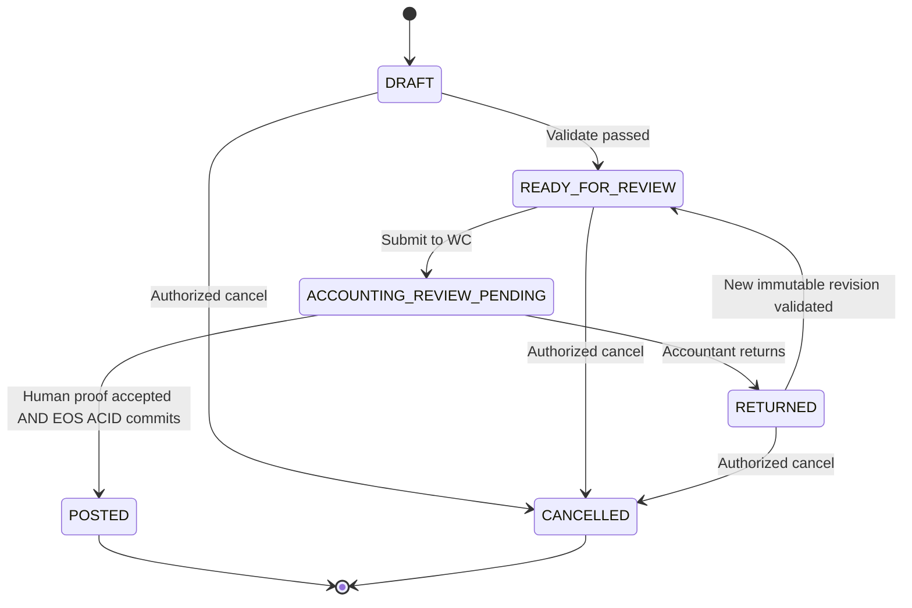

# NeX–MyBee D04/D12 EOS Software Requirements Specification v1.0

**Document ID:** `NEX-MYBEE-EOS-SRS-D04D12-20261109`  
**Status:** `IMPLEMENTATION-READY DRAFT / ARCHITECTURE-ALIGNED / ACCEPTANCE NOT EXECUTED`  
**Date:** 2026-11-09 (Asia/Seoul)  
**Target:** NeX Enterprise OS, MyBee D04 Accounting / D12 Project / shared payroll & purchase cost integration, Phase-1  
**Parent:** `NeX–MyBee D04/D12 EOS Pre-Architecture Decision v1.0`, `EOS Source Audit & Gap Analysis v1.0`, `Accounting Transaction Contract Closure v1.0-RC1`  
**Authority order:** Frozen NeX Platform v2.1 / Agent v2.1 / admitted NSL v0.2.x > NeX EOS canonical contracts > MyBee business-domain policy  
**Change control:** All changes additive / versioned, no silent frozen change; the user-approved PAD-ADR-01~15 are **retained without reversal**.  
**Assurance:** This is an implementable requirements/design specification, NOT a claim that migrations, CI tests, fiscal accounting, or production approval have already passed. Source D04/D12 PDFs are registered in MyBee GitHub but **page-by-page text inspection could not be completed via the available GitHub binary connector**; `G-SRC-PDF` remains a release gate.  
**Reference snapshots (from Source Audit):** `2607_nex_platform@c2c03b20e22691cc1984f044e0cacd5d698f9bd3`, `2608_nsl@f5d899bb611ee2cd65ce9f6544ed6e51b450b7d4`, `2611_MyBee_Blueprint@948b50fd43fc4e0f0d3f40ffd6335871ec741559`; reconfirm HEAD before committing.

---

## 0. Executive summary and mandatory FX correction

### 0.1 Purpose

MyBee is a **domain AX application running on NeX Platform v2.1**, not an architecture replacement. Establish a minimal end-to-end transaction path: **approved business proposal/document → accounting candidate → human accounting approval → atomic posted GL → eligible source-pool allocation → near-real-time Project P&L**, while preserving existing P8 / Golden A voucher draft and NSL execution semantics. The same core contracts accept future D08 payroll and D15 purchase events.

### 0.2 Highest-priority decisions carried from PAD (not reopened)

1. `NeX-WC` owns WorkItem/workflow, `NeX-OA` owns principals and authorization, `NeX-AE` operates Agent and NSL adapter, `NeX-EOS` owns business approval facts, GL, budget and allocation, `NeX-WA` owns artifact/evidence source. No cross-service database join/FK or distributed ACID.
2. Business approval (`BUSINESS_FORMAL`/`DOCUMENT_SIGNOFF`), accountant's human decision (`ACCOUNTING_POSTING`), NSL `approve` for a single WRITE, and `GL POSTED` are **different proof obligations and events**.
3. P8 `eos_voucher_draft` remains DRAFT-only and its v1 API remains compatible. A new MyBee `VoucherCandidate v2` is subject to mandatory approved-document proof; the final GL is a new immutable `PostedJournal` aggregate.
4. Company-shared accounting approval is scoped to a real LegalEntity, not a synthetic Project. Origin postings and many Project allocations have different cardinalities.
5. One EOS PostgreSQL transaction commits the posting acceptance + journal header/lines + document allowance consumption + idempotency + outbox + candidate transition, or commits **none**.
6. Management allocations reference only eligible `POSTED` GL components; P&L chooses `DIRECT` or `MANAGEMENT_ALLOCATION` or `GL_COST_TRANSFER` **exactly once per source component**. P&L is a rebuildable query model, not another GL.

### 0.3 FX-specific normative decision — `SRS-FX-001` to `SRS-FX-024`

**FX is Phase-1 P0 and must not be deferred.** `K-IFRS 1021 / IAS 21` generally requires a transaction-date **spot rate** for initial recognition and a closing rate for foreign-currency **monetary items** at reporting dates; recognizing advance consideration can require the recognition date of the non-monetary advance under `K-IFRS 2122 / IFRIC 22`. Separately, Korean tax rules reference the legally defined **매매기준율 또는 재정된 매매기준율** and a taxpayer's eligible/filing method for tax valuation. Thus, **do not encode a false invariant that K-IFRS mandates one '매매기준율' for every transaction or every item**. The business requirement is implemented as an approved, versioned `MARKET_BASE_RATE` source policy for standard Korean legal-entity bookkeeping, with transaction/closing/settlement/tax-purpose separation and exception review. No invented rate or silent manual fallback.

Important external evidence, reviewed on 2026-11-09:
- IFRS Foundation IAS 21: https://www.ifrs.org/issued-standards/list-of-standards/ias-21-the-effects-of-changes-in-foreign-exchange-rates/
- Korean Accounting Standards Board K-IFRS 1021 Q&A on recognition-date spot: https://kasb.or.kr/front/board/View016005.do?seq=38551 (published 2022-12-19; unofficial researcher rapid-response caveat applies).
- KASB K-IFRS 2122 advance consideration case: https://www.kasb.or.kr/front/board/View016005.do?ctgCd=016005&searchfield=ALL&searchword=%EC%99%B8%ED%99%94+%EC%84%A0%EC%88%98%EA%B8%88&seq=38520
- Corporate Tax Enforcement Decree Article 76 (2026-10-01 version): https://www.law.go.kr/LSW/lsLinkCommonInfo.do?lsJoLnkSeq=1018124385 and paragraph 2: https://www.law.go.kr/lsLinkCommonInfo.do?lsJoLnkSeq=1027290381
- Corporate Tax Enforcement Rule 39-2: https://law.go.kr/lsLinkCommonInfo.do?chrClsCd=010202&lspttninfSeq=58994

**Accounting sign-off required:** actual exchange rate provider, first/final publication convention, trading calendar, monetary-item classification, corporate tax election and possible policy exceptions must be approved by the company's finance/accounting owner before production seeding.

---

## 1. Status, boundaries and testable non-negotiable requirements

| ID | Requirement | Acceptance criterion |
|---|---|---|
| `SRS-ARCH-001` | Frozen NeX v2.1 responsibility map remains unchanged. | Frozen semantic file modification diff = 0; contract compatibility gate passes. |
| `SRS-ARCH-002` | Business SoR is EOS, WC SoR is workflow, OA SoR is authorization, WA SoR is original artifact. | No cross-service JOIN/FK; only API and immutable evidence ref/hash. |
| `SRS-ARCH-003` | MyBee FL-code is domain identity, not executable privilege or automatic REST/NSL Tool ID. | Unauthorized FL-code requests always denied by OA/EOS. |
| `SRS-ARCH-004` | No dual-running business GL or duplicate EOS accounting SoR inside MyBee. | Any posting to MyBee-owned GL persistence is forbidden. |
| `SRS-ARCH-005` | P8 Golden A v1 Draft remains contract stable. | Existing OpenAPI route, schema and DRAFT DB CHECK untouched; regression passes. |
| `SRS-ARCH-006` | Each EOS command uses stable `BusinessOperationId`, `IdempotencyKey`, `PayloadHash`, `TenantId`, trace. | Same key/hash replay returns original result; same key/different hash returns 409. |
| `SRS-ARCH-007` | No untrusted LLM text, draft rule or guessed exchange rate may determine a GL business fact. | Only approved/versioned rule, exact arithmetic and verified evidence used in POST. |
| `SRS-ARCH-008` | State synchronization may be eventual; GL local posting must be atomic. | WC ACK loss cannot create duplicate POSTED journal. |
| `SRS-ARCH-009` | Approved limits, company, candidate hash, monetary amount and line classification are rechecked in EOS at mutation. | Fail closed and zero half-writes for stale/malformed proof. |
| `SRS-ARCH-010` | Data classification and salary suppression apply before P&L API response. | Unauthorized raw payroll and differencing attacks have no useful response. |

**Phase-1 IN:** legal entity/master, approved account policy and K-IFRS reference, accounting period, fx rate snapshots, recognized FX journal and monetary remeasurement, D12 work-code readiness, approved-document proof, candidate v2, accountant review and atomic posting, posted journal read/reversal, cost pool/allocation, budget SoR, Project and NVT P&L, policy-aware read/query, NSL adapters, PG acceptance E2E.

**Phase-1 OUT:** full payroll taxation/social-insurance engine, bank treasury system, full consolidation/overseas subsidiaries translation, derivative hedge accounting, MPS/MRP/BOM automation, tax filings, XBRL, all statutory financial statements, every FX product. External-system import is permitted as an evidence **source** but must not bypass ledger admission.

**Assumptions requiring sign-off (not silently guessed):** functional currency per LegalEntity (KRW default only for KRW entities), source rate vendor/contract/license, rate-date business calendar, exact source account mapping seed, AP/AR monetary classification, currency exponents, rounding method, statement mapping, accountant delegation matrix, budget variance rules, P&L latency SLO, retention/legal hold.

---

## 2. Responsibility and aggregate matrix

| Aggregate (logical; physical `eos_*`) | Owner | Existing / To-Be | Transactional boundary | Key relationships |
|---|---|---|---|---|
| `BusinessOperation`, `Idempotency`, `Outbox` | EOS | REUSE `2501` | each EOS WRITE, same Unit of Work | operation → journal/batch |
| `Project`, `NVTProject`, `ProjectMember` | EOS | KEEP `2503/2504/2514` | existing Project writes | Project → company binding |
| `Account` | EOS | KEEP `2505` | v1 lookup stable | account → company policy |
| `VoucherDraft v1` | EOS | KEEP `2506` | existing P8 only | NEVER interpreted as GL posted |
| `BusinessFormalApproval v1` | EOS + WC workflow | KEEP `2509~2512` | immutable decision and proof | document proof ref |
| `LegalEntityAccounting` | EOS | NEW | EOS controlled master WRITE | company / functional currency |
| `AccountCatalogRelease / CompanyAccountPolicy / PostingRuleRelease` | EOS | NEW | immutable release publishing | account and journal line |
| `AccountingPeriod` | EOS | NEW | close or post row lock | company, fiscal period |
| `FxRatePolicy / FxRateSnapshot / FxRemeasurementRun` | EOS | NEW | rate publication separate from GL, remeasurement journal atomic | company/date/pair/rate hash |
| `ApprovedDocumentEnvelope / Consumption` | EOS | NEW | create immutable approval envelope; usage inside posting | proof → candidate(s) |
| `VoucherCandidate / Revision / Line` | EOS | NEW v2 | versioned candidate and state CAS | document, company, rate |
| `ScopedApprovalCase v2` | EOS subject + WC workflow | NEW, no duplicate engine | approval per exact subject hash | scope COMPANY/PROJECT_SET/PROJECT |
| `AccountingApprovalAcceptance` | EOS | NEW | **same transaction as GL** | human decision → candidate revision |
| `PostedJournal / JournalLine` | EOS | NEW, append-only | **same transaction as acceptance** | company, period, fx, source, reversed journal |
| `GLBalanceProjection` | EOS | NEW derived | after commit, rebuildable | journal event watermark |
| `CostSourcePool / AllocationPlan / Batch / Line / Adjustment` | EOS | NEW | allocation commit per batch | posted eligible GL components |
| `Budget / ProjectBudgetBinding / BudgetActualProjection` | EOS | NEW | budget write, bind in separate versioned operation | D04 money SoR / D12 link |
| `ProjectWorkCodeSet / WorkAssignment / BusinessReadiness` | EOS | NEW | project readiness verification | code version, PM / performer |
| `ProjectPnlProjection` | EOS | NEW derived | event projector/checkpoint, not GL | project, NVT roll-up |

**No SQLite production substitution:** PostgreSQL DDL is authoritative. SQLite may be used for unit fixtures, but FK, concurrency, unique, numeric scale, isolation and locking are proven on guarded `nex_eos_test`.

---

## 3. SRS format, common contracts and conventions

### 3.1 Requirement notation

- `MUST` = release blocker, `SHOULD` = required unless documented exception signed off, `MAY` = opt-in later. Every `MUST` maps to Test ID.
- Amounts are **decimal strings on wire**. Binary float not allowed for exchange rates or posted money. Internal Python `Decimal`; PostgreSQL `NUMERIC`. Each amount carries currency and an approved `currency_scale_policy`.
- Server time is `TIMESTAMPTZ UTC`, entity recognition date is business `DATE` in the LegalEntity's configured business timezone. Include source timezone and source timestamp for FX.
- Every new table MUST at least support `tenant_id`, immutable `company_id` where financial, UUIDv7-compatible identity (generated externally or DB), `created_at`, version/hash fields where approved, and trace/operation references. FK and UNIQUE include tenant/company where necessary.
- UUIDs are illustrative identity types, but **no cross-service FK** may be introduced. EOS-owned same-DB FK is allowed. Company identifiers are EOS-owned.
- `POSTED` is the only definitive booked financial status. `APPROVED_NOT_POSTED`, `PENDING_RECONCILIATION`, `FORECAST` must never be added to confirmed P&L actuals.
- Compensating correction means new approved reversal/adjustment entry, not deleting or editing a posted row.

### 3.2 Required common Command Envelope — `SRS-COM-001`

```json
{
  "schema_version": "eos_finance_command.v2",
  "tenant_id": "tenant-from-trusted-context",
  "company_id": "uuid-of-legal-entity",
  "business_operation_id": "uuid-stable-for-business-action",
  "idempotency_key": "semantic-stable-key",
  "payload_hash": "sha256:64-hex-of-canonical-business-payload",
  "subject_ref": {"type": "oa.user", "id": "trusted-subject"},
  "trace": {"trace_id": "id", "correlation_id": "id", "causation_id": "id"}
}
```

Illustrative fields are **not valid fixture values**. Real JSON Schema enforces syntax, canonical hashing, max sizes, route-specific required properties and extra-field rejection. Client-supplied `subject_ref` is bound to trusted OA principal, never accepted as authority by itself. Tool request `BusinessOperationId / IdempotencyKey / PayloadHash` must match the corresponding EOS command byte-for-byte semantically.

### 3.3 Uniform result/error semantics — `SRS-COM-002`

```text
COMMITTED:    original business fact exists and can be verified by canonical GET
NOT_COMMITTED: refusal proven (422/403/409, no mutation)
UNKNOWN_COMMIT_STATE: transport/ack uncertain -> QUERY by BusinessOperationId
PENDING_RECONCILIATION: query not yet decisive -> no blind new-key reissue
```

A timeout MUST NOT be converted into an assumed POSTING failure. All handlers emit stable machine-readable `error_code`, `reason`, `retryable`, `reconciliation_ref?`, `trace_id` and safe public details. Sensitive payroll amounts and proofs are not logged in user-visible errors.

---

## 4. Master Data / Project / Account / AccountingPeriod requirements

### 4.1 LegalEntity and company binding

| ID | MUST requirement | Suggested physical columns / constraints | Verification |
|---|---|---|---|
| `SRS-MST-001` | `eos_legal_entity` identifies accounting company; it is not an arbitrary Project. | `(tenant_id,company_id) PK`; `company_code UNIQUE(tenant,company_code)`, `name`, `functional_currency`, `presentation_currency`, `business_timezone`, `status`, `effective_from`, `version`. | T-MST-01 |
| `SRS-MST-002` | `eos_project_company_binding` binds Project to exactly one accounting company at an effective instant. | `binding_id PK`, `project_id FK EOS`, `company_id FK EOS`, `valid_from`, `valid_until`, `approved_proof_hash`, `state`; no overlapping active periods per Project (PostgreSQL exclusion constraint or serialized write check). | T-MST-02 |
| `SRS-MST-003` | A COMPANY/PROJECT_SET approval must include only Projects belonging to the same company at the relevant date. | Validate effective binding at approval proposal and Posting, never fabricate `OPERATING` Project to satisfy old FK. | T-MST-03 |
| `SRS-MST-004` | Functional currency is a period-sensitive accounting policy. | Once posted, currency change requires controlled future-effective revision and migration plan, no rewriting old journals. | T-MST-04 |

### 4.2 K-IFRS-based account catalogue

**Reference rule:** A K-IFRS standard does **not itself prescribe one universal numerical chart of account codes**. Use the actual MyBee-adopted chart of accounts (pending verified seed source/hash) as company-accounting base; company extensions via `FL0004011` must receive audited versioned approval. Never synthesize account codes from generic IFRS terminology.

| ID | MUST requirement | Suggested schema / behavior | Test |
|---|---|---|---|
| `SRS-ACC-001` | Keep `eos_account` v1 identity/resolver. | Existing `(tenant_id,account_id)` and `(tenant_id,account_code)` preserved, no destructive migration. | T-ACC-01 |
| `SRS-ACC-002` | `eos_account_catalog_release` is published immutable source snapshot. | `release_id`, `source_reference`, `source_version`, `source_hash`, `effective_from`, `published_by`, `approved_proof_ref`, `status={DRAFT,PUBLISHED,SUPERSEDED}`, same-tenant unique source/version. | T-ACC-02 |
| `SRS-ACC-003` | `eos_company_account_policy` binds allowed leaf/postable codes per company. | `company_id`, `account_id`, `catalog_release_id`, `parent_account_id?`, `is_postable_leaf`, `is_monetary`, `statement_line_ref`, `allowed_currencies[]`, `valid_from/until`, `rule_revision`; overlapping active policies rejected. | T-ACC-03 |
| `SRS-ACC-004` | Only active, effective, **postable leaf** accounts can be journal lines. | Check candidate VALIDATE and under Posting row lock; parent account/retired code rejected. | T-ACC-04 |
| `SRS-ACC-005` | Account category, economic category, K-IFRS recognition and statement mapping are approved data, not LLM output. | `eos_posting_rule_release` with `rule_id/version/hash/effective_date/company_id/account_mapping_hash`; rule validation deterministic. | T-ACC-05 |
| `SRS-ACC-006` | Company account addition requires human approval and new policy/cat release. | `FL0004011`, `finance:account:manage`; exact account code, parent, statement line, currency/FX item classification and duplicated code verification. | T-ACC-06 |
| `SRS-ACC-007` | Existing journal must keep the posted account snapshot even if current account later inactive. | Each JournalLine retains account_id, code snapshot and policy release/hash. | T-ACC-07 |

### 4.3 AccountingPeriod and close race

`eos_accounting_period`: `(tenant_id,company_id,period_id) PK`, unique `(tenant_id,company_id,fiscal_year,period_no)`, `start_date`, `end_date`, `state={OPEN,CLOSING,CLOSED}`, `version`, `close_proof_ref?`, `closed_at?`, `ledger_cutoff_watermark?`, `created_at`, `updated_at`. Overlapping active ranges for a company are prohibited. Posting a JournalLine requires `period.date ∈ range` and `OPEN`, and acquires a `FOR UPDATE` lock on the exact period row. Period close uses the **same row lock** and checks unsatisfied financial operations before changing state.

| ID | Requirement | Test |
|---|---|---|
| `SRS-PER-001` | No POST in `CLOSING/CLOSED`, even if original candidate was reviewed when OPEN. | T-PER-01 |
| `SRS-PER-002` | Close/post concurrency linearizes on period lock: either the post commits before close cutover or is rejected. | T-PER-02 |
| `SRS-PER-003` | Unauthorized period reopen prohibited. Reopening needs separate controlled finance policy and audit; Phase-1 normal correction posts in approved open adjustment period. | T-PER-03 |
| `SRS-PER-004` | `fx_close_rate_release` and remeasurement completion status are checked by financial close Gate. | T-PER-04 |

---

## 5. FX architecture and requirements (Phase-1 P0)

### 5.1 Terminology and legal/accounting separation

| Term | Meaning | SoR policy |
|---|---|---|
| Transaction currency | Currency on invoice/receivable/payable (e.g. USD, EUR, JPY, CNY). | Journal document/line snapshot. |
| Functional currency | Currency of the legal entity's principal economic environment (e.g. KRW for Korean entity if approved). | LegalEntity version. |
| Presentation currency | Reporting currency. | LegalEntity/report settings; do not conflate with functional. |
| `매매기준율` / market base | Legally or contractually defined/reference interbank benchmark selected by company policy; not necessarily actual bank settlement rate. | Approved rate source, date, publication issue. |
| `재정환율` / derived cross | Cross-derived rate where no direct local pair is quoted. | Rate source + base leg + quote unit + derivation hash. |
| Transaction-date spot | Rate used at initial K-IFRS recognition (or justified close approximation). | `FX_TRANSACTION_RECOGNITION` policy. |
| Closing rate | Reporting-date spot for **monetary** assets/liabilities. | `FX_MONETARY_REMEASUREMENT` policy. |
| Settlement executed rate | Actual rate/charges applied by bank on receipt/payment, if different from market base. | Bank receipt evidence and `FX_SETTLEMENT` posting. |
| Tax valuation policy | Separate legal election/valuation under applicable Corporate Tax Enforcement Decree. | `FX_TAX_VALUATION`, may produce tax-adjustment rather than GL entry. |

**Two policy tracks:** K-IFRS ledger financial results and tax evaluation are not assumed identical. The code must not infer a company's filed tax election from financial ledger policy. Any difference is tracked in a separate tax reconciliation record, not silently applied to financial GL.

### 5.2 FX policy schema and rate ingestion

**`eos_fx_rate_policy`** (versioned): `tenant_id, company_id, policy_id, version, purpose ENUM(TRANSACTION_SPOT,MONETARY_CLOSE,SETTLEMENT_REFERENCE,TAX_VALUATION), rate_kind ENUM(MARKET_BASE,DERIVED_CROSS,APPROVED_EXCEPTION), source_provider_id, publication_selector ENUM(FIRST,FINAL,AS_OF_TIMESTAMP), effective_from, effective_to, allow_previous_business_day, max_staleness_business_days, rounding_mode, rate_decimal_scale, approved_by, approval_proof_hash, policy_hash, status`. Unique effective interval per company/purpose/currency-pair rule. **Default source publication selector is unspecified until signed-off**; first/final are not interchangeable.

**`eos_fx_rate_snapshot`** (immutable): `tenant_id, rate_snapshot_id UUID PK, source_provider_id, rate_policy_id/version, base_currency, quote_currency, quote_unit NUMERIC(18,6), published_rate NUMERIC(28,12), normalized_rate NUMERIC(28,12), rate_date DATE, rate_as_of TIMESTAMPTZ, published_at TIMESTAMPTZ, publication_issue, is_final, effective_business_date, source_record_id, source_uri, source_sha256, calendar_ref, source_timezone, provenance_json, imported_at, approved_state`. Unique `(tenant_id,source_provider_id,source_record_id,publication_issue,base_currency,quote_currency,rate_date)` and raw payload hash, no post-admission UPDATE except status via controlled supersession record. FK `rate_policy` EOS-local. For JPY or other quoted-100 currencies **normalize explicitly with quote_unit**; never assume every published number quotes one unit. Provider attributes are checked and normalized by deterministic parser.

**`eos_fx_currency_precision`**: `currency_code`, `unit_scale`, `posting_rounding_mode`, `rate_precision`, `effective_from`, `catalog_ref`. Foreign amount recorded with currency exponent (e.g., USD 2; JPY 0 as configured), functional KRW posted with approved functional rounding (often 0). Intermediate values keep unrounded high-precision NUMERIC then round once at defined posting granularity; store rounding deltas explicitly.

**`eos_fx_tax_policy`**: `company_id,tax_year,method ENUM(ACQUISITION_OR_ORIGIN_DATE,YEAR_END),filing_ref?,effective_from,policy_hash,approved_by,legal_basis_version`. Only accept supported filed method and legal classification of assets; lack of filing evidence must not be silently defaulted to year-end taxable valuation.

| ID | Requirement | Acceptance |
|---|---|---|
| `SRS-FX-001` | Supports at least `USD/KRW`, `EUR/KRW`, `JPY/KRW` with configured legal-entity functional currency and **schema not hard-coded to three pairs**. Additional pair via versioned provider catalogue. | T-FX-01 |
| `SRS-FX-002` | Every foreign currency transaction retains original amount/currency and functional amount/currency. | T-FX-02 |
| `SRS-FX-003` | Every nonfunctional posting line references **immutable** rate snapshot and rate policy hash/version, unless exact recognized exception contract. | T-FX-03 |
| `SRS-FX-004` | Accounting transaction recognition date is the standards-based recognition date, not necessarily invoice issue, payment or document approval date. | T-FX-04 |
| `SRS-FX-005` | Transaction initial recognition uses policy-approved transaction-date spot/market-base reference, or documented allowed proxy. | T-FX-05 |
| `SRS-FX-006` | Quote basis (`KRW per 1 USD`, `KRW per 100 JPY`, inverted pairs, cross derivation) is normalized deterministically with no false 100x error. | T-FX-06 |
| `SRS-FX-007` | Source vendor, publication date, calendar, issue, first/final, timezone and original response hash are audit-preserved. | T-FX-07 |
| `SRS-FX-008` | Missing/stale/untrusted published rate blocks candidate validation and Posting. No LLM-generated or ad hoc online spot substitution. | T-FX-08 |
| `SRS-FX-009` | Weekend/holiday fallback only to approved previous-business-day policy; snapshot records original desired date, selected date and staleness. | T-FX-09 |
| `SRS-FX-010` | Superseding/retracted source rate triggers candidate validation recheck; if candidate rate hash changes after accounting review, new candidate revision and approval. No silent post using stale approval. | T-FX-10 |
| `SRS-FX-011` | Currency exponent and deterministic rounding are enforced; no binary float; debit/credit functional totals balance after explicit rounding adjustment when authorized. | T-FX-11 |
| `SRS-FX-012` | Nonmonetary cost items retain historical transaction rate; nonmonetary fair-value items use measurement-date rate only when separately supported/approved. | T-FX-12 |
| `SRS-FX-013` | Monetary foreign assets/liabilities (AR/AP/cash/loan) are evaluated at approved close rate in reporting period; preserve original foreign units. | T-FX-13 |
| `SRS-FX-014` | Realized FX at actual settlement is separately classified from unrealized FX remeasurement; transaction vs bank-executed rate difference is traceable. | T-FX-14 |
| `SRS-FX-015` | Revaluation journal is a new approved immutable journal; it cannot rewrite initial transaction posting. | T-FX-15 |
| `SRS-FX-016` | A close-rate correction after close follows controlled adjustment/reversal and approved open-period policy, not mutation of historical JournalLine. | T-FX-16 |
| `SRS-FX-017` | Foreign advance consideration uses documented `K-IFRS 2122 / IFRIC 22` initial advance recognition-date treatment if applicable; more complex multi-advance patterns require separate accepted case. | T-FX-17 |
| `SRS-FX-018` | Corporate tax FX method stored separately; tax valuation basis and reconciliation can be queried but may not replace K-IFRS GL rate silently. | T-FX-18 |
| `SRS-FX-019` | FX-related realized/unrealized gain/loss is separated in P&L; allocation to a Project requires explicit approved attribution policy. Default is company-unallocated. | T-FX-19 |
| `SRS-FX-020` | Foreign GL and local functional balances reconcile by currency, LegalEntity and posting period; financial P&L always uses booked functional amount, not today's ad-hoc FX. | T-FX-20 |
| `SRS-FX-021` | FX source outage after approval leaves operation blocked/pending, not posted at fabricated rate. | T-FX-21 |
| `SRS-FX-022` | Rate feed import idempotent on source record, date/issue/hash. Conflict does not overwrite an approved snapshot. | T-FX-22 |
| `SRS-FX-023` | Accounting approval UI displays source currency, amount, applied market base, reference date, publication and functional amount plus any exception. | T-FX-23 |
| `SRS-FX-024` | Source, company tax election and quote convention are approved by accounting owner prior to production; missing policy is fail closed. | T-FX-24 |

### 5.3 Journal foreign-currency model (required in Phase-1)

**`eos_journal_header`** stores `functional_currency`, `document_currency`, `posting_date`, `recognition_date`, `company_id`, `period_id`, source document/proof, `foreign_transaction_type?`, `posting_policy_hash`. Do **not** store only a converted KRW amount.

**`eos_journal_line`** (minimum):

| Field | SQL/type | Constraint / meaning |
|---|---|---|
| `tenant_id, company_id, journal_id, line_no` | text/UUID/int | PK scoped to company and journal |
| `account_id, account_code_snapshot` | UUID/text | EOS account FK, immutable account release reference |
| `debit_functional, credit_functional` | `NUMERIC(28,6)` or approved scale | Exactly one positive or zero; both positive disallowed; `Σdebit_functional = Σcredit_functional` at journal level after rounding. |
| `functional_currency` | `CHAR(3)` | Same as LegalEntity functional currency in the recorded period. |
| `transaction_currency` | `CHAR(3)` | Original currency, may equal functional. |
| `debit_foreign, credit_foreign` | `NUMERIC(28,6)` nullable | Original currency amounts for relevant line; positive amounts when applicable. Not every multi-currency journal balances separately by foreign currency. |
| `fx_rate_snapshot_id, fx_rate_policy_hash` | UUID/sha256 nullable | Required for foreign-to-functional translation; no free-text rate. |
| `rate_quote_unit, normalized_rate` | DECIMAL snapshot | Immutable display/calculation trace; source SoR is rate snapshot. |
| `recognition_date, monetary_class` | DATE / enum | `MONETARY`, `NON_MONETARY_HISTORICAL`, `NON_MONETARY_FAIR_VALUE`, `NONE`. |
| `original_document_line_ref, economic_component_id, source_transaction_ref` | stable refs | Preserve exact source and avoid duplicated pool creation. |
| `project_id?`, `work_code?`, `allocation_mode` | UUID/text/enum | Direct attribution optional; company-shared journal never forced to a Project. |
| `account_release_id, posting_rule_hash, evidence_hash` | UUID/sha256 | Freeze posting-time evaluated rules. |

**Validation:** All functional currency lines balance exactly at configured posted currency quantization. When multiple original currencies occur, foreign-currency subledger balances are validated **by currency/exposure where applicable**, not by an incorrect global `Σ foreign == 0` across incompatible currencies. A distinct, authorized ROUNDING/FX_GAIN_LOSS entry may balance functional amounts and must point to a reconciliation calculation, never a hidden mutator.

### 5.4 FX remeasurement aggregate and recognition

`eos_fx_remeasurement_run(run_id, company_id, period_id, close_rate_release_hash, source_set_hash, state, approved_document_ref, approval_ref, journal_id, business_operation_id, version)` and `eos_fx_remeasurement_line(run_id, source_monetary_item_ref, foreign_open_balance, prior_functional_carrying, close_rate_snapshot_id, remeasured_functional, delta_functional, fx_gain_loss_account_id, journal_line_id, source_hash)`.

Requirements:
- Idempotency key `tenant/company/period/close-rate-release/source-set-hash/remeasurement-kind`, with same hash returning prior result.
- Only open foreign-currency **monetary** balances (or a standards-approved exception) enter the remeasurement source set. Historical-cost nonmonetary cost accounts are excluded.
- `delta_functional = translated_close_amount - prior_carrying` with sign semantics documented; signed gain/loss creates balancing lines through the same accounting Human Approval and GL Posting flow.
- Re-running with changed official close-rate release creates approved adjustment/reversal of the earlier run; never duplicates a period's remeasurement value silently.
- The company month-end `CLOSING` gate must check remeasurement success, outstanding UNKNOWNs, GL/FX/Allocation reconciliation, or an approved close exception.

### 5.5 Worked deterministic FX acceptance examples (numbers are **fixtures**, NOT live rates)

**FX-EX-01 — USD invoice initial recognition (illustrative):** USD 10,000.00 × 1,350.20 KRW/USD = KRW 13,502,000. At recognition, eligible revenue or expense and AR/AP are booked in functional KRW at approved rate `R0`; source USD exposure and R0 snapshot are preserved. Debit and credit in functional KRW must match.

**FX-EX-02 — USD cash settlement (illustrative):** USD 10,000 settled when approved settlement reference is 1,360.30, producing KRW 13,603,000 **before separately recognized bank fees**. Difference from original receivable KRW 13,502,000 is KRW +101,000 realized FX (for positive receivable, absent intervening remeasurement). Bank **actual executed rate** and fees must be recorded with receipt as distinct evidence rather than overwritten into the transaction-date market-base snapshot.

**FX-EX-03 — JPY 100 unit:** Provider publishes KRW 960.50 / 100 JPY; normalized = KRW 9.605 / 1 JPY; 10,000 JPY = KRW 96,050 prior to policy quantization. A 100x or inverse conversion error MUST fail deterministic fixture.

**FX-EX-04 — close date:** An outstanding USD monetary liability is valued at approved closing rate at the reporting date. Nonmonetary inventory at historical cost must **not** be remeasured only because the current market base changed. Approved differences and originating journal links are visible.

**FX-EX-05 — prepaid USD advance:** If a nonmonetary advance was recognized on 2026-08-01, later recognition of the corresponding portion of revenue/asset may use that earlier rate under K-IFRS 2122; do not automatically apply the later invoice-date rate. Mark scenario as jurisdiction/policy classification gated.

**FX-EX-06 — EUR, holiday, missing rate:** If required `FINAL` issue is unavailable on a non-business day, apply only an explicitly approved last-valid-business-date policy and record selected rate date; otherwise `FX_RATE_UNAVAILABLE` with 0 journal postings.

---

## 6. Approved business document and approval proof contract

### 6.1 Approval document identity — `eos_approved_document_envelope`

| Field | Required | Contract |
|---|---|---|
| `tenant_id, company_id, envelope_id, approved_document_id` | Y | Immutable EOS tenant+company identity; document record external ref is not an authorization token. |
| `document_revision, document_type, work_code` | Y | Approved specific revision, MyBee FL-code (not access grant). |
| `document_content_hash, attachment_manifest_hash` | Y | Exact document/attachments the approver saw. Artifact itself stored in WA/approved Blob Store. |
| `business_approval_proof_id, business_proof_hash` | Y | EOS-verified `BUSINESS_FORMAL/DOCUMENT_SIGNOFF` final proof; no arbitrary string-only acceptance. |
| `approval_policy_id, approval_policy_version, approval_policy_hash` | Y | Immutable policy snapshot and chain, company/scope bound. |
| `scope_type, project_set_hash, allowed_project_ids` | Y | COMPANY, PROJECT or PROJECT_SET; no synthetic Project ID. |
| `approved_amount, approved_currency, tolerance_policy_hash?` | Y | Currency-specific limit; no automatic currency conversion of allowance. |
| `valid_from, valid_until?, state, approved_at` | Y | ACTIVE, REVOKED, EXPIRED, SUPERSEDED; no use outside validity. |
| `approved_by_principal_ref, source_work_item_ref` | Y | Real OA human principal and workflow decision evidence. |
| `payload_hash, created_business_operation_id` | Y | Stable immutable business and source identity. |

`eos_approved_document_consumption`: `consumption_id`, `envelope_id`, `source_document_line_ref`, `supplier_invoice_ref?/payroll_period_ref?`, `candidate_revision_id`, `posted_journal_id`, `consumed_amount`, `currency`, `state=COMMITTED`, `operation_id`, `posted_at`, `reversed_journal_ref?`, `hash`. Unique: `(tenant_id,company_id,envelope_id,source_document_line_ref,supplier_invoice_ref)` with explicit nullable-key normalization; and `(tenant_id,company_id,candidate_revision_id)` for posting admission. Consumption exists only if GL Commit succeeds, under same UoW and envelope lock. Summation of consumption cannot exceed approved amount or specifically approved tolerance.

| ID | Requirement | Test |
|---|---|---|
| `SRS-DOC-001` | All **new MyBee v2 candidates** reference a final approved business document and exact proof; v1 Draft continues unchanged. | T-DOC-01 |
| `SRS-DOC-002` | Proof must match company, purpose, document revision/hash, attachment manifest, policy version, validity and limit, not just contain non-null ref. | T-DOC-02 |
| `SRS-DOC-003` | A single approved document can support multiple partial invoices only when `sum(consumption) <= allowance`; duplicate invoice/source line is refused. | T-DOC-03 |
| `SRS-DOC-004` | Concurrent consumption of same envelope locks same row. Two requests cannot each consume the last amount. | T-DOC-04 |
| `SRS-DOC-005` | Foreign invoice allowance compared in its approved original currency. Different billing currency requires explicit approved amendment and deterministic conversion policy. | T-DOC-05 |
| `SRS-DOC-006` | Reversal does not automatically restore approved **business spending authority**. Restoration requires a separate controlled credit/refund or document amendment. | T-DOC-06 |
| `SRS-DOC-007` | Material modification to document amount/meaning/project-set/attachments requires revised document+fresh business proof. | T-DOC-07 |

### 6.2 Scoped ApprovalCase v2 — real company scope

`eos_scoped_approval_case(case_id, tenant_id, company_id, purpose ENUM(DOCUMENT_SIGNOFF,ACCOUNTING_POSTING), scope_type ENUM(COMPANY,PROJECT,PROJECT_SET), project_set_hash, subject_ref, subject_revision, subject_hash, requester_ref, approval_policy_hash, oa_auth_ref, state, version, created_at, decided_at?)`. `eos_scoped_approval_subject_binding(case_id, project_id, company_id, authorization_scope_hash)` has one-to-many Project membership for PROJECT_SET and no Project rows for COMPANY. Required unique `(tenant,company,purpose,subject_ref,subject_revision)` for an active case, guarded by immutable hash/version. The legacy `eos_approval_instance.project_id NOT NULL` is **not altered**.

- WC continues existing `ApprovalWorkItem` decision/workflow/event protocol, while EOS uses a v2 scoped subject binding + adapter to generate an approved WC-compatible work-item target and receive its exact decision. Do not create another workflow engine.
- The old `BUSINESS_FORMAL` domain name is reused, but **purpose** is mandatory in v2; a `DOCUMENT_SIGNOFF` proof cannot be substituted for `ACCOUNTING_POSTING`, and vice versa.
- The new v2 `AccountingApprovalEvidence` must bind `(company, candidate_id, candidate_revision, candidate_hash, document_envelope_hash, fx_rate_set_hash, rule_release_hash, accounting_period_id, approver_subject, approval_policy_hash, wc_final_decision_id, oa_authorization_revision_hash, decided_at, proof_hash)`.
- Publish only approved/redacted proof summaries to MyBee/AE. Full approval chain storage and private evidence remain EOS/WC/OA controlled.

### 6.3 Human accounting approval — rights and separation of duties

| ID | Requirement | Test |
|---|---|---|
| `SRS-APR-001` | `FL0004008` must be performed by a human currently authorized for company and `finance:journal:approve`. A job/agent cannot self-approve. | T-APR-01 |
| `SRS-APR-002` | `requester != accountant_approver` and `candidate_preparer != accountant_approver`. Same human must not be sole business approver and sole accountant for the document. | T-APR-02 |
| `SRS-APR-003` | `TEAM_LEAD` title by itself gives no accounting authority; current OA finance role/scope and company mapping are separately required. | T-APR-03 |
| `SRS-APR-004` | Accountant reviews exact immutable candidate revision + source FX snapshot/rule release + attachments. Changes invalidate review proof. | T-APR-04 |
| `SRS-APR-005` | Approval/rejection event may arrive more than once, after delay or out of order: process idempotently and reject conflicting terminal state. | T-APR-05 |
| `SRS-APR-006` | WC's APPROVED signal is **not** GL POSTED. Until EOS transaction commits, expose `ACCOUNTING_APPROVED_PENDING_POST` only as a cross-service observation. | T-APR-06 |
| `SRS-APR-007` | Verify current OA decision revision/hash/checked_at with short bounded freshness before posting, and fail closed on missing/expired/revoked evidence. | T-APR-07 |
| `SRS-APR-008` | Approval promotion, delegated authority, emergency break-glass and company cross-scope are explicit approved policies; no first-slice bypass. | T-APR-08 |

**TOCTOU:** Because EOS and OA are separate services, a globally atomic OA-revocation-vs-EOS-Commit guarantee cannot be claimed. Perform fresh OA admission immediately before EOS short transaction, bind proof to policy revision and candidate hash, monitor revocation events, and deny when evidence is stale. High-risk policies can impose a temporary Posting kill-switch; if strict distributed simultaneity is required, raise Controlled Amendment rather than claiming it exists.

---

## 7. VoucherCandidate v2, PostedJournal and state transition

### 7.1 Physical model

**`eos_voucher_candidate`**: `(tenant_id,company_id,candidate_id) PK`, `document_envelope_id FK`, `preparer_subject_id`, `source_kind`, `source_record_ref`, `business_work_code`, `transaction_currency`, `recognition_date`, `posting_period_id`, `state`, `current_revision_no`, `version`, `created_at`, `updated_at`. There is **no mandatory `project_id` in shared-candidate header**. Project list belongs in revision/line source and allocation plan.

**`eos_voucher_candidate_revision`**: `(tenant_id,company_id,candidate_id,revision_no) PK`, `revision_id`, `candidate_hash`, `source_evidence_hash`, `approved_document_hash`, `attachment_manifest_hash`, `fx_rate_set_hash`, `posting_rule_release_hash`, `account_policy_release_hash`, `journal_payload_hash`, `accounting_review_case_id?`, `created_by`, `created_at`. Immutable after create; revisions added, not overwritten.

**`eos_voucher_candidate_line`**: `(tenant,company,candidate_id,revision_no,line_no) PK`, `account_id`, `debit_original,credit_original,original_currency`, `debit_functional,credit_functional,functional_currency`, `rate_snapshot_id?`, `monetary_class`, `economic_component_id?`, `project_ref?`, `source_record_line_ref`, `description`, `evidence_hash`. Signed source amounts and functional lines balance under approved rule. No actual POST before accounting approval.

**`eos_accounting_approval_acceptance`**: `(tenant,company,acceptance_id) PK`, `candidate_id,revision_no,candidate_hash`, `approval_case_id,purpose,proof_hash,wc_decision_id,oa_decision_revision_hash,accepted_by,accepted_at, journal_id`, unique candidate revision and proof. Must be inserted in the **same EOS UoW** as `PostedJournal`; never saved on external WC event alone.

**`eos_journal_header`**: `(tenant,company,journal_id) PK`, unique `(tenant,company,candidate_id,revision_no)` for candidate posting, unique `(tenant,company,period_id,posting_sequence)`; `journal_no`, `state=POSTED`, `transaction_kind`, `recognition_date`, `posting_date`, `currency_functional`, `source_document_id/revision/hash`, `accounting_acceptance_id`, `posting_rule_release`, `fx_rate_set_hash`, `reversal_of_journal_id?`, `business_operation_id`, `idempotency_key`, `payload_hash`, `total_debit_functional`, `total_credit_functional`, `journal_hash`, `posted_at`. `eos_journal_line` fields defined in §5.3; immutable after posting. No trigger or API to mutate/delete posted amounts.

`eos_gl_balance_projection` (derived): `(tenant,company,period,account,fx_currency,project_scope?,journal_watermark)` keyed balance, rebuilt deterministically from PostedJournal; no independent money source of truth. Protect direct raw reads.

### 7.2 Normative state machines



**Cross-service projection (not candidate DB state):** `ACCOUNTING_APPROVED_PENDING_POST` (WC decision is approved but EOS commit pending), `RECONCILIATION_REQUIRED`, `STALE_REVIEW`. When `STALE_REVIEW`, candidate returns to `RETURNED` or creates new review revision according to governed transition; it must never be directly POSTED. No `POSTED -> DRAFT/RETURNED` transition. Reversal creates a new `PostedJournal`.

| ID | Requirement | Test |
|---|---|---|
| `SRS-VCH-001` | v2 candidate cannot be created before final business signoff. | T-VCH-01 |
| `SRS-VCH-002` | Candidate revisions immutable and hash-bound to approved source/rate/rule; CAS on current version for transitions. | T-VCH-02 |
| `SRS-VCH-003` | Candidate cannot advance to POSTED on WC decision alone. | T-VCH-03 |
| `SRS-VCH-004` | Candidate review changes invalidate accounting proof; must resubmit. | T-VCH-04 |
| `SRS-VCH-005` | `ΣDr = ΣCr` for functional currency after rounding. Invalid currency, period or account blocks POST. | T-VCH-05 |
| `SRS-VCH-006` | Existing v1 `eos_voucher_draft` DB state restriction `DRAFT` and v1 API untouched. | T-VCH-06 |
| `SRS-VCH-007` | A candidate must produce at most one POSTED Journal; retry and concurrent threads return same journal. | T-VCH-07 |
| `SRS-VCH-008` | Reversal follows fresh approved document and accounting approval path; former Journal remains immutable and referenced. | T-VCH-08 |

### 7.3 Atomic Posting requirement (the primary safety property)

**`FINANCE.VOUCHER.APPROVE_AND_POST`** logical operation creates a new immutable GL journal, validates approved accountant evidence, and writes all EOS-local facts atomically. WC coordination and OA lookup happen outside the SQL transaction; no external HTTP, embedding, file read, LLM or distributed lock while holding EOS row locks.

```text
PRECONDITIONS (outside SQL, fail closed)
  Trusted service token + NSL verified Skill Artifact + current OA admission
  Authenticated EOS business document proof, WC accounting decision evidence
  Candidate immutable revision, account policy, company, period, FX rate hashes

BEGIN EOS POSTGRES UoW                    # single local ACID transaction
  1. Reserve stable BusinessOperationId / idempotency identity.
  2. Lock company-period + candidate state/CAS + document allowance (consistent lock order).
  3. Recheck same company, revision, exact approved evidence hashes, OA freshness.
  4. Recheck period OPEN, account leaf/effective, applicable FX, functional balance.
  5. Verify proof purpose ACCOUNTING_POSTING, human principal, SoD, policy/case.
  6. Insert immutable accounting acceptance (with journal FK resolved in same UoW).
  7. Insert immutable JournalHeader+all JournalLines and configured FX snapshots.
  8. Insert unique consumption(s); CAS candidate state into POSTED.
  9. Commit BusinessOperation result, idempotency result and new Outbox event.
COMMIT EXACTLY ONCE

AFTER COMMIT (async, no impact on GL consistency)
  Outbox publication, GL query/verification, SourcePool eligibility projector,
  allocation/budget/P&L projector, WA trace projection.
```

In implementation, if FK insertion order requires allocating stable `journal_id` before acceptance and journal rows, allocate IDs before transaction; choose an insert order that respects database constraints. **Do not create a second nested transaction** inside the existing EOS `EosBusinessTransactionCoordinator` mutation callback. Contract acceptance/Posting fact is atomic inside EOS; WC human decision is **not** rewritten in EOS as a distributed transaction.

**Unique constraints and locks**:
- `UNIQUE(tenant_id, company_id, candidate_id, candidate_revision)` on PostedJournal.
- `UNIQUE(tenant_id, company_id, acceptance_proof_hash)` on acceptance; reject cross-purpose or replay with conflicting candidate.
- `UNIQUE(tenant_id, company_id, period_id, posting_sequence)`; allocate sequence under company/period lock, not `MAX(seq)+1` without lock.
- ApprovedDocument usage locked by envelope, each source billing line unique; check `sum + requested <= approved` in same DB transaction.
- Candidate and accounting period row `FOR UPDATE`; deterministic lock order documented to prevent deadlock.
- A `SerializationFailure` / deadlock is retried **only** under the same idempotency identity and after authoritative EOS query, never via an unbound new operation ID.

### 7.4 Journal correction / reversal

`FL0004010` corresponds to a fresh `REVERSAL` candidate referencing exact `original_journal_id`, `reason`, `accounting_period` and authorized correcting document. Reverse original debit/credit in a new `POSTED` journal, preserve original status and make direction/net-effect a query projection. Any source allocations from original journal must be compensated with new allocation adjustment/reversal; the system may not modify a closed period or delete posted lines.

---

## 8. D12 Project and business code readiness

The five mandatory MyBee project governance FL-codes are `FL0012004` Project open, `FL0012005` Work-set approve, `FL0012006` PM designate, `FL0012013` Progress aggregate, `FL0012026` Project close. These are **required work-code set entries**, not instructions to close the Project on creation. Other minimum accounting-related codes are added by project template and approval.

**`eos_project_work_code_set`**: `(tenant_id,project_id,set_id,revision)`, `template_ref/version`, `work_code_catalog_hash`, `mandatory_codes_hash`, `approved_proof_ref`, `state`, `effective_from/until`. **`eos_project_work_assignment`**: `assignment_id`, `project_id`, `work_code`, `work_set_revision`, `performer_kind={HUMAN,AGENT}`, `subject_ref`, `assignment_scope`, `planned_man_days`, `planned_grade_id`, `valid_from/until`, `policy_ref`, `approved_by`; *no personal salary field*. **`eos_project_business_readiness`** derived-or-versioned state with `required_codes_ok`, `project_company_bound`, `pm_assigned`, `members_eligible`, `budget_bound_if_required`, `state={DRAFT_CONFIGURATION,WORK_SET_APPROVED,MEMBER_READY,BUSINESS_READY,BLOCKED}`, `reason_codes`, `source_hash`.

| ID | Requirement | Test |
|---|---|---|
| `SRS-PRJ-001` | Preserve existing Project 3-depth, NVTProject and membership creation/API. | T-PRJ-01 |
| `SRS-PRJ-002` | Newly created MyBee Project cannot run protected PA Domain WRITE until `BUSINESS_READY`. Existing P8 `ACTIVE` project remains backward compatible. | T-PRJ-02 |
| `SRS-PRJ-003` | The mandatory 5 FL-codes cannot be removed or silently replaced from approved work set. | T-PRJ-03 |
| `SRS-PRJ-004` | PM (human role) and PA (persistent Agent identity) are distinct; one active PA logical identity per Project under AE Registry rule. | T-PRJ-04 |
| `SRS-PRJ-005` | Project Member grants no universal FL-code execution authority. Each assignment must be valid in OA scope, role and time. | T-PRJ-05 |
| `SRS-PRJ-006` | Grade-based planning Man-Day and private actual payroll cost are separated. No employee salary in standard PA/PM read. | T-PRJ-06 |
| `SRS-PRJ-007` | Project close checks outstanding unposted candidates, unallocated source cost, period/foreign-currency reconciliation and incomplete approvals; no silent close. | T-PRJ-07 |
| `SRS-PRJ-008` | Work-set change adds immutable revision and triggers authorization/readiness revalidation, not history rewrite. | T-PRJ-08 |

---

## 9. Cost Source Pool, Project Allocation and accounting reconciliation

### 9.1 Minimal physical schema and immutable references

**`eos_cost_source_pool`**: `(tenant,company,pool_id) PK`, `journal_id FK EOS`, `journal_line_no`, `eligible_component_id`, `source_kind={PAYROLL,PURCHASE,SERVICE,SHARED_EXPENSE,REVENUE,FX_GAIN_LOSS,OTHER}`, `allocation_mode={DIRECT,MANAGEMENT_ALLOCATION,GL_COST_TRANSFER}`, `source_amount_functional`, `eligible_amount_functional`, `functional_currency`, `account_id`, `monetary_class`, `recognized_at`, `source_record_ref`, `source_hash`, `pool_state={OPEN,ALLOCATED,REVERSED,ON_HOLD}`, `source_journal_hash`, `created_at`. Unique `(tenant,company,journal_id,journal_line_no,eligible_component_id)`. Pool can be built ONLY from authenticated POSTED ledger lines, with eligibility verified according to K-IFRS financial recognition and account policy. No pooling AP liability, unremitted withholding liability, cash movement, unconsumed inventory/asset or deferred cost solely because cash was paid.

**`eos_cost_allocation_plan`**: `plan_id`, `company_id`, `plan_revision`, `source_kind`, `scope_type`, `basis_kind={ACTUAL_WORK,APPROVED_PLAN,USAGE,HEADCOUNT_CASCADE,JUSTIFIED_PERCENTAGE}`, `rule_release_hash`, `basis_source_ref/hash`, `effective_start/end`, `approved_by`, `approved_proof`, `state`, `plan_hash`. Multiple Project lines with line-specific work code, basis units, eligibility, confidentiality; plan's version is immutable after approval.

**`eos_cost_allocation_batch`**: `batch_id`, `company_id`, `plan_id/revision`, `period_id`, `source_set_hash`, `functional_currency`, `state={DRAFT,COMMITTED,RECONCILIATION_FAILED,REVERSED}`, `allocated_total`, `unallocated_total`, `reconciliation_hash`, `business_operation_id`, `idempotency_key`, `outbox_event_id`, `committed_at`. A committed batch and all lines written together in single EOS ACID.

**`eos_cost_allocation_line`**: `(tenant,company,batch_id,line_no) PK`, `pool_id`, `project_id`, `work_code?`, `basis_source_ref/hash`, `basis_units`, `allocation_ratio`, `allocated_amount_functional`, `rounding_delta`, `allocation_mode`, `original_source_line_ref`, `evidence_hash`, `status`. Company binding and Project membership validated; allocations carry **no raw salary/pay-slip**. Source lineage can reference protected private payroll store IDs but must redact them from normal Project reads.

**`eos_cost_allocation_adjustment`**: `adjustment_id`, `original_batch_line_ref`, `original_journal_ref`, `new_journal_ref?`, `delta_amount`, `reason`, `effective_period`, `approved_proof`, `operation_id`, `adjustment_hash`. Append-only; never UPDATE original line. One-source correction cannot generate unlimited duplicate adjustments.

### 9.2 Conservation and eligibility invariants

For each **source economic component** `s` in *one company and functional currency*:

```text
E_s = eligible signed POSTED-GL component
D_s = recognized direct Project attribution
A_s = recognized management allocation (sum Project lines)
U_s = explicit company/OPERATING/unallocated residue
E_s = D_s + A_s + U_s                 # signed algebra for reversal/revenue
```

The source pool is not an extra expense and must not be added on top of journal cost. For simple positive expense components each term is non-negative; for negative/reversal/revenue use signed conservation and documented direction. `DIRECT`, `MANAGEMENT_ALLOCATION`, `GL_COST_TRANSFER` are **mutually exclusive per source component**. Internal GL transfer journals must not create new eligible corporate economic expense in aggregate. Each `GL_COST_TRANSFER` mode uses only authorized transfer ledger lines and excludes duplicate Management Allocation.

**Deterministic allocation:** freeze approved basis and source version; calculate `exact_share = eligible_amount * weight/sum(weights)` at high precision, quantize at company functional currency posting scale, distribute remaining smallest unit by stable sort `(approved_priority, project_id, work_code)` with persisted `rounding_delta`. `sum(lines)+unallocated == eligible_amount` **exact**, never floating tolerance. For zero eligible amount create a zero-result verified batch, not synthetic cost.

**Cross-period FX:** source eligible amount uses the **booked functional journal amount** on the correct recognition date; never reconvert that amount using today's rate for Project P&L. Approved FX differences are separate GL components with separate allocation classification and policy; normally `company-unallocated` unless there is a well-grounded approved Project economic attribution.

### 9.3 Domain adapters without duplicate GL

| MyBee source | Business code | Source facts | Eligibility / allocation |
|---|---|---|---|
| D08 payroll group total | `FL0008013`, `FL0008022`, `FL0004052` | Approved group/company payroll evidence, one company GL with salary expense/liability split | Pool only cost components; payroll withholding, unpaid tax etc. are liability, **not second company cost**. Monthly work logs → approved plan → participation fallback. |
| D12 project labor plan | `FL0012044`, `FL0012008` | Work-code × performer planned MD + approved grade | Planning baseline only; actual derived from posted payroll, privacy/rights hold. |
| D15 common purchase | `FL0015009`, `FL0015010`, `FL0015017`, `FL0015019` | One approved PO, many Project pegged lines, receipts, invoice | Unconsumed lot remains inventory asset; cost Pool after appropriate consumption/impairment or direct expense recognition. |
| Shared office/software/cloud | `FL0005005` etc. | Approved payment/relevant expense recognition, license/usage/seat evidence | Approved actual usage, planned allocation, or justified ratio. Bank payment alone is not expense proof. |
| Revenue recognized to Project | D11/D14 + D04 | Posted recognized revenue, company/document scope and project attribution | DIRECT when supported or governed AllocationPlan; avoid duplicated sales/receipts. |
| Currency exchange gain/loss | `FL0004019` | FX rate snapshot / original AR/AP and settlement/revaluation GL | Default company-level separate KPI, Project attribution only by approved economic policy. |

### 9.4 Requirements

| ID | MUST requirement | Test |
|---|---|---|
| `SRS-ALC-001` | Only `POSTED`, eligible account components may enter SourcePool. | T-ALC-01 |
| `SRS-ALC-002` | One source journal line+economic component has at most one active pool; event redelivery is idempotent. | T-ALC-02 |
| `SRS-ALC-003` | No cash/AP/withholding/inventory asset incorrectly recognized as Project expense. | T-ALC-03 |
| `SRS-ALC-004` | Shared purchase source may have zero/many Projects; cost distribution after valid expense recognition. | T-ALC-04 |
| `SRS-ALC-005` | Project member PA cannot infer individual payroll cost from allocation rows/API. | T-ALC-05 |
| `SRS-ALC-006` | GL source component conservation holds exactly at configured precision. | T-ALC-06 |
| `SRS-ALC-007` | Deterministic weight sort/rounding yields byte-identical lines with same source+plan/rules. | T-ALC-07 |
| `SRS-ALC-008` | Duplicate/parallel RUN same identity produces one committed Batch. | T-ALC-08 |
| `SRS-ALC-009` | Posted Journal reversing forces a new negative adjustment/compensation and P&L rebuild, no prior line deletion. | T-ALC-09 |
| `SRS-ALC-010` | Any FX cost component uses booked functional value and policy-approved direction. | T-ALC-10 |
| `SRS-ALC-011` | Source line direct and management allocation mutually exclusive. | T-ALC-11 |
| `SRS-ALC-012` | All allocations check Project/company effective binding at the source date; illegal cross-company target fails. | T-ALC-12 |
| `SRS-ALC-013` | Partial/unallocated pool remains explicit, traceable, NOT hidden as Project A cost. | T-ALC-13 |
| `SRS-ALC-014` | Allocation batch emits an outbox event and source/plan/hash reconciliation proof atomically. | T-ALC-14 |
| `SRS-ALC-015` | Annual actual payroll cost adjustment uses a new approved journal and allocation adjustment; locked budgets remain original. | T-ALC-15 |

---

## 10. Budget SoR, Project P&L and NVT rollup

### 10.1 Physical model

`eos_budget`: `budget_id,company_id,fiscal_year,account_id?,budget_category,approved_currency,approved_functional_amount,version,approved_proof,source_hash,state`. D04 `FL0004012` owns money authority. `eos_project_budget_binding`: `binding_id,project_id,budget_id,allocation_limit/percent,approved_work_set_revision,approved_proof,valid_dates,version` — D12 `FL0012008` owns the Project-budget link, never independently changes `eos_budget` amount. `eos_budget_execution_projection` derived from Posted Journal/Allocation with idempotent event watermark and source references. `eos_project_pnl_projection` keyed `(tenant,company,project_id,period_id,projection_version,posting_watermark,allocation_watermark)`, rebuilt from journals + allocation; not an independent amount register.

### 10.2 Query model and classification

| Field | Semantics |
|---|---|
| `posted_revenue` | Recognized POSTED GL revenue directly attributable/allocated, company functional currency. |
| `posted_direct_cost` | Recognized eligible direct Project expense from POSTED journal. |
| `posted_allocated_cost` | Reconciled management allocations of eligible POSTED expenses. |
| `posted_operating_result` | Revenue − direct cost − allocated cost, with cost sign convention normalized. |
| `fx_realized_gain_loss, fx_unrealized_gain_loss` | Explicit subcomponents **with scope classification**, not implicitly double counted in operating result. |
| `operating_or_unallocated_cost` | Company/common or OPERATING Project residue; no invented distribution. |
| `planned_budget, budget_actual, budget_variance` | Approved budget, actual derived from POSTED+Allocation, variance with approved sign policy. |
| `approved_not_posted, forecast` | Separate informational fields excluded from confirmed P&L. |
| `accounting_status, reconciliation_status` | Verified / PENDING / BLOCKED / PARTIAL; errors never hidden as success. |
| `as_of, posting_watermark, allocation_watermark, fx_rate_release_ref, staleness_seconds` | Evidence of recency/consistency; users distinguish P&L lag from zero expense. |

`NVTProject` rollup uses an acyclic Project ancestry and **each leaf economic component exactly once**; the NVT mother Project must not also double count child totals. Currency differences: no rollup across distinct functional currencies without a separately approved presentation-currency conversion policy; Phase-1 company scope is one functional currency and cross-company rollup is not a valid accounting assertion.

### 10.3 P&L security

| ID | Requirement | Test |
|---|---|---|
| `SRS-PNL-001` | Confirmed result based on Posted GL / reconciled Allocation only. | T-PNL-01 |
| `SRS-PNL-002` | Unposted approval, PO, payroll draft, cost plans, projections remain visibly non-final. | T-PNL-02 |
| `SRS-PNL-003` | NVT ancestor rollup includes each descendant only once and shows missing reconciliation. | T-PNL-03 |
| `SRS-PNL-004` | OA `project:pnl:read`/company scopes required; group/company management gets authorized cross-Project aggregate. | T-PNL-04 |
| `SRS-PNL-005` | Payroll-specific small-cell suppression and repeated filter/subtraction defense. The private payroll owner may view source on separate scope, not general PA. | T-PNL-05 |
| `SRS-PNL-006` | `as_of` + GL/Allocation watermarks mandatory; eventual lag explicitly reported. | T-PNL-06 |
| `SRS-PNL-007` | Authorized P&L response includes FX realized/unrealized as separately classifiable income/cost. | T-PNL-07 |
| `SRS-PNL-008` | Same request/version/watermarks results identical for replay; correction creates new projection version. | T-PNL-08 |
| `SRS-PNL-009` | FX monetary and functional amounts never mixed in single total without approved presentation currency conversion. | T-PNL-09 |
| `SRS-PNL-010` | A closed/idle projection is not represented as near-real-time current; return `stale` metadata or 503 when policy requires. | T-PNL-10 |

**Proposed performance SLO (to approve; not an observed measurement):** after a committed `FINANCE.JOURNAL_POSTED` event, P&L projection refresh `p95 <=30 sec`, `p99 <=120 sec` under signed pilot workload; interactive scoped P&L read `p95 <=2 sec` with 50 concurrent authorized users. If consumer is late, report exact watermark/staleness, not a made-up 'real-time' assurance. Performance numbers are **Phase-1 acceptance targets subject to load-profile sign-off**, not measured values.

---

## 11. Canonical EOS API surface v2 (proposed implementation endpoints)

Every operation requires trusted service caller, exact tenant/company identity, audience `nex-eos`, route-specific OA business scope, `schema_version`, trace, typed errors. Paths are **new proposals**, not claims of existing routes. Exact operation-ID registry collision checks are a gate before implementation. v1 routes remain untouched.

| Canonical operation ID | Method / proposed route | Owner | Request/response essence | Approval / scope |
|---|---|---|---|---|
| `FINANCE.LEGAL_ENTITY.GET` | GET `/internal/v2/finance/legal-entities/{id}` | EOS | company functional currency/period | `finance:company:read` |
| `PROJECT.WORK_CODE_SET.GET` | GET `/internal/v2/projects/{id}/work-code-set` | EOS | set revision and readiness | `project:work-code:read` |
| `PROJECT.WORK_CODE_SET.APPROVE` | POST `/internal/v2/projects/{id}/work-code-set:approve` | EOS | approved work-code revision | `project:work-code:approve` + business proof |
| `FINANCE.ACCOUNT.CATALOG_GET` | GET `/internal/v2/finance/accounts/catalog` | EOS | approved catalog, company leaf/effective filter | `finance:account:read` |
| `FINANCE.ACCOUNT.CREATE_APPROVED` | POST `/internal/v2/finance/accounts:create-approved` | EOS | new approved account/release | `finance:account:manage` + human proof |
| `FINANCE.PERIOD.GET` | GET `/internal/v2/finance/periods/{id}` | EOS | state, close/version | `finance:period:read` |
| `FINANCE.PERIOD.CLOSE` | POST `/internal/v2/finance/periods/{id}:close` | EOS | close result/reconciliation proof | `finance:period:close` + human proof |
| `FINANCE.FX_RATE.IMPORT` | POST `/internal/v2/finance/fx-rate-batches` | EOS | signed source batch and normalized snapshots | `finance:fx:publish` + source approval |
| `FINANCE.FX_RATE.RESOLVE` | GET `/internal/v2/finance/fx-rates:resolve` | EOS | company/purpose/date/pair exact snapshot/policy/hash | `finance:fx:read` |
| `BUSINESS.DOCUMENT_APPROVED.GET` | GET `/internal/v2/finance/approved-documents/{id}` | EOS | verified proof, remaining allowance, hashes | `finance:document:read` |
| `FINANCE.VOUCHER_CANDIDATE.CREATE_V2` | POST `/internal/v2/finance/voucher-candidates` | EOS | document proof + company + draft lines => candidate/revision | `finance:voucher-candidate:create` |
| `FINANCE.VOUCHER_CANDIDATE.VALIDATE` | POST `/internal/v2/finance/voucher-candidates/{id}:validate` | EOS | policy/rate/period/evidence/SoD precheck, no POST | `finance:voucher-candidate:validate` |
| `FINANCE.ACCOUNTING_APPROVAL.REQUEST` | POST `/internal/v2/finance/accounting-approval-cases` | EOS/WC | company-scoped case to WC Human Gate | `finance:journal:request-approval` |
| `FINANCE.VOUCHER.APPROVE_AND_POST` | POST `/internal/v2/finance/journals:approve-and-post` | EOS | candidate revision+human proof+FX/rule hashes => posted Journal | `finance:journal:post` + accountant approval proof |
| `FINANCE.JOURNAL.GET` | GET `/internal/v2/finance/journals/{id}` | EOS | immutable header/lines/rate/evidence | `finance:journal:read` |
| `FINANCE.JOURNAL.VERIFY` | GET `/internal/v2/finance/journals/{id}/verification` | EOS | original operation/posted hash/balance/period | `finance:journal:verify` |
| `FINANCE.JOURNAL.RECONCILE` | GET `/internal/v2/finance/business-operations/{id}/journal-status` | EOS | authoritative state after uncertain ACK | `finance:journal:reconcile` |
| `FINANCE.JOURNAL.REVERSE` | POST `/internal/v2/finance/journals/{id}:reverse` | EOS | **new** approved reversal candidate, not direct mutation | `finance:journal:reverse` + human proof |
| `FINANCE.FX_REMEASUREMENT.RUN` | POST `/internal/v2/finance/fx-remeasurement-runs` | EOS | create approved remeasurement candidate/case; separately POST | `finance:fx:remeasure` + approval |
| `FINANCE.COST_ALLOCATION.RUN` | POST `/internal/v2/finance/cost-allocation-batches` | EOS | approved plan + posted pool + signed amounts | `finance:allocation:execute` |
| `FINANCE.COST_ALLOCATION.VERIFY` | GET `/internal/v2/finance/cost-allocation-batches/{id}/verification` | EOS | conservation, source version, hash | `finance:allocation:verify` |
| `FINANCE.PROJECT_PNL.GET` | GET `/internal/v2/finance/projects/{id}/pnl` | EOS | scoped P&L with watermark + privacy | `project:pnl:read` |
| `FINANCE.NVT_PNL.GET` | GET `/internal/v2/finance/nvt-projects/{id}/pnl` | EOS | authorized deduplicated rollup | `finance:pnl:company-read` or stricter per scope |

**Request boundaries:** `validate` is a read/validation (even if POST as HTTP request with no business mutation); approval request **does not** approve; approve-and-post refuses the wrong approval purpose. Write authorization is enforced in **EOS**, not solely at API Gateway/AE. A MyBee FL-code has no direct account create, approve or post authorization.

### 11.1 VoucherCandidate CREATE_V2 example (structural sample, not production fixture)

```json
{
  "schema_version": "eos_voucher_candidate_create.v2",
  "tenant_id": "tenant-A",
  "company_id": "aaaaaaaa-aaaa-4aaa-8aaa-aaaaaaaaaaaa",
  "business_operation_id": "bbbbbbbb-bbbb-4bbb-8bbb-bbbbbbbbbbbb",
  "idempotency_key": "tenant-A/company-A/PO-123/invoice-2026-11-001/rev1",
  "payload_hash": "sha256:HASH_OF_CANONICAL_PAYLOAD",
  "business_approval": {
    "envelope_ref": "eos.approved_document:doc123:r3",
    "purpose": "DOCUMENT_SIGNOFF",
    "approved_document_hash": "sha256:HASH_OF_APPROVED_DOCUMENT"
  },
  "candidate": {
    "recognition_date": "2026-11-09",
    "document_currency": "USD",
    "source_ref": "mybee.purchase_invoice:INV-001",
    "lines": [
      {"line_no": 1, "account_ref": "eos.account:expense", "debit_foreign": "1000.00", "currency": "USD", "fx_rate_snapshot_ref": "eos.fx_rate:R1"},
      {"line_no": 2, "account_ref": "eos.account:payable", "credit_foreign": "1000.00", "currency": "USD", "fx_rate_snapshot_ref": "eos.fx_rate:R1"}
    ]
  }
}
```

**Important:** `HASH_OF...`, `eos.account:expense`, and human-readable IDs above are placeholders; golden test fixtures MUST use valid UUIDs and canonical SHA256 hashes computed by the shared hash function. External source adapter may compose lines but EOS independently validates policy/FX. Real candidate and approval schema are `additionalProperties:false` and modelled with `allOf` conditional required fields for foreign lines.

### 11.2 Approve-and-Post v2 minimal schema contract

```text
Required input:
  tenant_id, company_id, business_operation_id, idempotency_key, payload_hash
  candidate_id, candidate_revision_id, candidate_revision_no, candidate_hash
  document_envelope_id, document_revision_hash, document_business_proof_hash
  accounting_approval_case_id, accounting_decision_id, accounting_proof_hash
  oa_decision_ref, oa_revision_hash, authorization_checked_at
  posting_rule_release_hash, fx_rate_set_hash, accounting_period_id
  prepared_journal_payload_hash, trace

Committed output:
  commit_state=COMMITTED, posted_journal_id, journal_no, posted_at,
  candidate_ref/revision/hash, posting_acceptance_ref,
  business_operation_id, immutable_journal_hash,
  outbox_event_ref, verification_ref

Uncertain result:
  commit_state=UNKNOWN_COMMIT_STATE (provider-side observation),
  business_operation_id, reconciliation_ref, no fabricated journal ID
```

Company/amount/period/FX/policy in the approval case and candidate MUST exactly match the Posting command. On full deterministic failure, no acceptance/journal/consumption/outbox rows may remain.

---

## 12. OA authorization / data protection contract

### 12.1 Scope matrix

| Action | Required OA scope (proposed, exact registry validation before freeze) | Additional evidence |
|---|---|---|
| View company account/period | `finance:account:read`, `finance:period:read` | tenant/company + accounting org, confidentiality |
| Publish account, posting rule | `finance:account:manage` | human formal approved policy and SoD |
| Publish or correct exchange rate source | `finance:fx:publish` | signed provider evidence + accounting policy approver |
| Query FX / FX evidence | `finance:fx:read` | company + source data classification |
| Create v2 candidate | `finance:voucher-candidate:create` | signed business document proof, project/company scope |
| Request accountant review | `finance:journal:request-approval` | candidate ready + WC adapter + current OA |
| Decide accountant review | `finance:journal:approve` | **human** + accounting role+company+SoD, exact candidate revision |
| Execute GL Posting | `finance:journal:post` | trusted service + bound accounting human proof + fresh OA, no agency approval |
| Read/verify/reconcile GL | `finance:journal:read/verify/reconcile` | company/line-level classifications + protected evidence |
| Reverse journal | `finance:journal:reverse` | new correction document and accounting Human Gate |
| Revalue monetary FX | `finance:fx:remeasure` | approved period/rate + human accounting approval for resulting journal |
| Run allocation | `finance:allocation:execute` | approved cost plan, financial company and GL source |
| View Project P&L | `project:pnl:read` | project membership, company, payroll privacy suppression |
| View aggregated company P&L | `finance:pnl:company-read` | company management scope and salary-safe projection |
| Query private payroll source | `hr:payroll:cost:read` (separate private role) | HR/finance restricted view, not Agent/PM default |
| Approve Project work-code set | `project:work-code:approve` | verified human and Project role/ready policy |

Scope names above are **additive contract candidates**; SRS freezes their meaning, but implementations must confirm there is no existing OA scope collision and register them under a governed transition. No scope is derived solely from the fact that a person has a MyBee FL business code, has `TEAM_LEAD` title, or is a Project Member.

### 12.2 SoD and sensitive-data invariants

- `SRS-SEC-001`: Reject requests with mismatched tenant/company across principal, proof, document, period, account, Project, FX snapshot and Journal.
- `SRS-SEC-002`: Reject accountant self-review of candidate or sole circular business+accountant approvals; deny expired/delegation-revoked scope.
- `SRS-SEC-003`: Audit all approval/policy/rate/catalog changes with actual `oa.user` and evidence refs. Agent is not a human approver.
- `SRS-SEC-004`: Payroll private actual cost and employee IDs may exist only in protected payroll/expense source; Project allocation projection redacts small samples, per-line worker identification and difference attacks.
- `SRS-SEC-005`: Finance Accounting Human Inbox shows original currency, market base rate source and functional amounts; masked personal source as required.
- `SRS-SEC-006`: Deny unbounded list/read and cross-tenant inference via not-found vs forbidden responses; use consistent resource-scoped privacy semantics.
- `SRS-SEC-007`: Audit traces include proof/FX/journal hashes and masked references; never store full credentials, raw bearer tokens, private wage data or sensitive documents in Outbox events.
- `SRS-SEC-008`: FX provider failure is not an authorization exception; only separately authorized policy change may permit an alternate source, with immutable provenance.
- `SRS-SEC-009`: Include tenant isolation RLS or exact guarded repository predicates, company-qualified foreign keys and negative multi-tenant tests.

---

## 13. NSL v0.2.x Canonical Tool Contracts / AE Runtime Bindings

### 13.1 Frozen technical contract preservation

**Confirmed constraint:** NSL v0.2 defines WRITE kinds `CREATE` and `CREATE_DRAFT`; admitted **v0.2.1** extends with `UPDATE`. There is **no admitted `POST` OperationKind** in the reviewed v0.2.1 update record, and `TRANSACTION` capability is reserved. Therefore **never add an unsupported `operation_kind: "POST"` to NSL or alter NSL runtime/compiler**. `FINANCE.VOUCHER.APPROVE_AND_POST` uses `capability:WRITE`, `operation_kind:CREATE` because it **creates a new immutable PostedJournal** in one EOS provider transaction. `FINANCE.JOURNAL.REVERSE` also creates a **new reversal journal**, not mutates an old one. The HTTP business operation name may contain `POST`, but Tool `OperationKind` remains a currently allowed enum.

The provider-specific EOS endpoint, credentials, mapping and DB implementation live in AE Runtime Tool Binding / EOS Canonical Business API. NSL compiler/runtime owns only provider-independent Tool Contract, typed Result, preconditions, single atomic write, approval/evidence/verification. Workflow routing is WC, not NSL.

| Canonical Tool ID v2 proposal | Capability | NSL OperationKind | Risk | Verification | Note |
|---|---|---|---|---|---|
| `BUSINESS.DOCUMENT_APPROVED.GET` | READ | — | R2 | immutable proof hash | No direct finance WRITE |
| `FINANCE.ACCOUNT.CATALOG_GET` | READ | — | R1/R2 | catalog release | leaf/effective account |
| `FINANCE.FX_RATE.RESOLVE` | READ | — | R2 | FX snapshot hash | no runtime guessed rate |
| `FINANCE.VOUCHER_CANDIDATE.CREATE_V2` | WRITE | `CREATE_DRAFT` | R3 | `CANDIDATE.GET/VERIFY` | strict business proof first |
| `PROJECT.WORK_CODE_SET.APPROVE` | WRITE | `UPDATE` under **admitted NSL 0.2.1** | R4 | work-set GET | blocked on unadmitted wheel |
| `FINANCE.ACCOUNTING_APPROVAL.REQUEST` | WRITE | `CREATE` | R4 | approval-case GET | only creates a request |
| `FINANCE.VOUCHER.APPROVE_AND_POST` | WRITE | `CREATE` | R5 | `FINANCE.JOURNAL.VERIFY` | creates immutable journal, not `POST` kind |
| `FINANCE.JOURNAL.REVERSE` | WRITE | `CREATE` | R5 | reversal Journal GET | fresh human proof required |
| `FINANCE.FX_REMEASUREMENT.RUN` | WRITE | `CREATE_DRAFT`/`CREATE` depending on admitted candidate creation contract | R4 | run/candidate GET | cannot auto-POST without gate |
| `FINANCE.COST_ALLOCATION.RUN` | WRITE | `CREATE` | R4 | `FINANCE.COST_ALLOCATION.VERIFY` | creates immutable batch |
| `FINANCE.PROJECT_PNL.GET` | READ | — | R2 | watermark/reconciliation | privacy-filtered by EOS |

**Version gate:** Package/wheel digest, compiler admission profile and tool contract ID are pinned before new operations are enabled. If a required OperationKind is unsupported in the admitted runtime, the operation must fail closed; do not use dynamic string or patched compiler as workaround. Existing `FINANCE.CREATE_VOUCHER_DRAFT` v1 and AE `build_eos_create_voucher_command()` remain unchanged, even though its `business_approval_proof_ref` is None. New adapter must be independent.

### 13.2 Required WRITE semantics — normative

For each new WRITE Tool:

```yaml
capability: WRITE
operation_kind: CREATE            # or admitted CREATE_DRAFT / UPDATE, never POST
write_semantics:
  side_effect: true
  atomicity: ATOMIC               # provider EOS-local mutation
  idempotency:
    required: true
    scope: TOOL_AND_TENANT
    duplicate_behavior: RETURN_ORIGINAL_RESULT
    payload_conflict_behavior: IDEMPOTENCY_CONFLICT
  commit:
    confirmation: EXPLICIT
  approval:
    required: true               # NSL execution gate; not accounting Human Decision
  preconditions:
    supported: true
  verification:
    tool_id: FINANCE.JOURNAL.VERIFY
    consistency_hint: READ_AFTER_WRITE_STRONG
```

This is **semantic pseudocode**, not an asserted drop-in validated JSON Schema. Its actual fields/types must be passed through `nsl.api` and canonical Tool Registry tests. Tool READ must accept necessary tenant/company/journal/candidate and be permission-aware. Do not expose raw SQL, external FX vendor secrets or general unrestricted project payroll reads through the NSL runtime.

### 13.3 AE adapter and source implementation candidates

| Layer | Existing source reusable | Additive new module(s), provisional names |
|---|---|---|
| AE request admission | `services/nex-ae-api/nex_ae_api/nsl_controlled_write_integration.py`, `nsl_idempotency.py` | `nsl_eos_accounting_posting.py`, `nsl_eos_candidate_v2.py` |
| AE verified EOS execution | `nsl_eos_write_execution.py` v1 pattern | `nsl_eos_journal_execution.py` (new) |
| AE commit reconciliation | `nsl_eos_reconciliation.py` | `nsl_eos_journal_reconciliation.py` |
| AE verification | `nsl_eos_post_write_verification.py` | `nsl_eos_journal_verification.py`, `nsl_eos_allocation_verification.py` |
| EOS canonical store | `business_transactions.py`, `approval_transitions.py` | `accounting_periods.py`, `fx_rates.py`, `voucher_candidates.py`, `journals.py`, `cost_allocations.py`, `project_pnl.py` |
| EOS exposed routes | `app.py`, `voucher_api.py` | `finance_v2_api.py` / scoped routers |
| NSL Skill/Tool samples | `examples/voucher_draft_validation`, `examples/golden_a_voucher_draft`, `examples/project_operations` | new versioned `examples/mybee_accounting` without replacing prior files |
| Contract registry | `contracts/openapi/nex-eos.openapi.yaml`, new JSON Schema directory | Additive path/operation entries, new positive and negative fixtures |

**NSL post-write verification:** Journal Verification must observe actual source `journal_hash`, accepted candidate/proof IDs, company, period, functional balance and BusinessOperation committed identity. **`UNKNOWN_COMMIT_STATE` -> reconcile EOS by same business_operation_id -> verify journal**. Verification failure after a confirmed POSTED does not delete or blindly re-post. `COMMITTED + VERIFICATION_FAILED` is a separate protected failure condition and operations alert.

---

## 14. Controlled error catalogue and recovery

| Error code (proposed) | HTTP | Meaning / side effect | Recovery |
|---|---:|---|---|
| `DOCUMENT_APPROVAL_REQUIRED` | 422 | Missing/unfinished business approval; no candidate | Submit to WC document approval. |
| `DOCUMENT_PROOF_MISMATCH` | 422 | Wrong revision, company, hash, purpose or attached content; no POST | New signed document revision or corrected binding. |
| `DOCUMENT_ALLOWANCE_EXCEEDED` | 409 | Approved consumption remaining insufficient; no POST | Obtain increased approved amount or correct duplicated source. |
| `ACCOUNTING_APPROVAL_REQUIRED` | 422 | Accountant Human Proof absent/not final | Request accounting Human review. |
| `ACCOUNTING_PROOF_PURPOSE_MISMATCH` | 422 | Business signoff proof used as accounting proof | Proper ACCOUNTING_POSTING case. |
| `ACCOUNTING_SOD_DENIED` | 403 | Human creator/requester and accounting checker separation violated | Assign eligible independent accountant. |
| `OA_SCOPE_DENIED` | 403 | Current scoped entitlement insufficient | Authorized user must act; no system override. |
| `OA_AUTHORIZATION_STALE` | 409/503 | Time/revision freshness invalid, dependency failure | Reauthorize; fail closed pending external check. |
| `CANDIDATE_REVISION_STALE` | 409 | Approved hash/revision no longer current | Revalidate and request approval again. |
| `ACCOUNT_NOT_POSTABLE` | 422 | Missing/inactive/non-leaf account | Approved chart policy correction. |
| `ACCOUNTING_PERIOD_NOT_OPEN` | 409 | Closing/closed period or date out of range | Correct in approved open period. |
| `JOURNAL_UNBALANCED` | 422 | Functional debit/credit inconsistent | Fix approved candidate and reapprove. |
| `JOURNAL_ALREADY_POSTED` | 200 replay / 409 | Same vs conflicting identity | Return original vs conflict. |
| `IDEMPOTENCY_CONFLICT` | 409 | Same key different semantic payload | Investigate, never silently generate new key. |
| `FX_RATE_UNAVAILABLE` | 422/503 | No approved rate for required pair/purpose/date | Publish approved rate or explicitly govern exception. |
| `FX_RATE_STALE_OR_UNTRUSTED` | 422 | Expired/untrusted/superseded source | Reimport valid source, re-review candidate. |
| `FX_QUOTE_CONVENTION_INVALID` | 422 | Bad quote unit/pair/inversion | Correct provider-specific deterministic mapping. |
| `FX_POLICY_NOT_APPROVED` | 403/422 | Missing legal entity/approval/fx source policy | Accounting policy sign-off. |
| `FX_REMEASUREMENT_INELIGIBLE` | 422 | Nonmonetary or already revalued source | Remove or adjust under approved accounting case. |
| `ALLOCATION_SOURCE_NOT_POSTED` | 422 | Draft/approved only source | Wait for posted GL and verified source pool. |
| `ALLOCATION_CONSERVATION_FAILED` | 422 | Component E != D+A+U | Fix basis/mapping/rounding; no committed batch. |
| `ALLOCATION_MODE_CONFLICT` | 409 | Direct and management/GL transfer double claim | Classify source component once. |
| `PROJECT_COMPANY_SCOPE_MISMATCH` | 403/422 | Allocation target in another legal entity | Correct company/project binding. |
| `PROJECT_BUSINESS_NOT_READY` | 409 | Missing MyBee mandatory work codes/PM/work assignments | Complete D12 gates. |
| `PAYROLL_PRIVACY_DENIED` | 403 / redacted | Raw wage/private small-cell read | Return approved aggregate only. |
| `GL_POSTING_PERSISTENCE_UNAVAILABLE` | 503 | DB transaction could not finish reliably | Query BusinessOperation before retry. |
| `UNKNOWN_COMMIT_STATE` | 202/typed NSL unknown | Acknowledgment/transport uncertain | Reconcile by stable operation ID; never new-key replay. |
| `COMMITTED_VERIFICATION_FAILED` | typed runtime | EOS committed but verification/read rejected | Retain GL, alert, reconcile; no duplicate. |

**Error mapping rule:** HTTP statuses are recommended first-party server mappings. Contract tests pin the actual typed error schema. For an ambiguous network failure, HTTP 503 alone cannot prove non-commit; the caller must enter UNKNOWN/reconciliation.

---

## 15. Database migration plan, concurrency model, audit and immutability

### 15.1 Migration principles

All migrations are additive under `database/nex-eos/migrations/`, use the existing service-owned migration runner. The reviewed EOS branch ended at `2515_eos_worker_heartbeat`; **migration numbers below are logical batches only**, not hard-coded sequential filenames until current HEAD is checked. New table names must be verified for collisions. Do not modify frozen history, existing `2501~2515` SQL, current `eos_voucher_draft.state='DRAFT'` CHECK, old OpenAPI paths, or v1 Tool semantics.

| Logical migration group | Additive tables / purpose | Depends |
|---|---|---|
| M-A | LegalEntity/ProjectCompanyBinding, approved account-release/policy, accounting period | existing `eos_project`, `eos_account` |
| M-B | FX source policy, currency precision, immutable rate snapshots, tax policy | M-A |
| M-C | ApprovedDocumentEnvelope/Consumption, ScopedApprovalCase v2 SubjectBinding | existing EOS WC-proofs and M-A |
| M-D | VoucherCandidate/Revision/Line, accounting acceptance, JournalHeader/Line | M-A/B/C |
| M-E | FX monetary remeasurement source/run, GL balance projection | M-D |
| M-F | Project WorkCodeSet/Assignment/BusinessReady, Budget/ProjectBinding | M-A |
| M-G | CostSourcePool/Allocation Plan/Batch/Line/Adjustment | M-D/F |
| M-H | BudgetActual/ProjectPnlProjection, projector checkpoints | M-D/G/F |

Every financial row includes company-qualified FK references within EOS and UTC metadata, conflict-stable UUIDs, and indexes supporting `(tenant,company,date/period)` and `(tenant,company,project,watermark)` queries. Source document references point across service boundaries by cryptographic ref/hash, not relational FK.

### 15.2 PostgreSQL constraint and lock rules

1. `eos_journal_header` state `POSTED` only; block UPDATE/DELETE of posted header and lines with DB roles/trigger. External connection has no arbitrary table write grant.
2. Foreign snapshot `published_rate > 0`, `quote_unit > 0`, currency code differs as required; canonical decimal scales verified. `fx_rate_snapshot` content hash immutable; if corrected create a superseding revision.
3. `debit_functional >= 0 AND credit_functional >= 0 AND NOT(both > 0) AND (one > 0)` on each economically posted line; do not accept blank zero-zero lines unless a separately specified memo-line type in a non-GL table.
4. `ΣDr==ΣCr` is a **journal aggregate** invariant; a per-row CHECK is insufficient. Enforce in the EOS posting UoW and with an appropriate deferred constraint/verification strategy (depending on insertion pattern) before commit. PostgreSQL smoke tests must prove unbalanced manual attempts cannot commit through application roles.
5. `UNIQUE(tenant,company,candidate_id,revision)`, `UNIQUE(tenant,company,document_consumption_source_identity)`, `UNIQUE(tenant,company,journal_id)` and idempotency keys enforce same identity exactly once.
6. Candidate/version transitions use CAS `WHERE version=expected`; period and approval allowance use row locks. Lock order agreed and tested: **period → document envelope → candidate → source reference/operation**, or equivalent deterministic total order; avoid deadlock under 20 concurrent writers.
7. No network call while holding PostgreSQL open TX. Fresh OA/auth and WC proof resolved before TX, recorded immutable evidence verified again locally in TX.
8. Outbox event and mutation commit in same TX; publisher can redeliver, consumers dedupe by `(tenant,event_id)`, check source hash and stable watermark.
9. Repository bootstrap includes migration checksum drift detection and guarded `nex_eos_test` resets; avoid using production DB for fault-injection.
10. Journal closed-period correction requires new open-period approved reversal/adjustment; fixed old journal amount data is never changed.

### 15.3 Operational events and P&L projector

New versioned EOS outbox event registry: `FINANCE.VOUCHER_CANDIDATE_READY.v1`, `FINANCE.ACCOUNTING_APPROVAL_ACCEPTED.v1` (emit only with committed PostedJournal if acceptance is posting-local), `FINANCE.JOURNAL_POSTED.v1`, `FINANCE.JOURNAL_REVERSED.v1`, `FINANCE.FX_RATE_PUBLISHED.v1`, `FINANCE.FX_REMEASUREMENT_POSTED.v1`, `FINANCE.COST_ALLOCATION_COMMITTED.v1`, `FINANCE.PROJECT_PNL_REFRESHED.v1`. Preserve old `{BUSINESS_TRANSACTION_COMMITTED,VOUCHER_DRAFT_CREATED}`. Financial events contain IDs/hash/status/watermark and non-sensitive company/project scope only; no employee salary.

Projector checkpoint is committed idempotently with derived projection update. Out-of-order events are buffered or re-read by authoritative posted source. Never assume event delivery order equals financial date order. Replay must not duplicate GL cost or salary. After reconciliation, verify by `(company,period,source-component)` and watermark. Consumer downtime means `stale`, not incorrect GL state.

---

## 16. PostgreSQL acceptance / negative / fault-injection tests

### 16.1 Test environment and coverage

- Dedicated `nex_eos_test` PostgreSQL only; same canonical migrations, real FK/CHECK/UNIQUE/partial indexes, real concurrent session locking. Never run reset/fault tests on development or production DB.
- Unit/contract tests may use fixture DB; PostgreSQL smoke must explicitly exercise transaction failure after partial line inserts, deadlock/retry, proof-hash CAS, period close and idempotency/ACK uncertainty.
- Suggested new test files: `tests/test_nex_eos_mybee_accounting_master.py`, `tests/test_nex_eos_mybee_fx.py`, `tests/test_nex_eos_mybee_approval_v2.py`, `tests/test_nex_eos_mybee_journal_postgres.py`, `tests/test_nex_eos_mybee_allocation_postgres.py`, `tests/test_nex_eos_mybee_pnl_privacy.py`, `tests/test_nex_ae_mybee_nsl_contracts.py`, `tests/test_mybee_d04_d12_end_to_end.py`. New filenames are candidates; check current test naming conventions before code.
- Release quality floor for new EOS code: **statement >=96%, branch >=94%** and full regression/contract/negative gate PASS (existing NSL release quality floors remain as defined in that repo, not replaced by EOS thresholds).
- Every failing test must state **expected returned error, expected side effects, expected original state**. Coverage alone is not proof of data correctness.

### 16.2 Contract, master and FX test matrix

| Test ID group | Case matrix (each MUST be implemented) | Pass criteria |
|---|---|---|
| `T-MST-01..04` | LegalEntity create/dedup; Project company rebind effective boundary; mixed company approval reject; functional currency revision after prior posting | No cross-company posting, old history unchanged |
| `T-ACC-01..07` | v1 account resolver regression, seeded release hash, parent non-postable, inactive/out-of-effective account, K-IFRS mapping missing, unauthorized FL0004011, existing journal snapshot after policy retirement | All bad postings 0, historic posted journal intact |
| `T-PER-01..04` | closed period; 20 concurrent post-vs-close races; reopen unauthorized; FX close rate missing at period close | Zero posted-in-closed, deterministic serial result |
| `T-FX-01..04` | USD/EUR/JPY and extra currency schema; original/functional preservation; immutable snapshot and policy; invoice date vs recognition date | Accurate FX snapshot/hashes, correct legal date |
| `T-FX-05..08` | initial spot reference exact; 100JPY quote-unit/inversion; first/final issue reproducibility; missing or stale rate fail-closed | USD 10,000 × 1,350.20 = 13,502,000; JPY 10,000 × 9.605 = 96,050 fixture |
| `T-FX-09..12` | holiday previous business day with approved max-staleness; rate source supersession after approval; rounding/decimal; historical-cost nonmonetary no close remeasurement | Same rate chosen deterministically, old approval invalidated if hash changes |
| `T-FX-13..16` | monetary closing rate; settled AR/AP realized gain/loss; immutable FX adjustment; remeasurement correction only via approved journal | Differences separately booked, old JournalLine never changed |
| `T-FX-17..20` | IFRIC22 advance; company tax election separate from GL; FX gain default unallocated; multi-currency subledger versus functional GL balance | No tax-policy override, no foreign-currency cross-add |
| `T-FX-21..24` | external source outage; duplicate provider import; accountant UI evidence view; reject unpublished tax/source policy | Source failure cannot produce POSTED; no guessed rates |

### 16.3 Approval, Posting, allocation and P&L tests

| Test group | Required cases | Pass criteria |
|---|---|---|
| `T-DOC-01..07` | no business signoff, wrong hash/tenant/company, two concurrent last-allowance invoices, foreign-currency allowance mismatch, reversal allowance non-restore, attachment replacement/new revision | No unapproved candidate/POST, consumption never exceeds approved amount |
| `T-APR-01..08` | nonhuman approval, preparer self-approval, TEAM_LEAD without finance role, candidate mutation after approval, duplicate/out-of-order WC events, approved-but-not-posted projection, OA revocation/freshness, no breakglass bypass | SoD enforced, 0 wrong-authority POSTED |
| `T-VCH-01..08` | candidate before document; revision immutable; WC APPROVED alone; new revision invalidates; unbalanced FX functional; v1 DRAFT invariant; parallel same candidate Posting; approved reversal | Exactly one Journal or none as contract |
| `T-PRJ-01..08` | P8 Project/owner regression, five FL-code set missing, mandatory code removal, PM vs PA identity, member no FL privilege, grade-vs-actual privacy, close with pending transactions, work code revision CAS | Protected PA action requires BusinessReady |
| `T-ALC-01..05` | unposted source, duplicate event, inventory/withholding rejection, one shared invoice multiple Projects, salary reconstruction denial | No double count or private wage disclosure |
| `T-ALC-06..10` | exact conservation, stable rounding repeated result, 20 parallel batch calls, reversal adjustment, FX booked functional amount | `E=D+A+U`, no extra expense, one batch |
| `T-ALC-11..15` | DIRECT vs MANAGEMENT conflict, cross-company allocation, explicit residual, outbox atomicity, year-end payroll adjustment | No conflicting mode, original unchanged |
| `T-PNL-01..05` | posted-only numbers, pending separation, NVT unique ancestry, authorization, single-person/averaging/differencing suppression | Confidential data not inferable and no overcount |
| `T-PNL-06..10` | stale watermark, FX gain/loss separate, same projection replay, KRW/JPY aggregation denial, consumer unavailable | Correct provenance and `stale` truth |
| `T-SEC-01..09` | each SEC invariant in §12.2 including tenant isolation, principal-to-OA trust, event redaction, FX source exception deny | Fail closed, no secrets leaked |

### 16.4 Critical fault and concurrency test gates

| ID | Fault injection point | Expected database state after failure |
|---|---|---|
| `T-ACID-01` | Fail after acceptance INSERT but before JournalHeader INSERT | No acceptance, no journal, no document consumption, no committed BusinessOperation/outbox. |
| `T-ACID-02` | Fail after JournalHeader and 2 of 3 JournalLines | No header/lines or side effects after rollback. |
| `T-ACID-03` | Fail after approved-document consumption INSERT before candidate CAS | No consumption, no journal, candidate not POSTED. |
| `T-ACID-04` | Fail after candidate CAS but before Outbox INSERT | No candidate POSTED, no journal, no acceptance/consumption. |
| `T-ACID-05` | Network ACK lost **after committed Journal** | Original journal retrievable by same operation ID; retry new key forbidden. |
| `T-ACID-06` | Same idempotency key and equal hash, 20 concurrent calls | Precisely 1 new posted journal, all other results REPLAY/consistent. |
| `T-ACID-07` | Same idem key but changed payload/rate/proof | All conflicting calls 409; original GL unchanged. |
| `T-ACID-08` | Period-close vs Posting with 20 writers | Each journal committed strictly before close or rejected after close; 0 partial. |
| `T-ACID-09` | Two invoices consume last approved amount concurrently | Total consumption <= approved; exactly allowed subset commits. |
| `T-ACID-10` | WC event duplicate/late/out of order | 1 proof acceptance for exact candidate, no false promotion. |
| `T-ACID-11` | OA authorization revoked just before Posting admission | Current failed check prevents Posting. Note unavoidable cross-service race is monitored, not falsely asserted to be global ACID. |
| `T-ACID-12` | Outbox publisher down after successful GL COMMIT | GL remains POSTED; projector reports stale; recovery delivers once semantically. |
| `T-ACID-13` | Allocation batch line #N failure or sum mismatch | No allocation batch committed, no Project P&L refresh pretending success. |
| `T-ACID-14` | FX publisher changes rate issue between review and post | Review hash mismatch; blocked and new revision required. |
| `T-ACID-15` | Source FX record corrected after Journal has POSTED | Existing posted rate hash intact; adjustment requires approved new Journal. |
| `T-ACID-16` | `COMMITTED` but remote verification denied/timed out | Provider state remains committed, reconciliation alert raised, 0 duplicate Journal. |
| `T-ACID-17` | Remeasurement job repeated with same period/rate/source hash | 1 adjustment journal, original result returned, no double FX profit. |
| `T-ACID-18` | Unauthorized raw SQL manual attempt to UPDATE/DELETE posted JournalLine | Database role/trigger rejects modification. |

**Gate:** `T-ACID-01..18` PASS under real PostgreSQL and authoritative EOS/AE/WC/OA integration is mandatory before production activation. Full E2E and reliability acceptance must run with injected failures. Do not claim these tests passed just because source code compiles.

### 16.5 Property-based checks (recommended; high leverage)

- Random positive/negative eligible amount across N Project weights, 0/1/N rounding remainder and 1-cent/1-KRW rounding cases → exact conservation and stable result hash.
- Random currency pair rate quote units 1/100/1000, inversion, locked scale and close/report dates → exact Decimal conversion, no overflow or underflow, no 100x bug.
- Generate state transition sequences and reject any path from DRAFT or APPROVED_NOT_POSTED directly to Journal except proven Human Accounting Approval + EOS ACID.
- Multiple approval document partial-consumption orders → sum limit independent of concurrency scheduling.
- Multiple NVT tree shapes (up to 3 EOS hierarchy levels) → one-time descendant inclusion, no cycle.

---

## 17. Canonical E2E acceptance — mandatory business outcome

### 17.1 `E2E-D04D12-FX-01`: approved USD shared purchase, accountant approval, posting and project cost

**Test fixtures only** (not live rates): legal entity C (`functional=KRW`), Projects A and B linked to company C, each `BUSINESS_READY` with mandatory five work codes. PO/expense invoice USD 10,000.00; approved initial recognition-date market base rate 1,350.20 KRW/USD; 40% actual eligible consumption A, 60% B. This example assumes the purchase constitutes an **immediately recognized service/expense**, not inventory. Inventory receipt must be tested separately as asset with **no** premature Project cost.

| Step | Responsible context | Operation + mandatory assertion |
|---:|---|---|
| 1 | D12 → EOS | Project A/B company binding, work-code sets, PM/PA, BusinessReady verified. |
| 2 | D15/MyBee → WC/EOS | One company `PURCHASE_APPROVAL` document USD 10,000.00 submitted. WC Human business approval completes. EOS verifies immutable `BUSINESS_FORMAL/DOCUMENT_SIGNOFF` proof, hash, revision, amount, vendor and company. |
| 3 | MyBee/FX → EOS | Resolve approved initial recognition-date USD/KRW `MARKET_BASE_RATE` (fixture R=1,350.20), publication source/issue/calendar/hash pinned. |
| 4 | AE/NSL → EOS | `FINANCE.VOUCHER_CANDIDATE.CREATE_V2`: create company-scoped candidate with Dr approved service expense KRW 13,502,000 and Cr USD payable KRW 13,502,000, original USD amount preserved. No GL before accounting review. |
| 5 | EOS → WC/OA | Request `ACCOUNTING_POSTING` Human Approval for exact candidate revision/rate/document. OA resolves company-scoped accountant; maker/checker and business/accounting SoD verified. |
| 6 | Human accountant → WC/EOS | Accountant approves exact candidate. WC decision alone leaves `ACCOUNTING_APPROVED_PENDING_POST` observation, `GL POSTED=0`. |
| 7 | AE/NSL → EOS | `FINANCE.VOUCHER.APPROVE_AND_POST` uses approval proof + current OA evidence, period lock, Decimal validation, document consumption. One EOS ACID commits `Journal=POSTED` + proof acceptance + consumed allowance + idempotency + outbox. |
| 8 | EOS → P&L projector | SourcePool created from eligible expense JournalLine only; AP liability line excluded, all original USD/KRW/rate hashes traceable. |
| 9 | EOS allocation | Approved allocation plan A 40%, B 60% uses expense KRW 13,502,000 -> A KRW 5,400,800, B KRW 8,101,200. Exactly conserved and 0 unallocated in this fixture. |
| 10 | EOS READ / executive IA | `FINANCE.PROJECT_PNL.GET` returns A cost 5,400,800, B cost 8,101,200; NVT rollup exactly 13,502,000; correct watermarks. `approved_not_posted=0` after Posting; no duplicate cost from AP liability. |
| 11 | EOS verification | Reverse trace each P&L cost line to AllocationBatch/Pool/JournalLine/RateSnapshot/AccountingApproval/BusinessDocument, with role-based confidentiality. |

**Explicit E2E assertions:**

```text
BusinessApprovedWithoutAccountingProof => PostedJournalCount = 0
AccountingApprovedWithoutEOSCommit    => PostedJournalCount = 0
AcceptedPOSTED                         => PostedJournalCount = 1
JournalDrFunc                         == JournalCrFunc == 13,502,000 KRW
Allocation_A + Allocation_B            == 5,400,800 + 8,101,200 == 13,502,000 KRW
DirectCostForSameSource                == 0 when mode=MANAGEMENT_ALLOCATION
Unallocated                            == 0 for this exact example
NVT rollup                             == A+B (source included once)
IdempotentPostingReplay                => exactly one journal and one usage record
```

### 17.2 `E2E-D04D12-FX-02`: recognized USD receivable and subsequent settlement

1. One approved foreign revenue case at USD 10,000 × 1,350.20 = KRW 13,502,000; `AR` and revenue booked, original USD exposure retained.
2. At settlement, bank received USD 10,000 at actual settlement rate 1,360.30 (assuming no prior remeasurement), receipt KRW 13,603,000; difference KRW +101,000 is a separately booked **realized exchange gain** for a receivable, with bank fee if any in its own line.
3. Actual bank execution quote is not silently overwritten into prior official transaction-rate snapshot. Original journal and settlement journal link through AR reference; company/currency unit and both immutable rate evidence are traceable.
4. If prior monetary remeasurement occurred, settlement FX gain must be calculated against carrying amount **after** remeasurement (avoids cumulative double recognition).
5. Project revenue is recognized once; FX realized gain is company-unallocated unless approved Project attribution policy says otherwise. NVT operating P&L cannot inadvertently include gain twice.

### 17.3 `E2E-D04D12-FX-03`: close-rate remeasurement / company tax policy

- Open foreign AR/AP balance; retrieve approved reporting-date closing spot/market-base snapshot under Finance FX policy; remeasure **monetary** item, produce accounting-approved candidate and new journal in OPEN period, with balance carried forward and disclosure of unrealized FX gain/loss.
- Historical-cost nonmonetary inventory from foreign purchase **not** remeasured by month-end FX only.
- Corporate tax valuation policy's reporting method is stored and independently reconciled; if it differs from K-IFRS, query indicates difference rather than rewriting GL amount.
- Period-close gate tests missing close rate/revaluation → blocked close, not fabricated zero FX.

### 17.4 Additional E2E lanes

| ID | Scenario | Exit criteria |
|---|---|---|
| `E2E-D04D12-01` | Korean KRW direct expense Golden business approval + accountant proof + journal + P&L | Source/approval trace full; no FX required. |
| `E2E-D04D12-02` | Shared salary total + group/company voucher + plan/actual MD allocation | No personal payroll leak; no duplicated withholding expense. |
| `E2E-D04D12-03` | Shared purchase inventory 120 units with A 40, B 60 consumed and 20 surplus | Only economically consumed expense into P&L; 20 asset units exclude cost until disposal. |
| `E2E-D04D12-04` | Exact approved business doc partial invoices and concurrent Posting | Total allowance no overconsumption, duplicate invoice blocked. |
| `E2E-D04D12-05` | Error after JournalLine #2, rollback and same-id reconciliation | Half-post count 0, original state stable. |
| `E2E-D04D12-06` | APPROVED accounting human event delivered twice before Posting | Exactly one proof acceptance/journal, WC/EOS state distinct. |
| `E2E-D04D12-07` | P8/Golden A existing v1 Voucher Draft path | Byte/semantic contracts preserved, result still DRAFT; no mandatory new proof for old v1. |
| `E2E-D04D12-08` | Statement/rate policy change after review | Candidate blocked until new approved revision; existing POSTED immutable. |
| `E2E-D04D12-09` | Project/NVT P&L suppressed for unauthorized/small payroll group | No private inference or cross-tenant data. |

**All E2E lanes are required for formal Phase-1 closure except explicit later-domain full business functionality**; the payroll/purchase lanes may be run on controlled source fixtures if entire D08/D15 engines are out of scope.

---

## 18. Implementation slices and formal release gates (PAD S0~S8 preserved)

This is **SRS sequencing guidance**, not a substitute for next `Implementation Slice Plan`. Each Slice is an independently testable Codex task family. Any 'complete' claim must attach actual test output, PostgreSQL database identity, source commit and signed approval when applicable.

| PAD Slice | Implementable SRS deliverables | Key source files to REUSE / ADD | Exit Gate |
|---|---|---|---|
| `S0` Frozen/Golden A baseline | pin exact master, contract and wheel hashes, record current EOS migration head/test baseline, snapshot C1~C6/ADR-01~15 | Frozen v2.1, `voucher_commands.py`, current Golden A tests | Existing v1 Draft contract + NSL/Approval regression pass; Frozen delta=0 |
| `S1` Master/Project readiness | EOS LegalEntity, ProjectCompanyBinding, account release/company policy, AccountingPeriod, mandatory WorkCodeSet/BusinessReady, **FX rate source/policy/precision** | `projects.py`, `project_operations.py`, `accounts.py`, new migration groups M-A/B/F | valid company and five FL-code gate; official approved FX source; T-MST/ACC/PER/FX source tests |
| `S2` Business envelope and company-scoped approval | immutable business document, consumption identity/limit, `ScopedApprovalCase v2` adapter, evidence/SoD, WC event mapping | existing `approval_instances.py`, `approval_transitions.py`, WC/OA; new M-C | original approved proof bound, double-consumption concurrency; `T-DOC/T-APR` |
| `S3` Candidate v2, rule/FX validation | immutable candidate revisions/lines, recognized dates, FX source fields/hashes, READY/RETURNED transitions and accountant approval request | `vouchers.py` **v1 preserved**, new M-D + `finance_v2_api.py` | unbalanced, wrong FX, stale proof and account reject before review |
| `S4` Human accountant and atomic GL Posting | OA purpose/scope, immutable `AccountingApprovalAcceptance`, JournalHeader/Line, exact review hash, Posting UoW and outbox | `business_transactions.py` reuse; new M-D and posting module | `T-ACID-01..11`, human proof, `POSTED` 1-or-0, full DB rollback |
| `S5` Reversal, period, FX remeasurement, verification | journal reversal, close/post race, FX closing monetary run, realized/unrealized FX, GL query and reliable unknown commit reconciliation | existing AE reconcile/verification adapter patterns, new M-E | `T-FX-12..24`, `T-ACID-12,14..18`; originals immutable |
| `S6` Allocation source and ledger | eligible GL source pool, immutable plans/batches/lines, shared payroll/purchase and FX classification, deterministic rounding | new M-G, D08/D15 controlled adapters | `T-ALC-01..15` and exact reconciliation |
| `S7` Budget SoR, NVT Project P&L | finance budget master + project binding, authorized P&L projections, FX gain/loss and watermark privacy | new M-H + P&L service/query, Project tree reuse | `T-PNL-01..10`, no payroll inference, rollup once |
| `S8` Tool/E2E/Legacy closure | registered versioned NSL Tool + AE binding, accepted wheel, MyBee business FL-code mapping, full cross-domain E2E and negative PG gates | existing NSL 0.2.x artifacts, `contracts/`, `tests/` | All E2E, P8/Golden A, Postgres race/fault and docs source gates PASS |

**Build note:** S4 must NOT be exposed as a production endpoint until both S2/S3 proof semantics and S1 official FX policy are satisfied; S7 P&L must not claim confirmed financial totals until S4/6 reconcile. S5 (FX closing) is P0 alongside transaction FX; it is not optional for a system that claims complete foreign-currency period-end GL.

### 18.1 Release gates (reproducible evidence)

| Gate | Mandatory evidence | Threshold |
|---|---|---|
| `G-ARCH` | Frozen file and semantic contract diff; NSL wheel lock hash | 0 unauthorized changes; admitted wheel |
| `G-V1` | Golden A original call, response, payload hash & DRAFT check contract | 100% existing regressions pass |
| `G-DOC` | DocumentProof, exact revision and allowance exhaustion tests | 0 unauthorized candidates/POSTs |
| `G-HUMAN` | Accountant SoD, OA current scope, company approval v2 | 0 agent/self/cross-scope approvals accepted |
| `G-GL-ACID` | PostgreSQL fault/race `T-ACID-01..18` | 0 partial GL and 0 duplicate POSTED |
| `G-FX` | All `SRS-FX-001..024`, rates provider/election sign-off | 100% deterministic fixtures, missing rate fail closed |
| `G-ALLOCATION` | Pool/Plan/Batch tests, purchasing asset treatment | every eligible component `E=D+A+U` exact |
| `G-PNL` | Scope/salary-safe NVT rollup and watermark | no duplicate totals or unauthorized wage inference |
| `G-E2E` | `E2E-D04D12-FX-01..03` and lanes 01..09 | all mandatory assertions PASS |
| `G-SRC-PDF` | D04 v1.9 PDF and D12 v2.8 PDF page-by-page clause mapping | all substantive conflicts resolved in Change Ledger |
| `G-COA` | Original MyBee K-IFRS chart seed, source hash, approved account and exchange-policy mapping | no fabricated account codes/rates |
| `G-COVERAGE` | pytest cov report and negative tests | EOS new code statement >=96%, branch >=94%, protected gates retained |

---

## 19. Traceability Matrix: source → PAD ADR → SRS → Test

| PAD decision | SRS family | Primary verification |
|---|---|---|
| ADR-01 Frozen/ownership | `ARCH-001..010`, §2, §13 | G-ARCH/G-V1 |
| ADR-02 LegalEntity scope | `MST-001..004`, §6.2 | T-MST, T-APR, G-DOC |
| ADR-03 K-IFRS account/period | `ACC-001..007`, `PER-001..004`, **`FX-001..024`** | G-COA/G-FX, T-PER |
| ADR-04 D12 readiness | `PRJ-001..008` | T-PRJ, S1 |
| ADR-05 document proof & consumption | `DOC-001..007` | T-DOC, T-ACID-03/09 |
| ADR-06 Candidate v2 preserved v1 | `VCH-001..008`, §7.1 | T-VCH, G-V1 |
| ADR-07 Company scoped human case | §6.2, `APR-001..008` | T-APR, G-HUMAN |
| ADR-08 Accountant Human SoD | `APR-001..008`, §12 | T-APR, T-ACID-10/11 |
| ADR-09 Posting ACID | §7.3, §15, `T-ACID` | G-GL-ACID, E2E |
| ADR-10 Immutable GL/period/reversal | `VCH-005..008`, `PER`, §5.4 | T-VCH, T-FX-15, T-ACID-18 |
| ADR-11 Management allocation priority | §9.1/9.2, `ALC` | G-ALLOCATION |
| ADR-12 Source-conservation | `ALC-001..015`, FX functional accounting | T-ALC, E2E-FX-01 |
| ADR-13 Budget SoR/P&L/privacy | `PRJ`, `PNL`, `SEC` | G-PNL, T-PNL |
| ADR-14 NSL additive Tool binding | §13 | NSL contract compile/registry Gate, G-V1 |
| ADR-15 Distinct events + UNKNOWN recovery | §3.3, §7.2, §14/15 | T-ACID-05,12,16 |

### 19.1 MyBee business code mapping (minimum relevant subset)

| MyBee FL code | Intended EOS use in Phase-1 | Full engine? |
|---|---|---|
| `FL0012001` Project request | Approved document/Project request input; D12 create source lineage | domain intake only |
| `FL0012004`, `FL0012005`, `FL0012006`, `FL0012013`, `FL0012026` | Mandatory Project code set and business readiness/close | **required** |
| `FL0012007`, `FL0012008`, `FL0012044` | Member/MD assignment, budget binding, private labor plan evidence | **minimum** |
| `FL0004005`, `FL0004006`, `FL0004007` | K-IFRS recognition, company accounting rule, deterministic candidate lines | **required** |
| `FL0004008` | Accountant Human Approval only | **required** |
| `FL0004009` | Immutable GL Posting after business and accounting proofs | **required** |
| `FL0004010`, `FL0004011`, `FL0004012`, `FL0004014`, `FL0004015` | Reversal, approved account new code, budget SoR, budget actual and allocation | **required** |
| `FL0004019` | Foreign currency translation/remeasurement | **required P0 FX** |
| `FL0004046`, `FL0004048`, `FL0004049`, `FL0004050` | Accounting period, K-IFRS rule release, posting and allocation policy | **required** |
| `FL0008013`, `FL0008021`, `FL0008022`, `FL0004052` | Payroll total source/grade vs private actual cost, monthly Project allocation | minimum pilot, payroll engine later |
| `FL0015009`, `FL0015010`, `FL0015017`, `FL0015019` | One shared PO approval, receipt, expense recognition, proposed journal | minimum pilot, full MRP later |

The above mapping is based on read-accessible MyBee HTML materials and prior Source Audit, not a claim of PDF-exclusive final wording. No arbitrary new FL-code is invented for FX because D04 already defines `FL0004019` as foreign-currency translation; SRS Tool IDs are not FL-codes.

---

## 20. Open acceptance items and controlled change ledger

| ID | Issue | Decision / required closer | Blocking? |
|---|---|---|---|
| `OV-01` | D04/D12 original PDF page-level verification unfinished by binary connector | Obtain readable source extract/page record; confirm accounting proof, period, role and original FL semantics against this SRS. Record exact page reference/changed text. | **YES to final source closure** |
| `OV-02` | MyBee's chosen detailed K-IFRS chart-of-accounts original dataset/version | Accounting master owner approves actual codes, types, hierarchy, FS presentation and hash; never fabricate seed. | **YES to live accounting seed** |
| `OV-03` | Rate provider and legally used `매매기준율`/cross-rate publication selector; source contract/license | Finance owner signs `FX_RATE_POLICY` incl. issue/FIRST/FINAL, market calendar and fallback rules. | **YES to foreign-currency prod** |
| `OV-04` | Actual functional currencies, quote convention, tax election by legal entity | Corporate finance/tax signer certifies KRW/non-KRW company and tax valuation selection/evidence. | **YES to multi-entity prod** |
| `OV-05` | Company ScopedApprovalCase v2 proof and applicant/accountant segregation | OA/WC/EOS security review; no legacy v1 FK relaxation. | **YES to GL Posting** |
| `OV-06` | Exact OA scope and canonical operation registry names | Validate no conflict, publish JSON Schema & OpenAPI transition, positive/negative fixtures. | **YES before Tool enable** |
| `OV-07` | NSL exact installed/admitted version and digest (`0.2.0` vs admitted `0.2.1 UPDATE`) | Pin wheel; unsupported kind -> fail closed. | **YES before relevant WRITE** |
| `OV-08` | Materiality/average FX rate exception and rounding policy | Accounting-approved standard interpretation; no unsupported automatic average. | **YES before FX live** |
| `OV-09` | Source allocation eligibility by inventory/payroll/FX components | Accounting owner signs component rules and `DIRECT/MANAGEMENT` exclusivity. | **YES before reported P&L** |
| `OV-10` | P&L refresh/read pilot workload and latency SLO | SLO sign-off and measured PostgreSQL/worker acceptance. | YES to near-real-time claim |
| `OV-11` | Foreign subsidiary consolidation/OCI and advanced hedges | Explicit defer to later SRS; no implication in Phase-1 company functional GL. | No, excluded |
| `OV-12` | Future external banking/legacy ERP import treatment | Define signed financial source facts and no double GL owner. | Pilot-specific |

**Conflict procedure:** If a MyBee original PDF or newer EOS source contradicts these fields, document a precise `ChangeLedger` entry with source passage, affected PAD ADR, compatibility blast radius and resolution. If resolution changes Frozen NeX semantics, STOP and request controlled architecture amendment; do not silently change v2.1 platform, compiler, approvals or Golden A.

### 20.1 Explicit release status and what has not been done

- This document **specifies** DDL/API/proofs/tools/tests; it does **not** assert they have been implemented.
- The PostgreSQL matrix, authorization review, v1 regression, FX source imports, PDF page text and accounting owner policy sign-offs have **not** been executed/certified in this writing task.
- The document is `SRS v1.0 / Implementation-Ready Draft with named release gates` under PAD; all production activation requires passing them.
- No GitHub source, EOS migration, remote service or database changed while authoring this SRS.

---

## Appendix A. Existing source references (read-only)

1. NeX Platform Frozen v2.1: `docs/frozen/v2.1/10_PLATFORM_v2.1/05_NORMATIVE_BASELINE/NeX_Platform_v2.1_Architecture_Consistency_Closure_and_Unified_Change_Ledger_v1.0.md` in https://github.com/nurigitdev/2607_nex_platform
2. EOS existing `database/nex-eos/migrations/2500~2515`, `services/nex-eos/nex_eos/vouchers.py`, `voucher_commands.py`, `business_transactions.py`, `approval_transitions.py`, `projects.py`, `project_operations.py`, `project_memberships.py`, `account_api.py`, `outbox_publication.py`, `contracts/openapi/nex-eos.openapi.yaml`.
3. AE: `services/nex-ae-api/nex_ae_api/nsl_eos_write_execution.py` (`business_approval_proof_ref: None` for v1), `nsl_eos_post_write_verification.py`, `nsl_eos_reconciliation.py`.
4. NSL https://github.com/nurigitdev/2608_nsl : `docs/v0_2/06_NeX_Skill_Tool_Contract_Detailed_Design_v0.2.md`, `docs/v0_2/24_NeX_Skill_Language_v0.2.1_UPDATE_OperationKind_Admission_v1.0.md`, `examples/voucher_draft_validation`, `examples/golden_a_voucher_draft`.
5. MyBee https://github.com/nurigitdev/2611_MyBee_Blueprint : `docs/origin/MyBee_업무스킬설계서_D04_회계업무_v1.9.pdf`, `docs/origin/MyBee_업무스킬설계서_D12_프로젝트수행업무_v2.8.pdf` (**files verified present; body text not verified**), `MyBee_프로젝트인건비예산집행_설계서_v1.7.html`, `MyBee_공용비용_통합결재_설계요약_v1.1.html`, `MyBee_업무영역_차수별오픈방안_v1.16.html`, `MyBee_D19_프로젝트기획생성_업무코드명세서_v1.2.html`.
6. Current Korean accounting/legal authority is listed in §0.3. Accounting applicability requires local professional sign-off; the SRS is a software requirements design, not a legal or audit opinion.

## Appendix B. Delivery and downstream implementation planning

- **Next artifact:** `NeX–MyBee D04/D12 EOS Implementation Slice Plan v1.0`, follow `S0→S8`, each Slice adds *exact* migration/contract/test filename, owner, dependency, acceptance commands, rollback/data-reconcile plan and commit gates.
- **Primary release outcome:** `ApprovedDocument → AccountingHumanProof → EOS Atomic POSTED Journal → Verified Allocation → Authorized Project/NVT P&L`, including transaction-date market-base FX, monetary remeasurement/realized exchange differences, company-appropriate tax policy, failure recovery and no raw salary leakage.
- **Non-negotiable fallback:** If official FX source/policy or accounting Human Proof is absent, preserve business workflow state but **DO NOT POST**. Never represent a missing rate, unposted transaction or delayed allocation as zero economic effect.
