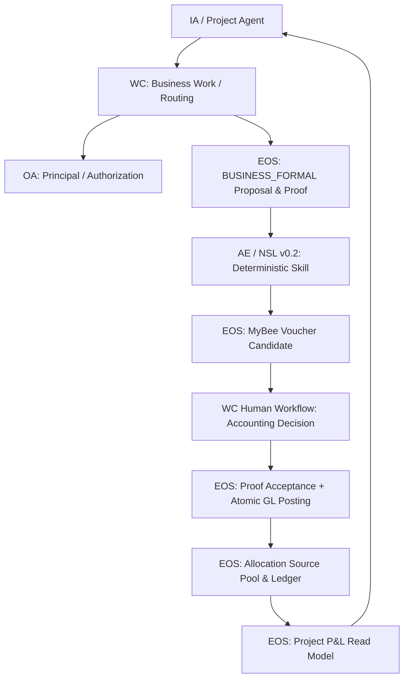
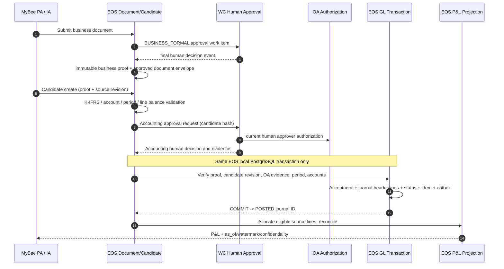

# NeX–MyBee D04/D12 EOS Source Audit & Gap Analysis v1.0

> **문서 상태:** `SOURCE AUDIT v1.0 / CONDITIONAL — 정적 소스 확인 완료(대상 범위), 구현 Acceptance 및 D04/D12 PDF 본문 대조 미완료`  
> **작성일:** 2026-11-09 (Asia/Seoul)  
> **대상:** NeX Enterprise OS(EOS)의 Project·회계·전표·관리원가·P&L Phase-1  
> **상위 계약:** `NeX–MyBee D04/D12 Accounting Transaction Contract Closure v1.0-RC1` (C1~C6)  
> **비변경 원칙:** `NeX Platform v2.1 Frozen Architecture > NeX EOS Canonical Business Contracts > MyBee Domain AX Service`  
> **작업 성격:** Read-only Source Audit / 설계 Gap 식별 / Codex 구현 Slice 분해. **GitHub source·DB·Frozen 문서를 변경하거나 테스트를 실행하지 않았다.**

## 0. Audit snapshot, provenance 및 주장 수준

| 출처 | 감사 기준 | 확인 방식 | 범위/제한 |
|---|---|---|---|
| NeX Platform | `nurigitdev/2607_nex_platform`, `master`, **`c2c03b20e22691cc1984f044e0cacd5d698f9bd3`** | GitHub 커넥터를 통해 Git tree, SQL Migration, Python source, OpenAPI, JSON Schema, 테스트 파일의 **정적 존재·본문** 확인 | 실 DB 접속·테스트 실행·실행 성능은 **검증하지 않음** |
| NSL v0.2 | `nurigitdev/2608_nsl`, `master`, **`f5d899bb611ee2cd65ce9f6544ed6e51b450b7d4`** | NSL README, Tool Contract, Golden A / Voucher / Project Skill, registry 예시 확인 | 기존 Tool/Skill 계약의 존재 및 의미만 확인, 새 Tool 컴파일 검증 전 |
| MyBee | `nurigitdev/2611_MyBee_Blueprint`, `main`, **`948b50fd43fc4e0f0d3f40ffd6335871ec741559`** | Git tree + 읽을 수 있는 연계 HTML (`D19`, 프로젝트 인건비 v1.7, 공용비용 v1.1, 단계별 오픈 v1.16 등) | `D04 v1.9.pdf`(7,570,040 bytes)·`D12 v2.8.pdf`(7,118,923 bytes)의 **파일 존재 및 Blob SHA 확인**, PDF 바이너리/본문 다운로드 불가. 상세 PDF 페이지 대조는 미완료 Gate |
| 상위 의사결정 | `NeX Platform v2.1 Architecture Consistency Closure & Unified Change Ledger v1.0` | Frozen Markdown 직접 조회 | Frozen 소유권/Approval/NSL 경계를 우선 적용 |
| 이전 검토 | `Accounting Transaction Contract Closure v1.0-RC1` | 현재 대화에 연결된 로컬 Markdown 전문 읽음 | `C1~C6`은 **설계 결정**이지 구현 PASS/FROZEN 아님 |

**증거 기호:** `V`=조회한 실제 소스에서 직접 확인, `H`=MyBee의 조회 가능한 HTML에서 확인, `D`=RC1 설계 결정, `N`=이번 감사의 신규 구현 제안, `?`=상세 원문/실행 검증 필요. 소스의 **부재**는 위 특정 `master`/`main` 스냅샷의 EOS 코드·Migration·OpenAPI 탐색 범위에 한정한다. 숨겨진 운영 DB/타 브랜치까지 없다는 의미가 아니다.

### 0.1 Executive verdict

**판정: `HOLD FOR IMPLEMENTATION ACCEPTANCE`, `GO FOR SRS / Slice Planning`.** 기존 EOS의 Project 계층·Member, Account 최소 모델, Voucher Draft·첨부, BusinessOperation/Idempotency/Outbox, `BUSINESS_FORMAL` Proof, OA/WC/NSL 기반은 **유지·재사용**한다. 그러나 현재 확인된 소스만으로는 `기안 최종결재 → 회계팀 최종 승인 → GL POSTED → Project Cost Allocation → Project P&L`을 E2E로 완료할 수 없다. **결손의 중심은 GL Posting Aggregate·Accounting Human Decision Binding·회사 공용원가 Pool·배부/손익 Projection**이다.

**최우선 경고:** 현행 AE NSL 경로 `build_eos_create_voucher_command()`는 `business_approval_proof_ref: None`을 **명시적으로 생성**한다(`nsl_eos_write_execution.py:471~522`). EOS의 `create_voucher_draft_command.v1`은 이 필드를 **optional**로 허용하고, `voucher_commands.py:158~305`의 `execute()`는 Proof 참조를 생성·검증/DB 저장에 사용하지 않는다. 따라서 기존 **Golden A Draft가 성공했다고 사전 기안/품의 결재 Proof가 검증된 것은 아니다**. 기존 경로를 무단 변경하지 말고 **MyBee 승인 필수 v2 경로를 신규로 도입**해야 한다.

---

## 1. Architecture invariants — 변경 불가

| ID | 불변 조건 | 기존 정본/실행 주체 | 금지되는 구현 |
|---|---|---|---|
| AR-01 | Frozen Agent v2.1, NSL v0.2, Platform v2.1의 책임 배치 우선 | NeX Frozen Authority Hierarchy | MyBee 독자 Agent Runtime·Workflow·DB 정본을 NeX 상위로 승격 |
| AR-02 | Business Transaction SoR, Formal Business Approval Proof, GL, Allocation, 예산 금액 정본은 EOS | `nex-eos` | WC·WA·MyBee에서 금액 원장 직접 변경 |
| AR-03 | WC는 인간 승인 WorkItem/Workflow, OA는 최신 Principal/Scope 권한 | WC / OA / EOS Hybrid | 결재 완료 이벤트만으로 GL POSTED 선언 |
| AR-04 | NSL은 결정적 **단일 Controlled WRITE**. 여러 업무 단계 orchestration은 WC·Agent Runtime | AE/NSL/WC | NSL에 새로운 스케줄러/분산 트랜잭션 엔진 또는 직접 SQL 추가 |
| AR-05 | 서비스 DB 간 Cross-Service FK/Join 및 전역 ACID 금지 | 서비스별 DB/API/Outbox | WC+OA+EOS를 하나의 DB 트랜잭션으로 기술 |
| AR-06 | `BusinessApproval`, `NSL_WRITE Approval`, `AccountingApproval`, `GL.POSTED`는 각각 별도 사건/증명 | EOS/WC/NSL/EOS | `승인 == 기표` 단일 Boolean 처리 |
| AR-07 | 기존 Golden A / P8 계약은 보존, 신규 MyBee 계약은 **additive/versioned** | 기존 v1 API + 신규 v2 | Draft state CHECK 변경·v1 필수 필드 강제·Frozen 파일 수정 |
| AR-08 | MyBee D04/D12 업무코드는 **Domain Operation Identity** | MyBee Domain Catalog | FL 업무코드 == EOS REST endpoint / NSL Tool ID 동일시 |
| AR-09 | 원천 회계금액 정본은 POSTED GL, 관리 귀속 정본은 Allocation, P&L은 재구축 가능한 투영 | EOS | 관리배부와 GL 비용대체를 동시에 P&L 합산 |

### 1.1 논리적 책임 흐름

*위의 박스는 설계상의 책임을 표현하며 EOS/WC/OA의 물리적 Deployment 변경을 지시하지 않는다. WC의 회계 결재와 EOS DB Commit은 서로 다른 트랜잭션이다.*

---

## 2. Existing EOS source inventory — SQL / Entity / API / Contract

### 2.1 EOS migration snapshot: 16개 버전(`2500`~`2515`)

| Source / Schema | 소스 확인 사실 (`V`) | 분류 | 재사용/결손 |
|---|---|---|---|
| `2500` baseline | EOS DB migration foundation | **유지** | 기존 DB 마이그레이션 Runner 사용 |
| `2501_eos_business_transaction_core.sql` | `eos_business_operation`, `eos_idempotency`, `eos_outbox` | **재사용** | Posting/Allocation 이벤트 유형·결과 스키마 추가 필요 |
| `2502_eos_organization_core.sql` | 조직·직책 기반 | **재사용/보완** | 회계조직+직책+OA Scope 복합 승인자가 필수. `TEAM_LEAD`만으로 승인 불가 |
| `2503_eos_nvt_project.sql`, `2504_eos_project_hierarchy.sql` | NVTProject, Project 3단계, Tenant FK, 기술 상태 `ACTIVE/INACTIVE` | **재사용/보완** | Business Request/5개 필수 업무코드/준비완료 Gate와 Project 손익 계층별 Roll-up 신규 |
| `2505_eos_account.sql` | `eos_account(code,name,category,account_type,status,effective_from/until,version)` | **재사용/보완** | K-IFRS 초기 Seed 출처, parent/postable, 회사·기간, Rule/FS-line 매핑 |
| `2506_eos_voucher_draft.sql` | `eos_voucher_draft` + `line`, `project_id NOT NULL`, `state CHECK (state='DRAFT')`, line `signed_amount NUMERIC(20,2)` | **유지** | **확정 GL 미포함**. 공유 비용 여러 Project의 단일 출처로 부적합; 별도 Candidate/Journal 필요 |
| `2507`, `2513` Voucher attachments/lineage | 첨부 참조, 승인 Manifest lineage 연계 | **재사용** | 문서 Revision/Business Proof 바인딩 추가 |
| `2508` operation-name compatibility | 이전 operation 호환성 처리 | **유지** | 신규 operation 별도 registry/version |
| `2509_eos_approval_policy.sql` | 승인 도메인, 단계, 금액, Project/Account, 조직/직책 | **재사용/보완** | 회계 승인 목적/업무 역할·회사 범위/SoD 검증 및 회계 Candidate hash binding |
| `2510_eos_approval_instance.sql` | `BUSINESS_FORMAL` 단계/승인 결정/요청자/Project 바인딩 | **재사용/보완** | `requester_ref_type='oa.user'`, `project_id NOT NULL` → 회사 공용급여/구매 승인 경계에 장애 |
| `2511`, `2512` approval proof | 불변 최종 Proof와 최종 WC Decision FK | **재사용** | 기안 Approved Envelope/Consumption 및 회계승인 Proof의 **대상·목적 분리** 필요 |
| `2514_eos_project_member.sql` | Project 멤버 `OWNER/MANAGER/MEMBER/VIEWER`, ACTIVE/REMOVED + 이력 | **재사용/보완** | Member 등급·Man-Day 단가·업무코드 별 실행 가능 범위 부재 |
| `2515_eos_worker_heartbeat.sql` | Worker 상태 기반 | **재사용** | EOS Outbox/Allocation Projection Worker 운영 관찰성에 활용 |

**정적 부재 확인 범위:** `database/nex-eos/migrations/2500~2515`, `services/nex-eos/nex_eos`의 38개 Python 모듈, `contracts/openapi/nex-eos.openapi.yaml`의 활성 경로 내에서 `journal posted GL`, `accounting period`, `project cost allocation`, `project P&L`의 정본 테이블/Write API를 확인하지 못했다. Frozen 문서의 **설계 존재**와 **현재 실행 소스 존재**는 분리해서 취급한다.

### 2.2 EOS service/domain implementation

| Verified file | 기존 capability | 분류 | Gap / 기술적 근거 |
|---|---|---|---|
| `projects.py`, `project_operations.py` | Project/상위 NVT 3계층 생성·조회·상태, `PROJECT.PROJECT.CREATE`, owner 동시 생성 | **재사용** | `create_project()`가 승인된 신청서/필수 `FL` 업무코드 집합을 확인하지 않음; MyBee 별도 Active Gate 필요 |
| `project_memberships.py`, `project_api.py` | Member Add/Remove/Batch, OA scope | **재사용/보완** | 업무코드 담당자 매핑·Man-Day·Grade rate 새 read/domain 계약 |
| `accounts.py`, `account_api.py` | ACTIVE·유효기간 Account 조회 및 DB Create Repository; `FINANCE.ACCOUNT.RESOLVE`, `.GET` | **재사용/보완** | `FL0004011`에 해당하는 **승인·등록 API는 현재 Read route만 확인**. K-IFRS leaf/account policy·company scope 부재 |
| `vouchers.py` | Project/Account 유효성, `Σsigned_amount == 0` 검증, Draft 생성 | **유지/재사용** | **Posting·회계기간·회계승인·전표 revision 관리 없음**. 기존 기본 Draft 보존 |
| `voucher_commands.py`, `voucher_api.py` | `FINANCE.CREATE_VOUCHER_DRAFT` v1 실행; OA + Membership + Draft + Outbox 일괄 원자화 | **유지/보완** | Business Approval Proof ref는 optional로 파싱되나 `execute()`의 계약 필수검증/영속 바인딩에 사용하지 않음 |
| `approval_policies.py`, `approval_instances.py`, `approval_transitions.py`, `approval_decision_api.py` | 승인 정책/단계, WC 결정 수용, EOS 불변 Proof | **재사용/보완** | 회계 승인 목적/SoD, 회사 공용 Source, 후보 Revision/hash의 Acceptance 필요 |
| `business_transactions.py`, `business_queries.py` | 동일 Operation의 Idempotent 결과, BusinessOperation 검색, Transactional Outbox | **재사용/보완** | `EOS_EVENT_TYPES` 현재 `{BUSINESS_TRANSACTION_COMMITTED, VOUCHER_DRAFT_CREATED}`만 허용. Journal/Allocation 이벤트·조회 Projection 신규 |
| `outbox_publication.py`, `ae_outbox_transport.py` | Outbox 배달·상태·재시도 | **재사용** | GL POSTED/Allocation/Reconciliation 이벤트 대상 소비자와 Dead-letter 관측 확장 |
| `voucher_access.py`, `voucher_verification.py` | Project Member 기준 Draft 조회·검증 | **재사용/신규** | 확정 GL/공용 비용/경영진 P&L은 Draft Member 필터만으로 부족; 별도 Scope/Privacy Projection |
| `wa_project_verification.py` | Project·Member 상태 확인을 WA 등에서 재사용 | **재사용** | WA 증적은 금액 원장이 아님; 수신 Artifact/Provenance 검증 신규 |
| `app.py` | EOS Route Registry | **보완** | Journal, Period, Allocation, P&L Router를 additive 등록 |

### 2.3 HTTP / NSL current-state truth table

| Contract/Operation (실제 ID) | 구현됨? | Evidence | Phase-1 처리 |
|---|---|---|---|
| `PROJECT.NVT_PROJECT.CREATE/GET/LIST/UPDATE` | 정적 소스 존재 | `project_api.py`; EOS OpenAPI | 재사용 |
| `PROJECT.PROJECT.CREATE/GET/LIST/DEACTIVATE` | 정적 소스 존재 | `project_api.py`, `project_operations.py` | 재사용. Project Business Ready/Close Gate 별도 |
| `PROJECT.MEMBERSHIP.ADD/REMOVE/...` | 정적 소스 존재 | `project_api.py`, `project_memberships.py` | 재사용 + 업무코드/등급 연결 |
| `FINANCE.ACCOUNT.RESOLVE/GET` | 정적 소스 존재 | `account_api.py` | 재사용 + new accounting catalog write 관리 경로 |
| `FINANCE.CREATE_VOUCHER_DRAFT` | 정적 소스 존재 | `voucher_api.py`, `voucher_commands.py`, AE `nsl_eos_write_execution.py` | Golden A 유지, **MyBee v2는 별도 승인필수** |
| `FINANCE.VOUCHER_DRAFT.GET/LIST` | 정적 소스 존재 | EOS OpenAPI + NSL `examples/voucher_operations/tools.json` | 재사용 |
| `BUSINESS_FORMAL` WC Decision→EOS Proof | 정적 소스 존재 | `approval_decision_api.py`, `approval_transitions.py` | 재사용 + accounting purpose/body hash/SoD |
| `FINANCE.JOURNAL.POST`, `REVERSE`, `FINANCE.ALLOCATION.*`, `FINANCE.PROJECT_PNL.*` | **해당 API 미확인** | EOS Source Tree/OpenAPI 스냅샷 | **신규**. 명칭은 제안이며 확정 Operation Registry 아님 |

### 2.4 NSL Tool Contract / AE adapter audit

| 위치 | 확인 사실 (`V`) | 판단 |
|---|---|---|
| `2608_nsl/examples/voucher_draft_validation/voucher_draft_write.ns` | `ACCOUNT.GET_ACCOUNT`, `PROJECT.GET_PROJECT`, `FINANCE.GET_ACCOUNTING_PERIOD`, `FINANCE.CREATE_VOUCHER_DRAFT`, `FINANCE.GET_VOUCHER`; `approve ...` 후 단일 WRITE | 기존 Skill/Tool 계약 **재사용 패턴**. 데모의 `FINANCE.GET_ACCOUNTING_PERIOD` Tool 존재가 EOS 운영 DB Period 구현 증거는 아님 |
| `2608_nsl/examples/voucher_draft_validation/tools_write.json` | WRITE `FINANCE.CREATE_VOUCHER_DRAFT` `operation_kind=CREATE_DRAFT`, `idempotency` 및 verification 필수 | 그대로 재사용. Posting은 **별도 고위험 Canonical Tool Contract**가 필요 |
| `2608_nsl/examples/golden_a_voucher_draft/tools.json` | `FINANCE.RESOLVE_VOUCHER_DRAFT_COMMAND` + Canonical EOS Create Draft 연동 Tool 명세 | Golden A 호환 및 Tool binding의 안정 기준 |
| `2608_nsl/examples/project_operations` | Project/Member READ·WRITE Skill/Tool 실례 | D12 기존 기술 실행 재사용. 신규 업무코드 Binding을 통해 연계 |
| `services/nex-ae-api/nex_ae_api/nsl_eos_write_execution.py` | EOS Create Draft v1 전용 HTTP adapter, 인자 필드 검증, Payload Hash, `business_approval_proof_ref=None` | **C1 차단 Gap**. v1을 전면 수정하지 말고 v2/new Tool adapter를 추가 |
| `nsl_eos_post_write_verification.py`, `nsl_eos_reconciliation.py` | EOS Draft Verification, `UNKNOWN_COMMIT_STATE` 재조회/복구 Adapter | 재사용 패턴. **Journal ID/Posting 상태** 전용 검증·대사 결과 schema 추가 |
| `nsl_controlled_write_integration.py`, `nsl_idempotency.py` | NSL v0.2 Controlled WRITE Admission/Idempotency 기반 | 재사용. 회계 승인 인가 증거와 Provider 결과의 의미는 별도 계약 |
| NSL v0.2 Tool Contract 설계 | Canonical Tool Contract / Runtime Tool Binding 분리; Provider 독립성 | 지켜야 하는 기존 Freeze. Tool Binding만 추가하고 NSL compiler/runtime을 ERP 업무별로 변경하지 않음 |

**주의:** NSL Source의 `approve`는 NSL WRITE 실행의 승인이며, 기안/품의 `BUSINESS_FORMAL` 승인이나 전표 회계팀 최종 승인과 대체관계가 아니다. MYBEE 업무코드는 Catalog/Skill Binding에서 각 Canonical Tool 호출에 대응시키되 무조건 1:1 Tool 수로 늘리지 않는다.

---

## 3. Critical Gap Register — 심각도/선후/분해 기준

| Gap ID | Severity | 발견(As-Is) | To-Be / 구현 최소단위 | RC1 | 분류 |
|---|---|---|---|---|---|
| **G01** | **BLOCKER** | EA NSL `business_approval_proof_ref=None`; Draft Command v1 Proof optional·미검증 | Approved Document immutable binding + proof validation + MyBee **v2 create contract**, v1 유지 | C1 | 신규/보완 |
| **G02** | **BLOCKER** | 전표 `DRAFT`만 존재, 별도 회계 검토 State Machine 없음 | `VoucherCandidate` + Revision + `READY_FOR_REVIEW`, `RETURNED`, `CANCELLED` + audited state | C2 | 신규 |
| **G03** | **BLOCKER** | EOS Accounting Human Approval 전용 권한/목적/SoD 없음 | `ACCOUNTING_VOUCHER_POST` 목적 Decision+Proof, `finance:voucher:approve` OA 역할/법인/조직/대상 해시 검증 | C4 | 보완/신규 |
| **G04** | **BLOCKER** | `eos_journal_header/line`, Posting API 부재 | immutable GL, AccountingApprovalAcceptance+Journal+CandidateState+Idem+Outbox **single EOS DB Tx** | C5 | 신규 |
| **G05** | **BLOCKER** | 회계기간 SoR/OPEN lock 부재 | `AccountingPeriod` OPEN/CLOSED & concurrent close/post guard | C3/C5 | 신규 |
| **G06** | **BLOCKER** | Allocation Source Pool/Ledger/P&L API 부재 | POSTED GL-line-based Source Pool, typed Distribution, conservation, P&L query + freshness | C6 | 신규 |
| **G07** | HIGH | `eos_account`는 flat/ACTIVE만 검증 | K-IFRS 채택 계정표 Seed, leaf postable, mapping & rule snapshots, 승인된 account create | C3 | 보완 |
| **G08** | HIGH | 현재 ApprovalInstance `project_id NOT NULL`, `requester=oa.user` 고정 | Company-scoped shared-cost approval의 정확한 범위/인간 요청자/Agent delegation proof를 additive 설계. **가짜 Project Anchor 금지** | C1/C4 | 설계차단 후보 |
| **G09** | HIGH | Project CREATE시 `ACTIVE`와 Owner만 생성 | 업무코드 5개 필수 포함·Project Business Ready Gate·Project Work Definition/Member assignment 추가 | D12 | 신규/보완 |
| **G10** | HIGH | Project Member `role`만 존재 | Grade/Man-Day/WorkCode 능력/투입량 계약; 계획 단가·실제 개인급여 분리 | D12/C6 | 신규 |
| **G11** | HIGH | Budget 정본/Project 예산 링크/실적 Projection 부재 | D04 Budget SoR, D12 budget assignment read linkage, Actual from POSTED GL만 투영 | D04/D12 | 신규 |
| **G12** | HIGH | 기존 AE NSL Tool adapter가 Draft v1만 지원 | approved v2 candidate, accounting post, journal verify/reconcile, allocation run READ/WRITE canonical Tool/Binding | C1/C5/C6 | 추가 |
| **G13** | HIGH | `EOS_EVENT_TYPES`는 2종; GL/Allocation 이벤트 없음 | New event types + Outbox consumer dedupe/trace/failure recovery | C5/C6 | 보완 |
| **G14** | HIGH | 공용 비용 1건은 다수 Project에 귀속, 기존 Draft header `project_id NOT NULL` | Company-level source Journal과 Project cost target line/Pool 분리; 기존 Draft 컬럼 유지 | C6 | 신규 |
| **G15** | HIGH | P&L의 개인 급여 추론 방지/read Scope 미정 | aggregation threshold, small-group suppression, query-composition/period differencing controls, OA data classification | C6 | 신규 |
| **G16** | MED | Project 종료 기술 API는 `DEACTIVATE` 중심 | Close 전에 미기표·미배부·미결재·미정산 검증, `FL0012026` 별도 업무 계약 | D12 | 신규 |
| **G17** | MED | Posting/Allocation/Period tests 없음(정적 경로 확인) | Postgres Fault Injection, race, exact replay, privacy tests | C1~C6 | 신규 Test |
| **G18** | SOURCE GATE | D04/D12 PDF 저장소 존재하지만 본문 미확인 | PDF 페이지별 Code/Stage/Approval/Account/GL 규칙 원문 대조 | C1~C6 | **Gate 전 미완료** |

### 3.1 즉시 해결해야 할 설계 충돌 세 가지

**K01 — Proof 존재 vs 실제 Proof 검증:** 명령 필드에 `business_approval_proof_ref`를 허용하는 것과 승인된 문서의 변경 불가 Envelope/예산 한도/첨부가 검증된 것은 다르다. **신규 MyBee 경로에서 C1 Proof 검증은 필수**. 기존 Golden A의 NSL WRITE Approval만으로 회계 승인/업무 결재를 대신하지 않는다.

**K02 — Company/Shared Expense vs Project-bound Draft/Approval:** 현행 Draft와 EOS ApprovalInstance에는 `project_id`가 필수다. **여러 Project 공용비용의 원천 전표·승인**을 Project 하나에 억지로 붙이면 데이터 소유·손익 왜곡이 발생한다. `company-scoped source`와 `project cost targets`를 분리해 EOS의 additive domain aggregate/approval policy로 다룬다. 기존 Frozen approval 의미나 DB간 FK는 바꾸지 않는다. 기존 ApprovalInstance Project 강제 스키마와 충돌하는 경우 **Controlled Amendment Candidate**로 별도 등록 후 결정한다.

**K03 — Accounting Approval Accepted vs GL Posted:** WC에서 회계 최종 Human Decision이 완료되더라도 EOS Posting 전까지는 `POSTING_SYNC_PENDING`(관측 상태)이다. EOS 내부에서는 **정확한 사람 결정 Proof 수용 + GL/원장 + Voucher 상태 + Idempotency/Outbox**를 동일 DB Tx로 commit한다. WC+EOS 간 글로벌 ACID라고 기술하지 않는다.

---

## 4. D04/D12 Business Code → EOS implementation trace

### 4.1 D04 회계 (1차 핵심만)

| MyBee Code | 업무 | EOS As-Is | Phase-1 구현 위치 | 우선순위 |
|---|---|---|---|---|
| `FL0004003` | 증빙 개인 업로드 | Voucher attachment/manifest 기반 | WA Artifact ref + EOS Approved Document evidence binding | P0 |
| `FL0004005` | K-IFRS 인식 판정 | Account 존재·상태만 검증 | EOS Accounting Policy Validator (`rule_version`) | P0 |
| `FL0004006` | 사내 회계규정 적용 | 포괄 Rule evaluator 확인 안 됨 | EOS Policy snapshot / rule evaluation | P0 |
| `FL0004007` | 분개 생성 | 기존 Draft balanced signed line 생성 | EOS deterministic Candidate/Journal builder (`signed ↔ debit/credit` 정의) | P0 |
| **`FL0004008`** | **전표 승인** | 별도 Accounting Human Gate 없음 | EOS Accounting Approval + WC WorkItem + OA SoD | **P0** |
| **`FL0004009`** | **전표 기표** | GL Posting 없음 | EOS Atomic Post Service, journal tables | **P0** |
| `FL0004010` | 전표 역분개 | API 없음 | Immutable Reverse Journal, approval/proof | P0/P1 |
| `FL0004011` | 계정과목 신설 | Account DB create repository 존재, Query API 중심 | 승인된 K-IFRS catalog extension | P0 admin |
| `FL0004012` | 예산 편성 | EOS Budget SoR 없음 | EOS budget master/version & allocation | P0/P1 |
| `FL0004014` | 예산 대비 실적 집계 | 조회 Projection 없음 | Budget vs GL actual vs allocated projection | P1 |
| `FL0004015` | 원가 배부 | GL source pool/ledger 없음 | Allocation source+plan+line+batch | **P0** |
| `FL0004046` | 회계 기간 개시 | period DB 없음 | EOS period OPEN/CLOSE locking | P0 |
| `FL0004048` | K-IFRS 판정 규칙 등재 | rule table 없음 | Policy/Rule Artifact import + approved snapshot | P0 seed |
| `FL0004049` | 분개 규칙 확정 | rule table 없음 | Immutable posting rule version + deterministic evaluation | P0 seed |
| `FL0004050` | 배부 규칙 확정 | rule table 없음 | Allocation policy version, mode/exclusivity/rounding | P0 seed |
| `FL0004052` | 프로젝트 인건비 집행 기록 | EOS 예산 집행 Projection 없음 | Posted payroll GL + allocation로 actual projection | D08 확장 |

**후순위:** 연결 재무제표·세무 신고·XBRL·복잡 FX·완전 결산·대량 자산평가 등은 1차 E2E와 구분한다. 기간 CLOSED 차단/역분개/계정 유효성은 후순위가 아니라 Posting 안전성 P0이다.

### 4.2 D12 프로젝트 (1차 핵심만)

| MyBee Code | 업무 | EOS As-Is | Phase-1 구현 위치 | 우선순위 |
|---|---|---|---|---|
| `FL0012001` | 프로젝트 신청 | 바로 Project CREATE만 존재 | ProjectRequest + Approved Document binding | P0 |
| `FL0012002` | 사전 검토 | 도메인 검토 workflow 없음 | MyBee Domain Rule + WC Stage | P1/정책 |
| `FL0012003` | NVT위원회 심의 | EOS 일반 Formal Approval 조립 가능, D12 특화 없음 | 적용 프로젝트 종류의 정책별 Approval Instance | P1/정책 |
| **`FL0012004`** | **프로젝트 개설** | EOS Project Create 구현 | 재사용 + business approval / work-code readiness | **P0** |
| **`FL0012005`** | **업무 구성 확정** | Project-work-code 확정/버전 없음 | `project_work_definition` + mandatory 5 codes validator | **P0** |
| **`FL0012006`** | **PM 지정** | Project owner/manager Member 존재 | human PM assignment + PA logical identity binding, Role/Scope 분리 | **P0** |
| `FL0012007` | 참여자 배정 | Member add/remove/batch 구현 | 재사용 + WorkCode/grade/MD & approved availability check | P0 |
| `FL0012008` | 예산 배정 | EOS 금액 budget 정본 없음 | D04 Budget SoR reference/link; D12 직접 budget amount WRITE 금지 | P0/P1 |
| `FL0012010` | 하위 프로젝트 개설 | EOS 3-level hierarchy 존재 | 재사용 / double-count-free NVT P&L | P1 |
| **`FL0012013`** | **진행 보고 집계** | Work/WA 부분 활용 가능 | 최소 Project progress projection, mandatory code assigned | P0 catalog / P1 execution |
| **`FL0012026`** | **프로젝트 종결** | technical DEACTIVATE 존재 | 결산/미배부/증적 Gate 후 사업 종결; technical state와 분리 | P0 catalog / P1 execution |
| `FL0012022` | 예산 변경 요청 | 금액 변경 업무 계약 없음 | D12 request → D04 approved budget revision | P1 |
| `FL0012023` | 업무 구성 변경 | 비즈니스 코드 revision 없음 | WorkDefinition revision + PA/WC scope re-evaluation | P1 |
| `FL0012044` | 인력투입계획 확정 | Man-Day/cost plan 없음 | D08 read: confidential actual cost vs public grade rate | D08 Slice |

**D12 필수 업무코드 5건:** `FL0012004 / FL0012005 / FL0012006 / FL0012013 / FL0012026`. 프로젝트 생성 시 필수 등록을 확인하되 `FL0012013/2026`의 **실제 실행은 진행·종결 시점**이다. 기존 EOS Project의 `ACTIVE/INACTIVE`는 기술적 유효상태이므로, `BUSINESS_READY`를 기술적 ACTIVE와 혼동하지 않는 additive Project Readiness State/Guard를 권장한다.

---

## 5. Proposed additive EOS data design — **소스 존재 아님, 구현 검토 후보**

### 5.1 Domain ownership & minimal table slices

| 소유(EOS unless indicated) | 후보 Aggregate / relation | 핵심 식별자·제약 | 최초 필요 Slice |
|---|---|---|---|
| Project Domain | `project_work_definition`, `project_work_code_assignment`, `project_business_readiness` | `(tenant,project,work_set_version)`, 필수 5건 immutable version, WorkCode identity | S1 |
| Accounting Master | `account_catalog_version`, `account_mapping`, `accounting_period`, `accounting_rule_version` | tenant/company + effective period; account `postable`; 기간/룰 version | S2 |
| Business Document | `business_document_binding`, `approved_envelope_usage` | ApprovalProof/DocumentRevision/PayloadHash/Amount ceiling, consumed sum <= approved | S3 |
| Voucher Candidate | `journal_candidate`, `journal_candidate_line`, `candidate_revision`, `candidate_state_history` | immutable revision/hash; `source_business_document_ref`; company scope 허용 | S3 |
| Accounting Approval | `accounting_approval_acceptance` (EOS) + WC Approval WorkItem (WC) | human decision ID, OA evidence, `candidate_revision/hash`, SoD | S4 |
| General Ledger | `journal_header`, `journal_line`, `journal_reversal_link` | `(tenant,source_candidate,revision)` unique; status POSTED immutable | S4 |
| Source Pool / Allocation | `cost_source_pool`, `cost_allocation_plan`, `cost_allocation_line`, `allocation_batch` | source **POSTED GL line** uniqueness + type/mode/version; sum conservation | S5 |
| Budget / P&L | `budget`, `project_budget_assignment`, `budget_actual_projection`, `project_pnl_projection` | budget SoR EOS; line/batch/watermark; company/NVT hierarchy | S6 |
| Eventing | EOS EventType Registry, Outbox consumer, Reconciliation status | exact dedupe `(tenant, event_id)` and stable BusinessOperationId | S4~S6 |
| NSL (AE adapter only) | Canonical Tool Contract/Binding/Skill Pack & versioned JSON schemas | `skill_id ≠ MyBee FL code ≠ EOS API`; approval and commit evidence | S3~S7 |

**명명 상태:** 위 table/operation 이름은 제안이며 현재 DB에 있는 것으로 표시하지 않는다. 신규 migration 번호도 현행 `2515` 이후 다른 작업과 충돌할 수 있어 **SRS/브랜치 생성 시 충돌 검증 후 확정**한다. 계정과목 상세 계층/공용회계 승인 모델은 MyBee PDF 원문과 정합성 대조를 통과한 뒤 schema를 freeze한다.

### 5.2 C1→C5 Posting critical path

**Posting local ACID 필수 기록:** 승인 증명 수용, 전표 헤더·라인, 후보 `POSTED` linkage, approved envelope 사용량/한도, BusinessOperation, Idempotency, Outbox. WC Human Decision 자체는 WC DB에서 별도 Commit이며 EOS에 수용한 Proof/Decision Reference를 원자적으로 함께 기록한다.

**순서 제약:** OA 최신 권한 조회·WC/WA 외부 요청은 DB Tx 바깥에서 수행; 짧은 DB Tx 내에는 확인된 Evidence 버전/TTL와 locked accounting period, candidate CAS, source usage locking/unique만 사용한다. OA 철회와 Commit 사이의 분산 TOCTOU를 영(0)이라고 단정하지 않고 deny/감사/운영 대응을 Gate로 검증한다.

### 5.3 Account validity (K-IFRS)

- EOS `eos_account`를 토대로 **MyBee가 채택한 실제 K-IFRS 대응 Account Chart**의 `source_name/version/hash`, 내부 `account_code`, 상위-하위 계정, 표시 재무제표라인, ACTIVE/effective, `postable`, 사용 가능한 `business_code`·company/period를 보존한다. K-IFRS는 단일 강제 상세 Account Code Set이 아니므로 임의 Seed 값 생성 **금지**.
- `FL0004011` 신규 계정과목 신설은 OA 회계기준관리 권한+정식 승인 Gate+불변 변화 기록을 사용한다. 하위/확장 계정은 이전 Posting의 코드/스냅샷을 소급 수정하지 않는다.
- 사전 NSL READ `FINANCE.ACCOUNT.RESOLVE`와 Posting **잠금 아래 재검증**을 구분한다. 유효 Account 검증만으로 Posting 안전성이 성립하지 않는다.
- Phase-1은 KRW 원장부터 시작하도록 권고. 기존 Draft 다통화 입력을 무단 제한하지 말되 환율·외화평가 계약이 없는 GL Posting을 차단한다. 정책은 SRS에서 확정.

### 5.4 Allocation / P&L의 비중복 규칙

1. **원천은 POSTED 적격 GL line**: 자산/재고/선급금은 곧바로 비용 Pool로 만들지 않음. `GL_POSTED_DIRECT`, `MANAGEMENT_ALLOCATION`, `GL_COST_TRANSFER` 모드는 line 단위로 **배타적** 귀속 규칙.
2. `eligible_recognized_source_amount = Σ posted_direct_eligible + Σ allocated + unallocated`의 합계 보존을 풀·통화·기간별로 검증. **원가/수익에 적격한 GL line만** 대상; 균형 잡힌 Journal 전체 서명금액 합(0)을 비용 Pool 금액으로 오인 금지.
3. 원천1개/계정/기간/원가구성요소에 대해 중복 Pool 금지. `allocation_plan_version`, `source_gl_line_ref`, `allocation_mode`, `batch_id` 및 `idempotency_key`를 보존.
4. 분배잔차는 Decimal + 결정적 tie-break(설정된 일관 규칙). 재배부 시 과거 라인 수정 금지, reversal/adjustment ledger로 추적. Project/NVT rollup에서 상위/하위 중복 합산 금지.
5. `POSTED`, `ALLOCATION_RECONCILED`, `UNALLOCATED`, `PENDING_APPROVAL`, `PENDING_POSTING`, `PROJECTION_STALE`는 보고에 별도 표시. P&L은 `as_of`, `posting_watermark`, `allocation_watermark`, `tenant/company`, `currency`, `scope`, `classification` 포함.
6. 직원 **계획용 등급별 MD 단가**와 **급여실제 원가**를 분리한다. PA/PM은 개인별 실제 급여 및 소집단 역산 가능한 Projection을 조회할 수 없음. MyBee 인건비 v1.7의 개인 실제예상원가 원칙과 NeX의 계획 Grade 기준을 별도 Policy/데이터클래스로 조정.
7. 구매 예시: 주문 120개 중 Project A 40 + B 60 + 재고 20은 단일 구매/결재 원천을 유지하되 재고 20을 비용처리하지 않는다. 실비가 확정·소비/불용 인식될 때 원가 반영. MRP 전체는 Slice 1에서 필수 아님.

---

## 6. API / NSL Contract delta (구현 전 이름·스키마 검증 필요)

| Proposed Canonical Operation | READ/WRITE / Risk | Owner | 필수 증거·응답 | Reuse/Add |
|---|---|---|---|---|
| `PROJECT.PROJECT.GET`, `PROJECT.MEMBERSHIP.LIST` | READ | EOS | OA Scope, Project/Member status | Reuse |
| `PROJECT.WORK_SET.ASSIGN` | WRITE / governed | EOS | mandatory 5, set version, approval, Project readiness | Add |
| `FINANCE.ACCOUNT.RESOLVE` | READ | EOS | Account version/effective/postable | Reuse + response extension |
| `FINANCE.ACCOUNT.CREATE_GOVERNED` | WRITE / critical | EOS | Chart/policy version, authorized FL0004011 proof | Add |
| `FINANCE.PERIOD.GET` | READ | EOS | OPEN/CLOSED + revision | Add (NSL demo Tool과 EOS 운영 API는 구분) |
| `FINANCE.DOCUMENT.APPROVAL_VERIFY` | READ | EOS | document revision, proof hash, amount envelope, authorization usage | Add |
| `FINANCE.VOUCHER_CANDIDATE.CREATE` | WRITE / controlled | EOS | BusinessApprovalProof mandatory, exact doc snapshot, new candidate id | Add (v1 Draft unchanged) |
| `FINANCE.VOUCHER_CANDIDATE.GET/VALIDATE` | READ | EOS | candidate hash, account and policy versions, balance | Add |
| `FINANCE.VOUCHER.APPROVE_AND_POST` | WRITE / **critical** | EOS | actual human accounting decision+OA evidence+business proof; `POSTED journal_id`/idempotency/outbox | Add |
| `FINANCE.JOURNAL.GET/VERIFY/RECONCILE` | READ | EOS | POSTED journal, source reference, hash, commit outcome | Add |
| `FINANCE.JOURNAL.REVERSE` | WRITE / critical | EOS | new approved correction, original retained | Add |
| `FINANCE.ALLOCATION.RUN/VERIFY` | WRITE/READ | EOS | source posted line refs, plan, evidence and conserved sum | Add |
| `FINANCE.PROJECT_PNL.GET` | READ (confidential) | EOS | role-filtered actual/planned/unallocated and watermark | Add |

**Tool ID/REST ID 분리:** 표의 신규 명칭은 Codex 작업 계약 후보이며 기존 Registry에 존재하는 ID라고 주장하지 않는다. 기존 `FINANCE.CREATE_VOUCHER_DRAFT`는 Golden A/NSL v0.2 회귀를 위해 남긴다. 신규 Tool은 `Canonical Contract → AE Runtime Binding → EOS API`로 추가. 회계승인은 사람이 `EOS/WC Human Gate`에서 수행하며 Tool이 사람 승인 결정을 만들어내지 않는다.

**조건부 구성:** MyBee `업무코드(FL...)` → `Domain Operation` → `NSL Skill`(복수 단계일 수 있음) → `Canonical Tool Contract` → `Runtime Binding` → `EOS API`. 업무코드마다 서비스 API를 1개씩 늘리지 않으며 **NSL compiler/runtime 코드를 회계 분야마다 수정하지 않는다.**

---

## 7. Slice Plan (Source Audit에서 도출한 제안, SRS 이전 확정 아님)

| Slice | 구현 단위 (최소) | 재사용 기준 | Definition of Done / Gate | 의존 |
|---|---|---|---|---|
| **S0** Baseline/Contract | Source Evidence Manifest, v1 Golden A Freeze Regression 목록, C1~C6 Schema Scaffold | 기존 Migration Runner, EOS Contract Validator | ABI/Schema backward-compatible; frozen 파일 0 변경 | 없음 |
| **S1** D12 Project Work Set | Project WorkCode Set, mandatory 5 assignment, `BUSINESS_READY` guard, Project Member/PM binding | `projects.py`, `project_operations.py`, `project_memberships.py`, OA/WC | 기본 5 누락 activate 거부, 기존 PROJECT.CREATE 정상 작동, hierarchy 유지 | S0 |
| **S2** Accounting Master | K-IFRS Chosen Account Seed/Version/Leaf, AccountingPeriod, Posting Rule | `accounts.py`, `account_api.py` | Snapshot/hash/OPEN period/leaf, 승인된 신규 계정 검증 | S0 |
| **S3** Business Proof + Candidate | ApprovedDocument binding, Proof usage, company/shared Candidate + revision, v2 command and AE adapter | EOS `eos_approval_proof`, `business_transactions.py`, v1 Draft | Proof missing/wrong tenant/wrong revision/overdraft 모두 fail-closed; Golden A regression | S1,S2 |
| **S4** Accounting Approval + GL | OA accounting scope, WC Human Accounting Approval, EOS candidate exact hash Proof Acceptance, atomic Posting & reverse, event types | `approval_*`, `business_transactions.py`, outbox, NSL Controlled WRITE | Postgres rollback/race/unknown commit/replay; WC 승인만으로 POSTED 0건 | S3 |
| **S5** Project Allocation | GL eligible source pool, typed allocation, rounding, adjustment, Source→Project | EOS transaction/outbox, MyBee R42 source basis | Project별 보존식 0차이, 중복투입·재고비용 조기인식 0 | S4 |
| **S6** Budget & Project P&L | EOS Budget SoR, D12 assignment link, Project/NVT P&L projection+watermark, secure read | EOS project/NVT hierarchy, OA, WC/WA evidence | posted-only actual, `as_of`/stale, ancestor rollup no double count, privacy negative | S5 |
| **S7** NSL/IA Integration | FL→Skill Pack/Tool registry, new verification/reconciliation adapters, IA→PA→EOS E2E | NSL v0.2 source/runtime/API **unchanged**, AE existing gateway | end-to-end and negative E2E, v1 Golden A/Project regressions | S4~S6 |
| **S8** Domain expansion pilot | D08 payroll allocation; D15 shared purchase/reception source | S5 pooled allocation ledger | 총급여/구매/재고 증거와 GL-Allocation 대사, 개인급여 비노출 | S7 |

**Critical Path:** `S0 → S2 → S3 → S4 → S5 → S6 → S7`; D12 최소 업무코드 Gate(S1)는 S3 전에 닫는다. S8은 전표·회계 기반과 공통 Allocation이 준비된 뒤 진행한다. **SRS에서 S3/S4는 회사 공용 기안·회계 승인 Scope의 G08 설계차단 조건을 먼저 해소해야 한다.**

### 7.1 최소 수용 시나리오 (E2E-CORE)

`ProjectRequest/기안 → Human BusinessApprovalProof → Project WorkSet(필수 5) / Member → Approved Voucher Candidate → K-IFRS 및 Period 검증 → Accounting Human Approval → EOS Atomic Journal.POSTED → (직접귀속/공용) Allocation → Project P&L(GET, as_of + watermark)`.

여기서 MyBee Project Agent는 계획·업무코드 실행을 주도하지만 OA 승인권자와 회계팀 검토자의 최종 결정을 대신할 수 없다.

---

## 8. Acceptance gates 및 회귀 테스트 Target (아직 실행하지 않음)

| Gate | 대상 | 대표 Negative/Fault test | PASS 조건 |
|---|---|---|---|
| A — Frozen Compatibility | Frozen/Golden A/Project/Approval v1 | 기존 CREATE_DRAFT payload/ToolId 변경·스키마 무효 | 기존 Golden A + NSL v0.2 + Project flows 회귀 PASS, Frozen 파일 변경 0 |
| B — Approval Binding | Business document, financial accounting approval | Ref None, wrong tenant, altered revision/hash, post amount beyond envelope, self-approval, revoked accountant | Post 0건; Proof 재사용/한도 위반 0; OA Evidence 완전성 |
| C — Ledger Atomicity | PostgreSQL real DB | GL line insert fault, same candidate concurrent post, closed-period race, response loss | Partial GL 0, duplicate posting 0, stable replay, same Unit of Work |
| D — Accounting & K-IFRS | Account Catalog/Period/Rules | inactive/parent account, stale rule, wrong currency, unbalanced debit/credit | Fail-closed, posted journal immutable, reverse is new journal |
| E — Allocation & P&L | Cost pool, allocation, project rollup | cost pool duplicate, rounding remainder, unconsumed inventory, GL_TRANSFER+MANAGEMENT double count | GL eligible amount == direct + allocated + residual, no cross-account double count |
| F — Confidentiality | Payroll grade vs actual cost; management read | PA single-person salary filter, differencing by period, cross tenant, unauthorised company-wide view | Sensitive totals suppressed/denied, data classification and Scope enforced |
| G — Recovery/Operations | Outbox/Consumer/JobQueue | WC decision ack lost, post committed response lost, P&L worker failure, replay stale approval | `UNKNOWN_COMMIT_STATE` reconciled; POSTED never reverted by projection failure; lag visible |
| H — Source Verification | D04 v1.9 PDF/D12 v2.8 PDF | 원문 업무코드/승인·기표 Gate vs HTML/RC1 차이 | PDF 페이지별 대조 기록 + conflict ledger, 명시 미결 0 |

**테스트 근거 파일(기존 존재 확인):**
`tests/test_nex_eos_p8_s09_business_transactions.py`, `...p8_s14_account.py`, `...p8_s15_voucher_draft.py`, `...p8_s19_voucher_command.py`, `...p8_s69_approval_policy.py`, `...p8_s73_approval_transition.py`, `...p8_s94_project_membership_persistence.py`, `tests/test_nex_ae_eos_p8_s67_golden_a_exactly_once.py`, `tests/test_platform_p8_s75_dual_approval_separation.py`, `tests/test_nex_ae_p8_s60_eos_reconciliation.py`. **테스트 파일 존재는 PASS 증거가 아니다.**

**필수 PostgreSQL 실DB 테스트:** concurrent `FOR UPDATE/CAS` + unique, case-sensitive account code, period close race, transaction rollback on injected error, idempotency replay, outbox atomic insert, 1/N shared allocation, multi-tenant permission, RLS/authorization/Privacy. SQLite Unit 테스트만으로 `Gate C`를 통과시킬 수 없다.

---

## 9. Source Audit 결론 / Decision Log / Next artifacts

### 9.1 2026-11-09 결정 기록

| Decision | 결과 | 이유 |
|---|---|---|
| SD-01 | **기존 EOS Transaction + Approval + Draft Foundation 재사용** | P8 누적 개발성과·Frozen compatibility 유지 |
| SD-02 | **MyBee business approved-v2 path 별도 추가** | v1 optional proof 및 AE None 값이 신규 사업 결재 요구와 충돌 |
| SD-03 | **추가 EOS GL/Posting Aggregate** | 현행 Draft `DRAFT` 전용/Project 강제 제약과 공용회사 원장 요구 충돌 |
| SD-04 | **Accounting Human Approval + OA SoD + exact hash binding** | 업무 결재와 별도 회계 담당자 승인 절대 필요 |
| SD-05 | **관리배부(GL 원천 참조) 우선, 직접 GL 원가대체 중복 금지** | 공통 급여·구매·비용의 빠른 Project 관리손익 조회 |
| SD-06 | **K-IFRS MyBee 선택 계정표 Seed는 원본 확인 전 임의 생성 금지** | IFRS 회계기준과 회사 계정코드표 차이 |
| SD-07 | **Project 5-code mandatory Set + Business Readiness Overlay** | 기존 `ACTIVE` 기술 상태·Golden 기능을 깨지 않음 |
| SD-08 | **대용량 PDF 원문 대조/실DB Acceptance 남음** | 이번 v1.0은 Static Source Audit, Complete Implementation Closure가 아님 |

### 9.2 Unresolved blockers / source questions

1. **G08 — Company-scoped 회계 승인:** 현행 `eos_approval_instance.project_id NOT NULL`과 `requester_ref_type=oa.user`를 유지하면서 급여·공용 구매·회사 전사 비용의 회계 승인 문서를 어떻게 정확하게 모델링할지? **임의 Project anchor는 금지**. EOS-owned additive ApprovalCase + WC existing Workflow 우선 검토; Frozen 외부 변경이 필요하면 Controlled Amendment Candidate로 제출.
2. **C1 proof lifecycle:** 기안/품의서 승인 한도와 분할 기표·부분 검수에 대한 문서 Revision/approved envelope consumption을 언제 lock·소진할지? `source_operation` 멱등성 및 감사 체인 확정 필요.
3. **K-IFRS Account Catalog:** MyBee의 실제 초기 계정표 seed 출처 파일/규정 버전, IFRS 표시 항목 계층/신규 과목 승인 정책은 PDF/최신 DB 코드 맵 대조 전 freeze 금지.
4. **Project 활성화:** MyBee의 Request Gate/필수 Work Code Set과 EOS 기술 `ACTIVE`를 별도로 둔 Status 계약 확정 필요.
5. **인건비 계획 단가:** MyBee v1.7은 개인별 실제 예상 Day Rate를, NeX에서는 등급별 계획 Man-Day 단가를 사용하려고 함. **두 개념을 혼동하지 않도록 계획/실제 장부·권한·표시 계약 분리**.
6. **급여/구매 Posting Grain:** 단일 총액 GL + 관리 배부 vs 추가 GL 대체 분개 혼용을 회계정책으로 통제해야 함. 사용자 의도는 Phase-1 Management Allocation 우선; 실 기업 회계정책 검토 필요.
7. **SLO:** 거의 실시간 P&L의 지연·신선도 목표는 `posting_watermark`, `allocation_watermark`, `as_of` 기준으로 SRS에서 수치화하며 현재 PASS 지표로 주장하지 않음.
8. **D04/D12 PDF:** GitHub에 존재하나 현재 GitHub 연결에서 7MB급 PDF를 직접 읽을 수 없어 **페이지별 상세 조항/서식/전표 상태표 확인 미완료**. 검증 완료 전 원문 정합성 100% 주장 금지.

### 9.3 Next deliverables — 순서

1. **`NeX–MyBee D04/D12 EOS Pre-Architecture Decision v1.0`**: G01~G16의 각 시나리오, EOS Aggregate SoR, company-scoped accounting approval 방식과 C1/C5/C6의 결정 보류사항 폐쇄.
2. **`NeX–MyBee D04/D12 EOS SRS v1.0`**: 명령·응답·상태·오류코드·DB Constraint·회계 승인 Role/OA Scope·NSL Tool Contract 및 P&L Privacy/Freshness NFR.
3. **`NeX–MyBee D04/D12 EOS Implementation Slice Plan v1.0`**: S0~S8을 Codex 작업/테스트/Commit Gate로 상세화. 구현은 별도 Branch, Frozen Source 직접 수정 금지.

---

## Appendix A. Evidence paths — GitHub URLs / line anchors

### A1. NeX source (pinned to audit commit)

- [Frozen v2.1 Authority Closure](https://github.com/nurigitdev/2607_nex_platform/blob/c2c03b20e22691cc1984f044e0cacd5d698f9bd3/docs/frozen/v2.1/10_PLATFORM_v2.1/05_NORMATIVE_BASELINE/NeX_Platform_v2.1_Architecture_Consistency_Closure_and_Unified_Change_Ledger_v1.0.md)
- [EOS DB Migration root](https://github.com/nurigitdev/2607_nex_platform/tree/c2c03b20e22691cc1984f044e0cacd5d698f9bd3/database/nex-eos/migrations)
- [`2501` Business Transaction core](https://github.com/nurigitdev/2607_nex_platform/blob/c2c03b20e22691cc1984f044e0cacd5d698f9bd3/database/nex-eos/migrations/2501_eos_business_transaction_core.sql)
- [`2505` Account model](https://github.com/nurigitdev/2607_nex_platform/blob/c2c03b20e22691cc1984f044e0cacd5d698f9bd3/database/nex-eos/migrations/2505_eos_account.sql)
- [`2506` VoucherDraft model](https://github.com/nurigitdev/2607_nex_platform/blob/c2c03b20e22691cc1984f044e0cacd5d698f9bd3/database/nex-eos/migrations/2506_eos_voucher_draft.sql)
- [`2509` Approval Policy](https://github.com/nurigitdev/2607_nex_platform/blob/c2c03b20e22691cc1984f044e0cacd5d698f9bd3/database/nex-eos/migrations/2509_eos_approval_policy.sql)
- [`2510` Approval Instance](https://github.com/nurigitdev/2607_nex_platform/blob/c2c03b20e22691cc1984f044e0cacd5d698f9bd3/database/nex-eos/migrations/2510_eos_approval_instance.sql)
- [`2511` Business Approval Proof](https://github.com/nurigitdev/2607_nex_platform/blob/c2c03b20e22691cc1984f044e0cacd5d698f9bd3/database/nex-eos/migrations/2511_eos_approval_proof.sql)
- [`2514` Project Member](https://github.com/nurigitdev/2607_nex_platform/blob/c2c03b20e22691cc1984f044e0cacd5d698f9bd3/database/nex-eos/migrations/2514_eos_project_member.sql)
- [`voucher_commands.py` : create v1 proof handling](https://github.com/nurigitdev/2607_nex_platform/blob/c2c03b20e22691cc1984f044e0cacd5d698f9bd3/services/nex-eos/nex_eos/voucher_commands.py#L158-L305)
- [`vouchers.py` : only-DRAFT state and account/project validator](https://github.com/nurigitdev/2607_nex_platform/blob/c2c03b20e22691cc1984f044e0cacd5d698f9bd3/services/nex-eos/nex_eos/vouchers.py#L158-L329)
- [`project_operations.py` : PROJECT.CREATE & Owner assignment](https://github.com/nurigitdev/2607_nex_platform/blob/c2c03b20e22691cc1984f044e0cacd5d698f9bd3/services/nex-eos/nex_eos/project_operations.py#L231-L292)
- [`account_api.py` : read routes](https://github.com/nurigitdev/2607_nex_platform/blob/c2c03b20e22691cc1984f044e0cacd5d698f9bd3/services/nex-eos/nex_eos/account_api.py#L1-L88)
- [`business_transactions.py` : ACID Idempotency & Outbox](https://github.com/nurigitdev/2607_nex_platform/blob/c2c03b20e22691cc1984f044e0cacd5d698f9bd3/services/nex-eos/nex_eos/business_transactions.py#L283-L389)
- [`nsl_eos_write_execution.py` : **explicit None BusinessApproval Proof**](https://github.com/nurigitdev/2607_nex_platform/blob/c2c03b20e22691cc1984f044e0cacd5d698f9bd3/services/nex-ae-api/nex_ae_api/nsl_eos_write_execution.py#L471-L522)
- [EOS OpenAPI](https://github.com/nurigitdev/2607_nex_platform/blob/c2c03b20e22691cc1984f044e0cacd5d698f9bd3/contracts/openapi/nex-eos.openapi.yaml)
- [VoucherDraft Create Schema](https://github.com/nurigitdev/2607_nex_platform/blob/c2c03b20e22691cc1984f044e0cacd5d698f9bd3/contracts/schemas/service/nex_eos/create_voucher_draft_command.v1.schema.json)

### A2. NSL (pinned to audit commit)

- [NSL README/Runtime Scope](https://github.com/nurigitdev/2608_nsl/blob/f5d899bb611ee2cd65ce9f6544ed6e51b450b7d4/README.md)
- [NSL v0.2 Canonical Tool Design](https://github.com/nurigitdev/2608_nsl/blob/f5d899bb611ee2cd65ce9f6544ed6e51b450b7d4/docs/v0_2/06_NeX_Skill_Tool_Contract_Detailed_Design_v0.2.md)
- [Voucher Controlled WRITE Skill](https://github.com/nurigitdev/2608_nsl/blob/f5d899bb611ee2cd65ce9f6544ed6e51b450b7d4/examples/voucher_draft_validation/voucher_draft_write.ns)
- [Voucher Controlled WRITE Tool Registry](https://github.com/nurigitdev/2608_nsl/blob/f5d899bb611ee2cd65ce9f6544ed6e51b450b7d4/examples/voucher_draft_validation/tools_write.json)
- [Golden A Voucher Draft Tool Contracts](https://github.com/nurigitdev/2608_nsl/blob/f5d899bb611ee2cd65ce9f6544ed6e51b450b7d4/examples/golden_a_voucher_draft/tools.json)

### A3. MyBee (pinned to audit commit)

- [D04 Accounting Work Skills PDF v1.9 — presence confirmed, content **not** read](https://github.com/nurigitdev/2611_MyBee_Blueprint/blob/948b50fd43fc4e0f0d3f40ffd6335871ec741559/docs/origin/MyBee_%EC%97%85%EB%AC%B4%EC%8A%A4%ED%82%AC%EC%84%A4%EA%B3%84%EC%84%9C_D04_%ED%9A%8C%EA%B3%84%EC%97%85%EB%AC%B4_v1.9.pdf)
- [D12 Project Work Skills PDF v2.8 — presence confirmed, content **not** read](https://github.com/nurigitdev/2611_MyBee_Blueprint/blob/948b50fd43fc4e0f0d3f40ffd6335871ec741559/docs/origin/MyBee_%EC%97%85%EB%AC%B4%EC%8A%A4%ED%82%AC%EC%84%A4%EA%B3%84%EC%84%9C_D12_%ED%94%84%EB%A1%9C%EC%A0%9D%ED%8A%B8%EC%88%98%ED%96%89%EC%97%85%EB%AC%B4_v2.8.pdf)
- [Project Labor Budget and Execution v1.7](https://github.com/nurigitdev/2611_MyBee_Blueprint/blob/948b50fd43fc4e0f0d3f40ffd6335871ec741559/docs/origin/MyBee_%ED%94%84%EB%A1%9C%EC%A0%9D%ED%8A%B8%EC%9D%B8%EA%B1%B4%EB%B9%84%EC%98%88%EC%82%B0%EC%A7%91%ED%96%89_%EC%84%A4%EA%B3%84%EC%84%9C_v1.7.html)
- [Shared-Cost Unified Approval v1.1](https://github.com/nurigitdev/2611_MyBee_Blueprint/blob/948b50fd43fc4e0f0d3f40ffd6335871ec741559/docs/origin/MyBee_%EA%B3%B5%EC%9A%A9%EB%B9%84%EC%9A%A9_%ED%86%B5%ED%95%A9%EA%B2%B0%EC%9E%AC_%EC%84%A4%EA%B3%84%EC%9A%94%EC%95%BD_v1.1.html)
- [Project Request & UI Design v1.12](https://github.com/nurigitdev/2611_MyBee_Blueprint/blob/948b50fd43fc4e0f0d3f40ffd6335871ec741559/docs/origin/MyBee_%ED%94%84%EB%A1%9C%EC%A0%9D%ED%8A%B8%EC%83%9D%EC%84%B1%EC%8B%A0%EC%B2%AD_%EC%9E%90%EB%A3%8C%C2%B7UI%EC%84%A4%EA%B3%84%EC%84%9C_v1.12.html)
- [D19 Project Business Code Specification v1.2](https://github.com/nurigitdev/2611_MyBee_Blueprint/blob/948b50fd43fc4e0f0d3f40ffd6335871ec741559/docs/origin/MyBee_D19_%ED%94%84%EB%A1%9C%EC%A0%9D%ED%8A%B8%EA%B8%B0%ED%9A%8D%EC%83%9D%EC%84%B1_%EC%97%85%EB%AC%B4%EC%BD%94%EB%93%9C%EB%AA%85%EC%84%B8%EC%84%9C_v1.2.html)

**Appendix 끝.** 향후 `SRS` 단계에서 모든 `N` 판정은 실제 Schema/Service API/NSL Tool/Acceptance Test로 닫고, 본 문서의 Source Audit 사실(`V`, `H`)을 바꾸지 않고 별도 Revision으로 추적한다.
